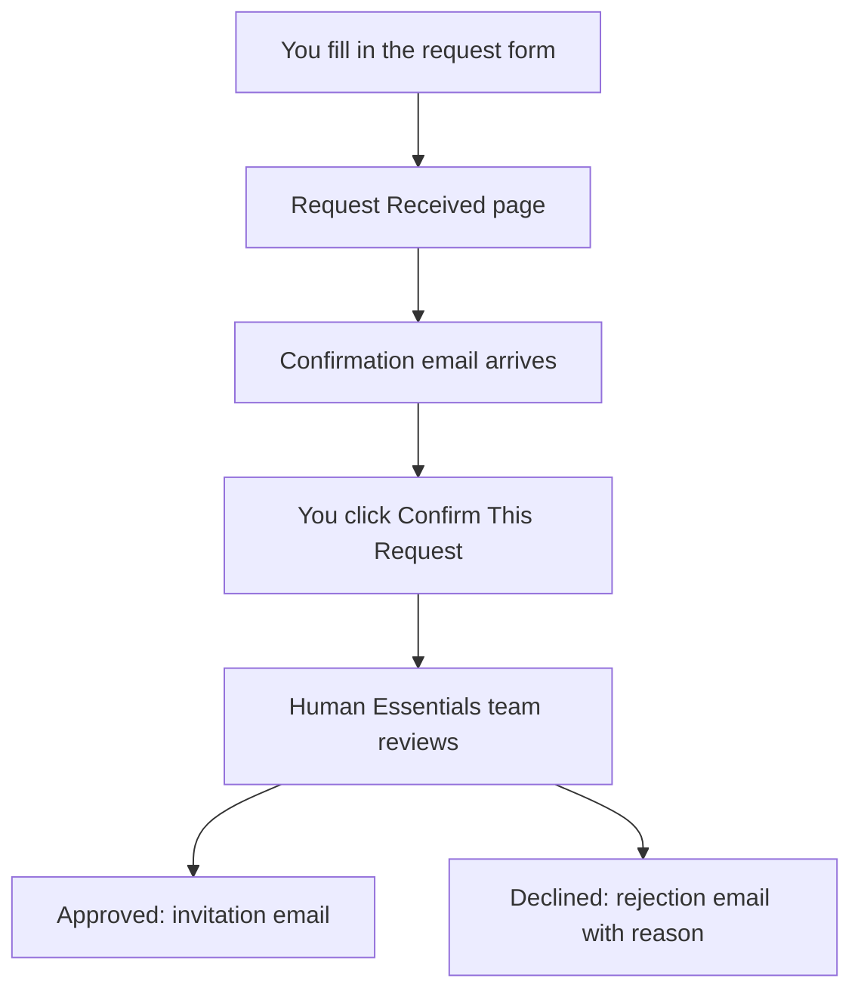
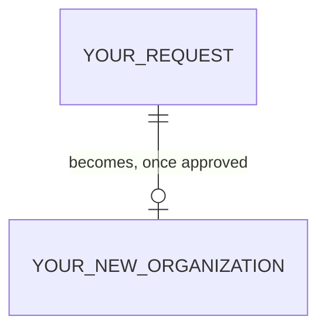

# Account Requests

> **Status**: ✅ Active
> **Generated**: 2026-10-24T00:00:00Z
> **Last Updated**: 2026-10-24T00:00:00Z
---

## Overview

### What It Does
Account Requests is how your essentials bank applies for a free Human Essentials account. You fill in a short form about your organization, confirm your request from an email we send you, and the Human Essentials team reviews it. When approved, your organization is created and you receive an invitation email.

### Why It Exists
Human Essentials accounts are reviewed by a real person so that the platform stays dedicated to genuine essentials banks (diaper and period-supply banks). The confirmation email step also proves you own the email address you signed up with.

### Key Capabilities
- Request an account online — no login needed
- Confirm your request with one click from your email
- Explore a free demo site before committing
- Receive a clear emailed reason if your request is declined

---

## Architecture

### High-Level Design

### Components

#### Backend Components
| Component | File Path | Purpose |
|-----------|-----------|---------|
| Request form and confirmation pages | (public website) | Where you apply and confirm |
| Review queue | (admin side) | Where the team approves or declines your request |
| Email notifications | (system) | Confirmation, team notification, and rejection emails |

#### Frontend Components
| Component | File Path | Purpose |
|-----------|-----------|---------|
| Account request form | (public website) | Collects your name, email, and organization details |
| "Request Received!" page | (public website) | Confirms your submission went through |
| "Are you ready to get started?" page | (public website) | The page your confirmation email links to |

### Technology Stack
- **Backend**: The Human Essentials web application (free, supported by the non-profit Code for Good; servers sponsored by Microsoft)
- **Frontend**: A simple web form with a captcha check
- **Database**: Your request details are stored securely until processed
- **External Services**: Email from no-reply@humanessentials.app; a captcha to block spam

---

## Model Details

### Your Account Request

#### Associations
Your request can optionally be linked to your **NDBN membership**, and once approved it becomes linked to your new **organization**.

#### Concerns
| Concern | Purpose |
|---------|---------|
| Change history | Every change to your request is recorded for auditing |

#### Callbacks
Not applicable — emails are sent at each step automatically.

#### State Machines (if applicable)
Your request moves through these stages:

> **Started** → **User Confirmed** → **Admin Approved** (account created), or **Rejected** / **Admin Closed**

#### Key Methods
| Method | Returns | Purpose | Notes |
|--------|---------|---------|-------|
| Submit | "Request Received!" page | Starts your application | A confirmation email is sent to you |
| Confirm | "Confirmed!" page | Tells the team you're ready | The team is notified immediately |
| Rejection | Email | Explains why a request was declined | Includes the team's reason |

---

## Database Schema

### What we ask you for

| Column | Type | Default | Notes |
|--------|------|---------|-------|
| Name | text | — | Required — your name |
| Email | text | — | Required — must not already be used by an existing account |
| Organization name | text | — | Required |
| Organization website | text | optional | If provided, must look like `https://www.example.com` |
| NDBN Membership | choice | optional | Pick your bank from the list if you're an NDBN member |
| Request details | text | — | Required — at least 50 characters about your organization and how you'd use Human Essentials |

### Relationships

---

## API Endpoints

| Method | Path | Action | Description | Notes |
|--------|------|--------|-------------|-------|
| Visit | Account request form | Apply | Fill in your details and complete the captcha | Choose "I am an Essentials Bank" |
| Click | Confirmation link in email | Confirm | One-click confirmation | The link works once |
| Receive | Invitation or rejection email | Outcome | The team's decision arrives by email | |

> Note: partner agencies do not apply here — your essentials bank creates your account for you.

---

## Authorization (Pundit)

| Method | Permission | Conditions | Notes |
|--------|------------|------------|-------|
| Requesting an account | None — open to everyone | Complete the captcha | No login required |
| Approving / declining | Human Essentials team only | — | You cannot approve your own request |

---

## Configuration

### Environment Variables
Not applicable — there is nothing for you to configure. The service is 100% free.

### Config Files
Not applicable.

---

## Usage Examples

### Trying the demo before you apply
Your confirmation email includes logins for a sandbox demo site, so you can explore the app risk-free:
- Bank user: `org_admin1@example.com` / `password!`
- Partner user: `verified@example.com` / `password!`

All demo data resets every day at 6 AM EST — never enter real or sensitive information there. The email also links the Human Essentials User Guide and eight getting-started videos.

---

## Testing

### Test Files
Not applicable for customers — but do test-drive the demo site from your confirmation email before your bank goes live.

---

## Known Issues & Caveats

| Issue | Location | Description |
|-------|----------|-------------|
| Confirmation link is single-use | Email link | Once confirmed (or once your account is created), the link shows "invalid, confirmed already, or processed already" |
| Email must be unique | Request form | An address already used by an existing organization, user, or request is refused |
| Minimum details length | Request form | "Request Details" must be at least 50 characters |
| No email on administrative close | — | If the team closes (rather than rejects) a request, no notification is sent |
| Check your spam | Email | Confirmation comes from **no-reply@humanessentials.app** |

---

## Performance

### Optimization Strategies
- Requests are typically reviewed promptly after you confirm; the team is notified the moment you click the link.

### Caching
Not applicable.

### Database Optimization
Not applicable.

---

## Troubleshooting

### Issue: I never received the confirmation email
**Symptoms:**
- Nothing in your inbox after seeing "Request Received!"

**Cause:**
Spam filtering, or a typo in your email address.

**Solution:**
Check spam for mail from no-reply@humanessentials.app. If the address was wrong, submit a new request.

### Issue: My confirmation link doesn't work
**Cause:**
The link works once — you may have already confirmed, or your account may already be created.

**Solution:**
Wait for your invitation email; contact the team if nothing arrives.

### Issue: The form says my email is already used
**Cause:**
That address already belongs to an existing organization or user.

**Solution:**
Sign in with your existing account, or use a different address.

---

## Related Features

- **Partner accounts** — created by your essentials bank, not through this form; contact your local bank.
- **Organizations** — your approved request becomes your bank's organization account.
- **Demo / sandbox site** — explore the full app with the credentials in your confirmation email.

---

**Generated:** 2026-10-24T00:00:00Z
**Last Updated:** 2026-10-24T00:00:00Z
**Status:** ✅ Active
