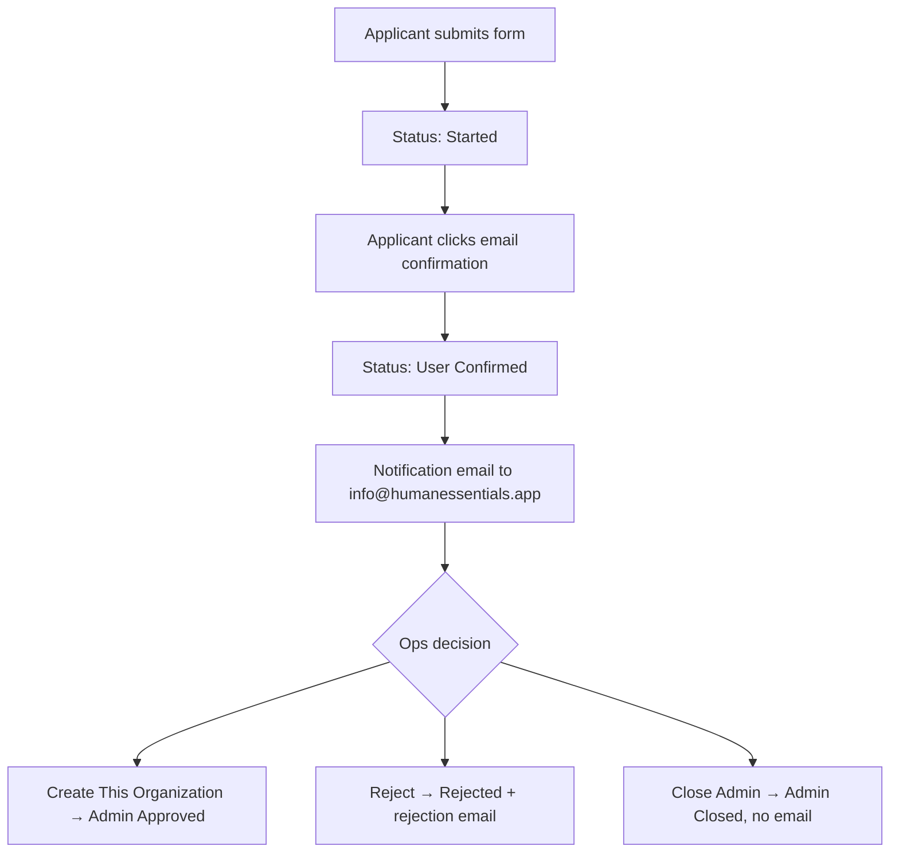
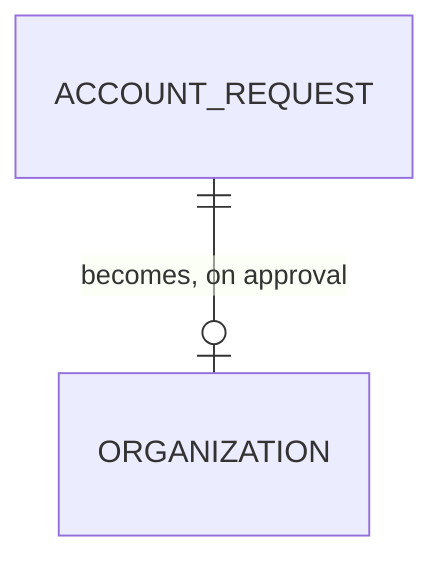

# Account Requests

> **Status**: ✅ Active
> **Generated**: 2026-10-24T00:00:00Z
> **Last Updated**: 2026-10-24T00:00:00Z
---

## Overview

### What It Does
Account Requests gives operations staff (super admins) a queue for vetting new essentials banks. Applicants submit a public form and confirm by email; you then review each request in **Admin > Account Requests** and either approve it into a new organization, reject it with an emailed reason, or close it administratively without notifying the requester.

### Why It Exists
Every bank on Human Essentials is manually vetted. This feature funnels all applications into one auditable queue, proves applicants control their email address before you spend review time, and records every decision and reason.

### Key Capabilities
- Two triage tables: Open Account Requests and Closed Account Requests, 15 rows per page each
- Reject with a mandatory reason that is emailed to the requester verbatim
- Close (Admin) with a mandatory reason that is recorded but **not** emailed
- Direct action links (Create / Reject This Organization) in the notification email sent to info@humanessentials.app
- Full change history kept for every request

---

## Architecture

### High-Level Design

### Components

#### Backend Components
| Component | File Path | Purpose |
|-----------|-----------|---------|
| Public request flow | (applicant-facing pages) | Form, Request Received, confirmation pages |
| Admin queue | **Admin > Account Requests** | Your triage screens |
| System emails | (automatic) | Confirmation to applicant, notification to ops, rejection to applicant |

#### Frontend Components
| Component | File Path | Purpose |
|-----------|-----------|---------|
| Open Account Requests table | Admin > Account Requests | Pending work: Started and User Confirmed requests |
| Closed Account Requests table | Admin > Account Requests | Decision history with reasons |
| Reject/Close modal | Admin > Account Requests | Captures the mandatory reason |

### Technology Stack
- **Backend**: Human Essentials admin panel (super-admin access required)
- **Frontend**: Paginated tables (15 per page) with action buttons per row
- **Database**: Each request and its decision trail is stored permanently
- **External Services**: System email from no-reply@humanessentials.app; ops notifications to info@humanessentials.app

---

## Model Details

### Account Request (as you see it)

#### Associations
A request may reference the applicant's **NDBN membership**; once you approve it, it is linked to the **organization** you create.

#### Concerns
| Concern | Purpose |
|---------|---------|
| Audit trail | All edits and status changes are versioned |

#### Callbacks
Emails fire automatically on submission (to the applicant), on confirmation (to info@humanessentials.app), and on rejection (to the applicant). Closing sends nothing.

#### State Machines (if applicable)
> Requests move through: **Started** → **User Confirmed** → one of **Admin Approved** / **Rejected** / **Admin Closed**

Open = Started or User Confirmed. Closed = Admin Approved, Rejected, or Admin Closed. Closing is only allowed from the two open states; otherwise you get "Cannot be closed from this state".

#### Key Methods
| Method | Returns | Purpose | Notes |
|--------|---------|---------|-------|
| Reject | "Account request rejected!" | Decline with a reason | Reason emailed to requester, subject "Human Essential Account Request Rejected" |
| Close (Admin) | "Account request closed!" | Shut without notifying | Reason stored for audit only |
| Create This Organization | New organization form | Approve the request | Reached from the notification email |

---

## Database Schema

### What each request record shows you

| Column | Type | Default | Notes |
|--------|------|---------|-------|
| Date Submitted | date | — | mm/dd/yyyy, open table |
| Organization Details | text | — | Organization name and website |
| Request details | text | — | Applicant's description (min 50 characters enforced at submission) |
| Request status | label | Started | Titleized status |
| Contact Details | text | — | Applicant name and email |
| Date Confirmed | date | "N/A" | Closed table; N/A when the applicant never confirmed |
| Rejection Reason | text | — | Closed table; also holds close reasons |

### Relationships

---

## API Endpoints

| Method | Path | Action | Description | Notes |
|--------|------|--------|-------------|-------|
| Open | **Admin > Account Requests** | index | View open and closed queues | Open sorted newest-submitted first; closed by latest update |
| Click | **Reject** on a row | reject | Opens the reason modal, then rejects | Requester is emailed the reason |
| Click | **Close (Admin)** on a row | close | Opens the reason modal, then closes | No email sent |
| Click | **Reject This Organization** (in notification email) | for_rejection | Jump straight to that request | Shows "Account Request not found!" if the link is stale |
| Click | **Create This Organization** (in notification email) | approve | Pre-fills the new organization form | Finalizes the request as Admin Approved |

---

## Authorization (Pundit)

| Method | Permission | Conditions | Notes |
|--------|------------|------------|-------|
| View queue, reject, close | Super admin | — | Admin panel access required |
| Submit / confirm a request | Anyone | Captcha | Applicant side, no login |

---

## Configuration

### Environment Variables
Nothing to configure day-to-day. Ops notifications go to **info@humanessentials.app**.

### Config Files
Not applicable.

---

## Usage Examples

### Rejecting a request
1. In **Open Account Requests**, click **Reject** on the row.
2. Enter the **Rejection reason** in the modal — it cannot be blank ("Reason must be provided").
3. Submit. You'll see "Account request rejected!" and the applicant receives the reason word-for-word by email.

### Closing a spam or duplicate request
1. Click **Close (Admin)** on the row.
2. Enter a reason (stored for audit, never emailed).
3. Submit — "Account request closed!". If the request was already finalized elsewhere you'll instead see the alert "Cannot be closed from this state".

---

## Testing

### Test Files
Not applicable for operations staff. To sanity-check the applicant experience, use the demo site credentials included in every confirmation email (demo data resets daily at 6 AM EST).

---

## Known Issues & Caveats

| Issue | Location | Description |
|-------|----------|-------------|
| Close sends no email | Close (Admin) | Only Reject notifies the requester; use Reject when the applicant deserves an explanation |
| Reasons share one field | Closed table | Close reasons appear under "Rejection Reason" |
| Single-use links | Applicant email | A confirmed/processed request's link shows "invalid, confirmed already, or processed already" |
| Approval lives elsewhere | Notification email | Approval happens via **Create This Organization** (new organization form), not from the queue itself |
| Email reuse after closure | Validations | An email from a rejected/closed request can be used again in a new request |

---

## Performance

### Optimization Strategies
- Both queues paginate independently at 15 per page, so large backlogs stay browsable.

### Caching
Not applicable.

### Database Optimization
Not applicable.

---

## Troubleshooting

### Issue: "Cannot be closed from this state"
**Symptoms:**
- Red alert after submitting the close modal.

**Cause:**
The request was already approved, rejected, or closed (possibly by another admin or via the email link).

**Solution:**
Refresh **Admin > Account Requests** and check the closed table for its final state.

### Issue: Applicant says their confirmation link is dead
**Cause:**
Links work once; the request is already confirmed or its organization already exists.

**Solution:**
Look the request up in both tables. If it's User Confirmed, process it; if Admin Approved, the invitation was already sent.

### Issue: Applicant never confirmed
**Cause:**
Confirmation email in spam, or a typo in their address.

**Solution:**
The request stays in the open table as Started (Date Confirmed shows "N/A" after closing). Tell them to check spam for no-reply@humanessentials.app or re-apply with the correct address.

---

## Related Features

- **Admin Organizations** — where approval actually completes ("Create This Organization").
- **NDBN Members** — applicants may select their NDBN membership on the form.
- **Users & Authentication** — the approved bank's first user receives an invitation email.

---

**Generated:** 2026-10-24T00:00:00Z
**Last Updated:** 2026-10-24T00:00:00Z
**Status:** ✅ Active
