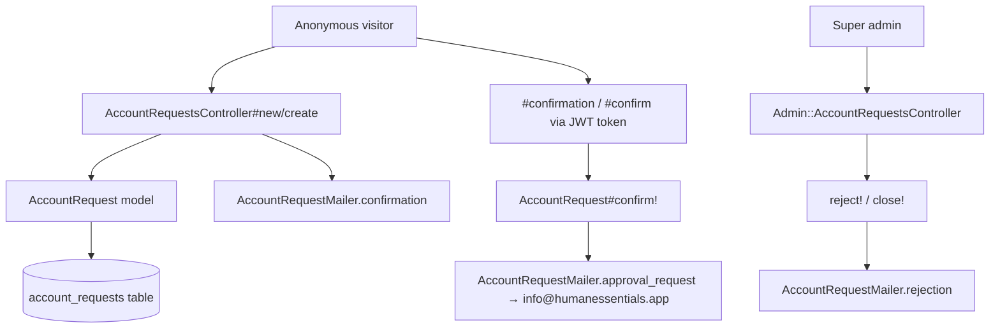
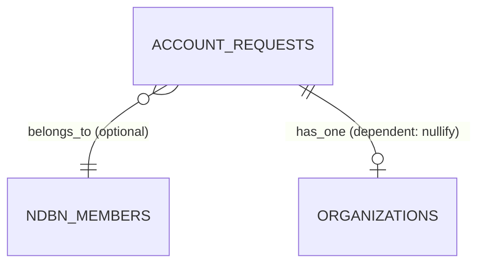

# Account Requests

> **Status**: ✅ Active
> **Generated**: 2026-10-24T00:00:00Z
> **Last Updated**: 2026-10-24T00:00:00Z
---

## Overview

### What It Does
Account Requests is the public onboarding pipeline for new essentials banks. An unauthenticated visitor submits a request form (name, email, organization details, reCAPTCHA), confirms the request via a JWT-tokenized email link, and super admins then triage the request from the admin panel — approving it into a new organization, rejecting it with an emailed reason, or closing it silently.

### Why It Exists
Organization accounts cannot be self-provisioned: each essentials bank must be vetted by the Human Essentials team. This feature captures the application, verifies the applicant's email ownership via a confirmation round-trip, and gives admins a reviewable queue with full audit history (PaperTrail).

### Key Capabilities
- Public, unauthenticated request form with bank/partner self-identification and reCAPTCHA
- Email confirmation flow using signed, single-effective-use JWT identity tokens
- Admin queue of open vs. closed requests with independent pagination
- Reject-with-reason (emails requester) and administrative close (no email)
- Automatic notification to `info@humanessentials.app` with approve/reject action links on confirmation

---

## Architecture

### High-Level Design


### Components

#### Backend Components
| Component | File Path | Purpose |
|-----------|-----------|---------|
| `AccountRequestsController` | `app/controllers/account_requests_controller.rb` | Public form, create, token-guarded received/confirmation/confirm, invalid_token |
| `Admin::AccountRequestsController` | `app/controllers/admin/account_requests_controller.rb` | Admin index, for_rejection, reject, close |
| `AccountRequest` | `app/models/account_request.rb` | Model: validations, status enum, JWT tokens, transitions |
| `AccountRequestMailer` | `app/mailers/account_request_mailer.rb` | confirmation / approval_request / rejection emails |

> Checklist: no services, jobs, policies, search classes, broadcasters, ViewComponents, form objects, or Liquid drops exist for this feature. Admin authorization comes from the `AdminController` base class; public actions skip auth. Mail is delivered via `deliver_later` (ActiveJob).

#### Frontend Components
| Component | File Path | Purpose |
|-----------|-----------|---------|
| New request form | `app/views/account_requests/new.html.erb` | Bank/partner radio toggle (CSS `:has` selector), simple_form, recaptcha_tags; staging fallback card |
| Received / Confirmation / Confirm / Invalid token pages | `app/views/account_requests/*.html.erb` | Post-submit and confirmation UX cards |
| Admin index | `app/views/admin/account_requests/index.html.erb` | Open + closed tables (Kaminari) |
| Open row partial | `app/views/admin/account_requests/_open_account_request.html.erb` | Row with Reject / Close (Admin) `js_button`s |
| Rejection modal | `app/views/admin/account_requests/_rejection_modal.html.erb` | Shared modal; jQuery sets action to `/admin/account_requests/${modal}`; requires reason |
| For-rejection page | `app/views/admin/account_requests/for_rejection.html.erb` | Single-request view from email link |
| Mailer templates | `app/views/account_request_mailer/` | HTML + text for all three emails |

### Technology Stack
- **Backend**: Rails controllers + ActiveRecord, JWT (HS256, `Rails.application.secret_key_base`), PaperTrail, reCAPTCHA (`verify_recaptcha`), ActionMailer with `deliver_later`
- **Frontend**: ERB + simple_form, Bootstrap-style cards/modals, jQuery for the modal wiring, Kaminari pagination
- **Database**: single `account_requests` table
- **External Services**: Google reCAPTCHA; outbound SMTP (from `no-reply@humanessentials.app`)

---

## Model Details

### AccountRequest

#### Associations
```ruby
belongs_to :ndbn_member, class_name: 'NDBNMember', optional: true
has_one :organization, dependent: :nullify
```

#### Concerns
| Concern | Purpose |
|---------|---------|
| `has_paper_trail` (PaperTrail macro) | Versioning/audit of every change |

No other concerns are included.

#### Callbacks
No lifecycle callbacks are declared; emails are triggered explicitly inside `confirm!`/`reject!` and the controllers.

#### State Machines (if applicable)
No AASM; a string enum acts as the state machine:
```ruby
enum :status, %w[started user_confirmed admin_approved rejected admin_closed].map { |v| [v, v] }.to_h

scope :requested, -> { where(status: %w[started user_confirmed]) }
scope :closed, -> { where(status: %w[admin_approved rejected admin_closed]) }
```
Transitions are only guarded in `close!` (`can_be_closed?`); `confirm!` and `reject!` have no `from:`-style constraints at the model level (the controller token guard prevents re-confirmation).

#### Key Methods
| Method | Returns | Purpose | Notes |
|--------|---------|---------|-------|
| `identity_token` | `String` | JWT `{account_request_id: id}`, HS256 | Raises `'must have an id'` unless persisted; token never expires |
| `.get_by_identity_token(token)` | `AccountRequest` or `nil` | Decode + find | Rescues `StandardError` → `nil` |
| `confirmed?` | Boolean | `user_confirmed? \|\| admin_approved?` | |
| `processed?` | Boolean | `organization.present?` | True once the org is created |
| `can_be_closed?` | Boolean | `started? \|\| user_confirmed?` | |
| `confirm!` | — | Sets `confirmed_at`, status `user_confirmed`; emails `approval_request` | |
| `reject!(reason)` | — | Status `rejected`, stores reason; emails `rejection` | |
| `close!(reason)` | — | Status `admin_closed`, stores reason in `rejection_reason` | Raises `'Cannot be closed from this state'` unless closable; sends no email |

#### Validations
- `name` presence; `email` presence + uniqueness + `URI::MailTo::EMAIL_REGEXP` format
- `request_details` presence + minimum length 50
- `organization_website` URI format (`URI::DEFAULT_PARSER.make_regexp`), message `"should look like 'https://www.example.com'"`, allow_blank
- `email_not_already_used_by_organization` — rejects emails belonging to an existing `Organization` (other than its own)
- `email_not_already_used_by_user` — rejects emails of existing `User`s not in the request's organization; **skipped** when status is `rejected` or `admin_closed`

---

## Database Schema

### account_requests

| Column | Type | Default | Notes |
|--------|------|---------|-------|
| `id` | `bigint` | — | Primary key |
| `confirmed_at` | `datetime` | `NULL` | Stamped by `confirm!` |
| `email` | `string` | — | `null: false`, unique by validation |
| `name` | `string` | — | `null: false` |
| `organization_name` | `string` | — | `null: false` |
| `organization_website` | `string` | `NULL` | Optional |
| `rejection_reason` | `string` | `NULL` | Also reused for close reasons |
| `request_details` | `text` | — | `null: false`, min 50 chars |
| `status` | `string` | `"started"` | `null: false`, enum-backed |
| `created_at` | `datetime` | — | `null: false` |
| `updated_at` | `datetime` | — | `null: false` |
| `ndbn_member_id` | `bigint` | `NULL` | Optional FK to NDBN members |

### Relationships


---

## API Endpoints

> Paths inferred from the route helpers used in controllers/views; all listed actions exist in the controllers.

| Method | Path | Action | Description | Notes |
|--------|------|--------|-------------|-------|
| `GET` | `/account_requests/new` | `new` | Public request form | Unauthenticated; `devise` layout |
| `POST` | `/account_requests` | `create` | Submit request | reCAPTCHA verified first |
| `GET` | `/account_requests/received?token=` | `received` | "Request Received!" page | Token-guarded |
| `GET` | `/account_requests/confirmation?token=` | `confirmation` | "Are you ready?" landing from email | Token-guarded |
| `GET` | `/account_requests/confirm?token=` | `confirm` | Executes `confirm!` | Token-guarded |
| `GET` | `/account_requests/invalid_token` | `invalid_token` | Error page | |
| `GET` | `/admin/account_requests` | `index` | Open + closed queues | Super admin |
| `GET` | `/admin/account_requests/for_rejection?token=` | `for_rejection` | Single request from email link | Super admin |
| `POST` | `/admin/account_requests/reject` | `reject` | Reject with reason | Super admin |
| `POST` | `/admin/account_requests/close` | `close` | Close with reason | Super admin |

---

## Authorization (Pundit)

No Pundit policy exists for this feature.

| Method | Permission | Conditions | Notes |
|--------|------------|------------|-------|
| Public actions | none | — | `skip_before_action :authorize_user, :authenticate_user!, :require_organization` |
| Admin actions | super admin | — | Inherited from `AdminController` base class |

---

## Configuration

### Environment Variables
```bash
# reCAPTCHA site/secret keys    # consumed by verify_recaptcha (recaptcha gem)
# SECRET_KEY_BASE               # signs/verifies the JWT identity tokens
```

### Config Files
- None specific to this feature.

---

## Usage Examples

### Token round-trip
```ruby
# Source: app/models/account_request.rb
def self.get_by_identity_token(identity_token)
  decrypted_token = JWT.decode(identity_token, Rails.application.secret_key_base, true, { algorithm: 'HS256' })
  account_request_id = decrypted_token[0]["account_request_id"]

  AccountRequest.find_by(id: account_request_id)
rescue StandardError
  # The identity_token was determined to not be valid
  # and returns nil to indicate no match found.
  nil
end

def identity_token
  raise 'must have an id' unless persisted?

  JWT.encode({ account_request_id: id }, Rails.application.secret_key_base, 'HS256')
end
```

### Create with captcha gate
```ruby
# Source: app/controllers/account_requests_controller.rb
def create
  @account_request = AccountRequest.new(account_request_params)
  @bank_selected = true

  if !verify_recaptcha(model: @account_request)
    flash.now[:alert] = "Invalid captcha submission"
    render :new
  elsif @account_request.save
    AccountRequestMailer.confirmation(account_request_id: @account_request.id).deliver_later

    redirect_to received_account_requests_path(token: @account_request.identity_token),
                notice: 'Account request was successfully created.'
  else
    render :new
  end
end
```

### Guarded close
```ruby
# Source: app/models/account_request.rb
def close!(reason)
  raise 'Cannot be closed from this state' unless can_be_closed?
  update!(status: 'admin_closed', rejection_reason: reason)
end
```

---

## Testing

### Test Files
- Not verified in this documentation pass (test directory not inspected); do not cite spec files without globbing.

---

## Known Issues & Caveats

| Issue | Location | Description |
|-------|----------|-------------|
| Non-expiring tokens | `account_request.rb#identity_token` | JWT has no `exp`; replay is only blocked by the `confirmed?`/`processed?` guard |
| Silent close | `account_request.rb#close!` | No email sent on admin close, unlike reject |
| Reused column | `close!` | Close reasons are stored in `rejection_reason` |
| `admin_approved` never set here | model enum | Approval happens in the admin organizations flow (`new_admin_organization_url(token:)`) |
| Demo credentials in email | `account_request_mailer/confirmation.*` | Sandbox logins (`org_admin1@example.com` / `password!`, `verified@example.com` / `password!`) are mailed to every requester; demo resets daily 6 AM EST |
| Staging short-circuit | `account_requests/new.html.erb` | On `Rails.env.staging?` the form is replaced with a link to production |
| Email check skip | `email_not_already_used_by_user` | Validation skipped for `rejected`/`admin_closed`, permitting email reuse after terminal states |
| Attribute dump in ops email | `approval_request.html.erb` | Iterates `@account_request.attributes` — all columns are emailed, including any future sensitive ones |

---

## Performance

### Optimization Strategies
- Kaminari pagination (15/page) with separate `open_page` / `close_page` params prevents loading all requests at once.

### Caching
- **Cache Layer**: none.

### Database Optimization
- Indexes: not inspected here beyond the primary key and `ndbn_member_id` FK; verify in `db/schema.rb`.

---

## Troubleshooting

### Issue: Requester's confirmation link shows the "Sorry" page
**Symptoms:**
- "The account request is either invalid, confirmed already, or processed already."

**Cause:**
`set_account_request_from_token` redirects when the token fails JWT verification, or the request is already `confirmed?` or `processed?`.

**Solution:**
Check the request's status in Admin > Account Requests; resend nothing — if it is still `started`, have the user re-copy the full link from the email.

### Issue: "Cannot be closed from this state" alert on close
**Cause:**
`close!` raises unless `can_be_closed?` (status `started` or `user_confirmed`); the request was already finalized.

**Solution:**
Refresh the index; take no action, or use the closed table to review the final state.

### Issue: Form repeatedly re-renders with "Invalid captcha submission"
**Cause:**
`verify_recaptcha` failing (missing/invalid reCAPTCHA keys or user response).

**Solution:**
Verify reCAPTCHA configuration; the user must complete the captcha widget before submitting.

---

## Related Features

- **Organizations (admin)** — "Create This Organization" consumes the identity token to build the org; `has_one :organization, dependent: :nullify` links back.
- **NDBN Members** — optional `ndbn_member_id` selected on the form ("NDBN Membership").
- **Users & Authentication** — email uniqueness is cross-checked against existing `User`s and `Organization`s; approved banks receive a user invitation.

---

**Generated:** 2026-10-24T00:00:00Z
**Last Updated:** 2026-10-24T00:00:00Z
**Status:** ✅ Active
