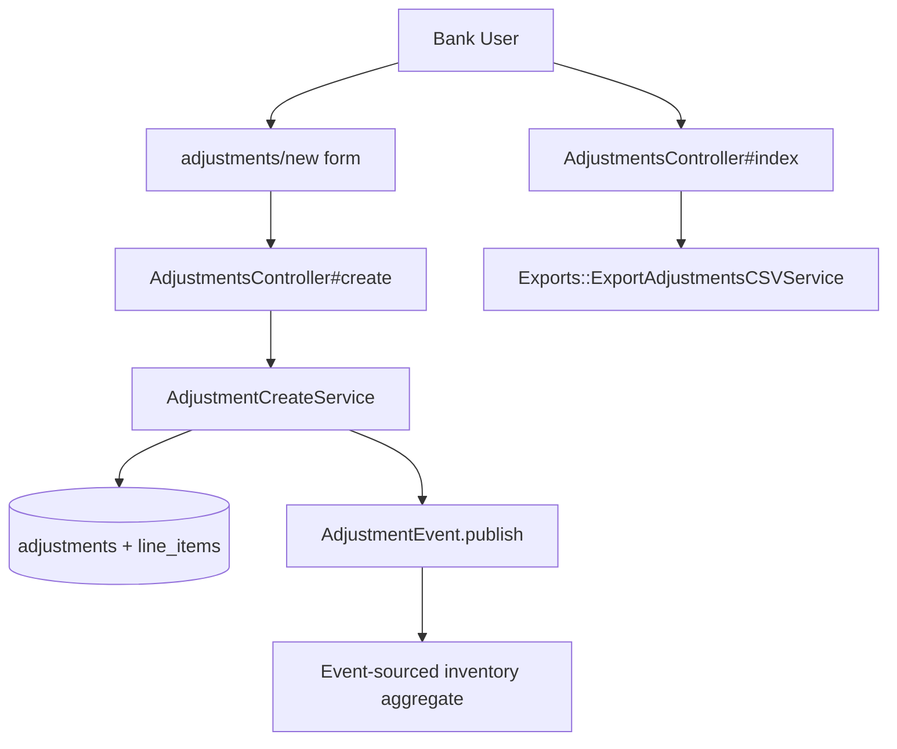
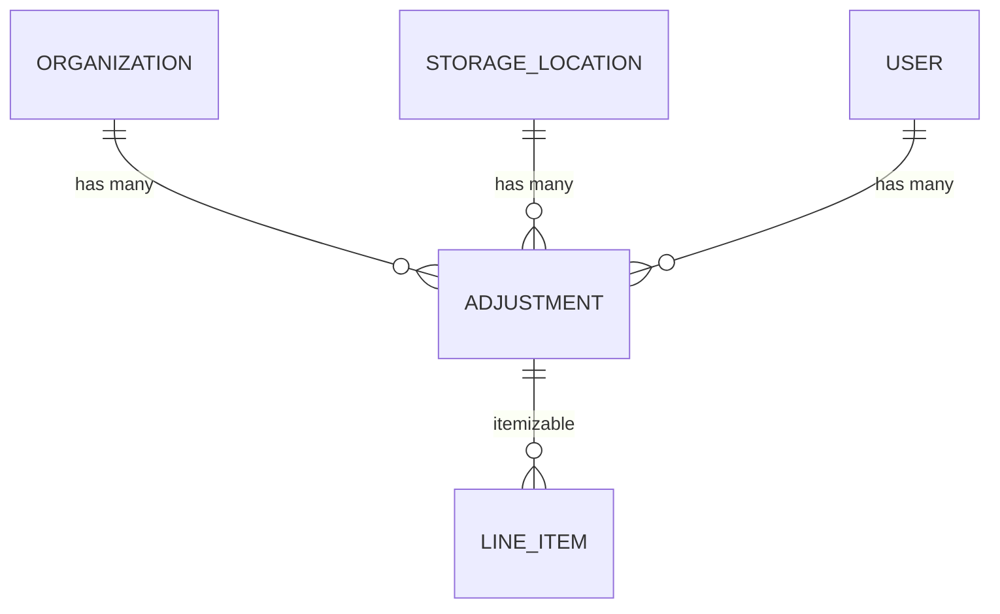

# Adjustments

> **Status**: ✅ Active
> **Generated**: 2026-10-24T00:00:00Z
> **Last Updated**: 2026-10-24T00:00:00Z
---

## Overview

### What It Does
Adjustments provide limited CRUD for manual inventory corrections: an Essentials Bank records a set of signed quantity changes (increases and/or decreases) for items at one of its storage locations, together with a comment and the user who made the change. Inventory totals are updated through the event-sourced inventory pipeline rather than by direct writes.

### Why It Exists
Physical counts drift from recorded counts — miscounts, damage, loss, and data-entry errors. Adjustments are the way Essentials Banks fix incorrect inventory totals at Storage Locations while preserving an immutable, attributable audit trail (no edit or destroy is offered).

### Key Capabilities
- Create a multi-item adjustment against a single active storage location, mixing positive (add) and negative (remove) quantities
- Browse, filter (by storage location, by user, by date range), and paginate the organization's adjustments
- View the detail of any adjustment with Added/Removed per line item
- Export the filtered list to CSV with one column per organization item
- Publish an `AdjustmentEvent` so the inventory aggregate applies the deltas

---

## Architecture

### High-Level Design


### Components

#### Backend Components
| Component | File Path | Purpose |
|-----------|-----------|---------|
| `AdjustmentsController` | `app/controllers/adjustments_controller.rb` | index (HTML/CSV), show, new, create |
| `Adjustment` | `app/models/adjustment.rb` | Model: associations, scopes, validation, CSV entry point, `split_difference` |
| `AdjustmentCreateService` | `app/services/adjustment_create_service.rb` | Combines line items, validates, saves + publishes event in a transaction |
| `Exports::ExportAdjustmentsCSVService` | `app/services/exports/export_adjustments_csv_service.rb` | Builds the CSV (headers + per-item columns) |
| `AdjustmentEvent` | `app/events/adjustment_event.rb` | Publishes the inventory payload for the adjustment |

> Checklist notes: no policies, jobs, search classes, broadcasters, ViewComponents, form objects, or drops exist for this feature. Model concerns are listed under Model Details.

#### Frontend Components
| Component | File Path | Purpose |
|-----------|-----------|---------|
| Index view | `app/views/adjustments/index.html.erb` | Filter card, table, pagination, Export/New buttons |
| New view | `app/views/adjustments/new.html.erb` | simple_form with line-item fields, barcode capture (`data-capture-barcode="true"`), barcode modal |
| Show view | `app/views/adjustments/show.html.erb` | Added/Removed line-item table plus org/location/comment |

### Technology Stack
- **Backend**: Rails controller + service object + event sourcing (`Event` subclasses, `EventTypes::InventoryPayload`)
- **Frontend**: ERB + AdminLTE-style cards, simple_form, Stimulus `form-input` controller, Kaminari pagination, shared date-range picker, barcode modal
- **Database**: ActiveRecord (`adjustments` table + `line_items` via `Itemizable`), PaperTrail versioning
- **External Services**: none

---

## Model Details

### Adjustment

#### Associations
```ruby
belongs_to :organization
belongs_to :storage_location
belongs_to :user
```

#### Concerns
| Concern | Purpose |
|---------|---------|
| `Exportable` | Shared export support |
| `Itemizable` | Provides `line_items` (item + signed quantity) incl. `line_items.combine!` |
| `Filterable` | Enables `class_filter(filter_params)` against declared scopes |

Also `has_paper_trail` for version history.

#### Callbacks
None declared in the model.

#### Scopes & Validations
| Scope | Definition |
|-------|-----------|
| `at_location` | `where(storage_location_id: location_id)` |
| `by_user` | `where(user_id: user_id)` |
| `during` | `where(adjustments: { created_at: range })` |

Custom validation `storage_locations_belong_to_organization`: skipped when `organization` is nil; otherwise adds `storage_location: "storage location must belong to organization"` unless the location is among the organization's storage locations.

#### Key Methods
| Method | Returns | Purpose | Notes |
|--------|---------|---------|-------|
| `split_difference` | `[Adjustment, Adjustment]` | Partitions line items into increasing/decreasing halves; negates the decreasing half | Mutates the original adjustment's line items (inline comment in source) |
| `self.generate_csv(adjustments)` | `String`/`nil` | Delegates to `Exports::ExportAdjustmentsCSVService` | Returns `nil` if the collection is empty |

---

## Database Schema

### adjustments

| Column | Type | Default | Notes |
|--------|------|---------|-------|
| `id` | integer | — | Primary key, not null |
| `comment` | text | — | Reason for the adjustment |
| `created_at` | datetime | — | not null |
| `updated_at` | datetime | — | not null |
| `organization_id` | integer | — | FK to organizations |
| `storage_location_id` | integer | — | FK to storage_locations |
| `user_id` | bigint | — | FK to users |

### Relationships


---

## API Endpoints

| Method | Path | Action | Description | Notes |
|--------|------|--------|-------------|-------|
| `GET` | `/adjustments` | `index` | List adjustments, filterable, paginated | `.csv` format streams `Adjustments-<date>.csv` |
| `GET` | `/adjustments/:id` | `show` | Show one adjustment | Scoped to `current_organization` |
| `GET` | `/adjustments/new` | `new` | New-adjustment form | Builds one blank line item |
| `POST` | `/adjustments` | `create` | Create via `AdjustmentCreateService` | Redirects to show on success |

No `edit`/`update`/`destroy` actions exist — adjustments are immutable ("limited CRUD" per the controller comment).

---

## Authorization (Pundit)

No Pundit policy exists for this feature. Access control is organization scoping: every query goes through `current_organization.adjustments` (and `create` merges `organization: current_organization, user: current_user`), so users only ever see and create adjustments for their own bank.

---

## Configuration

### Environment Variables
None.

### Config Files
None specific to this feature.

---

## Usage Examples

### Creating an adjustment (controller)
```ruby
# Source: app/controllers/adjustments_controller.rb:41
def create
  result = AdjustmentCreateService.new(adjustment_params.merge(organization: current_organization, user: current_user)).call
  @adjustment = result.adjustment
  if @adjustment.errors.none?
    flash[:notice] = "Adjustment was successful."
    redirect_to adjustment_path(@adjustment)
  else
    flash.now[:error] = @adjustment.errors.collect { |error| "#{error.attribute}: " + error.message }.join("<br />".html_safe)
    load_form_collections
    render :new
  end
end
```

### Publishing the inventory event
```ruby
# Source: app/events/adjustment_event.rb:3
def self.publish(adjustment)
  create(
    eventable: adjustment,
    group_id: "adjustment-#{adjustment.id}-#{SecureRandom.hex}",
    organization_id: adjustment.organization_id,
    event_time: Time.zone.now,
    data: EventTypes::InventoryPayload.new(
      items: EventTypes::EventLineItem.from_line_items(adjustment.line_items, to: adjustment.storage_location_id)
    )
  )
end
```

### Permitted parameters
```ruby
# Source: app/controllers/adjustments_controller.rb:61
def adjustment_params
  params.require(:adjustment).permit(:organization_id, :storage_location_id, :comment,
                                     line_items_attributes: %i(item_id quantity _destroy))
end
```

---

## Testing

Test files were not part of the documented file set for this feature; verify under `spec/` before relying on coverage claims.

---

## Known Issues & Caveats

| Issue | Location | Description |
|-------|----------|-------------|
| Method defined outside class | `adjustment_create_service.rb:39` | `enough_inventory_for_decreases?` sits after the class's `end`, becoming a top-level (Object) private method; still callable from `call` |
| No-op loop | `adjustment_create_service.rb:41-43` | The `line_items.each` body only has `next unless line_item.quantity.negative?` — no actual check; real insufficiency errors come from `Errors::InsufficientAllotment`/`InventoryError` raised during event publication |
| Mutating helper | `adjustment.rb:34` | `split_difference` negates line items shared with the original adjustment (flagged by inline comment) |
| Scope inconsistency | `adjustments_controller.rb:58` | `load_form_collections` (failure re-render) omits `.active` on items, unlike `new` (line 37) |
| `nil` CSV | `adjustment.rb:39` | `generate_csv` returns `nil` for an empty collection; UI hides the export button when there is nothing to export |

---

## Performance

### Optimization Strategies
- `index` eager-loads with `includes(:line_items, :storage_location)` before pagination
- Filter dropdown queries `select(:id, :name)` on storage locations to avoid loading full rows
- `StorageLocation.with_adjustments_for(current_organization)` restricts the filter to locations actually used

### Caching
- None.

### Database Optimization
- Pagination via Kaminari (`page(params[:page])`); ordering on `created_at desc`.

---

## Troubleshooting

### Issue: Adjustment rejected with an inventory error
**Symptoms:**
- Form re-renders with an error on base after submitting a decrease

**Cause:**
A negative line item exceeds the quantity on hand; `AdjustmentEvent.publish` raises `Errors::InsufficientAllotment`/`InventoryError`, the transaction rolls back, and nothing is saved.

**Solution:**
Reduce the decrease to at most the on-hand quantity at that storage location, or recount first.

### Issue: "storage location must belong to organization"
**Symptoms:**
- Validation error on create

**Cause:**
The submitted `storage_location_id` is not one of the current organization's storage locations.

**Solution:**
Pick a storage location owned by the organization (the form only offers active org locations).

---

## Related Features

- **Storage Locations** — adjustments change inventory at a storage location; the filter lists locations with adjustments
- **Items** — line items reference loose, active organization items (kits excluded)
- **Inventory Events** — `AdjustmentEvent` feeds the event-sourced inventory aggregate
- **Transfers** — move stock between locations instead of correcting counts
- **Audits** — formal verification of physical counts

---

**Generated:** 2026-10-24T00:00:00Z
**Last Updated:** 2026-10-24T00:00:00Z
**Status:** ✅ Active
