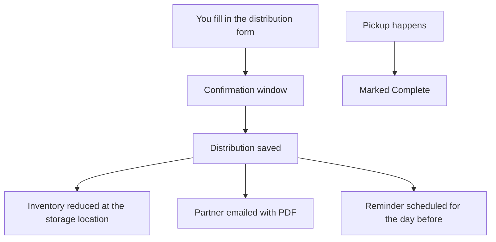

# Distributions

> **Status**: ✅ Active
> **Generated**: 2026-10-24T00:00:00Z
> **Last Updated**: 2026-10-24T00:00:00Z
---

*This article is written for customers of the essentials bank software (bank staff and the partners they serve), following the standard feature documentation structure.*

## Overview

### What It Does
A distribution is how supplies leave your bank and reach a partner organization. Each one records which items, in what quantities, are going from one of your storage locations to one partner on a scheduled date, by pick up, delivery, or shipping. Saving a distribution immediately reduces your inventory, can email the partner a PDF summary, and keeps your records and reports accurate.

### Why It Exists
Banks need a trustworthy record of what went out the door, to whom, and when — both for their own inventory counts and for the partners picking supplies up. Distributions also automate the busywork: partner notifications, day-before reminders, calendars, and exports.

### Key Capabilities
- Create a distribution from scratch, from a partner's request, or starting from a donation's contents
- Confirm exactly what you're sending before anything is saved
- Automatic partner emails with a PDF attachment, plus optional reminders the day before
- A schedule calendar you can subscribe to from Google Calendar
- A daily pickup list with item totals for staging product
- Corrections after the fact and full "reclaim" (undo) that returns items to inventory
- Spreadsheet exports and an estimated by-county breakdown

---

## Architecture

### High-Level Design
In plain terms, the flow looks like this:

### Components
From a user's point of view the feature is made of these screens:

| Screen | Where | What it's for |
|--------|-------|---------------|
| Distributions list | **Distributions** | Search, filter, export, and manage all distributions |
| New/Edit form | **New Distribution** / **Make a Correction** | Enter partner, date, method, and items |
| Confirmation window | appears on save | Final check of items and quantities |
| Distribution page | click a distribution | Details, totals, Complete/Correct/Print buttons |
| Schedule | **Distributions > Schedule** | Calendar of pickups; copy a calendar link |
| Pickup day | from the calendar | Everything going out on one day, with item totals |
| Distributions by County | reports area | Estimated items and value per county |

### Technology Stack
You don't need to know the internals: it's part of the same web application you already use, the PDF is generated for you, and the calendar link works with any calendar app that accepts standard internet calendar feeds.

---

## Model Details

In business terms, a distribution holds:

- **Partner** — exactly one recipient organization
- **Source storage location** — exactly one place the items come from
- **Date and time** — when it is scheduled
- **Delivery method** — Pick up, Delivery, or Shipped (Shipped adds a shipping cost)
- **Items and quantities** — what's going out; duplicate lines for the same item are merged automatically
- **Status** — **Scheduled** until you mark it **Complete**
- **Extras** — a comment, an agency representative, and a "send reminder" choice

Rules the system enforces for you:

- Every distribution needs a delivery method and at least one item with quantity 1 or more
- Shipping cost can't be negative, and it's only kept when the method is Shipped
- A distribution can be linked to at most one partner request; fulfilling the request links them and marks the request fulfilled
- Very old distributions (older than your latest inventory snapshot) can't be deleted or have contents changed

---

## Database Schema

Each distribution stores, behind the scenes: the partner, storage location, date/time, delivery method, shipping cost, status, comment, agency representative, and whether the day-before reminder is on. You never edit these directly — the form manages them all.

---

## API Endpoints

In user terms, the actions available are:

| What you do | Where |
|-------------|-------|
| View and filter all distributions | Distributions list |
| Create a new distribution | **New Distribution** button |
| See details | click a distribution |
| Correct it | **Make a Correction** |
| Undo it | **Reclaim** |
| Print the PDF | **Print** |
| Mark it done | **Distribution Complete** |
| See the calendar / subscribe | **Schedule** page, **Copy Calendar URL to clipboard** |
| Daily worklist | Pickup day view |
| Download spreadsheets | **Export Distributions**, itemized breakdown |
| County estimates | Distributions by County report |

---

## Authorization

- Anyone on your organization's team can create distributions and mark them complete.
- Editing a distribution that is already complete, or whose date has passed, requires an **organization administrator**.
- The calendar link works without signing in — treat it like a password and only share it with people who should see your pickup schedule.

---

## Configuration

Your organization's settings control several behaviors:

- Whether the PDF shows item values, package counts, year-to-date totals, and signature lines
- Whether CSV exports include per-item in-kind values and package columns
- The default email text sent to partners (it can include the delivery method, date, partner name, and your comment automatically)
- Each partner's notification preference — partners with notifications off receive no distribution emails

---

## Usage Examples

**Fulfilling a partner request:** open the request, start a distribution from it. The partner is locked in, requested items are pre-filled (items requested in special units leave the quantity blank for you), and the date defaults to tomorrow. Saving marks the request fulfilled — each request can be fulfilled only once.

**Starting from a donation:** begin a new distribution from a donation and its items appear pre-filled, ready to adjust.

**Morning routine:** open the pickup-day view to see every partner coming today, each pickup time, and a combined item total for staging.

---

## Testing

Before the distribution saves, the system checks your storage location actually has enough of every item, and the confirmation window asks you to verify the list. If anything is short, you're told which items are the problem and nothing is saved.

---

## Known Issues & Caveats

| Caveat | What it means for you |
|--------|----------------------|
| Shipping cost clears automatically | If you switch the method away from Shipped, the shipping cost is discarded |
| Inactive items block editing | A distribution containing discontinued items can't be edited or reclaimed until the items are reactivated |
| Snapshot cutoff | Distributions older than your last inventory snapshot can't be deleted; the message tells you the cutoff date |
| County report is an estimate | Values are apportioned by each partner's declared service-area percentages, not exact deliveries |
| Emails skip past dates | Notifications and reminders are not sent for distributions whose date has already passed |

---

## Performance

The list page totals (items and value, for the page and for everything matching your filters) are calculated instantly even for large histories, and exports stream as downloads. Large banks can filter by date range to keep lists manageable.

---

## Troubleshooting

### My distribution won't save
**Cause:** usually a quantity larger than what's on hand at the chosen location, or no items entered.
**Solution:** check the highlighted items, reduce quantities or switch locations, and resubmit.

### The Edit button is greyed out
**Cause:** the distribution contains inactive items, or it's past/complete and you're not an organization admin.
**Solution:** reactivate the items, or ask an admin.

### The partner says they got no email
**Cause:** their notifications are turned off, their account is deactivated, or the distribution date had already passed.
**Solution:** check the partner's settings and the date, then re-save or resend by editing.

### My calendar app says the link is invalid
**Cause:** the link was truncated or altered when copied.
**Solution:** use **Copy Calendar URL to clipboard** on the Schedule page and paste it again.

---

## Related Features

- **Requests** — partner requests can be fulfilled by distributions
- **Donations** — a donation's contents can seed a distribution
- **Storage Locations** — distributions draw down a location's inventory
- **Partners** — recipients; their profile drives emails and addresses
- **Reports** — distribution quantities and values feed your reporting

---

**Generated:** 2026-10-24T00:00:00Z
**Last Updated:** 2026-10-24T00:00:00Z
**Status:** ✅ Active
