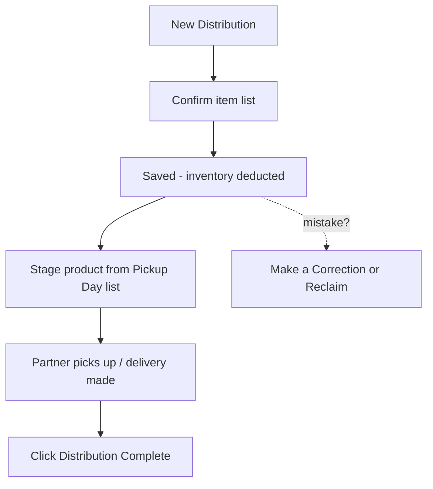

# Distributions

> **Status**: ✅ Active
> **Generated**: 2026-10-24T00:00:00Z
> **Last Updated**: 2026-10-24T00:00:00Z
---

*This manual is written for operations staff, following the standard feature documentation structure.*

## Overview

### What It Does
Distributions move supplies out of your storage locations to partner organizations. As operations staff you create them, stage product for them, hand them over, mark them complete, and correct them when something was recorded wrong. Saving a distribution immediately deducts stock from the source location.

### Why It Exists
Your inventory counts are only right if every outgoing box is recorded. Distributions are that record — plus the partner paperwork (PDF), the notification emails, and the daily pickup schedule your floor team works from.

### Key Capabilities
- Create distributions (blank, from a partner request, or from a donation)
- Confirm the exact item list before inventory moves
- Mark pickups complete from the detail page or the pickup-day list
- Print the PDF manifest for the driver or the partner
- Correct or reclaim (undo) distributions
- Work the day from the Schedule calendar and Pickup Day list

---

## Architecture

### High-Level Design
Your daily flow:

### Components
The screens you will use:

| Screen | How to get there | Used for |
|--------|------------------|----------|
| Distributions list | **Distributions** in the menu | Finding, filtering, exporting, reclaiming |
| New Distribution form | **New Distribution** button | Creating |
| Confirmation window | appears when you submit | Final check: partner, location, items |
| Distribution page | click any row | **Distribution Complete**, **Make a Correction**, **Print** |
| Schedule calendar | **Distributions > Schedule** | Week/month view; copy calendar link |
| Pickup Day | click a calendar day | The day's pickups + item totals for staging |

### Technology Stack
Nothing to install — everything runs in the browser. The calendar link can be added to Google Calendar or any app that accepts internet calendar (ICS) links.

---

## Model Details

What a distribution records, in operational terms:

| Field | Meaning | Rules |
|-------|---------|-------|
| Partner | Who receives it | Required; deactivated partners not offered |
| Distribution date and time | When it goes out | Reminder email is sent 1 day before, if enabled |
| Delivery method | Pick up / Delivery / Shipped | Required; **Shipping cost** box appears only for Shipped |
| Source storage location | Where stock is deducted | Only active locations with stock are offered |
| Items in this distribution | Items + quantities | At least one item, quantity 1 or more; duplicates merge |
| Agency representative | Contact at the partner agency | Optional |
| Comment | Notes; appears on PDF and in emails | Optional |
| Status | **Scheduled** → **Complete** | You flip it with **Distribution Complete** |

---

## Database Schema

All of the above is stored for you automatically, including who the organization is and when the record was created and last changed. You never touch the database directly.

---

## API Endpoints

Operational actions and where to click:

| Action | Button / place |
|--------|----------------|
| Create | **New Distribution** (Distributions list) |
| Confirm creation | **Yes, it's correct** in the confirmation window |
| View | **View** on a row |
| Complete | **Distribution Complete** (detail page or Pickup Day row) |
| Correct | **Make a Correction** (detail page) or edit icon on the row |
| Undo | **Reclaim** on the row (asks for confirmation) |
| Print PDF | **Print** on the row or detail page |
| Export CSV | **Export Distributions** (respects your filters) |
| Calendar link | **Copy Calendar URL to clipboard** on Schedule |

---

## Authorization

- Any signed-in member of your organization can create, complete, and print distributions.
- Editing a distribution that is **past or complete** requires the organization admin role — others are redirected with an error explaining this.
- Distributions with inactive items can't be edited or reclaimed by anyone until the items are reactivated.

---

## Configuration

Ask your administrator about these organization-wide settings that change what you see:

- PDF options: hide value columns, hide package column, show year-to-date totals, include signature lines ("Received By:" / "Delivered By:")
- CSV options: per-item in-kind value and package columns
- Default partner email text
- Per-partner notification settings (partners with notifications off get no emails)

---

## Usage Examples

### Task 1: Create and confirm a distribution
1. Go to **Distributions**, click **New Distribution**
2. Choose **Partner**, set **Distribution date and time**, tick **Send email reminder the day before?** if wanted
3. Pick the **Delivery method** (choosing **Shipped** reveals **Shipping cost**)
4. Choose the source storage location, add a **Comment** if needed
5. Under **Items in this distribution**, select items and quantities; **Add Another Item** for more rows
6. Submit, review the **Distribution Confirmation** window, click **Yes, it's correct**

*Expected result:* "Distribution created!", the new row highlighted in the list, inventory deducted. Low-stock warnings appear if any item fell below your minimums.

### Task 2: Work a pickup day
1. **Distributions > Schedule**, click today
2. Stage product using the **Item totals** table at the bottom
3. As each partner collects, click **Distribution Complete** on their row

*Expected result:* each row's status flips to Complete; the message "This distribution has been marked as being completed!" confirms it.

### Task 3: Correct a mistake
1. Open the distribution, click **Make a Correction**
2. Read any warnings (past-date caution; audit-since-creation caution)
3. Fix quantities/items/date/method — a zero quantity removes the line — and submit

*Expected result:* "Distribution updated!", inventory adjusted, and the partner automatically notified of changes ("Your Distribution Has Changed") if their notifications are on.

### Task 4: Reclaim (undo)
1. Find the row, click **Reclaim**, confirm the prompt

*Expected result:* "Distribution <id> has been reclaimed!" — the record is deleted and all items return to the source location.

---

## Testing

Before trusting the day's plan, sanity-check: filters cleared on the list, the day's Pickup Day totals match what you staged, and the confirmation window matches the request paperwork.

---

## Known Issues & Caveats

| Caveat | Operational impact |
|--------|--------------------|
| Shipping cost clears for non-shipped methods | Re-enter it if you switch back to Shipped |
| Snapshot cutoff | Distributions older than the last inventory snapshot can't be reclaimed or have contents changed; the error states the cutoff date |
| Audit warning on edit | If an audit happened after the distribution, a correction of physical amounts also needs an inventory adjustment |
| Emails skip past-dated distributions | Creating a distribution dated in the past sends no partner email or reminder |
| Reminder timing | The reminder goes out one day before the scheduled time — a reminder can't be sent for same-day distributions |

---

## Performance

Filter by date range on busy banks to keep the list fast; the totals row shows both "this page" and overall totals so you don't need to export just to get a sum.

---

## Troubleshooting

### "Sorry, we weren't able to save the distribution."
**Cause:** quantity exceeds on-hand stock, or no items with quantity ≥ 1.
**Solution:** fix the flagged items, lower quantities, or pick a different storage location.

### Redirected with "To edit a distribution, you must be an organization admin…"
**Cause:** the distribution is past or complete and you're not an admin.
**Solution:** ask an organization admin to make the correction.

### Edit/Reclaim disabled with "Has Inactive Items"
**Cause:** an item in the distribution was deactivated.
**Solution:** reactivate the item, make the change, then deactivate again if needed.

### Partner didn't receive the email or reminder
**Cause:** partner notifications off, partner deactivated, or the date already passed.
**Solution:** verify partner settings and the scheduled date.

### A storage location is missing from the dropdown
**Cause:** inactive, or no positive inventory.
**Solution:** reactivate it or transfer stock into it first.

---

## Related Features

- **Requests** — fulfill a partner request by creating its distribution; the request locks the partner and pre-fills items
- **Donations** — seed a distribution from a donation
- **Storage Locations** — source of stock; low-stock alerts fire on save
- **Audits** — trigger the audit-warning banner on edits
- **Reports** — distributions drive quantity and value reporting

---

**Generated:** 2026-10-24T00:00:00Z
**Last Updated:** 2026-10-24T00:00:00Z
**Status:** ✅ Active
