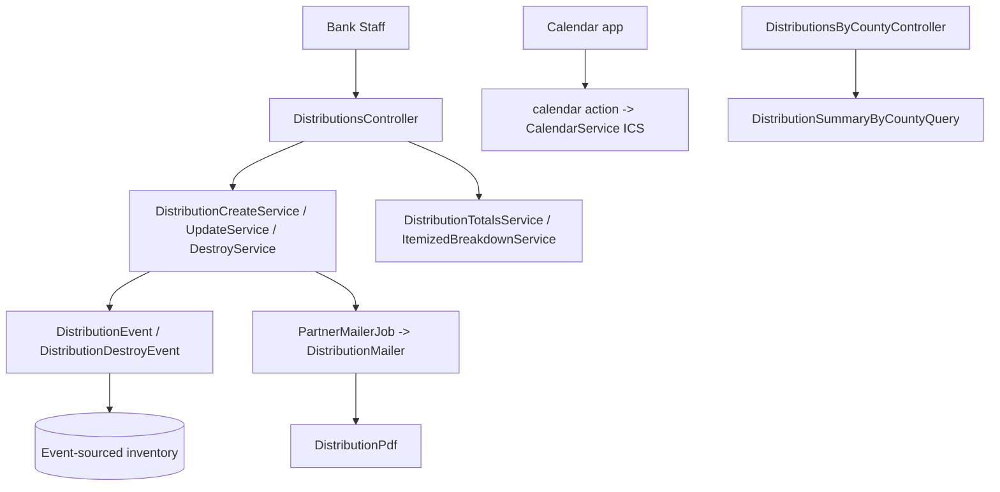
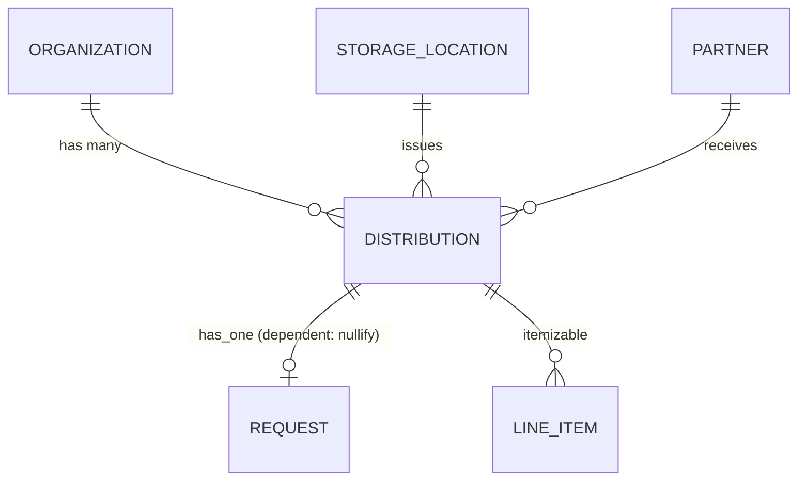

# Distributions

> **Status**: ✅ Active
> **Generated**: 2026-10-24T00:00:00Z
> **Last Updated**: 2026-10-24T00:00:00Z
---

## Overview

### What It Does
Distributions provide full CRUD+ for the primary way inventory leaves a diaper bank: issuing a set of items from a single storage location to a single partner organization on a scheduled date, with pick up, delivery, or shipped delivery methods. Creation decrements inventory through the event-sourcing layer, notifies the partner by email with a PDF manifest, and supports calendars, pickup-day worklists, CSV exports, and a by-county summary.

### Why It Exists
Essentials banks must track exactly which supplies went to which community partner, keep storage-location on-hand counts verifiable, give partners paperwork and reminders, and feed quantity/value reporting. Most distributions go to community partners; direct services are technically possible via a "Direct Services" partner but lack additional failsafes.

### Key Capabilities
- Create distributions from scratch, from a partner request (marking it fulfilled), or seeded from a donation
- Pre-save validation with a confirmation modal before inventory is committed
- Event-sourced inventory decrement/restore (create/destroy) and content-diffed updates
- Partner notification email with PDF manifest, change notifications, and day-before reminder emails
- Calendar page, public encrypted ICS feed, pickup-day worklist
- Filterable index with totals, CSV export, itemized breakdown CSV, by-county estimates

---

## Architecture

### High-Level Design


### Components

#### Backend Components
| Component | File Path | Purpose |
|-----------|-----------|---------|
| DistributionsController | `app/controllers/distributions_controller.rb` | CRUD+ actions: index, new, create, validate, show, edit, update, destroy, print, schedule, calendar, picked_up, pickup_day, itemized_breakdown |
| DistributionsByCountyController | `app/controllers/distributions_by_county_controller.rb` | `report` action for by-county estimates |
| Distribution | `app/models/distribution.rb` | Core model; state and delivery-method enums, copy-from-request/donation logic |
| DistributionService | `app/services/distribution_service.rb` | Base service: transaction wrapper, error capture, `success?` |
| DistributionCreateService | `app/services/distribution_create_service.rb` | Save + publish event + fulfill request + notify partner |
| DistributionUpdateService | `app/services/distribution_update_service.rb` | Delegates to `ItemizableUpdateService`; tracks date/method/content changes |
| DistributionDestroyService | `app/services/distribution_destroy_service.rb` | Publish destroy event (restores inventory) + destroy record |
| DistributionContentChangeService | `app/services/distribution_content_change_service.rb` | Diff old/new line items (updates, removed) |
| DistributionTotalsService | `app/services/distribution_totals_service.rb` | SQL window-function quantity/value totals per distribution |
| DistributionItemizedBreakdownService | `app/services/distribution_itemized_breakdown_service.rb` | Items distributed vs on-hand (+minimums) and CSV |
| CalendarService | `app/services/calendar_service.rb` | ICS feed of last year's distributions; curated time-zone list |
| DeadlineService | `app/services/deadline_service.rb` | Next monthly deadline (partner group day overrides org day) |
| Exports::ExportDistributionsCSVService | `app/services/exports/export_distributions_csv_service.rb` | Distributions CSV with filter-aware and per-item columns |
| DistributionEvent | `app/events/distribution_event.rb` | Inventory payload FROM storage location |
| DistributionDestroyEvent | `app/events/distribution_destroy_event.rb` | Zeroed line items (inventory restore) |
| DistributionHelper | `app/helpers/distribution_helper.rb` | Pickup-day params, hashed calendar URL, shipping-cost formatting |
| DistributionMailer | `app/mailers/distribution_mailer.rb` | `partner_mailer`, `reminder_email` |
| DistributionPdf | `app/pdfs/distribution_pdf.rb` | Prawn manifest (request vs non-request tables, column hiding, signatures) |
| DistributionSummaryByCountyQuery | `app/queries/distribution_summary_by_county_query.rb` | Raw-SQL county apportionment via partner served areas |

> Checklist: controllers ✓, models ✓, concerns (Itemizable, Exportable, IssuedAt, Filterable — see Model Details) ✓, services ✓, jobs (uses shared `PartnerMailerJob`) ✓, policies — none (no Pundit policy class for this feature; see Authorization), queries ✓, PDFs ✓, mailers ✓.

#### Frontend Components
| Component | File Path | Purpose |
|-----------|-----------|---------|
| Index view | `app/views/distributions/index.html.erb` | Filters, totals, actions, CSV export button |
| Form partial | `app/views/distributions/_form.html.erb` | simple_form; Stimulus `form-input`, `confirmation`, `distribution-delivery` controllers; confirmation modal shell |
| Validate modal | `app/views/distributions/validate.html.erb` | Modal body returned by the `validate` JSON endpoint |
| Schedule | `app/views/distributions/schedule.html.erb` / `schedule.json.jbuilder` | Calendar page + JSON event feed; copy-ICS-URL button |
| Pickup day | `app/views/distributions/pickup_day.html.erb` + `_pickup_day_row` / `_daily_item_row` | Day worklist and aggregated item totals |
| Show / Edit / New | `app/views/distributions/show.html.erb`, `edit.html.erb`, `new.html.erb` | Detail page with actions; edit warnings |
| Row partials | `_distribution_row`, `_distribution_total`, `_distribution_item_row`, `_distribution_item_total` | Table rows and totals |
| County report | `app/views/distributions_by_county/report.html.erb` | Estimated totals by county |
| Mailer views | `app/views/distribution_mailer/*` | Partner notification (HTML), reminder (HTML+text), changes partial |

### Technology Stack
- **Backend**: Rails controllers + PORO service objects, event sourcing (`Event` subclasses), PaperTrail versioning
- **Frontend**: ERB + simple_form, Turbo Streams (create failure re-render), Stimulus controllers, calendar JS, jQuery/toastr for the copy-URL button
- **Database**: PostgreSQL (window functions and raw SQL in totals/county queries)
- **External Services**: iCalendar (`icalendar` gem), Prawn PDF, Flipper (`enable_packs`), ActionMailer

---

## Model Details

### Distribution

#### Associations
```ruby
belongs_to :storage_location
belongs_to :partner
belongs_to :organization
has_one :request, dependent: :nullify
accepts_nested_attributes_for :request
```

#### Concerns
| Concern | Purpose |
|---------|---------|
| `Itemizable` | Line items (`line_items`), `combine!`, totals |
| `Exportable` | CSV export support |
| `IssuedAt` | `issued_at` handling |
| `Filterable` | `class_filter` scope-based filtering |
| `ItemsHelper` (module) | `cents_to_dollar` etc. |
| `has_paper_trail` | Version history |

#### Callbacks
| Callback | Method | Purpose |
|----------|--------|---------|
| `before_save` | `:combine_distribution` | `line_items.combine!` — merge duplicate item rows |
| `before_save` | `:reset_shipping_cost` | Nil `shipping_cost` unless `delivery_method == "shipped"` |
| `before_destroy` | `:check_no_intervening_snapshot` | Raise `"We can't delete distributions entered before <date>."` when a `SnapshotEvent` intervenes |

#### State Machines
Plain Rails enums (no AASM):
```ruby
enum :state, { scheduled: 5, complete: 10 }
enum :delivery_method, { pick_up: 0, delivery: 1, shipped: 2 }
```
`picked_up` transitions `scheduled → complete` via `complete!` with no additional guard beyond `!distribution.complete?`.

#### Validations
- `validates :delivery_method, presence: true`
- `validate :line_items_quantity_is_positive` (total quantity ≥ 1)
- `validates :shipping_cost, numericality: { greater_than_or_equal_to: 0 }, allow_blank: true, if: :shipped?`

#### Key Methods
| Method | Returns | Purpose | Notes |
|--------|---------|---------|-------|
| `copy_from_request(request)` | — | Seed from request: org/partner/comment, `agency_rep` = partner user email, `issued_at` = tomorrow, line item per item_request | Custom-unit requests leave quantity nil on purpose |
| `copy_from_donation(donation_id, storage_location_id)` | — | Copy donation line items, set location | |
| `initialize_request_items` | — | Link line items to item_requests; add zero-qty rows for unfulfilled requested items | Edit page |
| `distributed_at` | String | Date-only when midnight, else date-time format | |
| `future?` / `past?` | Boolean | `issued_at` vs `Time.zone.today` | |
| `csv_export_attributes` | Array | Partner, date, location, quantity, value, method, state, agency rep | |
| `combine_duplicates` | — | Logs "Combining!" then `line_items.combine!` | |

#### Scopes
`active`, `with_diapers`, `with_period_supplies`, `by_item_id`, `by_item_category_id`, `by_reporting_category`, `by_partner`, `by_location`, `by_state`, `recent(3)`, `future` (tomorrow onward), `during(range)`, `apply_filters(filters, date_range)`, `this_week`, `in_last_12_months`.

---

## Database Schema

### distributions (from the model's schema annotation)

| Column | Type | Default | Notes |
|--------|------|---------|-------|
| `id` | integer | — | Primary key |
| `agency_rep` | string | — | |
| `comment` | text | — | |
| `delivery_method` | integer | `"pick_up"` | not null, enum |
| `issued_at` | datetime | — | Scheduled date/time |
| `reminder_email_enabled` | boolean | `false` | not null |
| `shipping_cost` | decimal(8,2) | — | Cleared unless shipped |
| `state` | integer | `"scheduled"` | not null, enum |
| `created_at` | datetime | — | not null |
| `updated_at` | datetime | — | not null |
| `organization_id` | integer | — | FK |
| `partner_id` | integer | — | FK |
| `storage_location_id` | integer | — | FK |

### Relationships


---

## API Endpoints

> Derived from controller actions and path helpers used in views; routes file not in feature scope.

| Method | Path | Action | Description | Notes |
|--------|------|--------|-------------|-------|
| `GET` | `/distributions` | `index` | Filterable list; CSV format exports | |
| `GET` | `/distributions/new` | `new` | New form (accepts `request_id`, `donation_id`, `storage_location_id`) | |
| `POST` | `/distributions` | `create` | Create via service; Turbo Stream on failure | |
| `POST` | `/distributions/validate` | `validate` | JSON `{valid:, body:}` for confirmation modal; does NOT persist | `validate_distributions_path` |
| `GET` | `/distributions/:id` | `show` | Detail with line items and totals | |
| `GET` | `/distributions/:id/edit` | `edit` | Guarded: future+incomplete or org admin | |
| `PATCH` | `/distributions/:id` | `update` | Update via service; change notification | |
| `DELETE` | `/distributions/:id` | `destroy` | "Reclaim" — restores inventory | |
| `GET` | `/distributions/:id/print` | `print` | Inline PDF (`format.any`) | |
| `GET` | `/distributions/schedule` | `schedule` | HTML calendar; JSON event feed with `start`/`end` params | |
| `GET` | `/distributions/calendar?hash=…` | `calendar` | Public ICS feed; encrypted org id; 401 on bad hash | Skips authentication |
| `PATCH` | `/distributions/:id/picked_up` | `picked_up` | Mark complete | |
| `GET` | `/distributions/pickup_day` | `pickup_day` | Day worklist + per-item totals | `filters[during]` |
| `GET` | `/distributions/itemized_breakdown.csv` | `itemized_breakdown` | Itemized CSV for date range | CSV only |
| `GET` | `/distributions_by_county/report` | `report` | County estimates for date range | `DistributionsByCountyController` |

---

## Authorization

No Pundit policy class exists for distributions. Access control is:

| Mechanism | Where | Effect |
|-----------|-------|--------|
| `authenticate_user!` / `authorize_user` / `require_organization` (ApplicationController) | all actions except `calendar` | Org-scoped access; `calendar` skips all three |
| `current_organization.distributions.find` | member actions | Tenant isolation |
| `current_user.has_cached_role?(Role::ORG_ADMIN, current_organization)` | `edit`, `update` path, show/index buttons | Only org admins may edit past/complete distributions |
| Encrypted hash (`MessageEncryptor` on `secret_key_base[0..31]`) | `calendar` | Possession of URL = access to ICS feed |

---

## Configuration

### Environment Variables
None specific to this feature. `Rails.application.secret_key_base` (first 32 bytes) keys the calendar-URL encryption.

### Feature flags / organization settings
- Flipper `enable_packs` — show request units in the PDF requested-quantity column
- `organization.include_in_kind_values_in_exported_files` — per-item In-Kind Value CSV columns
- `organization.include_packages_in_distribution_export` — per-item Packages CSV columns
- `organization.ytd_on_distribution_printout` — YTD items on PDF
- `organization.hide_value_columns_on_receipt`, `hide_package_column_on_receipt` — hide PDF columns
- `organization.signature_for_distribution_pdf` — signature lines on PDF
- `organization.default_email_text` — interpolated partner email body (`delivery_method`, `distribution_date`, `partner_name`, `comment`)
- `partner.send_reminders` — gates creation/change notifications and reminder emails

---

## Usage Examples

### Creating a distribution (controller flow)
```ruby
# Source: app/controllers/distributions_controller.rb:99
def create
  dist = Distribution.new(distribution_params.merge(organization: current_organization))
  result = DistributionCreateService.new(dist, request_id).call

  if result.success?
    session[:created_distribution_id] = result.distribution.id
    @distribution = result.distribution

    perform_inventory_check
    schedule_reminder_email(result.distribution) if @distribution.reminder_email_enabled
    # ...
```

### Create service
```ruby
# Source: app/services/distribution_create_service.rb:9
def call
  perform_distribution_service do
    validate_request_not_yet_processed! if @request.present?

    distribution.save!

    DistributionEvent.publish(distribution)

    distribution.reload
    @request&.update!(distribution_id: distribution.id, status: 'fulfilled')
    send_notification if distribution.partner&.send_reminders
  end
end
```

### Reminder scheduling
```ruby
# Source: app/controllers/distributions_controller.rb:294
def schedule_reminder_email(distribution)
  return if distribution.past? || !distribution.partner.send_reminders

  DistributionMailer.reminder_email(distribution.id).deliver_later(wait_until: distribution.issued_at - 1.day)
end
```

---

## Testing

Test files are outside the documented file set; specs for this feature were not verified. (Do not assume paths.)

---

## Known Issues & Caveats

| Issue | Location | Description |
|-------|----------|-------------|
| FIXME: duplicate status filter state | `distributions_controller.rb:71-72` | "one of these needs to be removed but it's unclear which" (`@statuses` vs `@selected_status`) |
| Scaffold leftover | `app/views/distributions/print.html.erb` | "Find me in app/views/…" placeholder; real printing is the PDF via `format.any` |
| Silent data reset | `distribution.rb:185` | `reset_shipping_cost` silently nils shipping cost for non-shipped methods |
| Hard delete guard raises | `distribution.rb:178` | `check_no_intervening_snapshot` raises a bare `RuntimeError` string, surfaced as flash error |
| Unauthenticated endpoint | `distributions_controller.rb:12-14,257` | `calendar` skips auth/authorization/organization; protected only by encrypted hash |
| TODO on schedule | `distributions_controller.rb:245` | "This needs a little more context. Is it JSON only? HTML?" |
| `ensure return self` | `distribution_service.rb:18-19` | `ensure` block swallows any re-raise; services never raise to callers |
| `initialize_request_items` set misuse | `distribution.rb:110-117` | `item_ids` Set stores `item_request` objects, not ids (works, but name misleads) |

---

## Performance

### Optimization Strategies
- Index totals computed in a single SQL pass with window functions (`DistributionTotalsService`) instead of N+1 per-row sums
- `includes(:partner, :storage_location)` / `includes(line_items: :item)` eager loading on index, show, CSV export
- County report is one raw SQL query with CTEs

### Caching
- None feature-specific; `has_cached_role?` uses rolify's cached roles

### Database Optimization
- Window-function partitioning on `distributions.id`; schema indexes not listed here (schema file outside feature file set)

---

## Troubleshooting

### Issue: distribution won't save, "insufficient" error
**Symptoms:** flash "Sorry, we weren't able to save the distribution. \n <details>", line items highlighted.
**Cause:** `Errors::InsufficientAllotment` — requested quantity exceeds storage-location inventory (event-sourced check).
**Solution:** lower quantities or pick a different storage location; `assign_insufficiency_errors` marks the offending items.

### Issue: cannot edit a distribution
**Cause:** it is complete or not in the future and the user lacks `Role::ORG_ADMIN`; or line items include inactive items; or a `SnapshotEvent` intervenes (`@changes_disallowed`).
**Solution:** have an org admin edit, reactivate items, or accept the snapshot cutoff.

### Issue: partner never received an email
**Cause:** `partner.send_reminders` false, partner deactivated, or `distribution.past?` (mailer guard clauses).
**Solution:** check partner settings and the distribution date.

### Issue: ICS link returns 401
**Cause:** invalid/garbled `hash` param (`InvalidSignature`/`InvalidMessage`).
**Solution:** re-copy the URL from the schedule page ("Copy Calendar URL to clipboard").

---

## Related Features

- **Requests** — distributions fulfill partner requests (`has_one :request`, fulfilled on create, picklists)
- **Donations** — a distribution can be seeded from a donation's line items
- **Storage Locations / Inventory Events** — event-sourced decrement/restore; snapshot guard
- **Partners** — recipients; profile drives emails, addresses, send_reminders
- **Reports / Historical Trends** — consume distribution totals
- **Audits** — audit-after-distribution warning on edit

---

**Generated:** 2026-10-24T00:00:00Z
**Last Updated:** 2026-10-24T00:00:00Z
**Status:** ✅ Active
