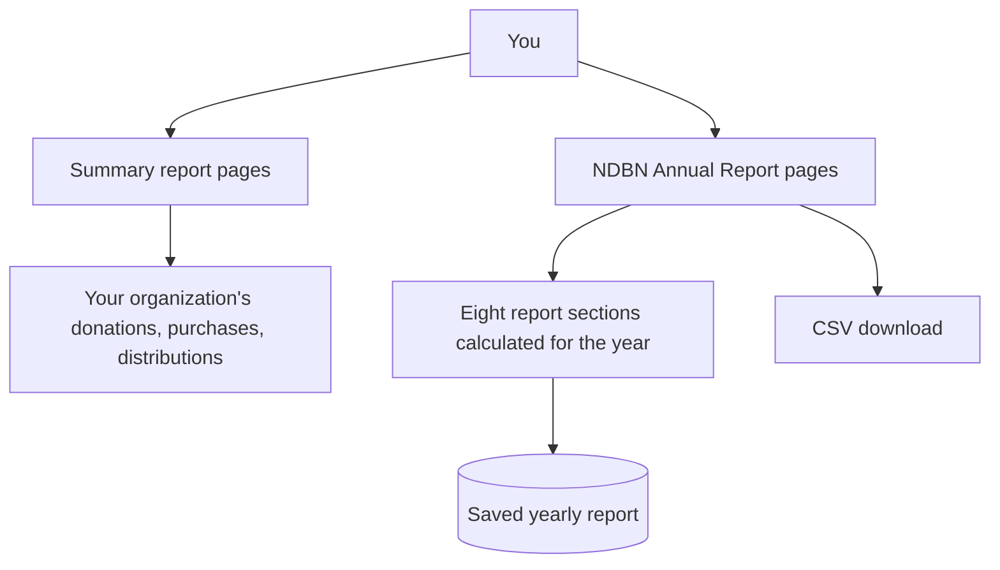

# Reports

> **Status**: ✅ Active
> **Generated**: 2026-10-24T00:00:00Z
> **Last Updated**: 2026-10-24T00:00:00Z
---

## Overview

### What It Does
Reports show your bank's activity at a glance. You get everyday summary reports — donations, purchases, distributions, product drives, manufacturer donations, item-by-item breakdowns, and an activity graph — each filterable by date range, plus an official **NDBN Annual Report** compiled for every completed year, which you can view online or download as a spreadsheet.

### Why It Exists
Banks need quick answers ("how much came in last month?", "which items are running low?") and standardized year-end figures for NDBN annual surveys. Reports answers both without manual spreadsheet work.

### Key Capabilities
- Filter any summary report to the dates you care about
- See recent donations, purchases, and distributions with one-click access to each record
- Spot low-stock items instantly — rows turn red when on-hand falls below your minimum
- Open a complete annual report for any completed year, going back to your first reporting year
- Refresh an annual report after correcting past records (**Recalculate Report**)
- Download an annual report as a CSV spreadsheet (**Export Report**)

---

## Architecture

### High-Level Design

### Components

#### What you see
| Component | Where | Purpose |
|-----------|-------|---------|
| Donations (All Sources) card | Reports area | Items received and money raised in the period, recent donations |
| Manufacturer Donations card | Reports area | Items donated by manufacturers, top recent manufacturers |
| Purchases card | Reports area | Money spent overall and by category, recent purchases |
| Product Drives card | Reports area | Active drives, items received, money raised |
| Distributions card | Reports area | Items distributed, future scheduled items, recent distributions |
| Itemized Donations / Distributions / Requests | Reports area | Per-item quantities vs. what you have on hand |
| Activity Graph | Reports area | Bar chart: received vs. purchased vs. distributed |
| NDBN Annual Reports list | Reports page | One entry per completed year |
| Annual report page | Reports page | Eight sections of year-end figures with Recalculate and Export buttons |

#### Behind the scenes
| Component | Purpose |
|-----------|---------|
| Yearly calculation | The first time you open a year, all eight sections are calculated and saved |
| Saved report | Subsequent visits load instantly from the saved copy |
| CSV export | Turns the whole report into one spreadsheet row of labeled figures |

### Technology Stack
- **Reports are live**: summary pages always reflect your current records for the chosen dates
- **Annual reports are saved**: calculated once, stored, refreshed only when you ask

---

## Model Details

### The Annual Report record

Each annual report belongs to your organization and covers one year. Changes to it are tracked over time.

#### Key facts
| Fact | Detail |
|------|--------|
| One per year | Each organization gets one report per completed year |
| Valid years | Years must be sensible (after 1900) |
| What's stored | All eight sections with every labeled figure |
| History | Earlier versions of the stored report are kept |

#### The eight sections
| Section | What it tells you |
|---------|-------------------|
| Diapers | Disposable and cloth diapers distributed (kits included), monthly average, drive results (in-person and virtual), donated vs. purchased split, money spent, purchase sources |
| Warehouse and Storage | Storage location count, total square footage, largest site type |
| Adult Incontinence | Supplies distributed, adults assisted per month, supplies per adult, donated vs. purchased, money spent |
| Period Supplies | Supplies distributed (kits included), types stocked, donated vs. purchased, money spent |
| Other Items | Everything else: quantity, split, spend, product list |
| Partner Agencies and Service Area | Partner count, counts per agency type, zip codes served |
| Children Served | Total and monthly average children served, repackaging and monthly-distribution answers |
| Year End Summary | Percentage change vs. last year: donations, money donated, disposable diaper donations |

---

## Database Schema

Your annual report is saved with: the year it covers, your organization, all eight sections of figures, and when it was created and last updated. You never edit it directly — it is recalculated from your records on demand.

---

## API Endpoints

The pages you can visit:

| Page | What it shows |
|------|---------------|
| Donations summary | Items received and money raised in the chosen period |
| Manufacturer donations summary | Manufacturer giving in the period |
| Purchases summary | Spending in the period, by category |
| Product drives summary | Drive activity in the period |
| Distributions summary | Items distributed and upcoming distributions |
| Itemized donations / distributions / requests | Per-item quantities with on-hand amounts |
| Activity graph | Received vs. purchased vs. distributed chart |
| Annual reports list | Every completed year's report |
| Annual report (per year) | The full eight-section report; also downloadable as CSV |
| Recalculate | Refreshes a year's figures ("Recalculated annual report!") |

---

## Authorization

You need a staff login for your bank. Every report shows only your own organization's data. Opening an annual report with an invalid year shows a not-found page.

---

## Configuration

No setup is required. Agency-type labels in the partner section come from the system's standard wording.

---

## Usage Examples

### Checking last month's inflow
Open **Donations (All Sources)**, set the date range to last month, and read the items-received and money-raised headlines.

### Preparing the NDBN survey
Open **Reports**, click the year, review all eight sections, then click **Export Report** to download `NdbnAnnuals-<year>-<date>.csv`.

### After fixing old records
Open the affected year and click **Recalculate Report**; the confirmation "Recalculated annual report!" appears and figures refresh.

---

## Testing

Reports reflect your real records — the quickest sanity check is comparing a summary report's recent list against the full donations/purchases/distributions pages linked via **See more...**.

---

## Known Issues & Caveats

| Issue | Description |
|-------|-------------|
| Annual reports are cached | Figures only change when you click **Recalculate Report** |
| Current year not listed | Annual reports cover completed years; the page shows months remaining |
| Drive money rounding | Product-drive money totals in the Diapers section are rounded to whole dollars |
| Missing square footage | If some storage locations lack square footage, the report says how many |

---

## Performance

The first open of a year's annual report takes a moment while figures are calculated; afterwards it loads instantly from the saved copy. Summary reports are always calculated live for your chosen dates.

---

## Troubleshooting

### My annual report doesn't match my corrected records
**Cause:** The report is saved from an earlier calculation.
**Solution:** Click **Recalculate Report** on that year's page.

### This year is missing from the list
**Cause:** Only completed years are reportable.
**Solution:** Wait until year end — the page tells you how many months remain.

### A summary report is empty
**Cause:** The date range has no activity.
**Solution:** Adjust the date filter on the card.

---

## Related Features

- **Donations** — the source of received-items and money-raised figures
- **Purchases** — spending figures and category breakdowns
- **Distributions** — distributed-items figures and partner activity
- **Kits** — kit contents are counted inside diaper, adult incontinence, and period supply figures
- **Partners** — agency counts and service-area zip codes
- **Storage Locations** — warehouse figures

---

**Generated:** 2026-10-24T00:00:00Z
**Last Updated:** 2026-10-24T00:00:00Z
**Status:** ✅ Active
