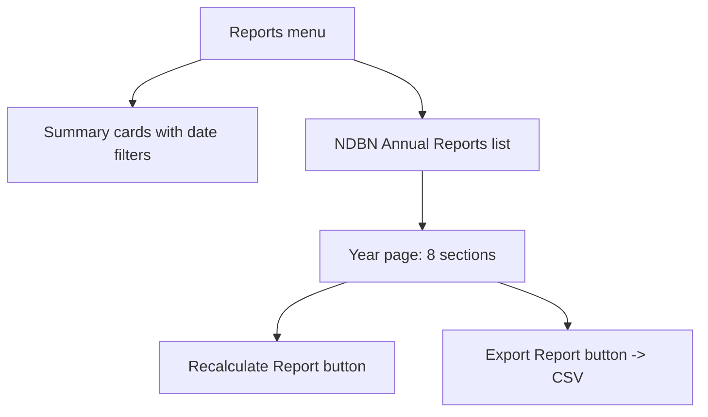

# Reports

> **Status**: ✅ Active
> **Generated**: 2026-10-24T00:00:00Z
> **Last Updated**: 2026-10-24T00:00:00Z
---

## Overview

### What It Does
This guide shows operations staff how to use the Reports area: the date-filterable summary reports you'll use day to day, and the year-end NDBN Annual Report you'll open, refresh, and export at reporting time.

### Why It Exists
Operations staff need to check inflow and outflow quickly, catch low stock before it bites, and produce the annual survey figures without building spreadsheets by hand.

### Key Capabilities
- Set a date range on any summary card and read totals for exactly that period
- Jump from a report's recent-activity list straight into a donation, purchase, or distribution
- Catch shortages: red rows in itemized reports mean an item is below your minimum
- Open, recalculate, and export the NDBN Annual Report for any completed year

---

## Architecture

### How the pieces fit (operator's view)

### Components

#### Pages you will use
| Page | Daily use |
|------|-----------|
| Donations (All Sources) | Check items received and money raised; record a **New Donation** |
| Manufacturer Donations | Track manufacturer giving; see your top recent manufacturers |
| Purchases | Check spend overall and by category; record a **New Purchase** |
| Product Drives | Track drive activity and money raised |
| Distributions | Check items out and upcoming distributions; record a **New Distribution** |
| Itemized Donations / Distributions / Requests | Per-item quantities vs. on-hand; red = below minimum |
| Activity Graph | In-vs-out bar chart for the period |
| NDBN Annual Reports | Year list → full report → recalculate/export |

### Technology Stack
- Summary cards update live for the date range you pick
- Annual reports are saved once calculated and refresh only via **Recalculate Report**

---

## Model Details

### What an annual report contains

Eight sections, each a two-column table of measure and value:

| # | Section | Operator notes |
|---|---------|----------------|
| 1 | Diapers | Includes diapers packed in kits; splits in-person vs. virtual drives |
| 2 | Warehouse and Storage | Flags how many locations are missing square footage |
| 3 | Adult Incontinence | Adults assisted per month and supplies per adult |
| 4 | Period Supplies | Includes kit contents |
| 5 | Other Items | Everything outside the above categories |
| 6 | Partner Agencies and Service Area | Counts per agency type, zip codes served |
| 7 | Children Served | Total and monthly average; Y/N repackaging and monthly-distribution answers |
| 8 | Year End Summary | % change vs. last year (donations, money, disposable diapers) |

---

## Database Schema

One saved report per organization per completed year. You never edit it; you recalculate it. Past versions are retained.

---

## API Endpoints

### Task: Read a summary report
1. Open the report card you need.
2. Set the date range in the card's filter.
3. Read the headline totals; scroll for the recent-activity list.
4. Click any row to open the underlying record; **See more...** opens the full list page.

### Task: Check for low stock
1. Open **Itemized Distributions** (or **Itemized Requests**).
2. Set your range.
3. Scan for red on-hand cells — those items are below your minimum. Plan a purchase or transfer.

### Task: Open an annual report
1. Go to **Reports** (Home > Reports).
2. In **NDBN Annual Reports**, click the year. First open takes a moment; later opens are instant.

### Task: Recalculate after corrections
1. Open the year's report.
2. Click **Recalculate Report**.
3. Expect the message "Recalculated annual report!" and refreshed figures.

### Task: Export for the NDBN survey
1. Open the year's report.
2. Click **Export Report**.
3. A file named `NdbnAnnuals-<year>-<today's date>.csv` downloads with every measure as a column.

---

## Authorization

Log in with your bank staff account. You only ever see your own organization's numbers. Invalid years in the address bar show a not-found page.

---

## Configuration

Nothing to configure. If storage-location square footage is incomplete, the warehouse section will say so — fix the locations, then recalculate.

---

## Usage Examples

- **Month-end check**: set each summary card to last month; compare the Activity Graph's received/purchased/distributed bars.
- **Pre-survey routine**: recalculate the year, review all eight sections, export the CSV, submit.
- **Restock pass**: weekly scan of Itemized Distributions for red rows.

---

## Testing

Spot-check a report by opening a recent donation/purchase/distribution from its list and confirming the record matches.

---

## Known Issues & Caveats

| Issue | What to do |
|-------|------------|
| Annual figures look stale | They're cached — click **Recalculate Report** |
| Current year missing | Appears only after the year ends; the page shows months remaining |
| Empty summary card | Check the date filter — likely no activity in range |
| Warehouse section notes missing square footage | Enter square footage on those storage locations, then recalculate |

---

## Performance

First open of a year calculates everything and may take a few seconds. Everything after that is instant until you recalculate.

---

## Troubleshooting

### Export gives figures that don't match the screen
**Cause:** Report recalculated in another session after your download.
**Solution:** Re-open the year and export again.

### "No ... found for the selected date range"
**Cause:** Date filter excludes all records.
**Solution:** Widen the range.

### Red rows everywhere in itemized reports
**Cause:** On-hand minimums set high or stock genuinely low.
**Solution:** Review item minimums; schedule purchases/transfers.

---

## Related Features

- **Donations / Purchases / Distributions** — the records behind every figure; create them from the report cards
- **Kits** — kit contents count toward diaper, AI, and period-supply figures
- **Storage Locations** — keep square footage current for the warehouse section
- **Partners** — keep profiles current for agency counts and zip codes

---

**Generated:** 2026-10-24T00:00:00Z
**Last Updated:** 2026-10-24T00:00:00Z
**Status:** ✅ Active
