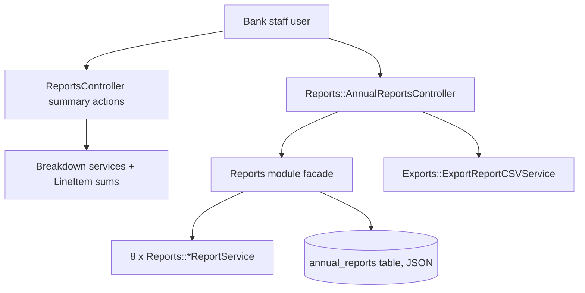
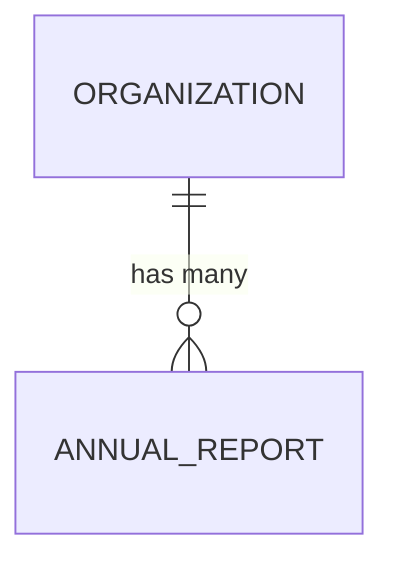

# Reports

> **Status**: ✅ Active
> **Generated**: 2026-10-24T00:00:00Z
> **Last Updated**: 2026-10-24T00:00:00Z
---

## Overview

### What It Does
The Reports feature gives a bank organization date-range-filterable operational summary reports (donations, manufacturer donations, purchases, product drives, distributions, itemized donations/distributions/requests, and an activity graph) plus a persisted, recalculable **NDBN Annual Report** composed of eight calculated sections per year, viewable as HTML and exportable as CSV.

### Why It Exists
Essentials banks must monitor day-to-day inflow/outflow and must produce standardized year-end figures (NDBN annual survey). This feature centralizes both: quick operational snapshots for staff, and a cached, reproducible annual report per organization per year.

### Key Capabilities
- Nine date-range-filtered summary/itemized report pages scoped to `current_organization`
- Annual report generation across eight domains (diapers, warehouse, adult incontinence, period supplies, other items, partner info, children served, year-end summary)
- Caching of annual reports in the database with explicit recalculation
- CSV export of a year's full annual report (`NdbnAnnuals-<year>-<date>.csv`)
- Low-stock highlighting in itemized reports (`table-danger` when below on-hand minimum)

---

## Architecture

### High-Level Design


### Components

#### Backend Components
| Component | File Path | Purpose |
|-----------|-----------|---------|
| ReportsController | `app/controllers/reports_controller.rb` | Nine summary report actions, all behind `setup_date_range_picker` |
| Reports::AnnualReportsController | `app/controllers/reports/annual_reports_controller.rb` | `index`, `show` (HTML/CSV), `recalculate` |
| AnnualReport | `app/models/annual_report.rb` | Persisted per-org/per-year report (JSON `all_reports`) |
| Reports (module) | `app/services/reports.rb` | Builds all eight sections; `retrieve_report` find-or-create + cache |
| Reports::DiaperReportService | `app/services/reports/diaper_report_service.rb` | "Diapers" section (19 entries, kit-aware) |
| Reports::WarehouseReportService | `app/services/reports/warehouse_report_service.rb` | "Warehouse and Storage" section |
| Reports::AdultIncontinenceReportService | `app/services/reports/adult_incontinence_report_service.rb` | "Adult Incontinence" section (kit-aware) |
| Reports::PeriodSupplyReportService | `app/services/reports/period_supply_report_service.rb` | "Period Supplies" section (kit-aware) |
| Reports::OtherProductsReportService | `app/services/reports/other_products_report_service.rb` | "Other Items" section |
| Reports::PartnerInfoReportService | `app/services/reports/partner_info_report_service.rb` | "Partner Agencies and Service Area" section |
| Reports::ChildrenServedReportService | `app/services/reports/children_served_report_service.rb` | "Children Served" section |
| Reports::SummaryReportService | `app/services/reports/summary_report_service.rb` | "Year End Summary" (YoY percentages) |
| Exports::ExportReportCSVService | `app/services/exports/export_report_csv_service.rb` | Two-row CSV (all keys / all values) |

#### Frontend Components
| Component | File Path | Purpose |
|-----------|-----------|---------|
| Summary views | `app/views/reports/*.html.erb` | One filtered card per action (shared `shared/filtered_card`) |
| Row partials | `app/views/reports/_{donation,distribution,purchase,manufacturer,product_drive}.html.erb` | Recent-activity rows |
| Annual report views | `app/views/reports/annual_reports/{index,show}.html.erb` | Year list; per-section tables with Recalculate/Export buttons |
| Highchart Stimulus hook | used in `activity_graph.html.erb` | `data-controller="highchart"` renders the bar chart |

### Technology Stack
- **Backend**: Rails controllers + POROs (service objects), raw SQL for kit math, `ActionView::Helpers::NumberHelper` for formatting
- **Frontend**: ERB views, shared filtered-card partial, Stimulus-driven Highcharts bar chart
- **Database**: `annual_reports` table with a `json` column; aggregates over donations/purchases/distributions/line_items/items/kits/storage_locations/partners

---

## Model Details

### AnnualReport

#### Associations
```ruby
belongs_to :organization, inverse_of: :annual_reports
```

#### Concerns
| Concern | Purpose |
|---------|---------|
| `has_paper_trail` (PaperTrail) | Version history of the stored report |

#### Callbacks
None defined.

#### Validations
```ruby
validates :year, numericality: { greater_than: 1900, less_than: 10_000 }
```

#### Key Methods
| Method | Returns | Purpose | Notes |
|--------|---------|---------|-------|
| `each_report` | yields `(String, Array<Hash>)` | Iterates stored sections, yielding `hash['name']`, `hash['entries']` | String-keyed access — expects JSON round-trip |

---

## Database Schema

### annual_reports

| Column | Type | Default | Notes |
|--------|------|---------|-------|
| `id` | `bigint` | — | Primary key |
| `all_reports` | `json` | — | Array of `{name, entries}` section hashes |
| `year` | `integer` | — | Validated 1901–9999 |
| `created_at` | `datetime` | — | not null |
| `updated_at` | `datetime` | — | not null |
| `organization_id` | `bigint` | — | FK to organizations |

### Relationships


---

## API Endpoints

> Paths inferred from route helpers used in the views (`reports_*_path`); actions verified in controllers.

| Method | Path | Action | Description | Notes |
|--------|------|--------|-------------|-------|
| `GET` | `/reports/donations_summary` | `donations_summary` | Donations in range + recent list | |
| `GET` | `/reports/manufacturer_donations_summary` | `manufacturer_donations_summary` | Manufacturer donations + top-10 manufacturers | |
| `GET` | `/reports/purchases_summary` | `purchases_summary` | `Purchase.organization_summary_by_dates` struct | |
| `GET` | `/reports/product_drives_summary` | `product_drives_summary` | Drive stats (controller loads same data as donations_summary) | |
| `GET` | `/reports/itemized_donations` | `itemized_donations` | Per-item donated vs on-hand | |
| `GET` | `/reports/itemized_distributions` | `itemized_distributions` | Per-item distributed vs on-hand | |
| `GET` | `/reports/distributions_summary` | `distributions_summary` | Distributions in range + recent list | |
| `GET` | `/reports/activity_graph` | `activity_graph` | Received/Purchased/Distributed bar chart data | |
| `GET` | `/reports/itemized_requests` | `itemized_requests` | Per-item requested vs on-hand | |
| `GET` | `/reports/annual_reports` | `index` | Years list (`earliest_reporting_year ... current_year`, exclusive) | |
| `GET` | `/reports/annual_reports/:year` | `show` | HTML sections or CSV (`format: :csv`) | 404 unless `year.to_i.positive?` |
| `POST` | `/reports/annual_reports/:year/recalculate` | `recalculate` | Force recompute; notice "Recalculated annual report!" | |

---

## Authorization

No Pundit policies appear in this feature's file set. Access control is organization scoping: every query runs through `current_organization` (donations, distributions, purchases, partners, storage locations, annual reports). `validate_show_params` guards `show`/`recalculate` with `not_found!` for non-positive years.

---

## Configuration

### Environment Variables
None specific to this feature.

### Config Files
- I18n: partner agency-type labels resolved via `I18n.t(agency, scope: [:partners_profile])` in `PartnerInfoReportService`.

---

## Usage Examples

### Retrieving (and caching) an annual report
```ruby
# Source: app/services/reports.rb
def retrieve_report(year:, organization:, recalculate: false)
  report_attributes = { organization: organization, year: year }
  report = AnnualReport.find_or_create_by(report_attributes)
  if report.all_reports.blank? || recalculate
    calculated_reports = all_reports(**report_attributes)
    report.update!(all_reports: calculated_reports)
  end
  report
end
```

### Year-over-year percentage formatting
```ruby
# Source: app/services/reports/summary_report_service.rb
def percent_difference(last, this)
  if last.zero?
    if this.zero?
      "0%"
    else
      "+100%"
    end
  else
    res = (((this - last) / last.to_f) * 100).round
    return "0%" if res.zero?

    res = "#{number_with_delimiter(res)}%"
    res = "+#{res}" unless res.start_with?('-')
    res
  end
end
```

### Activity graph data
```ruby
# Source: app/controllers/reports_controller.rb
def received_distributed_data(range = selected_range)
  {
    "Received donations" => total_received_donations_unformatted(range),
    "Purchased" => total_purchased_unformatted(range),
    "Distributed" => total_distributed_unformatted(range)
  }
end
```

---

## Testing

Test files were not part of the documented file set and are not verified here.

---

## Known Issues & Caveats

| Issue | Location | Description |
|-------|----------|-------------|
| Symbol/string key boundary | `annual_report.rb` / `export_report_csv_service.rb` | Services emit symbol-keyed hashes; `each_report` and CSV export read string keys — correct only after JSON round-trip through the DB |
| Duplicate controller data | `reports_controller.rb` (`product_drives_summary`) | Loads identical variables to `donations_summary`; drive totals come from view helpers |
| Integer division | `diaper_report_service.rb` (`money_from_drives`, `money_from_virtual_drives`) | `sum(:money_raised) / 100` truncates cents (others use `/ 100.0`) |
| Guard/denominator mismatch | `diaper_report_service.rb` (`percent_*_purchased`) | Guards on purchased count zero but divides by total acquired |
| Copy-pasted card id | itemized donations/distributions/requests views | All pass `id: "purchases"` to `shared/filtered_card` |
| Stray tag | `donations_summary.html.erb` | Unmatched closing `</section>` |
| Year coercion asymmetry | `summary_report_service.rb` | Only this service calls `year.to_i` |

---

## Performance

### Optimization Strategies
- Annual report results cached in `annual_reports.all_reports` (JSON); recomputed only when blank or on explicit recalculate
- Memoization (`@report ||=`, `@distributed_supplies ||=`, etc.) inside section services
- Kit quantities computed in single raw-SQL aggregate queries instead of per-record Ruby loops (diaper, AI, period supply services)
- `includes(:partner)` on distribution queries avoids N+1 on partner names

### Caching
- **Cache Layer**: PostgreSQL `json` column (`annual_reports.all_reports`)
- **TTL**: None — invalidated manually via **Recalculate Report**

### Database Optimization
- Aggregations use `SUM`/`CEILING` in SQL; `DISTINCT ON` subquery in children-served kit math

---

## Troubleshooting

### Annual report shows outdated numbers
**Symptoms:** Figures don't reflect corrected historical records.
**Cause:** The report is cached after first calculation.
**Solution:** POST to `recalculate` (the **Recalculate Report** button); `retrieve_report(..., recalculate: true)` rewrites `all_reports`.

### A year is missing from the annual report index
**Symptoms:** Current year absent.
**Cause:** `(foundation_year...@actual_year)` is an exclusive range — only completed years are listed.
**Solution:** Expected behavior; the index shows months remaining until the current year is reportable.

### Summary report is empty
**Symptoms:** "No ... found for the selected date range" alert.
**Cause:** The date-range filter excludes all records.
**Solution:** Widen `selected_range` via the card's filter.

---

## Related Features

- **Donations** — source data for donation summaries and annual donation/diaper figures
- **Purchases** — purchase totals, category spend columns (`amount_spent_on_*_cents`)
- **Distributions** — distribution sums, itemized breakdowns, children/adults served
- **Kits** — kit contents counted into diaper/AI/period-supply annual figures
- **Storage Locations** — warehouse section (count, square footage, type)
- **Partners** — partner profile counts, agency types, zip codes served
- **Product Drives** — drive counts, collected quantities, money raised

---

**Generated:** 2026-10-24T00:00:00Z
**Last Updated:** 2026-10-24T00:00:00Z
**Status:** ✅ Active
