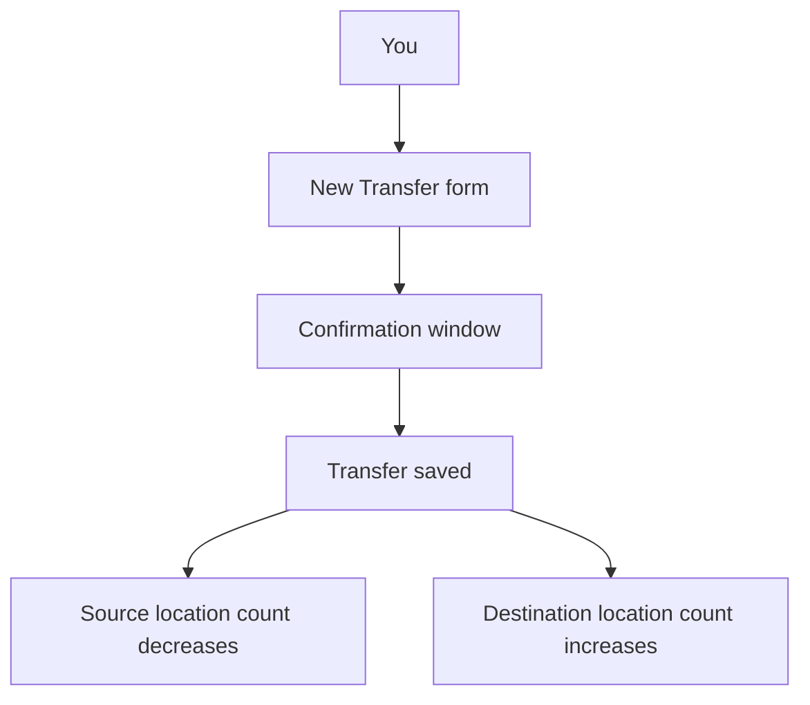

# Transfers

> **Status**: ✅ Active
> **Generated**: 2026-10-24T00:00:00Z
> **Last Updated**: 2026-10-24T00:00:00Z
---

## Overview

### What It Does
Transfers let your bank move supplies from one storage location to another — for example, from your main warehouse to a satellite closet. When you save a transfer, inventory counts at both locations update automatically; your organization's overall totals never change, because the items only change address.

### Why It Exists
Banks keep inventory in more than one place. Transfers give you an accurate, auditable record of internal moves without having to manually adjust two locations.

### Key Capabilities
- Move one or more items (with quantities) between two of your storage locations
- Review a confirmation summary of items and quantities before anything is saved
- Browse and filter past transfers by source location, destination location, and date range
- Export your transfer history to a spreadsheet (CSV)
- Delete a mistaken transfer — the inventory is put back automatically

---

## Architecture

### High-Level Design

### Components
From your point of view, the feature has three screens:

| Component | Where | Purpose |
|-----------|-------|---------|
| Transfers list | Transfers page | Filter, review, export, and delete transfers |
| New Transfer form | **New Transfer** button | Choose From/To locations, items, quantities, and a comment |
| Transfer detail | View action on a row | See every item, quantity, the total, and the comment |

### Technology Stack
Everything runs inside your bank's web portal — no extra software or setup is needed. Barcode scanning is supported when entering items.

---

## Model Details

A transfer is made of a few simple pieces of information:

- **From location** — where the items leave.
- **To location** — where the items arrive. Must be different from the From location, and both must belong to your organization.
- **Items and quantities** — one or more lines, each with an item and how many of it to move (at least 1). If you enter the same item twice, the lines are merged automatically.
- **Comment** (optional) — a note for your records, shown on the detail page and in exports.
- **Date** — recorded automatically when you save.

Rules the system checks for you:
- The From location must actually hold enough of each item. If it doesn't, the transfer is rejected and the message names the item(s) that fell short.
- A transfer cannot go from a location to itself.

---

## Database Schema

You don't need to know how transfers are stored, but it may help to know **what is kept** for each transfer: the From location, the To location, your comment, the date it was created, and the list of items with quantities. Nothing else is recorded, and transfers never change once saved.

---

## API Endpoints

These are the things you can do, and where:

| What you do | Where |
|-------------|-------|
| See all transfers (with filters) | Transfers page |
| Download your transfers as CSV | **Export Transfers** button on the Transfers page |
| Start a new transfer | **New Transfer** button |
| Save a transfer | Confirmation window → **Yes, it's correct** |
| See one transfer's details | View action on a row |
| Delete a transfer | Delete action on a row (asks you to confirm) |

There is deliberately **no edit** option — to correct a transfer, delete it and create a new one.

---

## Authorization (Pundit)

You need to be signed in as a user of your organization's bank account. Any bank user in your organization can create, view, export, and delete transfers; there are no extra per-person transfer permissions.

---

## Configuration

Nothing to configure. The locations offered when creating a transfer are your organization's active storage locations, and the items offered are your organization's active items.

---

## Usage Examples

### Moving stock to a satellite closet
1. Open **Transfers** and click **New Transfer**.
2. Pick the **From storage location** and the **To storage location**.
3. Add each item and quantity; click **Add Another Item** for more lines (or scan barcodes).
4. Optionally add a **Comment** such as "Restock for July drive".
5. Submit — a **Transfer Confirmation** window lists everything. Click **Yes, it's correct** to save, or **No, I need to make changes** to go back.
6. You'll see a message like "25 items have been transferred from Main Warehouse to East Closet!"

### Undoing a mistake
Find the transfer in the list, click the delete action, and confirm. The quantities return to the original From location, and you'll see "Successfully deleted Transfer #12!".

---

## Testing

Before a transfer is saved, the system itself tests it: locations must differ and belong to your organization, every quantity must be at least 1, and the From location must have enough stock. You also get a final visual check in the confirmation window.

---

## Known Issues & Caveats

| Caveat | What it means for you |
|--------|----------------------|
| Transfers can't be edited | Delete and re-create to fix a mistake |
| Deletion can be blocked | If an inventory audit was finalized at either location after the transfer, it can no longer be deleted — you'll see "We can't delete this transfer because its items were audited since you made the transfer." |
| Empty comments show as "none" | In the list and the CSV export, a blank comment appears as the word "none" |
| Filters only list used locations | The From/To filter dropdowns show only locations that have actually appeared in a transfer |

---

## Performance

Transfers take effect immediately — the moment you confirm, both locations' counts are up to date. Exports include exactly the transfers matching your current filters.

---

## Troubleshooting

### Issue: "location has insufficient inventory for …"
**Symptoms:** The form comes back with a red message naming one or more items.
**Cause:** The From location doesn't hold as much of those items as you tried to move.
**Solution:** Lower the quantity, or restock the From location first.

### Issue: Can't delete an old transfer
**Symptoms:** "We can't delete this transfer because its items were audited since you made the transfer."
**Cause:** An audit at one of the two locations was finalized after the transfer; deleting it would corrupt audited counts.
**Solution:** Leave the record in place and correct inventory with a new transfer in the opposite direction, or an adjustment.

### Issue: A location is missing from the New Transfer dropdowns
**Cause:** Only active storage locations are offered.
**Solution:** Reactivate the location, or choose another.

---

## Related Features

- **Storage Locations** — the places transfers move inventory between; check a location's page to see its current stock
- **Adjustments** — for correcting counts at a single location (rather than moving between two)
- **Audits** — finalized audits lock the transfers that happened before them against deletion
- **Reports** — transfers don't change incoming/outgoing totals, so distribution and donation reports are unaffected

---

**Generated:** 2026-10-24T00:00:00Z
**Last Updated:** 2026-10-24T00:00:00Z
**Status:** ✅ Active
