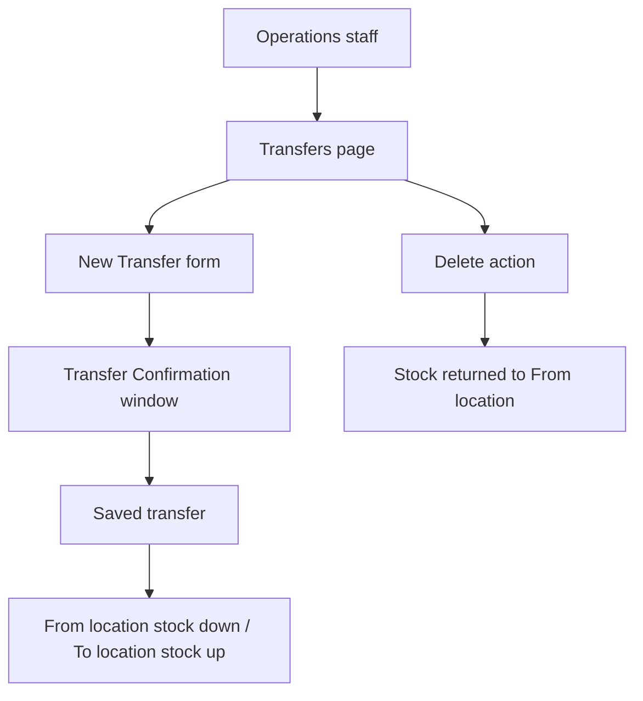

# Transfers

> **Status**: ✅ Active
> **Generated**: 2026-10-24T00:00:00Z
> **Last Updated**: 2026-10-24T00:00:00Z
---

## Overview

### What It Does
This document is for operations staff. Transfers move chosen quantities of items from one storage location (**From**) to another (**To**) inside your organization. Saving a transfer updates both locations' inventory counts at once; deleting a transfer puts the quantities back.

### Why It Exists
When stock physically moves — warehouse to closet, closet to vehicle — the records must move with it. Transfers do both ends of that bookkeeping in one step.

### Key Capabilities
- Create a transfer with any number of item lines, including by barcode scan
- Confirm the exact item list in a review window before saving
- Filter the transfer history by From location, To location, and date range
- Export the (filtered) history to a CSV spreadsheet
- Permanently delete a mistaken transfer, which automatically reverses the stock movement

---

## Architecture

### High-Level Design

### Components
| Component | Where you see it | Purpose |
|-----------|------------------|---------|
| Transfers list | Inventory Transfers page | History table with **Transfer Filters** card, **Export Transfers**, **New Transfer** |
| New Transfer form | After clicking **New Transfer** | From/To selectors, Comment, "Items in this transfer" lines, **Add Another Item** |
| Transfer Confirmation window | After submitting the form | Final review: item names, quantities, note; **Yes, it's correct** / **No, I need to make changes** |
| Transfer detail page | View action on a row | Full item/quantity table with total and comments |

### Technology Stack
Web portal only. Barcode scanners can be used when adding item lines.

---

## Model Details

Each transfer records: From location, To location, optional comment, creation date, and item lines (item + quantity). Operational rules enforced at save time:

| Rule | Effect |
|------|--------|
| Locations must differ | "location must be different than from location" |
| Locations must be yours | "location must belong to organization" |
| Stock must cover quantities | "location has insufficient inventory for <items>" |
| Quantities at least 1 | Zero/blank quantity lines are rejected |
| Duplicate item lines | Merged automatically into one line with the summed quantity |

Transfers are never editable after saving.

---

## Database Schema

For audit purposes, know that the system permanently stores per transfer: source location, destination location, comment, date, and every item with its moved quantity. Deleted transfers are removed from the list and their movement reversed.

---

## API Endpoints

Day-to-day operations map to these actions:

| Operation | How |
|-----------|-----|
| Review history | Open **Transfers**; columns: From, To, Date, Comment, Total Moved, Actions |
| Narrow history | **Transfer Filters**: "From this storage location", "To this storage location", "Date Range"; click **Filter** |
| Export | **Export Transfers** (visible only when the list is non-empty); downloads `Transfers-<date>.csv` |
| Create | **New Transfer** → fill form → submit → confirm |
| Inspect | View action on a row |
| Delete | Delete action on a row → confirm "Are you sure you want to permanently remove this transfer?" |

---

## Authorization (Pundit)

You must be signed in to your organization's bank account. All bank users of the organization can perform every transfer operation; there is no separate transfer-specific permission to request.

---

## Configuration

No settings pages for transfers. Note for setup staff: only **active** storage locations and items are offered on the New Transfer form, so keep location and item records current.

---

## Usage Examples

### Standard transfer procedure
1. Go to **Transfers** and click **New Transfer**.
2. Select **From storage location** — where the items are coming from.
3. Select **To storage location** — where the items are going (must differ from From).
4. Optionally enter a **Comment** (e.g., shipment reference or reason).
5. Under **Items in this transfer**, choose an item and enter a quantity of at least 1. Use **Add Another Item** for additional lines, or scan barcodes.
6. Submit. In the **Transfer Confirmation** window, verify every item and quantity.
7. Click **Yes, it's correct** to save (or **No, I need to make changes** to go back).

**Expected result:** You return to the list with a message such as "25 items have been transferred from Main Warehouse to East Closet!" Both locations are already updated.

### Reversing an erroneous transfer
1. Locate the transfer in the list (use filters if needed).
2. Click the delete action and confirm the prompt.

**Expected result:** "Successfully deleted Transfer #<number>!" and the quantities are back at the From location.

---

## Testing

Before committing a transfer, the system checks your locations, quantities, and available stock, and shows the confirmation window as a final manual check. Make the confirmation review part of your standard procedure — it is the last chance to catch a wrong quantity before inventory moves.

---

## Known Issues & Caveats

| Caveat | Operational impact |
|--------|--------------------|
| No editing | Fix mistakes by delete + re-create, while deletion is still allowed |
| Audit lock | After a finalized audit of either location, the transfer can no longer be deleted ("We can't delete this transfer because its items were audited since you made the transfer.") — correct with a reverse transfer or adjustment instead |
| "none" comment | Blank comments print as "none" in the table and CSV |
| Filter dropdowns | Only show locations already used in at least one transfer |

---

## Performance

Transfers apply instantly on confirmation. CSV exports respect the filters currently applied, so filter first, then export, to get exactly the slice you need.

---

## Troubleshooting

### Issue: Form rejected with "location has insufficient inventory for …"
**Symptoms:** Red error naming one or more items; form re-shown.
**Cause:** The From location holds less of those items than the quantities entered.
**Solution:** Reduce quantities or restock the From location, then resubmit.

### Issue: Delete refused
**Symptoms:** "We can't delete this transfer because its items were audited since you made the transfer."
**Cause:** A finalized audit at either location postdates the transfer.
**Solution:** Do not force a deletion; record a compensating transfer or adjustment per your audit policy.

### Issue: Export Transfers button missing
**Cause:** The current filtered list has no transfers.
**Solution:** Clear or widen the filters.

---

## Related Features

- **Storage Locations** — maintain active locations and check stock levels before transferring
- **Adjustments** — single-location count corrections (use instead of a transfer when nothing moved)
- **Audits** — finalized audits freeze prior transfers at those locations against deletion
- **Reports** — internal transfers never affect incoming/outgoing report totals

---

**Generated:** 2026-10-24T00:00:00Z
**Last Updated:** 2026-10-24T00:00:00Z
**Status:** ✅ Active
