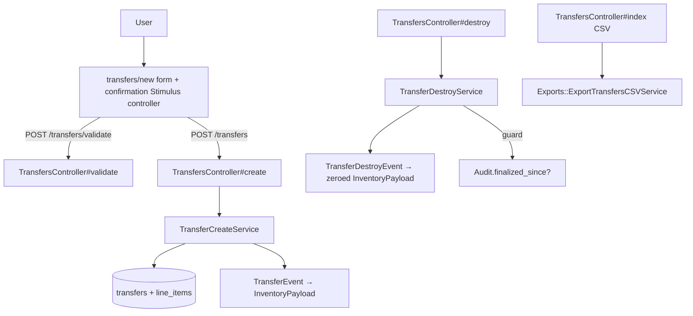
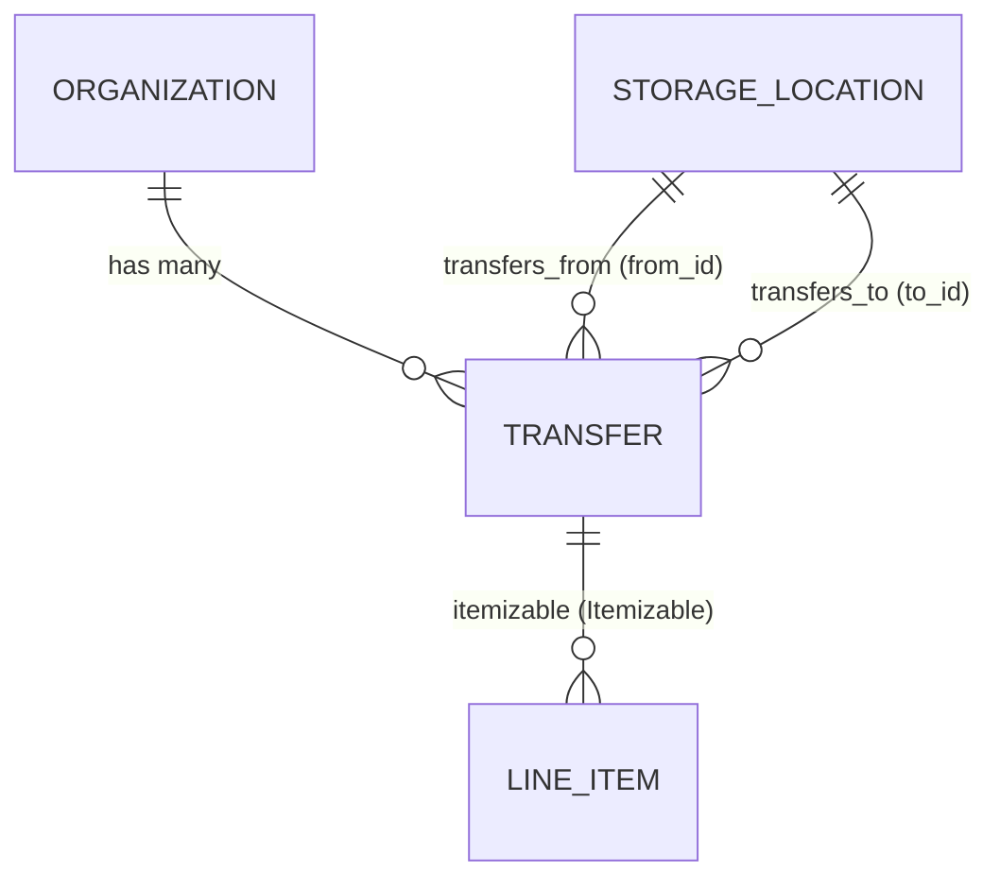

# Transfers

> **Status**: ✅ Active
> **Generated**: 2026-10-24T00:00:00Z
> **Last Updated**: 2026-10-24T00:00:00Z
---

## Overview

### What It Does
Transfers move quantities of inventory from one storage location to another within the same organization. The feature offers partial CRUD — create, list, view, and destroy, but no edit/update — and records every movement through the inventory event-sourcing system so both locations' quantities stay correct automatically.

### Why It Exists
Essentials banks store supplies in multiple places (warehouses, closets, vehicles). When stock physically moves between locations, the system must reflect that movement without changing organization-level totals and without manual adjustments at both ends.

### Key Capabilities
- Create a transfer of one or more items (with quantities) between two active storage locations, with a pre-submit confirmation modal
- Validate before saving: locations must differ, belong to the organization, and the source must hold sufficient inventory
- Filter the transfer list by source location, destination location, and date range
- Export filtered transfers to CSV with one column per organization item
- Delete a transfer (reversing its inventory movement) unless a finalized audit has since touched either location

---

## Architecture

### High-Level Design


### Components

#### Backend Components
| Component | File Path | Purpose |
|-----------|-----------|---------|
| `TransfersController` | `app/controllers/transfers_controller.rb` | index, new, create, show, destroy, validate |
| `Transfer` | `app/models/transfer.rb` | Model with associations, scopes, validations |
| `TransferCreateService` | `app/services/transfer_create_service.rb` | Transactional save + `TransferEvent.publish` |
| `TransferDestroyService` | `app/services/transfer_destroy_service.rb` | Audit guard, reversal event, destroy; returns `Result` |
| `Exports::ExportTransfersCSVService` | `app/services/exports/export_transfers_csv_service.rb` | CSV with base + per-item columns |
| `TransferEvent` | `app/events/transfer_event.rb` | Publishes inventory movement (from → to) |
| `TransferDestroyEvent` | `app/events/transfer_destroy_event.rb` | Publishes zeroed line items (reversal) |

#### Frontend Components
| Component | File Path | Purpose |
|-----------|-----------|---------|
| Index view | `app/views/transfers/index.html.erb` | Filters card, table, Export/New buttons |
| Row partial | `app/views/transfers/_transfer_row.html.erb` | From/To/Date/Comment/Total + delete/view actions |
| New form | `app/views/transfers/new.html.erb` | simple_form, line-items fieldset, barcode capture, confirmation modal shell |
| Validate modal | `app/views/transfers/_validate_modal.html.erb` | Item/quantity review, "Yes, it's correct" / "No, I need to make changes" |
| Show view | `app/views/transfers/show.html.erb` | Item/quantity table with total and comment |

Client behavior uses a Stimulus `confirmation` controller (`data-confirmation-pre-check-path-value="<%= validate_transfers_path(format: :json) %>"`) and `data-capture-barcode="true"` on the line-items container with the shared `barcode_items/barcode_modal` partial.

### Technology Stack
- **Backend**: Rails controller + POROs (service objects returning `Result`), PaperTrail versioning, event-sourced inventory (`Event` subclasses with `EventTypes::InventoryPayload`)
- **Frontend**: ERB + simple_form, Stimulus confirmation controller, Bootstrap modal, barcode capture
- **Database**: PostgreSQL, `transfers` table + shared `line_items`

---

## Model Details

### Transfer

#### Associations
```ruby
has_paper_trail
belongs_to :organization, inverse_of: :transfers
belongs_to :from, class_name: "StorageLocation", inverse_of: :transfers_from
belongs_to :to, class_name: "StorageLocation", inverse_of: :transfers_to

# to make it play nice with Itemizable - alias of `from`
belongs_to :storage_location, class_name: "StorageLocation", inverse_of: :transfers_from, foreign_key: :from_id
```

#### Concerns
| Concern | Purpose |
|---------|---------|
| `Itemizable` | Nested `line_items` (accepts `line_items_attributes`), `combine!`, `total`, `sorted`, `line_items_quantity_is_at_least` |
| `Filterable` | `class_filter` used by `index` with permitted filter scopes |

PaperTrail (`has_paper_trail`) records versions of transfer records.

#### Callbacks
No model callbacks are defined on `Transfer` itself; lifecycle side effects (event publication) live in the services.

#### Scopes
| Scope | Definition |
|-------|-----------|
| `from_location(location_id)` | `where(from_id: location_id)` |
| `to_location(location_id)` | `where(to_id: location_id)` |
| `during(range)` | `where(created_at: range)` |

#### Validations (custom)
| Validation | Behavior |
|-----------|----------|
| `storage_locations_belong_to_organization` | Adds "location must belong to organization" on `:from`/`:to` if either is not among the organization's storage locations |
| `storage_locations_must_be_different` | Adds "location must be different than from location" on `:to` when `from_id == to_id` |
| `from_storage_quantities` | Via `View::Inventory.new(organization_id)`, selects line items with `quantity > inventory.quantity_for(item_id:)`; adds "location has insufficient inventory for <names>" on `:from` |
| `line_items_quantity_is_positive` | Delegates to `line_items_quantity_is_at_least(1)` |

#### Key Methods
| Method | Returns | Purpose | Notes |
|--------|---------|---------|-------|
| `insufficient_items` | `Array<LineItem>` | Line items exceeding available inventory | Private; drives the insufficiency error message |

---

## Database Schema

### transfers

| Column | Type | Default | Notes |
|--------|------|---------|-------|
| `id` | `integer (serial)` | — | Primary key |
| `from_id` | `integer` | — | Source `StorageLocation` |
| `to_id` | `integer` | — | Destination `StorageLocation` |
| `comment` | `string` | — | Optional note |
| `created_at` | `datetime` | — | `null: false`; used by `during` scope and display |
| `updated_at` | `datetime` | — | `null: false` |
| `organization_id` | `integer` | — | Indexed (`index_transfers_on_organization_id`) |

### Relationships


---

## API Endpoints

Routes: `resources :transfers, only: %i(index create new show destroy)` plus `post :validate, on: :collection` (`config/routes.rb:124`). All actions verified in the controller.

| Method | Path | Action | Description | Notes |
|--------|------|--------|-------------|-------|
| `GET` | `/transfers` | `index` | Filterable list; `format.csv` streams `Transfers-<date>.csv` | Filters: `from_location`, `to_location`, date range |
| `GET` | `/transfers/new` | `new` | Form with active, alphabetized locations and items | |
| `POST` | `/transfers` | `create` | `combine!` line items, `TransferCreateService.call`; redirect with success notice; rescues to re-render `new` with `flash.now[:error]` | |
| `GET` | `/transfers/:id` | `show` | Detail with sorted line items and total | |
| `DELETE` | `/transfers/:id` | `destroy` | `TransferDestroyService`; notice "Successfully deleted Transfer #id!" or error flash; redirects to index | |
| `POST` | `/transfers/validate` | `validate` | JSON pre-check: `{valid: true, body: <modal html>}` or `{valid: false}` with 422 (`unprocessable_content`) | Used by confirmation modal |

Strong params: `permit(:from_id, :to_id, :comment, line_items_attributes: %i(item_id quantity _destroy))`; filters: `permit(:from_location, :to_location)`.

---

## Authorization (Pundit)

No Pundit policy exists for transfers. Access control is organization scoping only: every query goes through `current_organization.transfers`, and bank users of the organization can perform all transfer actions.

| Method | Permission | Conditions | Notes |
|--------|------------|------------|-------|
| — | Organization membership | Records scoped to `current_organization` | No per-action policy methods |

---

## Configuration

### Environment Variables
None specific to transfers.

### Config Files
None specific to transfers; routing in `config/routes.rb`.

---

## Usage Examples

### Creating a transfer (service invariant)
```ruby
# Source: app/services/transfer_create_service.rb
def call(transfer)
  if transfer.valid?
    ActiveRecord::Base.transaction do
      transfer.save
      TransferEvent.publish(transfer)
    end
  else
    raise StandardError.new(transfer.errors.full_messages.join(", "))
  end
end
```

### Guarded destroy
```ruby
# Source: app/services/transfer_destroy_service.rb
def call
  if Audit.finalized_since?(transfer, transfer.to_id, transfer.from_id)
    raise "We can't delete this transfer because its items were audited since you made the transfer."
  end

  transfer.transaction do
    TransferDestroyEvent.publish(transfer)
    transfer.destroy!
  end

  Result.new
rescue StandardError => e
  Result.new(error: e)
end
```

### Event publication (movement payload)
```ruby
# Source: app/events/transfer_event.rb
create(
  eventable: transfer,
  group_id: "transfer-#{transfer.id}-#{SecureRandom.hex}",
  organization_id: transfer.organization_id,
  event_time: Time.zone.now,
  data: EventTypes::InventoryPayload.new(
    items: EventTypes::EventLineItem.from_line_items(transfer.line_items,
      from: transfer.from.id,
      to: transfer.to.id)
  )
)
```

---

## Testing

### Test Files
- `spec/models/transfer_spec.rb`
- `spec/controllers/transfers_controller_spec.rb`
- `spec/requests/transfers_requests_spec.rb`
- `spec/services/transfer_destroy_service_spec.rb`
- `spec/system/transfer_system_spec.rb`
- `spec/factories/transfers.rb`

---

## Known Issues & Caveats

| Issue | Location | Description |
|-------|----------|-------------|
| No edit/update | `config/routes.rb:124` | Partial CRUD by design; corrections require delete + re-create |
| Inactive items on re-render | `transfers_controller.rb` (`load_form_collections`) | Error re-render loads `items.alphabetized` without `.active`, unlike `new` which uses `items.active.alphabetized` |
| CSV skips unknown items | `export_transfers_csv_service.rb` (`build_row_data`) | `next unless item_column_idx` silently drops line items whose item name is not among headers |
| Comment placeholder | CSV service / row partial | Blank comments render as the literal string "none" |
| Destroy guard scope | `transfer_destroy_service.rb` | Deletion is blocked by any finalized audit on either location since the transfer, even for unrelated items |

---

## Performance

### Optimization Strategies
- `index` and `show` eager-load `line_items`, `from`, `to` (and `items` on show) to avoid N+1
- CSV export reuses the filtered relation with `includes(line_items: :item)`
- Filter dropdowns limited via `StorageLocation.with_transfers_from/to`

### Caching
- None specific to transfers.

### Database Optimization
- Index: `index_transfers_on_organization_id`

---

## Troubleshooting

### Issue: Transfer creation fails with "location has insufficient inventory for …"
**Symptoms:**
- Form re-renders with the error flash naming item(s)

**Cause:**
`from_storage_quantities` found line items whose quantity exceeds `View::Inventory#quantity_for` for the organization.

**Solution:**
Reduce the requested quantities or replenish the source location, then resubmit.

### Issue: Cannot delete a transfer
**Symptoms:**
- Error flash: "We can't delete this transfer because its items were audited since you made the transfer."

**Cause:**
`Audit.finalized_since?(transfer, to_id, from_id)` is true — a finalized audit touched either location after the transfer.

**Solution:**
Do not delete; correct inventory with a reverse transfer or an adjustment consistent with the audit.

---

## Related Features

- **Storage Locations** — source/destination of every transfer; provide inventory levels checked at validation
- **Inventory Events** — `TransferEvent`/`TransferDestroyEvent` feed the event-sourced inventory aggregate
- **Audits** — finalized audits freeze transfer deletion for affected locations
- **Items** — line items reference organization items; CSV emits one column per item

---

**Generated:** 2026-10-24T00:00:00Z
**Last Updated:** 2026-10-24T00:00:00Z
**Status:** ✅ Active
