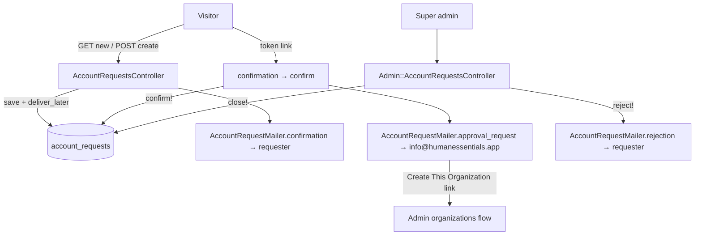
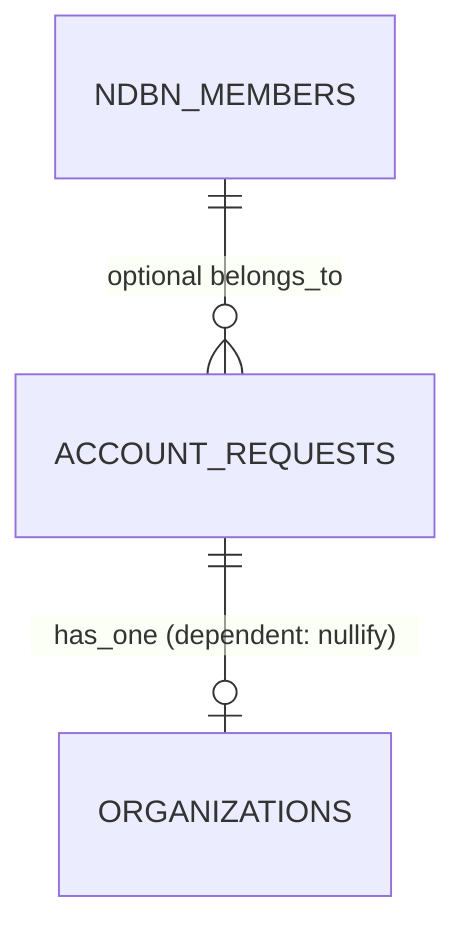

# Account Requests

> **Status**: ✅ Active
> **Generated**: 2026-10-24T00:00:00Z
> **Last Updated**: 2026-10-24T00:00:00Z
---

## Overview

### What It Does
The account-requests feature is the onboarding pipeline for new essentials banks. Unauthenticated visitors submit a vetted request form (reCAPTCHA-protected), prove email ownership by clicking a JWT-signed confirmation link, and super admins triage the resulting queue: approving requests into organizations, rejecting them with an emailed reason, or closing them administratively.

### Why It Exists
Organizations on Human Essentials are not self-service — each bank is manually vetted by the team. Account requests capture the application, filter out partner agencies (whose accounts are created by their banks), verify the applicant's email, and keep an auditable record of every decision.

### Key Capabilities
- Public request form with bank/partner self-identification, optional NDBN membership, and reCAPTCHA
- Email confirmation round-trip using non-expiring HS256 JWT identity tokens
- Admin triage queue split into open (started/user_confirmed) and closed (admin_approved/rejected/admin_closed) sets
- Reject-with-reason (requester emailed) vs. admin close (silent)
- Ops notification with one-click approve/reject links sent to info@humanessentials.app on confirmation

---

## Architecture

### High-Level Design


### Components

#### Backend Components
| Component | File Path | Purpose |
|-----------|-----------|---------|
| `AccountRequestsController` | `app/controllers/account_requests_controller.rb` | Public `new/create/received/confirmation/confirm/invalid_token`; skips all auth filters; `devise` layout |
| `Admin::AccountRequestsController` | `app/controllers/admin/account_requests_controller.rb` | `index/for_rejection/reject/close`; inherits `AdminController` |
| `AccountRequest` | `app/models/account_request.rb` | Validations, status enum, scopes, JWT token methods, `confirm!/reject!/close!` |
| `AccountRequestMailer` | `app/mailers/account_request_mailer.rb` | Three mail actions, all invoked with `deliver_later` |

> Checklist: no services, jobs, Pundit policies, search classes, broadcasters, ViewComponents, form objects, or Liquid drops belong to this feature. The only model concern-like inclusion is the `has_paper_trail` macro.

#### Frontend Components
| Component | File Path | Purpose |
|-----------|-----------|---------|
| Request form | `app/views/account_requests/new.html.erb` | Bank/partner radio gate (CSS `:has`), simple_form fields, `recaptcha_tags`; staging shows a redirect card instead |
| Received page | `app/views/account_requests/received.html.erb` | "Request Received!" + spam warning for no-reply@humanessentials.app |
| Confirmation page | `app/views/account_requests/confirmation.html.erb` | "Are you ready to get started?" → "I'm ready! Let's go!" link |
| Confirm page | `app/views/account_requests/confirm.html.erb` | "Confirmed! We will be processing your request now." |
| Invalid token page | `app/views/account_requests/invalid_token.html.erb` | "invalid, confirmed already, or processed already" |
| Admin index | `app/views/admin/account_requests/index.html.erb` | Open + closed tables, Kaminari pagination |
| Row partial | `app/views/admin/account_requests/_open_account_request.html.erb` | Reject / Close (Admin) `js_button`s |
| Rejection modal | `app/views/admin/account_requests/_rejection_modal.html.erb` | Shared modal; jQuery sets form action to `/admin/account_requests/${modal}`; blank-reason guard |
| For-rejection page | `app/views/admin/account_requests/for_rejection.html.erb` | Token-resolved single request or "Account Request not found!" |
| Mailer views | `app/views/account_request_mailer/` | confirmation / approval_request / rejection in HTML + text |

### Technology Stack
- **Backend**: Rails, ActiveRecord enum + scopes, `JWT` gem (HS256 signed with `Rails.application.secret_key_base`), PaperTrail, recaptcha gem, ActionMailer + ActiveJob
- **Frontend**: ERB, simple_form, Bootstrap-style modal, jQuery, Kaminari
- **Database**: `account_requests` table
- **External Services**: Google reCAPTCHA; SMTP (no-reply@humanessentials.app)

---

## Model Details

### AccountRequest

#### Associations
```ruby
belongs_to :ndbn_member, class_name: 'NDBNMember', optional: true
has_one :organization, dependent: :nullify
```

#### Concerns
| Concern | Purpose |
|---------|---------|
| `has_paper_trail` | Full version history of every request |

#### Callbacks
None declared. Side-effects (emails, timestamps) are triggered imperatively by `confirm!`, `reject!`, and the controllers.

#### State Machines (if applicable)
```ruby
enum :status, %w[started user_confirmed admin_approved rejected admin_closed].map { |v| [v, v] }.to_h

scope :requested, -> { where(status: %w[started user_confirmed]) }
scope :closed, -> { where(status: %w[admin_approved rejected admin_closed]) }
```
Note: only `close!` enforces a `from:` constraint (`can_be_closed?`). `confirm!` and `reject!` perform unconditional `update!`s; re-confirmation is prevented at the controller layer, not the model.

#### Key Methods
| Method | Returns | Purpose | Notes |
|--------|---------|---------|-------|
| `identity_token` | String | `JWT.encode({ account_request_id: id }, Rails.application.secret_key_base, 'HS256')` | Raises `'must have an id'` unless persisted; no expiry claim |
| `.get_by_identity_token(token)` | AccountRequest / nil | Decode-and-find | `rescue StandardError` → `nil` |
| `confirmed?` | Boolean | `user_confirmed? \|\| admin_approved?` | |
| `processed?` | Boolean | `organization.present?` | Organization created from the request |
| `can_be_closed?` | Boolean | `started? \|\| user_confirmed?` | |
| `confirm!` | — | `update!(confirmed_at: Time.current, status: 'user_confirmed')` + approval_request email | |
| `reject!(reason)` | — | status `rejected`, stores `rejection_reason`, rejection email | |
| `close!(reason)` | — | status `admin_closed`, reason into `rejection_reason` | Raises `'Cannot be closed from this state'` unless closable; no email |

#### Validations
| Field | Rule |
|---|---|
| `name` | presence |
| `email` | presence; uniqueness; `format: URI::MailTo::EMAIL_REGEXP` |
| `request_details` | presence; `length: { minimum: 50 }` |
| `organization_website` | `format: URI::DEFAULT_PARSER.make_regexp`, message `"should look like 'https://www.example.com'"`, `allow_blank: true` |
| custom | `email_not_already_used_by_organization` — error `already used by an existing Organization` |
| custom | `email_not_already_used_by_user` — error `already used by an existing User`; **returns early when `rejected?` or `admin_closed?`** |

---

## Database Schema

### account_requests

| Column | Type | Default | Notes |
|--------|------|---------|-------|
| `id` | `bigint` | — | Primary key |
| `confirmed_at` | `datetime` | NULL | Set by `confirm!` |
| `email` | `string` | — | not null |
| `name` | `string` | — | not null |
| `organization_name` | `string` | — | not null |
| `organization_website` | `string` | NULL | optional |
| `rejection_reason` | `string` | NULL | shared by reject and close |
| `request_details` | `text` | — | not null; ≥50 chars by validation |
| `status` | `string` | `"started"` | not null |
| `created_at` | `datetime` | — | not null |
| `updated_at` | `datetime` | — | not null |
| `ndbn_member_id` | `bigint` | NULL | optional association |

### Relationships


---

## API Endpoints

> Derived from path helpers used in the code (`received_account_requests_path`, `confirmation_account_requests_url`, `for_rejection_admin_account_requests_url`, etc.); every action listed exists in a controller.

| Method | Path | Action | Description | Notes |
|--------|------|--------|-------------|-------|
| `GET` | `/account_requests/new` | `new` | Request form | Public; staging env renders a redirect card |
| `POST` | `/account_requests` | `create` | Submit | reCAPTCHA gate → `"Invalid captcha submission"` flash on failure |
| `GET` | `/account_requests/received?token=` | `received` | Post-submit page | Token-guarded |
| `GET` | `/account_requests/confirmation?token=` | `confirmation` | Email landing page | Token-guarded |
| `GET` | `/account_requests/confirm?token=` | `confirm` | Executes `confirm!` | Token-guarded |
| `GET` | `/account_requests/invalid_token` | `invalid_token` | Token failure page | |
| `GET` | `/admin/account_requests` | `index` | Triage queue | Params `open_page` / `close_page`, 15 per page |
| `GET` | `/admin/account_requests/for_rejection?token=` | `for_rejection` | Single request from ops email | |
| `POST` | `/admin/account_requests/reject` | `reject` | Reject with reason | Notice `"Account request rejected!"` |
| `POST` | `/admin/account_requests/close` | `close` | Close with reason | Notice `"Account request closed!"`; rescued errors flash as alert |

Token guard (`set_account_request_from_token`, applied to `received/confirmation/confirm`): redirects to `invalid_token_account_requests_path` when the token is unresolvable or the request is already `confirmed?` or `processed?`.

---

## Authorization (Pundit)

No Pundit policy for this feature.

| Method | Permission | Conditions | Notes |
|--------|------------|------------|-------|
| `new/create/received/confirmation/confirm/invalid_token` | none | — | `skip_before_action :authorize_user, :authenticate_user!, :require_organization` |
| `index/for_rejection/reject/close` | super admin | — | via `AdminController` base class |

---

## Configuration

### Environment Variables
```bash
SECRET_KEY_BASE=...        # signs/verifies identity JWTs
# reCAPTCHA keys           # consumed by the recaptcha gem's verify_recaptcha
```

### Config Files
- None feature-specific.

---

## Usage Examples

### Strong parameters (public vs admin)
```ruby
# Source: app/controllers/account_requests_controller.rb
params.require(:account_request).permit(:name, :email, :organization_name, :organization_website, :request_details, :ndbn_member_id)

# Source: app/controllers/admin/account_requests_controller.rb
params.require(:account_request).permit(:id, :rejection_reason)
```

### Confirm transition
```ruby
# Source: app/models/account_request.rb
def confirm!
  update!(confirmed_at: Time.current, status: 'user_confirmed')
  AccountRequestMailer.approval_request(account_request_id: id).deliver_later
end
```

### Admin index queries
```ruby
# Source: app/controllers/admin/account_requests_controller.rb
@open_account_requests = AccountRequest.requested.order('created_at DESC')
  .page(params[:open_page]).per(15)
@closed_account_requests = AccountRequest.closed.order('updated_at DESC')
  .page(params[:close_page]).per(15)
```

---

## Testing

### Test Files
- Not globbed during this pass; verify under `spec/` before citing.

---

## Known Issues & Caveats

| Issue | Location | Description |
|-------|----------|-------------|
| Non-expiring JWT | `identity_token` | No `exp` claim; replay is blocked only by the `confirmed?`/`processed?` redirect |
| Unguarded `reject!` | model | Can be called from any status (no `can_be_rejected?`), e.g. re-rejecting a closed request via a stale page |
| Silent close | `close!` | No requester email, by design; reason still stored in `rejection_reason` |
| `admin_approved` set elsewhere | enum | This feature never writes `admin_approved`; the admin organizations flow consumes the token (`new_admin_organization_url(token:)`) |
| Demo credentials mailed broadly | `confirmation` mailer views | `org_admin1@example.com` / `password!` and `verified@example.com` / `password!` for staging.humanessentials.app; data resets daily 6 AM EST |
| Full attribute dump | `approval_request` views | Iterates `@account_request.attributes` — every column is emailed |
| Email-reuse window | `email_not_already_used_by_user` | Skipped for rejected/closed requests, so terminal requests don't block reusing the address |
| Staging short-circuit | `new.html.erb` | `Rails.env.staging?` hides the form and links to production |
| Closed-table markup | `index.html.erb` | Closed rows' `<tr>` open/close tags are misnested inside the loop (renders, but invalid HTML) |

---

## Performance

### Optimization Strategies
- Kaminari pagination at 15 rows per table with independent page params (`open_page`, `close_page`).

### Caching
- **Cache Layer**: none.

### Database Optimization
- Indexes: confirm in `db/schema.rb` (not read in this pass); only `id` and the `ndbn_member_id` association are certain.

---

## Troubleshooting

### Issue: Confirmation link always lands on the "Sorry" page
**Symptoms:**
- "The account request is either invalid, confirmed already, or processed already."

**Cause:**
JWT fails to decode (truncated link, wrong secret across environments) or the request is already `user_confirmed`/`admin_approved`/has an organization.

**Solution:**
Verify the request status in the admin queue; if genuinely pending, have the requester copy the entire URL from the email.

### Issue: "Invalid captcha submission" on every submit
**Cause:**
`verify_recaptcha(model: @account_request)` failing — missing keys or unanswered widget.

**Solution:**
Check reCAPTCHA configuration and complete the widget before submitting.

### Issue: Close fails with "Cannot be closed from this state"
**Cause:**
`close!` raises unless the request is `started` or `user_confirmed`.

**Solution:**
Refresh the admin index — the request was already finalized; the alert shows the raised message.

---

## Related Features

- **Admin organizations** — approval endpoint; creates the `Organization` from the request token and flips the request to processed.
- **NDBN members** — source of the optional "NDBN Membership" select on the form.
- **Users & authentication** — email collision checks against `User`; approved banks get user invitations.

---

**Generated:** 2026-10-24T00:00:00Z
**Last Updated:** 2026-10-24T00:00:00Z
**Status:** ✅ Active
