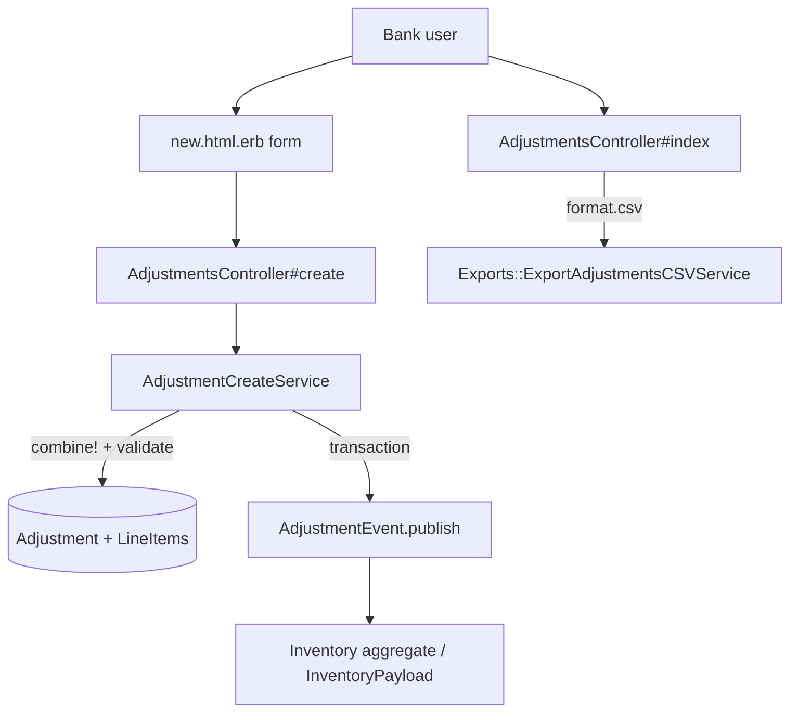
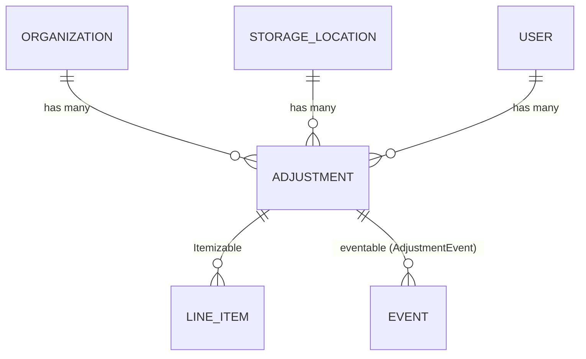

# Adjustments

> **Status**: ✅ Active
> **Generated**: 2026-10-24T00:00:00Z
> **Last Updated**: 2026-10-24T00:00:00Z
---

## Overview

### What It Does
The Adjustments feature lets an Essentials Bank record manual corrections to inventory quantities at a single storage location. Each adjustment holds one or more line items with signed quantities (positive = add, negative = remove), a free-text comment, and the creating user. Persisting an adjustment publishes an `AdjustmentEvent`, so the actual inventory change flows through the event-sourced inventory aggregate.

### Why It Exists
Per the controller's own comment, adjustments "are the way that Essentials Banks fix incorrect inventory totals at Storage Locations" — recounts, damage, loss, and entry mistakes all require the recorded totals to be corrected without faking a donation or distribution. The deliberately limited CRUD (no update/destroy) keeps the correction history immutable.

### Key Capabilities
- Create multi-item, mixed-sign adjustments against an active storage location of the organization
- List adjustments newest-first with filters: storage location, user, date range; paginated
- Show a single adjustment with Added/Removed per line item
- Export filtered adjustments to CSV (`Adjustments-<today>.csv`) with a column per organization item
- Barcode-assisted item entry on the form

---

## Architecture

### High-Level Design


### Components

#### Backend Components
| Component | File Path | Purpose |
|-----------|-----------|---------|
| `AdjustmentsController` | `app/controllers/adjustments_controller.rb` | `index` (HTML + CSV), `show`, `new`, `create`; filter params helper |
| `Adjustment` | `app/models/adjustment.rb` | Associations, concerns, scopes, org-ownership validation, `split_difference`, `generate_csv` |
| `AdjustmentCreateService` | `app/services/adjustment_create_service.rb` | Combines line items, validates, saves and publishes the event transactionally |
| `AdjustmentEvent` | `app/events/adjustment_event.rb` | Creates the event row with an `InventoryPayload` targeting the storage location |
| `Exports::ExportAdjustmentsCSVService` | `app/services/exports/export_adjustments_csv_service.rb` | CSV generation (headers, per-item quantity columns) |

> Checklist: no nested controllers, STI subclasses, policies, jobs/workers, search classes, broadcasters, ViewComponents, form objects, or Liquid drops belong to this feature. Concerns are listed below.

#### Frontend Components
| Component | File Path | Purpose |
|-----------|-----------|---------|
| Index | `app/views/adjustments/index.html.erb` | "Adjustment Filters" card, results table, Kaminari pagination, Export/New buttons |
| New | `app/views/adjustments/new.html.erb` | simple_form (`id: 'new_adjustment'`, Stimulus `form-input`), storage-location source partial, line-item fields with `data-capture-barcode="true"`, barcode modal |
| Show | `app/views/adjustments/show.html.erb` | Added/Removed table with `positive`/`negative` row classes; org, location, comments |

### Technology Stack
- **Backend**: Rails MVC + service object + event sourcing (`Event`, `EventTypes::InventoryPayload`, `EventTypes::EventLineItem`)
- **Frontend**: ERB/AdminLTE cards, simple_form, shared `shared/date_range_picker`, `line_items/line_item_fields` partials, Kaminari
- **Database**: ActiveRecord; PaperTrail (`has_paper_trail`) on the model
- **External Services**: none

---

## Model Details

### Adjustment

#### Associations
```ruby
belongs_to :organization
belongs_to :storage_location
belongs_to :user
```
(No `dependent:` options are declared.)

#### Concerns
| Concern | Purpose |
|---------|---------|
| `Exportable` | Shared CSV-export plumbing |
| `Itemizable` | `line_items` association with signed quantities; `line_items.combine!` merging |
| `Filterable` | `class_filter` dispatch to the scopes below |

Plus `has_paper_trail` (PaperTrail versioning).

#### Callbacks
None declared.

#### Scopes
```ruby
scope :at_location, ->(location_id) { where(storage_location_id: location_id) }
scope :by_user, ->(user_id) { where(user_id: user_id) }
scope :during, ->(range) { where(adjustments: { created_at: range }) }
```

#### Validations
- `validate :storage_locations_belong_to_organization` — no-op when `organization` is nil; otherwise requires `organization.storage_locations.include?(storage_location)`, else adds `storage_location: "storage location must belong to organization"`.

#### Key Methods
| Method | Returns | Purpose | Notes |
|--------|---------|---------|-------|
| `split_difference` | `[Adjustment, Adjustment]` | Returns new in-memory increasing and decreasing adjustments partitioned by quantity sign; decreasing quantities are multiplied by −1 | Inline comment warns this mutates the original adjustment's line items |
| `self.generate_csv` | CSV `String` or `nil` | `nil` when empty, else delegates to the export service with `adjustments.first.organization` | |

---

## Database Schema

### adjustments

| Column | Type | Default | Notes |
|--------|------|---------|-------|
| `id` | integer | — | Primary key, not null |
| `comment` | text | — | — |
| `created_at` | datetime | — | not null |
| `updated_at` | datetime | — | not null |
| `organization_id` | integer | — | — |
| `storage_location_id` | integer | — | — |
| `user_id` | bigint | — | — |

### Relationships


---

## API Endpoints

| Method | Path | Action | Description | Notes |
|--------|------|--------|-------------|-------|
| `GET` | `/adjustments` | `index` | Filterable, paginated list | `format.csv` → `send_data Adjustment.generate_csv(@adjustments), filename: "Adjustments-#{Time.zone.today}.csv"` |
| `GET` | `/adjustments/new` | `new` | Form with one prebuilt line item | Items: `current_organization.items.loose.active.alphabetized` |
| `POST` | `/adjustments` | `create` | Create via service | Success flash: "Adjustment was successful." |
| `GET` | `/adjustments/:id` | `show` | Detail view | Lookup via `current_organization.adjustments.find` |

No edit/update/destroy actions exist.

---

## Authorization (Pundit)

No Pundit policy for this feature. Isolation is by organization scoping: all reads go through `current_organization.adjustments`, and `create` force-merges `organization: current_organization, user: current_user` into the params before the service call, so the client-supplied `organization_id` cannot cross organizations.

---

## Configuration

### Environment Variables
None.

### Config Files
None feature-specific.

---

## Usage Examples

### Service call from the controller
```ruby
# Source: app/controllers/adjustments_controller.rb:42
result = AdjustmentCreateService.new(adjustment_params.merge(organization: current_organization, user: current_user)).call
```

### The create service
```ruby
# Source: app/services/adjustment_create_service.rb:16
def call
  # Combine line items for adjustment
  combine_adjustment
  # Check for validity, and save the actual adjustment

  if @adjustment.valid? && enough_inventory_for_decreases?
    ActiveRecord::Base.transaction do
      # Make the necessary changes in the db
      @adjustment.save
      AdjustmentEvent.publish(adjustment)
    rescue Errors::InsufficientAllotment, InventoryError => e
      @adjustment.errors.add(:base, e.message)
      raise ActiveRecord::Rollback
    end
  end
  self
end
```

### Event publication
```ruby
# Source: app/events/adjustment_event.rb:3
def self.publish(adjustment)
  create(
    eventable: adjustment,
    group_id: "adjustment-#{adjustment.id}-#{SecureRandom.hex}",
    organization_id: adjustment.organization_id,
    event_time: Time.zone.now,
    data: EventTypes::InventoryPayload.new(
      items: EventTypes::EventLineItem.from_line_items(adjustment.line_items, to: adjustment.storage_location_id)
    )
  )
end
```

---

## Testing

No test files were included in the feature's mapped file set; check `spec/` (e.g., model/controller/service specs) with a glob before citing coverage.

---

## Known Issues & Caveats

| Issue | Location | Description |
|-------|----------|-------------|
| Top-level method | `app/services/adjustment_create_service.rb:39` | `enough_inventory_for_decreases?` is defined after the class's closing `end` — it lands on Object as a private method instead of the service class |
| No-op inventory loop | `app/services/adjustment_create_service.rb:41` | The iteration body is only `next unless line_item.quantity.negative?`; the method effectively checks `storage_location` presence and `errors.none?`. Insufficient stock is actually caught by the rescued `Errors::InsufficientAllotment` / `InventoryError` at event-publish time |
| Mutation side effect | `app/models/adjustment.rb:34` | `split_difference` negates quantities on line items shared with the receiver ("This is changing the line items on the original adjustment!") |
| Inconsistent item scope | `app/controllers/adjustments_controller.rb:58` | `load_form_collections` uses `items.loose.alphabetized` (no `.active`), while `new` uses `items.loose.active.alphabetized` |
| `nil` CSV body | `app/models/adjustment.rb:39` | `generate_csv` returns `nil` for empty sets; index view only renders the export button `if @adjustments.any?` |

---

## Performance

### Optimization Strategies
- `includes(:line_items, :storage_location)` on the paginated relation avoids N+1 in the index table
- Storage-location filter query uses `select(:id, :name)` and `StorageLocation.with_adjustments_for(current_organization)`

### Caching
- None.

### Database Optimization
- Kaminari pagination; `order(created_at: :desc)`; date filtering via the `during` scope on `adjustments.created_at`.

---

## Troubleshooting

### Issue: Create fails with an insufficient-inventory message
**Symptoms:**
- Flash error on base; form re-renders; nothing saved

**Cause:**
A negative line item exceeds on-hand quantity; the event layer raises `Errors::InsufficientAllotment`/`InventoryError` and the transaction rolls back.

**Solution:**
Lower the decrease or verify current stock at the location first.

### Issue: "storage_location: storage location must belong to organization"
**Symptoms:**
- Validation error on create

**Cause:**
Submitted `storage_location_id` is outside `current_organization.storage_locations`.

**Solution:**
Use the locations offered by the form (`current_organization.storage_locations.active`).

---

## Related Features

- **Inventory Events** (`docs/features/inventory-events`) — `AdjustmentEvent` is one producer of the inventory aggregate
- **Storage Locations** — adjustment target; supplies `with_adjustments_for` filter scope
- **Items** — loose, active org items populate the line-item picker
- **Transfers** — the right tool for moving stock between locations
- **Audits** — physical-count verification workflow

---

**Generated:** 2026-10-24T00:00:00Z
**Last Updated:** 2026-10-24T00:00:00Z
**Status:** ✅ Active
