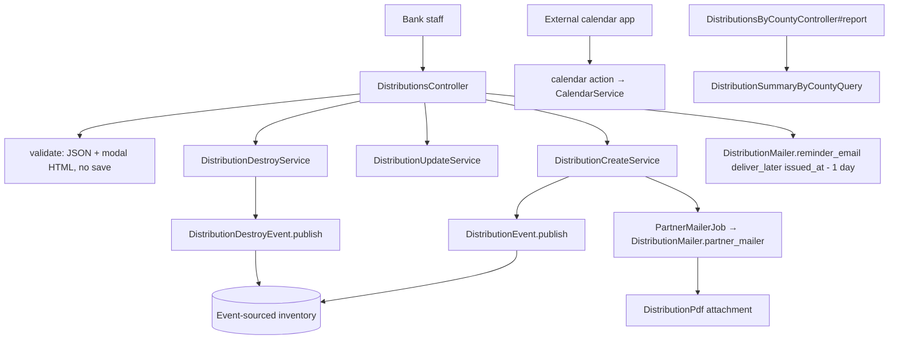
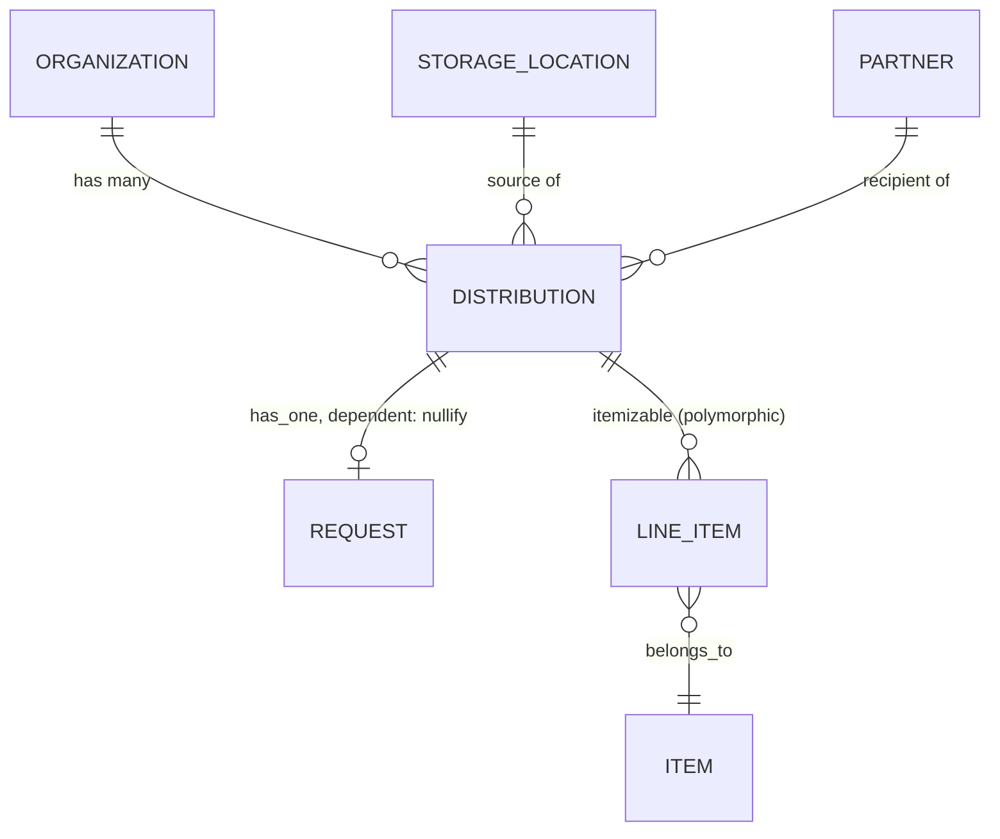

# Distributions

> **Status**: ✅ Active
> **Generated**: 2026-10-24T00:00:00Z
> **Last Updated**: 2026-10-24T00:00:00Z
---

## Overview

### What It Does
The Distributions feature is the primary way inventory leaves a diaper bank. A distribution issues line items from exactly one storage location to exactly one partner organization, on a scheduled `issued_at` date, by pick up, delivery, or shipping. Creating one publishes an inventory event that decrements stock; destroying one ("reclaim") publishes a compensating event that restores it. The feature also covers partner emails with PDF manifests, day-before reminder emails, an in-app calendar with a public ICS feed, a pickup-day worklist, CSV exports, and a by-county estimate report.

### Why It Exists
Banks need verifiable on-hand counts (hence the single-storage-location rule), an auditable record of what was given to which partner, and automated partner communication. Direct services are possible only by convention (a partner named "Direct Services"), without extra failsafes — the controller's own comment calls this out.

### Key Capabilities
- Create from scratch, from a partner `Request` (marks it fulfilled; double-fulfillment is blocked), or seeded from a `Donation`
- Pre-persistence validation endpoint powering a confirmation modal
- Event-sourced inventory movement with insufficient-stock error reporting per line item
- Content-diffed updates with automatic "Your Distribution Has Changed" partner notification
- Scheduled/Complete lifecycle with a one-click `picked_up` transition
- Filterable index (item, category, reporting category, partner, state, location, date range) with SQL-computed totals
- CSV export, itemized breakdown CSV, by-county proportional estimates, ICS calendar feed

---

## Architecture

### High-Level Design


### Components

#### Backend Components
| Component | File Path | Purpose |
|-----------|-----------|---------|
| `DistributionsController` | `app/controllers/distributions_controller.rb` | index, new, create, validate, show, edit, update, destroy, print, itemized_breakdown, schedule, calendar, picked_up, pickup_day |
| `DistributionsByCountyController` | `app/controllers/distributions_by_county_controller.rb` | `report` — county estimates over a date range |
| `Distribution` | `app/models/distribution.rb` | Model: enums, validations, copy/seed logic, scopes |
| `DistributionService` | `app/services/distribution_service.rb` | Base class: transaction, error capture, `success?`/`error` |
| `DistributionCreateService` | `app/services/distribution_create_service.rb` | Save, publish event, fulfill request, notify partner |
| `DistributionUpdateService` | `app/services/distribution_update_service.rb` | Zero-qty pruning, `ItemizableUpdateService`, change tracking |
| `DistributionDestroyService` | `app/services/distribution_destroy_service.rb` | Publish destroy event, destroy record |
| `DistributionContentChangeService` | `app/services/distribution_content_change_service.rb` | Line-item diff: `updates`, `removed`, `any_change?` |
| `DistributionTotalsService` | `app/services/distribution_totals_service.rb` | `Hash<id, DistributionTotal(quantity, value)>` via window functions |
| `DistributionItemizedBreakdownService` | `app/services/distribution_itemized_breakdown_service.rb` | Distributed vs on-hand (+ minimum flags), CSV |
| `CalendarService` | `app/services/calendar_service.rb` | ICS feed (last 12 months), curated time-zone list |
| `DeadlineService` | `app/services/deadline_service.rb` | Next deadline day; partner group overrides organization |
| `Exports::ExportDistributionsCSVService` | `app/services/exports/export_distributions_csv_service.rb` | Distributions CSV (filter-aware headers, per-item columns) |
| `DistributionEvent` | `app/events/distribution_event.rb` | InventoryPayload from storage location (`group_id` `dist-<id>-<hex>`) |
| `DistributionDestroyEvent` | `app/events/distribution_destroy_event.rb` | Zeroed line items (`group_id` `dist-destroy-<id>-<hex>`) |
| `DistributionHelper` | `app/helpers/distribution_helper.rb` | `pickup_date`, `hashed_calendar_path`, `distribution_shipping_cost` |
| `DistributionMailer` | `app/mailers/distribution_mailer.rb` | `partner_mailer`, `reminder_email` |
| `DistributionPdf` | `app/pdfs/distribution_pdf.rb` | Prawn manifest; request/non-request tables; column hiding; signatures |
| `DistributionSummaryByCountyQuery` | `app/queries/distribution_summary_by_county_query.rb` | Raw SQL CTEs; client_share apportionment |

> Checklist: controllers ✓ (both, incl. by-county), models ✓, model concerns ✓ (Itemizable, Exportable, IssuedAt, Filterable; `ItemsHelper` module; `has_paper_trail`), services ✓, jobs — shared `PartnerMailerJob` used, policies — none exist for this feature, queries ✓, PDFs ✓, mailers ✓. No ViewComponents, form objects, or drops.

#### Frontend Components
| Component | File Path | Purpose |
|-----------|-----------|---------|
| Index | `app/views/distributions/index.html.erb` | Filter card, totals footer, Export/New buttons |
| Row partials | `app/views/distributions/_distribution_row.html.erb`, `_distribution_total.html.erb` | Rows with View/Edit/Print/Reclaim; page+total sums |
| Form | `app/views/distributions/_form.html.erb` | simple_form; Stimulus `confirmation` + `distribution-delivery`; hidden partner_id when request-backed |
| Confirmation modal | `app/views/distributions/validate.html.erb` | Partner/location/items list; Yes/No buttons |
| New / Edit | `new.html.erb`, `edit.html.erb` | Edit shows past-date and audit warnings |
| Show | `show.html.erb` + `_distribution_item_row/_total` | Detail, totals, Complete/Correct/Print |
| Schedule | `schedule.html.erb`, `schedule.json.jbuilder` | Calendar; JSON events (`fc-dist-complete`/`fc-dist-scheduled`); copy-ICS button |
| Pickup day | `pickup_day.html.erb`, `_pickup_day_row`, `_daily_item_row` | Day list + aggregated item totals |
| County report | `app/views/distributions_by_county/report.html.erb` | Date-filtered county table |
| Mailer views | `app/views/distribution_mailer/partner_mailer.html.erb`, `reminder_email.{html,text}.erb`, `_distribution_changes.html.erb` | Partner notification, reminder, change list |

### Technology Stack
- **Backend**: Rails, PORO services, event sourcing, PaperTrail, Kaminari pagination
- **Frontend**: ERB, simple_form, Turbo (enabled on new/show; turbo_stream failure path), Stimulus, FullCalendar-style JS, jQuery + toastr (copy button)
- **Database**: PostgreSQL (window functions, raw-SQL CTE query)
- **External Services**: `icalendar` + `tzinfo`, Prawn (`prawn/table`), Flipper (`enable_packs`)

---

## Model Details

### Distribution

#### Associations
```ruby
belongs_to :storage_location
belongs_to :partner
belongs_to :organization
has_one :request, dependent: :nullify
accepts_nested_attributes_for :request
```

#### Concerns
| Concern | Purpose |
|---------|---------|
| `Itemizable` | `line_items`, `combine!`, `total_quantity`, insufficiency errors |
| `Exportable` | CSV export plumbing |
| `IssuedAt` | `issued_at` behavior |
| `Filterable` | `class_filter` used by index/exports |
| `ItemsHelper` | `cents_to_dollar` for CSV attributes |
| `has_paper_trail` | Versioning |

#### Callbacks
| Callback | Method | Purpose |
|----------|--------|---------|
| `before_save` | `:combine_distribution` | Merge duplicate line items |
| `before_save` | `:reset_shipping_cost` | `shipping_cost = nil` unless `delivery_method == "shipped"` |
| `before_destroy` | `:check_no_intervening_snapshot` | Raise "We can't delete distributions entered before <date>." when a `SnapshotEvent` intervenes |

#### State Machines
Rails enums, not AASM:
```ruby
enum :state, { scheduled: 5, complete: 10 }
enum :delivery_method, { pick_up: 0, delivery: 1, shipped: 2 }
```
Transition path: `scheduled → complete` via `complete!` in `picked_up`; nothing transitions back in this feature's code.

#### Validations
| Rule | Detail |
|------|--------|
| `delivery_method` | presence |
| `line_items_quantity_is_positive` | delegates to `line_items_quantity_is_at_least(1)` |
| `shipping_cost` | `>= 0`, allow_blank, only `if: :shipped?` |

#### Key Methods
| Method | Returns | Purpose | Notes |
|--------|---------|---------|-------|
| `distributed_at` | String | `:distribution_date` format at midnight, else `:distribution_date_time` | Uses `is_midnight` from `time_util` |
| `copy_from_request(request)` | — | Sets request/org/partner, `agency_rep` = `request.partner_user&.formatted_email`, `comment` = request comments, `issued_at` = `Time.zone.today + 1.day`; line item per item_request | Custom `request_unit` → quantity left nil intentionally |
| `copy_from_donation(donation_id, storage_location_id)` | — | Copies donation line items; sets location | Both args optional |
| `initialize_request_items` | — | Attaches `requested_item` to matching line items; builds zero-qty lines for unfulfilled item_requests | Edit page support |
| `csv_export_attributes` | Array | partner name, `%F` date, location, quantity, dollar value, method, state, agency_rep | |
| `future?` / `past?` | Boolean | strictly after / strictly before today | |
| `combine_duplicates` | — | Logs "Combining!"; `line_items.combine!` | |

#### Scopes
`active` (items active), `with_diapers` (disposable + cloth), `with_period_supplies`, `by_item_id`, `by_item_category_id`, `by_reporting_category`, `by_partner`, `by_location`, `by_state`, `recent(count = 3)`, `future` (`issued_at >= tomorrow`), `during(range)`, `apply_filters(filters, date_range)`, `this_week`, `in_last_12_months`.

---

## Database Schema

### distributions (per model schema annotation; `db/schema.rb` not in feature file set)

| Column | Type | Default | Notes |
|--------|------|---------|-------|
| `id` | integer | — | PK, not null |
| `agency_rep` | string | — | |
| `comment` | text | — | |
| `delivery_method` | integer | `"pick_up"` | not null, enum |
| `issued_at` | datetime | — | |
| `reminder_email_enabled` | boolean | `false` | not null |
| `shipping_cost` | decimal(8,2) | — | |
| `state` | integer | `"scheduled"` | not null, enum |
| `created_at` | datetime | — | not null |
| `updated_at` | datetime | — | not null |
| `organization_id` | integer | — | |
| `partner_id` | integer | — | |
| `storage_location_id` | integer | — | |

### Relationships


---

## API Endpoints

> Paths inferred from path helpers in views (`validate_distributions_path`, `picked_up_distribution_path`, `schedule_distributions_path`, `pickup_day_distributions_path`, `calendar_distributions_url`, `print_distribution_path`, `distributions_by_county_report_path`); every listed action exists in the controllers.

| Method | Path | Action | Description | Notes |
|--------|------|--------|-------------|-------|
| `GET` | `/distributions` | `index` | Filterable list; `format.csv` export | |
| `GET` | `/distributions/new` | `new` | Form; `request_id` or `donation_id`+`storage_location_id` seeds | |
| `POST` | `/distributions/validate` | `validate` | `{valid: true, body: modalHTML}` or `{valid: false}`; **never saves** | |
| `POST` | `/distributions` | `create` | Service-backed create; turbo_stream 400 on failure | |
| `GET` | `/distributions/:id` | `show` | Detail, totals, package count (nil when 0) | |
| `GET` | `/distributions/:id/edit` | `edit` | Guard: `(!complete? && future?) \|\| ORG_ADMIN` else redirect | |
| `PATCH/PUT` | `/distributions/:id` | `update` | Change notification + reminder rescheduling + inventory check | |
| `DELETE` | `/distributions/:id` | `destroy` | Reclaim; flash "Distribution <id> has been reclaimed!" | |
| `GET` | `/distributions/:id/print` | `print` | Inline PDF `"<partner> <date>.pdf"` via `format.any` | |
| `GET` | `/distributions/itemized_breakdown` | `itemized_breakdown` | CSV only, date-ranged | |
| `GET` | `/distributions/schedule` | `schedule` | HTML page; JSON pickups between `start`/`end` params | |
| `GET` | `/distributions/calendar` | `calendar` | Public ICS; `hash` = encrypted org id; 401 on bad hash | skips `authenticate_user!`, `authorize_user`, `require_organization` |
| `PATCH` | `/distributions/:id/picked_up` | `picked_up` | `complete!`; redirect back | |
| `GET` | `/distributions/pickup_day` | `pickup_day` | Day list + `daily_items` aggregation | `filters[during]` |
| `GET` | `distributions_by_county/report` | `report` | County estimates | separate controller |

Strong params: `comment, agency_rep, issued_at, partner_id, storage_location_id, reminder_email_enabled, delivery_method, shipping_cost, line_items_attributes: [item_id, quantity, _destroy]`; `request_id` also read from `distribution[request_attributes][id]`.

---

## Authorization (Pundit)

> No Pundit policy class exists for distributions. Authorization is ad hoc:

| Check | Where | Effect |
|-------|-------|--------|
| ApplicationController before_actions | all except `calendar` | Login + org membership required |
| `skip_before_action` ×3 | `calendar` | Fully public endpoint |
| `current_organization.distributions.find` | all member actions | Cross-tenant isolation |
| `has_cached_role?(Role::ORG_ADMIN, current_organization)` | `edit` guard; Edit buttons in index/show | Admins may edit past/complete distributions |
| `MessageEncryptor.decrypt_and_verify(params[:hash])` | `calendar` | Capability-URL security; rescue → `head :unauthorized` |

---

## Configuration

### Environment Variables
None dedicated. `Rails.application.secret_key_base[0..31]` keys the calendar-hash `MessageEncryptor`.

### Feature flags & org settings
```text
Flipper :enable_packs                                   # request units in PDF quantities
organization.include_in_kind_values_in_exported_files   # "<Item> In-Kind Value" CSV columns
organization.include_packages_in_distribution_export    # "<Item> Packages" CSV columns
organization.ytd_on_distribution_printout               # YTD line on PDF
organization.hide_value_columns_on_receipt              # hide Value/item + In-Kind columns on PDF
organization.hide_package_column_on_receipt             # hide Packages column on PDF
organization.signature_for_distribution_pdf             # signature lines on PDF
organization.default_email_text                         # interpolated partner email body
partner.send_reminders                                  # gates partner_mailer + reminder_email
```

---

## Usage Examples

### Destroy ("reclaim") flow
```ruby
# Source: app/services/distribution_destroy_service.rb:6
def call
  perform_distribution_service do
    DistributionDestroyEvent.publish(distribution)
    distribution.destroy!
  end
end
```

### Update change detection
```ruby
# Source: app/services/distribution_update_service.rb:27
def resend_notification?
  issued_at_changed? || delivery_method_changed? || distribution_content.any_change?
end
```

### Event publication
```ruby
# Source: app/events/distribution_event.rb:3
def self.publish(distribution)
  create(
    eventable: distribution,
    group_id: "dist-#{distribution.id}-#{SecureRandom.hex}",
    organization_id: distribution.organization_id,
    event_time: Time.zone.now,
    data: EventTypes::InventoryPayload.new(
      items: EventTypes::EventLineItem.from_line_items(distribution.line_items, from: distribution.storage_location_id)
    )
  )
end
```

### Calendar feed security
```ruby
# Source: app/controllers/distributions_controller.rb:257
def calendar
  crypt = ActiveSupport::MessageEncryptor.new(Rails.application.secret_key_base[0..31])
  organization_id = crypt.decrypt_and_verify(CGI.unescape(params[:hash]))

  render body: CalendarService.calendar(organization_id), content_type: Mime::Type.lookup("text/calendar")
rescue ActiveSupport::MessageVerifier::InvalidSignature, ActiveSupport::MessageEncryptor::InvalidMessage
  head :unauthorized
end
```

---

## Testing

Spec files live outside this feature's documented file set and were not inspected; none are listed to avoid fabricating paths.

---

## Known Issues & Caveats

| Issue | Location | Description |
|-------|----------|-------------|
| FIXME duplicate state | `distributions_controller.rb:71` | "one of these needs to be removed but it's unclear which" — `@statuses` / `@selected_status` |
| TODO on `schedule` | `distributions_controller.rb:245` | Format ambiguity acknowledged in comment |
| Scaffold view | `app/views/distributions/print.html.erb` | Placeholder text; real output is the PDF |
| `ensure`/`return self` | `distribution_service.rb:18` | Swallows exceptions raised in rescue blocks; callers must check `success?` |
| Silent shipping-cost reset | `distribution.rb:185` | Non-shipped methods lose entered shipping cost on save |
| Misleading variable | `distribution.rb:110` | `item_ids` Set actually stores ItemRequest objects |
| Public endpoint | `calendar` | By design; protected solely by encrypted hash parameter |
| String-raise guards | `distribution.rb:181`, `distribution_create_service.rb:32` | Business-rule failures raised as RuntimeError strings, caught by base service |

---

## Performance

### Optimization Strategies
- Single-query totals via window functions (`DistributionTotalsService`, county query) instead of per-record aggregation
- Eager loading: `includes(:partner, :storage_location)` on index; `includes(line_items: :item)` for show/CSV; `includes(:storage_location, :partner)` in `CalendarService`
- CSV row building reuses already-loaded line items in memory (commented rationale in the export service)

### Caching
- None feature-specific (role checks use rolify's cache)

### Database Optimization
- `GROUP BY`/`PARTITION BY distributions.id` aggregation; county query pushes all math into one SQL round-trip

---

## Troubleshooting

### Issue: "Sorry, we weren't able to save the distribution."
**Symptoms:** red flash with details; form re-rendered (HTTP 400 turbo stream).
**Cause:** usually `Errors::InsufficientAllotment` — insufficient on-hand quantity; offending line items receive errors via `assign_insufficiency_errors`.
**Solution:** reduce quantities or change storage location; verify totals ≥ 1 and delivery method present.

### Issue: "Request has already been fulfilled by Distribution <id>"
**Cause:** `validate_request_not_yet_processed!` — the request already has a distribution.
**Solution:** open the existing distribution instead; a request is fulfillable exactly once.

### Issue: Edit redirects away
**Cause:** distribution complete or not future, user not ORG_ADMIN.
**Solution:** org admin performs the edit.

### Issue: "We can't delete distributions entered before <date>."
**Cause:** `SnapshotEvent.intervening` — an inventory snapshot postdates the distribution.
**Solution:** none; deletion is intentionally blocked past the snapshot boundary.

### Issue: Partner email missing
**Cause:** `partner_mailer` returns early when `distribution.past?` or partner deactivated; create-time notification requires `partner.send_reminders`.
**Solution:** check partner status/settings and the issued_at date.

---

## Related Features

- **[Requests](../requests)** — `has_one :request`; fulfilled on create; `initialize_request_items` on edit
- **[Donations](../donations)** — `copy_from_donation` seeding
- **[Inventory Events](../inventory-events)** — `DistributionEvent`/`DistributionDestroyEvent`, `SnapshotEvent` guard, `View::Inventory`
- **[Storage Locations](../storage-locations)** — source location; positive-inventory filtering in `new`
- **[Partners](../partners)** — recipient; `send_reminders`, profile addresses & pick-up emails
- **[Audits](../audits)** — audit warning on edit
- **[Reports / Historical Trends](../reports)** — consume distribution data

---

**Generated:** 2026-10-24T00:00:00Z
**Last Updated:** 2026-10-24T00:00:00Z
**Status:** ✅ Active
