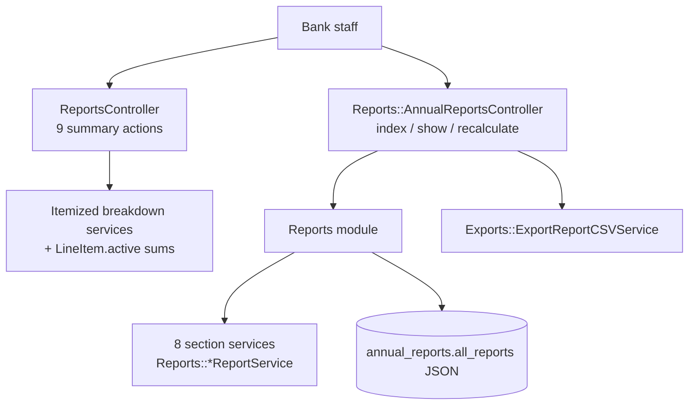
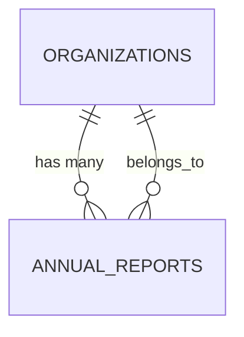

# Reports

> **Status**: ✅ Active
> **Generated**: 2026-10-24T00:00:00Z
> **Last Updated**: 2026-10-24T00:00:00Z
---

## Overview

### What It Does
Provides a bank organization with (a) nine operational report pages — donations, manufacturer donations, purchases, product drives, distributions, itemized donations/distributions/requests, and an activity graph — every one filtered by a user-selected date range, and (b) the NDBN Annual Report: eight calculated sections per completed year, persisted as JSON on an `AnnualReport` record, recalculable on demand, and exportable as CSV.

### Why It Exists
Staff need fast operational visibility (inflow, outflow, low stock) and a reproducible, standardized year-end report for NDBN annual surveys without manual aggregation.

### Key Capabilities
- Date-range-scoped summaries over donations, purchases, distributions, requests, drives, and manufacturers
- Item-level breakdown tables with on-hand quantities and below-minimum highlighting
- Received/Purchased/Distributed bar chart (Highcharts via Stimulus)
- Annual report generation across 8 domains, cached per org+year, with explicit recalculation
- CSV export: `NdbnAnnuals-<year>-<date>.csv`

---

## Architecture

### High-Level Design


### Components

#### Backend Components
| Component | File Path | Purpose |
|-----------|-----------|---------|
| ReportsController | `app/controllers/reports_controller.rb` | Summary actions; `before_action :setup_date_range_picker`; all scoping via `current_organization` + `helpers.selected_range` |
| Reports::AnnualReportsController | `app/controllers/reports/annual_reports_controller.rb` | Year list, per-year show (HTML/CSV), POST recalculate; `validate_show_params` → `not_found!` unless positive year |
| AnnualReport | `app/models/annual_report.rb` | `belongs_to :organization`; `json all_reports`; `has_paper_trail`; `each_report` iterator |
| Reports | `app/services/reports.rb` | `all_reports(year:, organization:)` → 8 section hashes; `retrieve_report` → find_or_create + cache/recalculate |
| Reports::DiaperReportService | `app/services/reports/diaper_report_service.rb` | 19-entry "Diapers" section; kit diapers via raw SQL on `reporting_category = 'disposable_diapers'` |
| Reports::WarehouseReportService | `app/services/reports/warehouse_report_service.rb` | "Warehouse and Storage": count, square footage (with missing-data note), largest site type |
| Reports::AdultIncontinenceReportService | `app/services/reports/adult_incontinence_report_service.rb` | "Adult Incontinence": kit-aware totals, adults/month via `distribution_quantity` (default 50 loose / 1 kit) |
| Reports::PeriodSupplyReportService | `app/services/reports/period_supply_report_service.rb` | "Period Supplies": `kit_items_calculation` reused for distributions, purchases, donations |
| Reports::OtherProductsReportService | `app/services/reports/other_products_report_service.rb` | "Other Items" over `Item.other_categories` |
| Reports::PartnerInfoReportService | `app/services/reports/partner_info_report_service.rb` | Partner profile count, per-agency-type tallies (I18n `partners_profile` scope), zip codes |
| Reports::ChildrenServedReportService | `app/services/reports/children_served_report_service.rb` | CEILING-based children math over loose disposables + kits subquery |
| Reports::SummaryReportService | `app/services/reports/summary_report_service.rb` | YoY % change in donations, money raised, disposable diaper donations |
| Exports::ExportReportCSVService | `app/services/exports/export_report_csv_service.rb` | Header row = all entry keys concatenated; data row = all values |

#### Frontend Components
| Component | File Path | Purpose |
|-----------|-----------|---------|
| Filtered summary cards | `app/views/reports/{donations,distributions,purchases,product_drives,manufacturer_donations}_summary.html.erb` | `shared/filtered_card` with date filter, headline totals, recent lists, New Donation/Purchase/Distribution buttons |
| Itemized tables | `app/views/reports/itemized_{donations,distributions,requests}.html.erb` | Item / total / on-hand tables; `table-danger` when `below_onhand_minimum` |
| Activity graph | `app/views/reports/activity_graph.html.erb` | Bar chart config → `data-controller="highchart"` |
| Annual report list/detail | `app/views/reports/annual_reports/{index,show}.html.erb` | Year links; per-section tables; Recalculate + Export buttons |
| Recent-row partials | `app/views/reports/_{donation,distribution,purchase,manufacturer,product_drive}.html.erb` | One-line recent-activity rows with links and relative timestamps |

### Technology Stack
- **Backend**: Rails, PORO service objects, `ActionView::Helpers::NumberHelper` formatting, raw parameterized SQL for kit aggregation
- **Frontend**: ERB + shared filtered-card partial, Stimulus `highchart` controller (bar chart)
- **Database**: PostgreSQL (`CEILING`, `DISTINCT ON`, `EXTRACT(year FROM issued_at)`); `annual_reports.all_reports` JSON cache

---

## Model Details

### AnnualReport

#### Associations
```ruby
belongs_to :organization, inverse_of: :annual_reports
```

#### Concerns
| Concern | Purpose |
|---------|---------|
| PaperTrail (`has_paper_trail`) | Versions the stored report payload |

#### Callbacks
None.

#### Validations
```ruby
validates :year, numericality: { greater_than: 1900, less_than: 10_000 }
```

#### Key Methods
| Method | Returns | Purpose | Notes |
|--------|---------|---------|-------|
| `each_report` | yields `(String, Array<Hash>)` | Yields `hash['name']`, `hash['entries']` per stored section | String keys — assumes JSON round-trip of service output |

### Section service contract
Every `Reports::*ReportService` takes `(year:, organization:)` and exposes `#report` → `{name: String, entries: Hash}` with display-formatted values (`number_with_delimiter`, `number_to_currency`, `"NN%"`, `Y`/`N`, comma-joined lists). Results are memoized per instance.

---

## Database Schema

### annual_reports

| Column | Type | Default | Notes |
|--------|------|---------|-------|
| `id` | `bigint` | — | PK |
| `all_reports` | `json` | — | `[{name:, entries: {...}}, ...]`, 8 sections |
| `year` | `integer` | — | 1901..9999 enforced by validation |
| `created_at` | `datetime` | — | not null |
| `updated_at` | `datetime` | — | not null |
| `organization_id` | `bigint` | — | owning org |

### Relationships


---

## API Endpoints

> Actions verified in the two controllers; paths follow the `reports_*` route helpers referenced by the views.

| Method | Path | Action | Description | Notes |
|--------|------|--------|-------------|-------|
| `GET` | `/reports/donations_summary` | `donations_summary` | Range-scoped donations + recents | |
| `GET` | `/reports/manufacturer_donations_summary` | `manufacturer_donations_summary` | Manufacturer-sourced donations; top 10 manufacturers (`by_donation_date(10, range)`) | |
| `GET` | `/reports/purchases_summary` | `purchases_summary` | Summary struct from `Purchase.organization_summary_by_dates` | |
| `GET` | `/reports/product_drives_summary` | `product_drives_summary` | Drive stats; controller reuses donations data, totals via helpers | |
| `GET` | `/reports/itemized_donations` | `itemized_donations` | `DonationItemizedBreakdownService#fetch` | |
| `GET` | `/reports/itemized_distributions` | `itemized_distributions` | `DistributionItemizedBreakdownService#fetch` | |
| `GET` | `/reports/distributions_summary` | `distributions_summary` | Range-scoped distributions + recents | |
| `GET` | `/reports/activity_graph` | `activity_graph` | 3-bar received/purchased/distributed data | |
| `GET` | `/reports/itemized_requests` | `itemized_requests` | `RequestItemizedBreakdownService.call` | |
| `GET` | `/reports/annual_reports` | `index` | Years `(earliest_reporting_year...current_year)` — exclusive | |
| `GET` | `/reports/annual_reports/:year` | `show` | HTML sections; `.csv` streams export | 404 for non-positive year |
| `POST` | `/reports/annual_reports/:year/recalculate` | `recalculate` | Recompute + redirect, notice "Recalculated annual report!" | |

---

## Authorization

No Pundit policies in this feature's file set; isolation is by organization scoping (`current_organization.…`) on every query, including `AnnualReport.find_or_create_by(organization:, year:)`. `validate_show_params` rejects invalid years with `not_found!`.

---

## Configuration

### Environment Variables
None.

### Config Files
- I18n locale keys under scope `partners_profile` label agency types in the partner section.

---

## Usage Examples

### Cache-or-calculate retrieval
```ruby
# Source: app/services/reports.rb
def retrieve_report(year:, organization:, recalculate: false)
  report_attributes = { organization: organization, year: year }
  report = AnnualReport.find_or_create_by(report_attributes)
  if report.all_reports.blank? || recalculate
    calculated_reports = all_reports(**report_attributes)
    report.update!(all_reports: calculated_reports)
  end
  report
end
```

### Children served — loose disposables
```ruby
# Source: app/services/reports/children_served_report_service.rb
def total_children_served_with_loose_disposables
  organization
  .distributions
  .for_year(year)
  .joins(line_items: :item)
  .merge(Item.loose.disposable_diapers)
  .pick(Arel.sql("CEILING(SUM(line_items.quantity::numeric / COALESCE(items.distribution_quantity, 50)))"))
  .to_i
end
```

### CSV flattening
```ruby
# Source: app/services/exports/export_report_csv_service.rb
def generate_csv_data
  headers = []
  data = []

  csv_data = []

  @reports.each do |report|
    headers.concat(report['entries'].keys)
    data.concat(report['entries'].values)
  end

  csv_data << headers
  csv_data << data

  csv_data
end
```

---

## Testing

Spec files are outside this feature's documented file set and were not verified.

---

## Known Issues & Caveats

| Issue | Location | Description |
|-------|----------|-------------|
| String-key dependence | `annual_report.rb:19`, `export_report_csv_service.rb:25` | Services emit symbol keys; readers use `['name']`/`['entries']` — valid only after DB JSON round-trip |
| Duplicated action data | `reports_controller.rb:18-21` | `product_drives_summary` loads the same `@donations`/`@recent_donations` as `donations_summary` |
| Integer division on drive money | `diaper_report_service.rb:116,126` | `.sum(:money_raised) / 100` truncates; other money math uses `/ 100.0` |
| Mismatched zero-guards | `diaper_report_service.rb:160-171` | `percent_*_purchased` guard on numerator zero, divide by `total_*_acquired` |
| Reused DOM id | itemized views | `id: "purchases"` passed by itemized donations/distributions/requests cards |
| Stray `</section>` | `donations_summary.html.erb:27` | Unbalanced closing tag |
| `year.to_i` only in Summary | `summary_report_service.rb:10` | Other services pass `year` through unconverted |

---

## Performance

### Optimization Strategies
- Single-query SQL aggregates (SUM, CEILING, DISTINCT ON) for kit math — no Ruby iteration over line items (exception: `AdultIncontinenceReportService#total_distributed_kits_containing_adult_incontinence_items_per_month` loops kits in Ruby)
- Instance-level memoization throughout section services
- `includes(:partner)` on distribution report queries

### Caching
- **Cache Layer**: `annual_reports.all_reports` JSON column
- **TTL**: none — manual invalidation via `recalculate`

### Database Optimization
- Year filters via `for_year(year)` scopes / `EXTRACT(year FROM issued_at)` in raw SQL

---

## Troubleshooting

### Issue: Annual report numbers are stale
**Symptoms:** Corrections to past records not reflected.
**Cause:** `retrieve_report` returns the cached JSON unless blank.
**Solution:** POST recalculate (**Recalculate Report** button) → `recalculate: true` rewrites `all_reports`.

### Issue: Current year missing from index
**Symptoms:** Only prior years listed.
**Cause:** `(foundation_year...@actual_year)` excludes the current year by design.
**Solution:** None required; index shows "available in N months" (`12 - Time.current.month`).

### Issue: Empty summary card
**Symptoms:** "No ... found for the selected date range."
**Cause:** `helpers.selected_range` excludes all rows.
**Solution:** Adjust the card's date filter.

---

## Related Features

- **[Donations](../donations)** — source records for donation summaries and annual figures
- **[Purchases](../purchases)** — spend totals and `amount_spent_on_*_cents` category columns
- **[Distributions](../distributions)** — outflow sums, itemized breakdowns, served-population math
- **[Kits](../kits)** — kit contents folded into diaper/AI/period-supply counts
- **[Storage Locations](../storage-locations)** — warehouse section inputs
- **[Partners](../partners)** — profiles drive agency counts/types/zips
- **[Product Drives](../product-drives)** — drive counts and money raised

---

**Generated:** 2026-10-24T00:00:00Z
**Last Updated:** 2026-10-24T00:00:00Z
**Status:** ✅ Active
