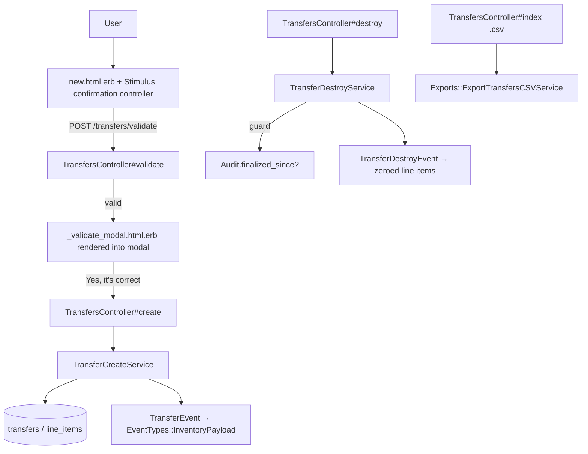
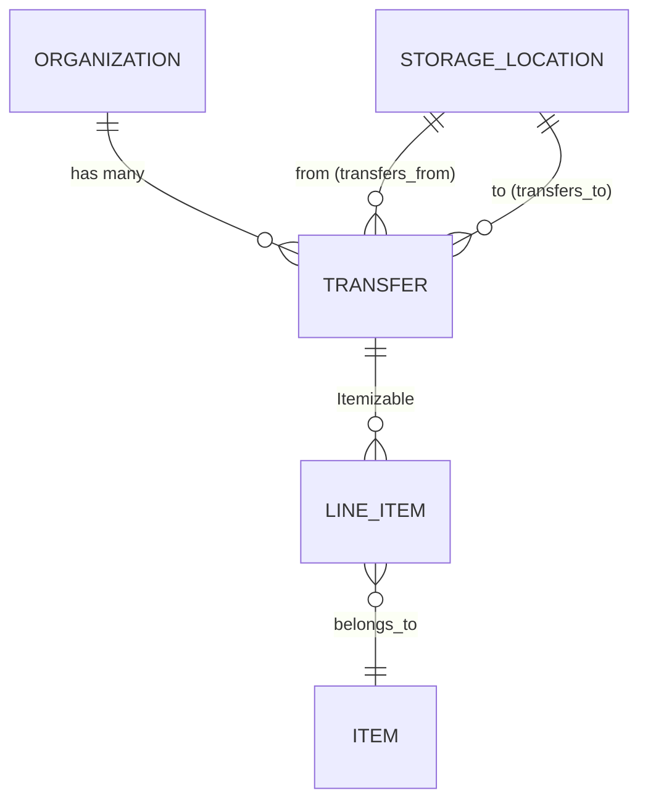

# Transfers

> **Status**: ✅ Active
> **Generated**: 2026-10-24T00:00:00Z
> **Last Updated**: 2026-10-24T00:00:00Z
---

## Overview

### What It Does
The Transfers feature moves quantities of inventory from one storage location to another within a single organization. It is intentionally partial CRUD — transfers can be created, listed, viewed, and destroyed, but there is no edit/update path. Every movement (and every reversal on destroy) is published to the event-sourced inventory system, which is the source of truth for location quantities.

### Why It Exists
Organizations store essentials in multiple storage locations. When goods physically move between them, both locations' counts must change atomically and auditably, without altering the organization's net inventory.

### Key Capabilities
- Create a multi-line-item transfer between two active storage locations with a server-validated confirmation modal
- Enforce integrity: distinct locations, organization ownership, sufficient source inventory, positive quantities
- Filter history by source location, destination location, and date range
- Export filtered history to CSV with a column per organization item
- Destroy a transfer (publishing a reversal event) unless a finalized audit has touched either location since

---

## Architecture

### High-Level Design


### Components

#### Backend Components
| Component | File Path | Purpose |
|-----------|-----------|---------|
| `TransfersController` | `app/controllers/transfers_controller.rb` | `index`, `new`, `create`, `show`, `destroy`, `validate` |
| `Transfer` | `app/models/transfer.rb` | Associations, scopes, four custom validations |
| `TransferCreateService` | `app/services/transfer_create_service.rb` | Transactional save + `TransferEvent.publish`; raises on invalid |
| `TransferDestroyService` | `app/services/transfer_destroy_service.rb` | Audit guard → reversal event → `destroy!`; returns `Result` |
| `Exports::ExportTransfersCSVService` | `app/services/exports/export_transfers_csv_service.rb` | CSV: base columns + per-item quantity columns |
| `TransferEvent` | `app/events/transfer_event.rb` | Movement payload (`from:`/`to:` location ids) |
| `TransferDestroyEvent` | `app/events/transfer_destroy_event.rb` | Zeroed payload reversing the movement |

#### Frontend Components
| Component | File Path | Purpose |
|-----------|-----------|---------|
| Index | `app/views/transfers/index.html.erb` | Filter card, results table, Export/New buttons |
| Row partial | `app/views/transfers/_transfer_row.html.erb` | From, To, Date (`%F`), Comment (`"none"` fallback), total, delete/view |
| New | `app/views/transfers/new.html.erb` | simple_form; `storage_locations/source` partial for `from`; line-items fieldset with barcode capture; modal shell |
| Validate modal | `app/views/transfers/_validate_modal.html.erb` | Item/quantity review table + note; confirm or return |
| Show | `app/views/transfers/show.html.erb` | Item/quantity table, Total row, Comments row |

The new form wires Stimulus: `data-controller="confirmation"` with `data-confirmation-pre-check-path-value="<%= validate_transfers_path(format: :json) %>"`; submit uses `click->confirmation#openModal`; the line-items container sets `data-capture-barcode="true"` and the page renders `barcode_items/barcode_modal`.

### Technology Stack
- **Backend**: Rails MVC, PORO services (`Result` object pattern), PaperTrail, event sourcing via `Event` subclasses
- **Frontend**: ERB, simple_form, Stimulus, Bootstrap modal, barcode capture
- **Database**: PostgreSQL (`transfers`, shared polymorphic `line_items` via `Itemizable`)

---

## Model Details

### Transfer

#### Associations
```ruby
has_paper_trail
belongs_to :organization, inverse_of: :transfers
belongs_to :from, class_name: "StorageLocation", inverse_of: :transfers_from
belongs_to :to, class_name: "StorageLocation", inverse_of: :transfers_to

# to make it play nice with Itemizable - alias of `from`
belongs_to :storage_location, class_name: "StorageLocation", inverse_of: :transfers_from, foreign_key: :from_id
```

#### Concerns
| Concern | Purpose |
|---------|---------|
| `Itemizable` | Nested line items (`line_items_attributes`), `combine!`, `total`, `sorted`, `line_items_quantity_is_at_least` helper |
| `Filterable` | Provides `class_filter`, consumed by `index` with permitted scopes |

`has_paper_trail` adds version history for transfer records.

#### Callbacks
None declared on the model; event publication happens in services, not callbacks.

#### Scopes
| Scope | Definition |
|-------|------------|
| `from_location` | `->(location_id) { where(from_id: location_id) }` |
| `to_location` | `->(location_id) { where(to_id: location_id) }` |
| `during` | `->(range) { where(created_at: range) }` |

#### Validations
| Validator | Rule / error |
|-----------|--------------|
| `storage_locations_belong_to_organization` | `from`/`to` must be in `organization.storage_locations`; else "location must belong to organization" |
| `storage_locations_must_be_different` | `from_id == to_id` → "location must be different than from location" on `:to` |
| `from_storage_quantities` | Any line item with `quantity > View::Inventory.new(organization_id).quantity_for(item_id:)` → "location has insufficient inventory for <names>" on `:from` |
| `line_items_quantity_is_positive` | `line_items_quantity_is_at_least(1)` |

#### Key Methods
| Method | Returns | Purpose | Notes |
|--------|---------|---------|-------|
| `insufficient_items` | `Array<LineItem>` | Line items whose quantity exceeds available inventory | Private; feeds the error message item names |

---

## Database Schema

### transfers

| Column | Type | Default | Notes |
|--------|------|---------|-------|
| `id` | `serial` | — | Primary key |
| `from_id` | `integer` | — | Source storage location |
| `to_id` | `integer` | — | Destination storage location |
| `comment` | `string` | — | Optional free text |
| `created_at` | `datetime` | — | `null: false`; drives `during` scope, list/show display, CSV `Date` |
| `updated_at` | `datetime` | — | `null: false` |
| `organization_id` | `integer` | — | FK to organizations; indexed |

Index: `index_transfers_on_organization_id`.

### Relationships


---

## API Endpoints

Defined at `config/routes.rb:124`: `resources :transfers, only: %i(index create new show destroy)` with `post :validate, on: :collection`. Every route's controller action verified.

| Method | Path | Action | Description | Notes |
|--------|------|--------|-------------|-------|
| `GET` | `/transfers` | `index` | List with `class_filter` + `during(selected_range)`; eager-loads `line_items`, `from`, `to` | `format.csv` → `Transfers-<Time.zone.today>.csv` |
| `GET` | `/transfers/new` | `new` | Empty transfer + one built line item; `storage_locations.active.alphabetized`, `items.active.alphabetized` | |
| `POST` | `/transfers` | `create` | `line_items.combine!` → `TransferCreateService.call`; notice "`N` items have been transferred from `X` to `Y`!" | Rescues `StandardError` → `flash.now[:error]`, re-renders `new` |
| `GET` | `/transfers/:id` | `show` | Sorted line items + `line_items.total` | |
| `DELETE` | `/transfers/:id` | `destroy` | `TransferDestroyService#call` → `Result`; success notice "Successfully deleted Transfer #id!" | Always redirects to index |
| `POST` | `/transfers/validate` | `validate` | Builds + combines from params; valid → `{valid: true, body: <modal HTML>}`; invalid → `{valid: false}`, 422 `unprocessable_content` | Pre-check for the confirmation modal |

Strong parameters:
```ruby
params.require(:transfer).permit(:from_id, :to_id, :comment,
                                 line_items_attributes: %i(item_id quantity _destroy))
```
Filter params permit `:from_location, :to_location`; dropdown collections come from `StorageLocation.with_transfers_from/with_transfers_to`.

---

## Authorization (Pundit)

No Pundit policy class exists for this feature. Authorization is implicit organization scoping: all reads/writes go through `current_organization.transfers`, so any signed-in bank user of the organization may perform every action.

| Method | Permission | Conditions | Notes |
|--------|------------|------------|-------|
| — | organization membership | `current_organization` scoping only | No policy methods to list |

---

## Configuration

### Environment Variables
None.

### Config Files
None beyond `config/routes.rb`.

---

## Usage Examples

### Create path — service is all-or-nothing
```ruby
# Source: app/services/transfer_create_service.rb
def call(transfer)
  if transfer.valid?
    ActiveRecord::Base.transaction do
      transfer.save
      TransferEvent.publish(transfer)
    end
  else
    raise StandardError.new(transfer.errors.full_messages.join(", "))
  end
end
```

### Destroy path — audit guard and reversal
```ruby
# Source: app/services/transfer_destroy_service.rb
def call
  if Audit.finalized_since?(transfer, transfer.to_id, transfer.from_id)
    raise "We can't delete this transfer because its items were audited since you made the transfer."
  end

  transfer.transaction do
    TransferDestroyEvent.publish(transfer)
    transfer.destroy!
  end

  Result.new
rescue StandardError => e
  Result.new(error: e)
end
```

### Movement payload
```ruby
# Source: app/events/transfer_event.rb
data: EventTypes::InventoryPayload.new(
  items: EventTypes::EventLineItem.from_line_items(transfer.line_items,
    from: transfer.from.id,
    to: transfer.to.id)
)
```
`TransferDestroyEvent` mirrors this with `EventTypes::EventLineItem.zeroed_line_items(transfer.line_items, to: transfer.to.id, from: transfer.from.id)`.

---

## Testing

### Test Files
- `spec/models/transfer_spec.rb`
- `spec/controllers/transfers_controller_spec.rb`
- `spec/requests/transfers_requests_spec.rb`
- `spec/services/transfer_destroy_service_spec.rb`
- `spec/system/transfer_system_spec.rb`
- `spec/factories/transfers.rb`

---

## Known Issues & Caveats

| Issue | Location | Description |
|-------|----------|-------------|
| Partial CRUD | `config/routes.rb:124` | No `edit`/`update`; corrections require destroy + re-create |
| Inconsistent item scoping | `transfers_controller.rb#load_form_collections` | Re-render after failed create uses `items.alphabetized` (includes inactive), while `new` uses `items.active.alphabetized` |
| Silent CSV drop | `export_transfers_csv_service.rb#build_row_data` | `next unless item_column_idx` skips line items whose item name isn't among headers |
| `"none"` literal | row partial & CSV service | Nil comments serialize as the string "none" |
| Broad audit guard | `transfer_destroy_service.rb` | Any finalized audit on either location since the transfer blocks deletion, regardless of which items were audited |

---

## Performance

### Optimization Strategies
- Eager loading on `index` (`line_items`, `from`, `to`) and `show` (adds `items`)
- CSV export uses `includes(line_items: :item)` on the already-filtered relation
- Filter dropdowns restricted to locations with transfer history (`with_transfers_from/to`)

### Caching
None.

### Database Optimization
- `index_transfers_on_organization_id` supports organization scoping; `during` filters on `created_at`

---

## Troubleshooting

### Issue: Creation rejected for insufficient inventory
**Symptoms:**
- Flash error "…location has insufficient inventory for <item names>"

**Cause:**
`from_storage_quantities` compared each line item against `View::Inventory#quantity_for` and found shortfalls.

**Solution:**
Reduce the quantities or replenish the source location.

### Issue: Destroy returns an error flash
**Symptoms:**
- "We can't delete this transfer because its items were audited since you made the transfer."

**Cause:**
`Audit.finalized_since?` is true for one of the two locations.

**Solution:**
Keep the transfer; issue a compensating transfer or adjustment instead.

### Issue: Confirmation modal never opens
**Symptoms:**
- Submit returns 422 from `/transfers/validate`

**Cause:**
The pre-check found the transfer invalid (`{valid: false}`).

**Solution:**
Fix the form inputs; the subsequent full submit surfaces the exact validation messages.

---

## Related Features

- **Storage Locations** — endpoints of every transfer; supply `with_transfers_from/to` filter collections and inventory levels
- **Inventory Events** — consume `TransferEvent`/`TransferDestroyEvent` payloads to compute quantities
- **Audits** — `Audit.finalized_since?` gates transfer deletion
- **Items / Line Items** — `Itemizable` provides the nested line-item machinery and totals

---

**Generated:** 2026-10-24T00:00:00Z
**Last Updated:** 2026-10-24T00:00:00Z
**Status:** ✅ Active
