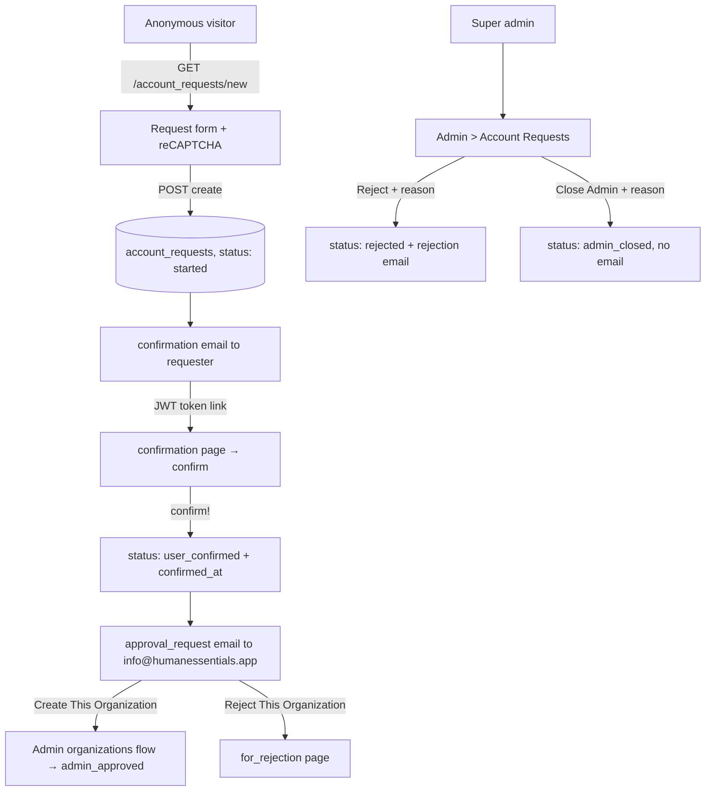
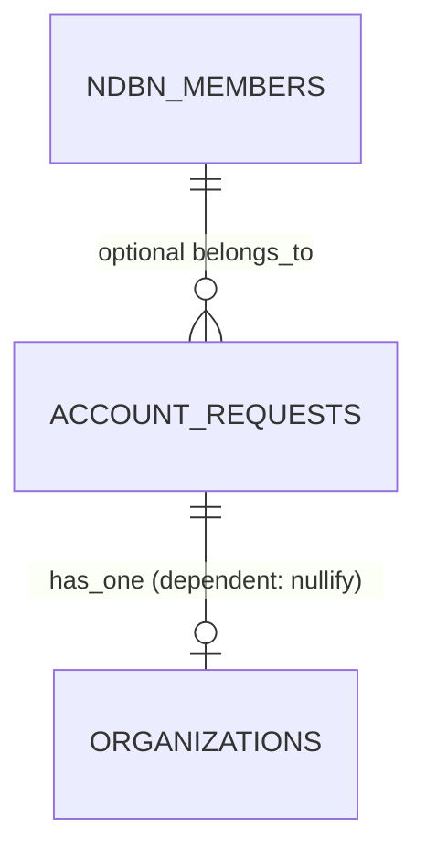

# Account Requests

> **Status**: ✅ Active
> **Generated**: 2026-10-24T00:00:00Z
> **Last Updated**: 2026-10-24T00:00:00Z
---

## Overview

### What It Does
Account Requests implements onboarding for new essentials banks. An anonymous visitor submits the public "Essentials Bank Account Request Form" (protected by reCAPTCHA), receives a confirmation email containing a signed JWT link, and confirms the request. Confirmation notifies the Human Essentials team at info@humanessentials.app, who then approve the request into a new organization, reject it with an emailed reason, or close it administratively without notification — all from the super-admin queue at Admin > Account Requests.

### Why It Exists
Bank accounts on Human Essentials are manually vetted rather than self-provisioned. This feature collects the application, screens out partner agencies (their accounts are created by their banks, not through this form), verifies that the applicant controls the email address, and gives the operations team a paginated, auditable triage queue.

### Key Capabilities
- Public, unauthenticated request form with bank/partner self-identification radio buttons, optional NDBN membership select, and reCAPTCHA
- Email-ownership verification via non-expiring HS256 JWT identity tokens, valid until the request is confirmed or processed
- Admin queue split into Open (statuses started, user_confirmed) and Closed (admin_approved, rejected, admin_closed), each paginated at 15 rows
- Reject with mandatory reason — the reason is emailed to the requester verbatim
- Close (Admin) with mandatory reason — recorded but never emailed
- Ops notification email with "Create This Organization" and "Reject This Organization" action links, sent on confirmation

---

## Architecture

### High-Level Design


### Components

#### Backend Components
| Component | File Path | Purpose |
|-----------|-----------|---------|
| `AccountRequestsController` | `app/controllers/account_requests_controller.rb` | Public actions `new`, `create`, `received`, `confirmation`, `confirm`, `invalid_token`; skips `authorize_user`, `authenticate_user!`, `require_organization`; uses the `devise` layout |
| `Admin::AccountRequestsController` | `app/controllers/admin/account_requests_controller.rb` | Admin actions `index`, `for_rejection`, `reject`, `close`; inherits `AdminController` (super-admin gate) |
| `AccountRequest` | `app/models/account_request.rb` | Model with validations, string status enum, requested/closed scopes, JWT token helpers, `confirm!` / `reject!` / `close!` |
| `AccountRequestMailer` | `app/mailers/account_request_mailer.rb` | `confirmation`, `approval_request`, `rejection`; all sent with `deliver_later` |

> Checklist: this feature has no services, jobs, Pundit policies, search classes, broadcasters, ViewComponents, form objects, or Liquid drops. Model versioning comes from the `has_paper_trail` macro.

#### Frontend Components
| Component | File Path | Purpose |
|-----------|-----------|---------|
| Request form | `app/views/account_requests/new.html.erb` | Radio gate "I am an Essentials Bank" vs "I am a Partner Agency" (CSS `:has` reveal); simple_form with fields below; `recaptcha_tags`; on `Rails.env.staging?` the form is replaced by a card linking to `https://humanessentials.app/account_requests/new` |
| Received page | `app/views/account_requests/received.html.erb` | "Request Received!" + "check your spam filters for a email from no-reply@humanessentials.app" |
| Confirmation page | `app/views/account_requests/confirmation.html.erb` | "Are you ready to get started?" with "I'm ready! Let's go!" link to confirm |
| Confirm page | `app/views/account_requests/confirm.html.erb` | "Confirmed! We will be processing your request now." — invitation promised by email |
| Invalid token page | `app/views/account_requests/invalid_token.html.erb` | "The account request is either invalid, confirmed already, or processed already." |
| Admin index | `app/views/admin/account_requests/index.html.erb` | "Open Account Requests" and "Closed Account Requests" tables with Kaminari pagination |
| Open-row partial | `app/views/admin/account_requests/_open_account_request.html.erb` | Row columns + **Reject** (ban icon) and **Close (Admin)** (times icon) buttons |
| Rejection modal | `app/views/admin/account_requests/_rejection_modal.html.erb` | One shared modal; jQuery sets the form action to `/admin/account_requests/${modal}` (reject or close), injects the request id, and blocks blank reasons with "Reason must be provided" |
| For-rejection page | `app/views/admin/account_requests/for_rejection.html.erb` | Token-resolved single request (same row partial + modal) or "Account Request not found!" |
| Mailer views | `app/views/account_request_mailer/` | confirmation, approval_request, rejection — each in HTML and text |

### Technology Stack
- **Backend**: Rails controllers/ActiveRecord; `JWT` gem (HS256, signed with `Rails.application.secret_key_base`); PaperTrail; recaptcha gem (`verify_recaptcha`); ActionMailer via ActiveJob (`deliver_later`)
- **Frontend**: ERB + simple_form, Bootstrap-style cards and modal, jQuery, Kaminari
- **Database**: single `account_requests` table
- **External Services**: Google reCAPTCHA; outbound mail from no-reply@humanessentials.app

---

## Model Details

### AccountRequest

#### Associations
```ruby
belongs_to :ndbn_member, class_name: 'NDBNMember', optional: true
has_one :organization, dependent: :nullify
```

#### Concerns
| Concern | Purpose |
|---------|---------|
| `has_paper_trail` | Versioned audit history of every change |

No other concerns are included.

#### Callbacks
None. Emails and timestamps are set imperatively inside `confirm!`, `reject!`, and the controllers.

#### State Machines (if applicable)
A string-backed enum serves as the lifecycle:
```ruby
enum :status, %w[started user_confirmed admin_approved rejected admin_closed].map { |v| [v, v] }.to_h

scope :requested, -> { where(status: %w[started user_confirmed]) }
scope :closed, -> { where(status: %w[admin_approved rejected admin_closed]) }
```
Only `close!` has a from-state guard (`can_be_closed?`). `confirm!` and `reject!` update unconditionally; double confirmation is prevented by the controller's token guard, not the model.

#### Key Methods
| Method | Returns | Purpose | Notes |
|--------|---------|---------|-------|
| `identity_token` | `String` | Encodes `{ account_request_id: id }` as HS256 JWT with `Rails.application.secret_key_base` | Raises `'must have an id'` unless persisted; token carries no expiry |
| `.get_by_identity_token(token)` | `AccountRequest`/`nil` | Verifying decode then `find_by(id:)` | `rescue StandardError` returns `nil` |
| `confirmed?` | `Boolean` | `user_confirmed? \|\| admin_approved?` | |
| `processed?` | `Boolean` | `organization.present?` | True once an org was created from the request |
| `can_be_closed?` | `Boolean` | `started? \|\| user_confirmed?` | |
| `confirm!` | — | `update!(confirmed_at: Time.current, status: 'user_confirmed')`; enqueues `approval_request` email | |
| `reject!(reason)` | — | `update!(status: 'rejected', rejection_reason: reason)`; enqueues `rejection` email | No state guard |
| `close!(reason)` | — | `update!(status: 'admin_closed', rejection_reason: reason)` | Raises `'Cannot be closed from this state'` unless `can_be_closed?`; sends no email |

#### Validations
| Field | Rule |
|---|---|
| `name` | presence |
| `email` | presence; uniqueness; format `URI::MailTo::EMAIL_REGEXP` |
| `request_details` | presence; `length: { minimum: 50 }` |
| `organization_website` | format `URI::DEFAULT_PARSER.make_regexp`, message `"should look like 'https://www.example.com'"`, `allow_blank: true` |
| custom | `email_not_already_used_by_organization` — error "already used by an existing Organization" when another `Organization` has the email |
| custom | `email_not_already_used_by_user` — error "already used by an existing User" when a `User` outside the request's organization has the email; skipped when the request is `rejected` or `admin_closed` |

---

## Database Schema

### account_requests

| Column | Type | Default | Notes |
|--------|------|---------|-------|
| `id` | `bigint` | — | Primary key |
| `confirmed_at` | `datetime` | `NULL` | Stamped by `confirm!` |
| `email` | `string` | — | `null: false`; unique via validation |
| `name` | `string` | — | `null: false` |
| `organization_name` | `string` | — | `null: false` |
| `organization_website` | `string` | `NULL` | Optional |
| `rejection_reason` | `string` | `NULL` | Stores reject **and** close reasons |
| `request_details` | `text` | — | `null: false`; ≥ 50 chars by validation |
| `status` | `string` | `"started"` | `null: false` |
| `created_at` | `datetime` | — | `null: false` |
| `updated_at` | `datetime` | — | `null: false` |
| `ndbn_member_id` | `bigint` | `NULL` | Optional reference to NDBN member |

### Relationships


---

## API Endpoints

> Paths reconstructed from the route helpers used in the code; every listed action exists in its controller.

| Method | Path | Action | Description | Notes |
|--------|------|--------|-------------|-------|
| `GET` | `/account_requests/new` | `new` | Public request form | Unauthenticated; staging renders a redirect card instead |
| `POST` | `/account_requests` | `create` | Submit request | reCAPTCHA first; failure → flash "Invalid captcha submission" and re-render; success → notice "Account request was successfully created." |
| `GET` | `/account_requests/received?token=` | `received` | Post-submit page | Token-guarded |
| `GET` | `/account_requests/confirmation?token=` | `confirmation` | Email landing page | Token-guarded |
| `GET` | `/account_requests/confirm?token=` | `confirm` | Runs `confirm!` | Token-guarded |
| `GET` | `/account_requests/invalid_token` | `invalid_token` | Token-failure page | |
| `GET` | `/admin/account_requests` | `index` | Open + closed queues | Open: `requested` scope ordered `created_at DESC`, param `open_page`; Closed: `closed` scope ordered `updated_at DESC`, param `close_page`; 15/page each |
| `GET` | `/admin/account_requests/for_rejection?token=` | `for_rejection` | Single request from ops email link | "Account Request not found!" when unresolved |
| `POST` | `/admin/account_requests/reject` | `reject` | Reject with reason | Redirects with notice "Account request rejected!" |
| `POST` | `/admin/account_requests/close` | `close` | Close with reason | Notice "Account request closed!"; rescued exceptions become an alert |

**Token guard**: `set_account_request_from_token` (on `received`, `confirmation`, `confirm`) loads via `get_by_identity_token(params[:token])` and redirects to the invalid-token page when the result is `nil`, `confirmed?`, or `processed?` — making confirmation links effectively single-use.

**Strong parameters**: public `create` permits `:name, :email, :organization_name, :organization_website, :request_details, :ndbn_member_id`; admin actions permit `:id, :rejection_reason`.

---

## Authorization (Pundit)

No Pundit policy exists for this feature.

| Method | Permission | Conditions | Notes |
|--------|------------|------------|-------|
| All public actions | none | — | `skip_before_action :authorize_user, :authenticate_user!, :require_organization` |
| All admin actions | super admin | — | Enforced by the `AdminController` base class |

---

## Configuration

### Environment Variables
```bash
SECRET_KEY_BASE=...     # Signs and verifies the JWT identity tokens
# reCAPTCHA site/secret keys — consumed by the recaptcha gem's verify_recaptcha
```

### Config Files
- None specific to this feature.

---

## Usage Examples

### JWT identity tokens
```ruby
# Source: app/models/account_request.rb
def self.get_by_identity_token(identity_token)
  decrypted_token = JWT.decode(identity_token, Rails.application.secret_key_base, true, { algorithm: 'HS256' })
  account_request_id = decrypted_token[0]["account_request_id"]

  AccountRequest.find_by(id: account_request_id)
rescue StandardError
  # The identity_token was determined to not be valid
  # and returns nil to indicate no match found.
  nil
end

def identity_token
  raise 'must have an id' unless persisted?

  JWT.encode({ account_request_id: id }, Rails.application.secret_key_base, 'HS256')
end
```

### Create with the reCAPTCHA gate
```ruby
# Source: app/controllers/account_requests_controller.rb
def create
  @account_request = AccountRequest.new(account_request_params)
  @bank_selected = true

  if !verify_recaptcha(model: @account_request)
    flash.now[:alert] = "Invalid captcha submission"
    render :new
  elsif @account_request.save
    AccountRequestMailer.confirmation(account_request_id: @account_request.id).deliver_later

    redirect_to received_account_requests_path(token: @account_request.identity_token),
                notice: 'Account request was successfully created.'
  else
    render :new
  end
end
```

### State transitions
```ruby
# Source: app/models/account_request.rb
def confirm!
  update!(confirmed_at: Time.current, status: 'user_confirmed')
  AccountRequestMailer.approval_request(account_request_id: id).deliver_later
end

def reject!(reason)
  update!(status: 'rejected', rejection_reason: reason)
  AccountRequestMailer.rejection(account_request_id: id).deliver_later
end

def close!(reason)
  raise 'Cannot be closed from this state' unless can_be_closed?
  update!(status: 'admin_closed', rejection_reason: reason)
end
```

---

## Testing

### Test Files
- Not verified in this pass — glob `spec/` before citing specific files.

---

## Known Issues & Caveats

| Issue | Location | Description |
|-------|----------|-------------|
| Non-expiring tokens | `account_request.rb` | JWTs carry no `exp`; reuse is blocked only by the controller's `confirmed?`/`processed?` redirect |
| Unguarded `reject!` | `account_request.rb` | No from-state check — a request can be rejected from any status (e.g. via a stale for_rejection page) |
| Close is silent | `close!` | No email on admin close; only rejection notifies the requester |
| Shared reason column | schema | Close reasons are stored in `rejection_reason` |
| `admin_approved` written elsewhere | enum | Nothing in this feature sets `admin_approved`; approval happens in the admin organizations flow via `new_admin_organization_url(token:)` |
| Demo credentials in email | `confirmation` mailer views | Sandbox logins for staging.humanessentials.app — bank `org_admin1@example.com` / `password!`, partner `verified@example.com` / `password!`; demo data resets daily at 6 AM EST |
| Full attribute dump in ops email | `approval_request` views | Iterates `@account_request.attributes`, emailing every column |
| Email reuse after terminal states | `email_not_already_used_by_user` | Validation skipped for rejected/admin_closed requests, so those addresses can re-apply |
| Staging short-circuit | `new.html.erb` | `Rails.env.staging?` hides the form and links to the production form |
| Misnested closed-table rows | `admin/account_requests/index.html.erb` | The closed table's `<tr>` tags are opened/closed outside the loop boundaries — renders, but invalid HTML |

---

## Performance

### Optimization Strategies
- Independent Kaminari pagination for the two admin tables (`open_page`, `close_page`, 15 rows each) keeps the queue page bounded.

### Caching
- **Cache Layer**: none.

### Database Optimization
- Indexes: beyond the primary key, not confirmed here — check `db/schema.rb`.

---

## Troubleshooting

### Issue: Confirmation link lands on the "Sorry" page
**Symptoms:**
- "The account request is either invalid, confirmed already, or processed already."

**Cause:**
The JWT failed to decode (truncated link or differing `secret_key_base` between environments), or the request is already confirmed/processed.

**Solution:**
Check the request's status in Admin > Account Requests. If still Started, have the applicant copy the complete URL from the email.

### Issue: "Invalid captcha submission" on every submit
**Cause:**
`verify_recaptcha` is failing — reCAPTCHA keys missing/invalid or the widget unanswered.

**Solution:**
Verify the reCAPTCHA configuration; the applicant must complete the widget.

### Issue: "Cannot be closed from this state" alert
**Cause:**
`close!` raises unless the request is `started` or `user_confirmed`; it was already finalized, possibly by another admin or the email links.

**Solution:**
Refresh the queue and confirm the final status in the closed table.

---

## Related Features

- **Admin organizations** — "Create This Organization" consumes the identity token to build the organization; the request then counts as processed/approved.
- **NDBN members** — populate the optional "NDBN Membership" select on the public form.
- **Users & authentication** — email collisions are checked against existing users; the approved bank's admin receives an invitation email.

---

**Generated:** 2026-10-24T00:00:00Z
**Last Updated:** 2026-10-24T00:00:00Z
**Status:** ✅ Active
