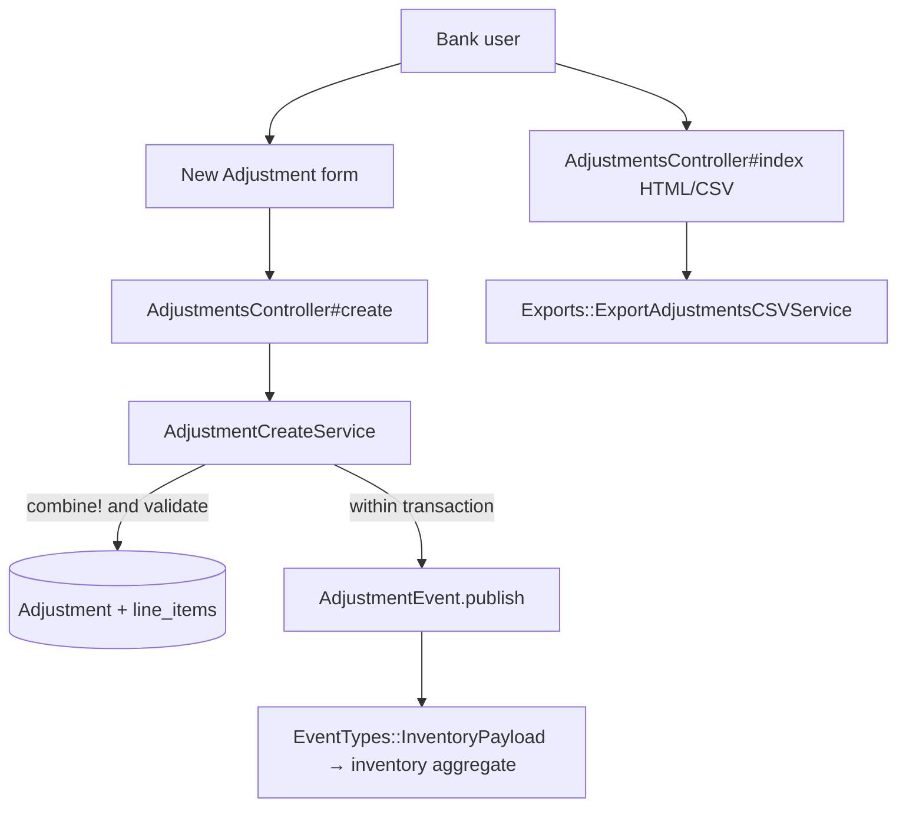
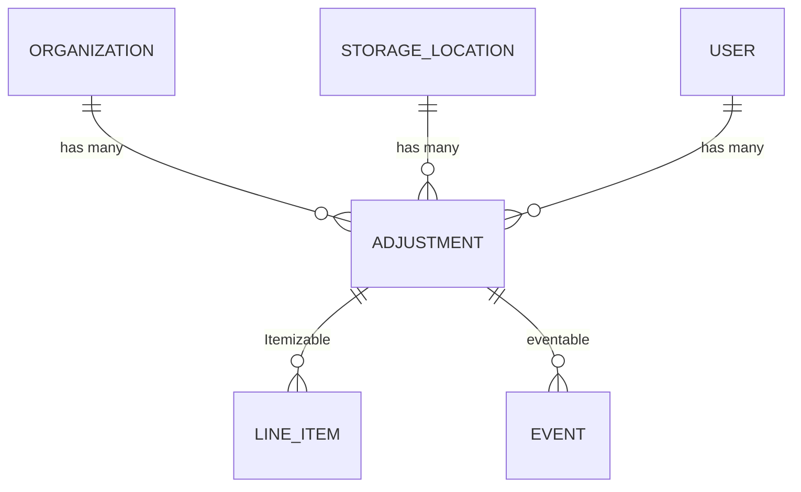

# Adjustments

> **Status**: ✅ Active
> **Generated**: 2026-10-24T00:00:00Z
> **Last Updated**: 2026-10-24T00:00:00Z
---

## Overview

### What It Does
Adjustments record manual corrections to inventory quantities at a storage location. A bank user creates an adjustment that targets exactly one storage location of their organization and contains one or more line items, each pairing an item with a signed quantity — positive quantities add inventory, negative quantities remove it. The record also stores a free-text comment and the user who created it. Saving an adjustment publishes an `AdjustmentEvent`; the inventory totals themselves are maintained by the event-sourced inventory aggregate, not written directly.

### Why It Exists
The controller documents the intent: adjustments "are the way that Essentials Banks fix incorrect inventory totals at Storage Locations." Physical stock drifts from recorded stock through miscounts, damage, loss, and typos. Adjustments correct the record honestly — without fabricating donations or distributions — and the feature intentionally offers only limited CRUD (no edit, no delete), so every correction is permanent and attributable.

### Key Capabilities
- Create a multi-item adjustment with mixed additions and removals against one active storage location
- List all of the organization's adjustments newest-first, filtered by storage location, creating user, and date range, with pagination
- View a single adjustment showing each line as Added or Removed with its quantity
- Export the filtered list as `Adjustments-<today>.csv` with one column per organization item
- Enter items by barcode on the creation form

---

## Architecture

### High-Level Design


### Components

#### Backend Components
| Component | File Path | Purpose |
|-----------|-----------|---------|
| `AdjustmentsController` | `app/controllers/adjustments_controller.rb` | Actions `index` (HTML + CSV), `show`, `new`, `create`; `filter_params` helper |
| `Adjustment` | `app/models/adjustment.rb` | Associations, concerns, scopes, organization-ownership validation, `split_difference`, `generate_csv` |
| `AdjustmentCreateService` | `app/services/adjustment_create_service.rb` | Combines duplicate line items, validates, saves and publishes the event in one transaction |
| `AdjustmentEvent` | `app/events/adjustment_event.rb` | Writes the event row carrying the inventory payload |
| `Exports::ExportAdjustmentsCSVService` | `app/services/exports/export_adjustments_csv_service.rb` | Builds CSV headers and per-item quantity columns |

> Checklist: this feature has no namespaced controllers, STI subclasses, Pundit policies, jobs/workers, search classes, broadcasters, ViewComponents, form objects, or Liquid drops. Model concerns are listed under Model Details.

#### Frontend Components
| Component | File Path | Purpose |
|-----------|-----------|---------|
| Index view | `app/views/adjustments/index.html.erb` | "Adjustment Filters" card (location, user, date range), results table, Export/New buttons, Kaminari pagination |
| New view | `app/views/adjustments/new.html.erb` | simple_form `new_adjustment` with storage-location source partial, Comment input, "Items in this adjustment" fieldset, "Add Another Item", barcode modal (`data-capture-barcode="true"`) |
| Show view | `app/views/adjustments/show.html.erb` | Added/Removed table (`positive`/`negative` row classes), organization, storage location, comments |

### Technology Stack
- **Backend**: Rails controller + service object + event sourcing (`Event` subclass with `EventTypes::InventoryPayload` / `EventTypes::EventLineItem`)
- **Frontend**: ERB (AdminLTE-style cards), simple_form, Stimulus `form-input` controller, shared date-range picker partial, Kaminari pagination
- **Database**: ActiveRecord `adjustments` table; line items via the `Itemizable` concern; PaperTrail versioning
- **External Services**: none

---

## Model Details

### Adjustment

#### Associations
```ruby
belongs_to :organization
belongs_to :storage_location
belongs_to :user
```
No `dependent:` options declared.

#### Concerns
| Concern | Purpose |
|---------|---------|
| `Exportable` | Shared export support |
| `Itemizable` | Provides `line_items` (item_id + signed quantity) and `line_items.combine!` |
| `Filterable` | Enables `class_filter(filter_params)` over the declared scopes |

The model also declares `has_paper_trail` (version history).

#### Callbacks
None declared.

#### Scopes
```ruby
scope :at_location, ->(location_id) { where(storage_location_id: location_id) }
scope :by_user, ->(user_id) { where(user_id: user_id) }
scope :during, ->(range) { where(adjustments: { created_at: range }) }
```

#### Validations
- `storage_locations_belong_to_organization` (custom): skipped when `organization` is nil; otherwise the storage location must be included in `organization.storage_locations`, else the error `storage_location: "storage location must belong to organization"` is added.

#### Key Methods
| Method | Returns | Purpose | Notes |
|--------|---------|---------|-------|
| `split_difference` | `[Adjustment, Adjustment]` | Partitions line items by quantity sign into an increasing and a decreasing adjustment; the decreasing half's quantities are multiplied by −1 | Side effect: mutates the original adjustment's line items (inline source comment) |
| `self.generate_csv(adjustments)` | `String` or `nil` | Returns `nil` when the collection is empty; otherwise delegates to `Exports::ExportAdjustmentsCSVService.generate_csv(adjustments, adjustments.first.organization)` | |

---

## Database Schema

### adjustments

| Column | Type | Default | Notes |
|--------|------|---------|-------|
| `id` | integer | — | Primary key, not null |
| `comment` | text | — | Reason for the adjustment |
| `created_at` | datetime | — | not null |
| `updated_at` | datetime | — | not null |
| `organization_id` | integer | — | Owning organization |
| `storage_location_id` | integer | — | Adjusted location |
| `user_id` | bigint | — | Creating user |

### Relationships


---

## API Endpoints

| Method | Path | Action | Description | Notes |
|--------|------|--------|-------------|-------|
| `GET` | `/adjustments` | `index` | Filterable, paginated list; newest first | `format.csv` → `send_data Adjustment.generate_csv(@adjustments), filename: "Adjustments-#{Time.zone.today}.csv"` |
| `GET` | `/adjustments/new` | `new` | Form with one prebuilt blank line item | Locations: `current_organization.storage_locations.active`; items: `current_organization.items.loose.active.alphabetized` (kits excluded) |
| `POST` | `/adjustments` | `create` | Creates via `AdjustmentCreateService`; success flash "Adjustment was successful.", redirect to show | On failure, errors are joined as `"attribute: message"` lines and the form re-renders |
| `GET` | `/adjustments/:id` | `show` | Detail of one adjustment | Lookup through `current_organization.adjustments.find` |

There are no `edit`, `update`, or `destroy` actions — adjustments are immutable once created.

Permitted parameters: `organization_id`, `storage_location_id`, `comment`, and `line_items_attributes: [item_id, quantity, _destroy]`. Filter parameters (`filters` key): `at_location`, `by_user`; the date range comes from the shared date-range picker.

---

## Authorization (Pundit)

No Pundit policy exists. Isolation is enforced by organization scoping: every read goes through `current_organization.adjustments`, and `create` merges `organization: current_organization, user: current_user` over the submitted params, so a client-supplied `organization_id` cannot create cross-organization records. Any signed-in bank user of the organization can use the feature.

---

## Configuration

### Environment Variables
None.

### Config Files
None specific to this feature.

---

## Usage Examples

### Controller create action
```ruby
# Source: app/controllers/adjustments_controller.rb:41
def create
  result = AdjustmentCreateService.new(adjustment_params.merge(organization: current_organization, user: current_user)).call
  @adjustment = result.adjustment
  if @adjustment.errors.none?
    flash[:notice] = "Adjustment was successful."
    redirect_to adjustment_path(@adjustment)
  else
    flash.now[:error] = @adjustment.errors.collect { |error| "#{error.attribute}: " + error.message }.join("<br />".html_safe)
    load_form_collections
    render :new
  end
end
```

### Create service
```ruby
# Source: app/services/adjustment_create_service.rb:16
def call
  # Combine line items for adjustment
  combine_adjustment
  # Check for validity, and save the actual adjustment

  if @adjustment.valid? && enough_inventory_for_decreases?
    ActiveRecord::Base.transaction do
      # Make the necessary changes in the db
      @adjustment.save
      AdjustmentEvent.publish(adjustment)
    rescue Errors::InsufficientAllotment, InventoryError => e
      @adjustment.errors.add(:base, e.message)
      raise ActiveRecord::Rollback
    end
  end
  self
end
```

### Event publication
```ruby
# Source: app/events/adjustment_event.rb:3
def self.publish(adjustment)
  create(
    eventable: adjustment,
    group_id: "adjustment-#{adjustment.id}-#{SecureRandom.hex}",
    organization_id: adjustment.organization_id,
    event_time: Time.zone.now,
    data: EventTypes::InventoryPayload.new(
      items: EventTypes::EventLineItem.from_line_items(adjustment.line_items, to: adjustment.storage_location_id)
    )
  )
end
```

### CSV layout
Headers: `Created date`, `Storage Area`, `Comment`, `Updates`, then every organization item name (sorted). Rows: creation date (`%F`), location name, comment, count of non-zero line items, then the summed signed quantity per item (0 when untouched).

---

## Testing

No spec files are part of the feature's mapped file set; verify under `spec/` (model, controller/request, service) before citing coverage.

---

## Known Issues & Caveats

| Issue | Location | Description |
|-------|----------|-------------|
| Method defined outside class | `app/services/adjustment_create_service.rb:39` | `enough_inventory_for_decreases?` appears after the class's closing `end`, so it is a top-level (Object) private method; it still resolves when called from `call` |
| No-op validation loop | `app/services/adjustment_create_service.rb:41` | The `line_items.each` body contains only `next unless line_item.quantity.negative?` — no real check. The method just requires a storage location (`false` when nil) and `errors.none?`. Actual insufficient-stock protection is the rescued `Errors::InsufficientAllotment` / `InventoryError` raised at event-publish time, which rolls the transaction back |
| Mutating helper | `app/models/adjustment.rb:34` | `split_difference` negates line-item quantities shared with the receiver — source comment: "This is changing the line items on the original adjustment!" |
| Item-scope inconsistency | `app/controllers/adjustments_controller.rb:58` | The failure-path `load_form_collections` uses `items.loose.alphabetized` (no `.active`), whereas `new` uses `items.loose.active.alphabetized` |
| Empty CSV returns `nil` | `app/models/adjustment.rb:39` | `generate_csv` yields `nil` for an empty set; the index view guards by rendering "Export Adjustments" only `if @adjustments.any?` |

---

## Performance

### Optimization Strategies
- Index eager-loads `includes(:line_items, :storage_location)` on the paginated relation (avoids N+1 in the table and "N changes" summary)
- Location filter restricted to `StorageLocation.with_adjustments_for(current_organization).select(:id, :name)`

### Caching
- None.

### Database Optimization
- Kaminari pagination (`page(params[:page])`), `order(created_at: :desc)`, date filtering via the `during` scope.

---

## Troubleshooting

### Issue: Adjustment rejected with an inventory message
**Symptoms:**
- Error flash on submit; form re-renders; nothing saved

**Cause:**
A negative line exceeds on-hand stock; `AdjustmentEvent.publish` raises `Errors::InsufficientAllotment`/`InventoryError` and the transaction rolls back.

**Solution:**
Lower the removal to at most the on-hand quantity at the location, or recount first.

### Issue: "storage location must belong to organization"
**Symptoms:**
- Validation error on create

**Cause:**
The submitted `storage_location_id` is not among `current_organization.storage_locations`.

**Solution:**
Select one of the locations offered by the form (active locations of the current organization).

---

## Related Features

- **Inventory Events** — `AdjustmentEvent` is one producer feeding the event-sourced inventory aggregate
- **Storage Locations** — the target of every adjustment; supplies the `with_adjustments_for` filter source
- **Items** — loose, active organization items populate the picker (kits excluded)
- **Transfers** — the correct tool for moving stock between locations
- **Audits** — formal physical-count verification that often precedes adjustments

---

**Generated:** 2026-10-24T00:00:00Z
**Last Updated:** 2026-10-24T00:00:00Z
**Status:** ✅ Active
