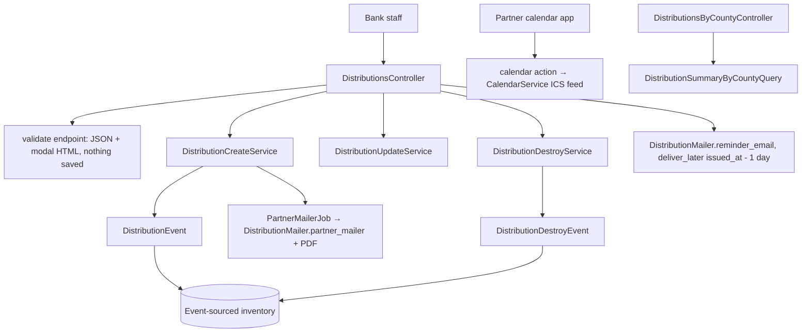
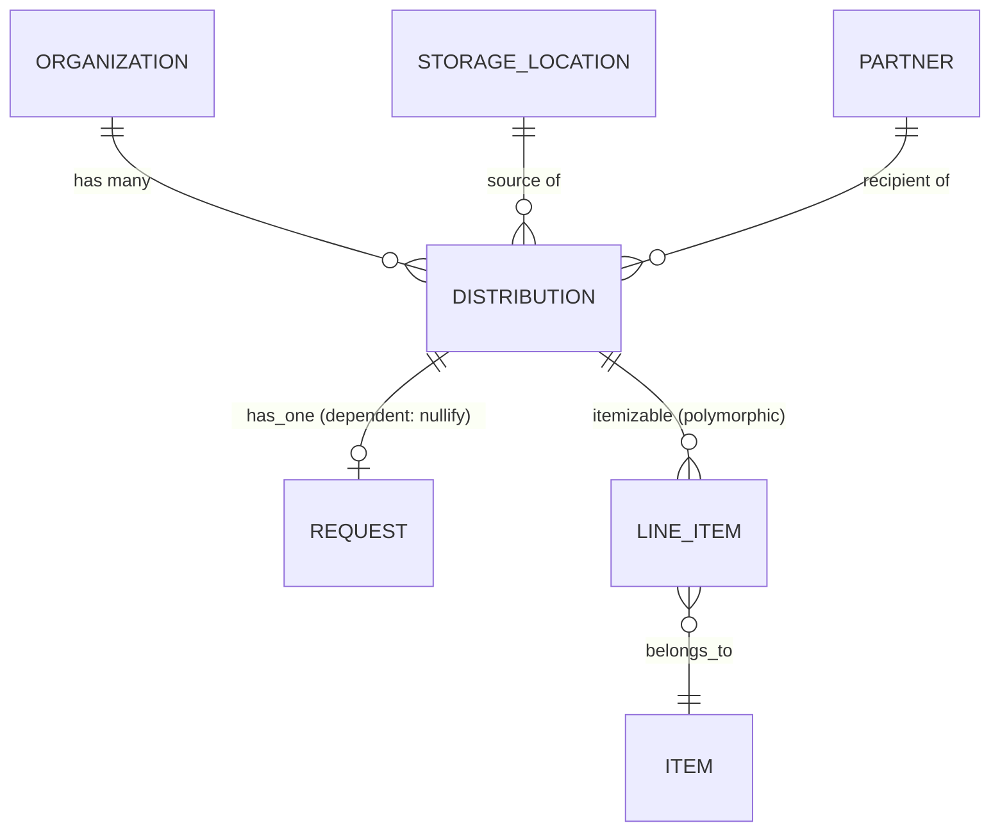

# Distributions

> **Status**: ✅ Active
> **Generated**: 2026-10-24T00:00:00Z
> **Last Updated**: 2026-10-24T00:00:00Z
---

## Overview

### What It Does
Distributions are the primary way inventory leaves a diaper bank in Human Essentials. Each distribution issues a set of line items from exactly one storage location to exactly one partner organization on a scheduled date (`issued_at`), using one of three delivery methods: pick up, delivery, or shipped (shipped distributions may carry a shipping cost). Saving a distribution publishes an inventory event that deducts stock from the storage location; deleting ("reclaiming") one publishes a compensating event that restores the stock. The feature also sends partner notification emails with a PDF manifest attached, schedules day-before reminder emails, renders a schedule calendar with a subscribable ICS feed, provides a pickup-day worklist with per-item totals, exports CSVs, and estimates distribution totals by county.

### Why It Exists
Essentials banks must keep storage-location on-hand counts verifiable, maintain an auditable record of which supplies went to which community partner on which date, and automate partner communication (notifications, change alerts, reminders). Most distributions go through community partners; direct services are only possible by convention via a partner named "Direct Services" and lack additional failsafes.

### Key Capabilities
- Create a distribution from scratch, from a partner request (the request is marked fulfilled and may only be fulfilled once), or seeded from a donation's line items
- Validate and preview in a confirmation modal before anything is saved
- Event-sourced inventory deduction on create and restoration on destroy, with per-line-item insufficient-stock errors
- Lifecycle: **scheduled** → **complete**, flipped by a one-click "picked up" action
- Partner email with PDF manifest on create; "Your Distribution Has Changed" email with an item diff on update; reminder email one day before the scheduled date
- Filterable index (item, item category, reporting category, partner, status, storage location, date range) with quantity/value totals for the page and the whole filtered set
- CSV export with per-item columns, an itemized breakdown CSV (distributed vs on-hand), a by-county proportional estimate report, and a public encrypted ICS calendar feed

---

## Architecture

### High-Level Design


### Components

#### Backend Components
| Component | File Path | Purpose |
|-----------|-----------|---------|
| `DistributionsController` | `app/controllers/distributions_controller.rb` | Actions: index, new, create, validate, show, edit, update, destroy, print, itemized_breakdown, schedule, calendar, picked_up, pickup_day |
| `DistributionsByCountyController` | `app/controllers/distributions_by_county_controller.rb` | `report` — estimated totals per county over a date range |
| `Distribution` | `app/models/distribution.rb` | Core model: enums, validations, callbacks, request/donation seeding, scopes |
| `DistributionService` | `app/services/distribution_service.rb` | Base service: transaction wrapper, error capture, `success?`/`error` API |
| `DistributionCreateService` | `app/services/distribution_create_service.rb` | Save + publish event + fulfill request + partner notification |
| `DistributionUpdateService` | `app/services/distribution_update_service.rb` | Prunes zero-quantity lines, delegates to `ItemizableUpdateService`, tracks date/method/content changes |
| `DistributionDestroyService` | `app/services/distribution_destroy_service.rb` | Publishes destroy event (restores inventory), destroys record |
| `DistributionContentChangeService` | `app/services/distribution_content_change_service.rb` | Diffs old/new line items into `updates` (old/new quantity) and `removed` |
| `DistributionTotalsService` | `app/services/distribution_totals_service.rb` | Per-distribution quantity and value totals in one SQL pass (window functions) |
| `DistributionItemizedBreakdownService` | `app/services/distribution_itemized_breakdown_service.rb` | Per-item distributed totals vs current on-hand and minimums; CSV with headers Item / Total Distribution / Total On Hand |
| `CalendarService` | `app/services/calendar_service.rb` | ICS calendar of the last year's distributions; curated time-zone list helper |
| `DeadlineService` | `app/services/deadline_service.rb` | Next monthly deadline day; partner group `deadline_day` overrides the organization's |
| `Exports::ExportDistributionsCSVService` | `app/services/exports/export_distributions_csv_service.rb` | Distributions CSV: base columns + per-item columns (+ optional in-kind value / packages columns) |
| `DistributionEvent` | `app/events/distribution_event.rb` | Inventory payload drawn FROM the storage location; `group_id` `dist-<id>-<hex>` |
| `DistributionDestroyEvent` | `app/events/distribution_destroy_event.rb` | Zeroed line items restore inventory; `group_id` `dist-destroy-<id>-<hex>` |
| `DistributionHelper` | `app/helpers/distribution_helper.rb` | Pickup-day date params, encrypted calendar URL, shipping-cost formatting (blank when zero/nil) |
| `DistributionMailer` | `app/mailers/distribution_mailer.rb` | `partner_mailer` (notification + PDF), `reminder_email` |
| `DistributionPdf` | `app/pdfs/distribution_pdf.rb` | Prawn manifest; request vs non-request table layouts; configurable column hiding and signature lines |
| `DistributionSummaryByCountyQuery` | `app/queries/distribution_summary_by_county_query.rb` | Raw SQL CTE query apportioning totals by partner served-area client share |

> Checklist: controllers ✓ (2), models ✓ (1 + concerns), services ✓ (9), events ✓ (2), jobs — uses shared `PartnerMailerJob`; policies — none exist for this feature (see Authorization); queries ✓ (1); PDFs ✓ (1); mailers ✓ (1). No ViewComponents, search classes, broadcasters, form objects, or Liquid drops.

#### Frontend Components
| Component | File Path | Purpose |
|-----------|-----------|---------|
| Index | `app/views/distributions/index.html.erb` | Filter card (item, category, reporting category, partner, source inventory, status, date range), Export Distributions + New Distribution buttons, filter-aware totals |
| Row partials | `app/views/distributions/_distribution_row.html.erb`, `_distribution_total.html.erb` | Row actions View / View Request / Edit / Print / Reclaim; page and overall totals |
| Form | `app/views/distributions/_form.html.erb` | simple_form; Stimulus `confirmation` and `distribution-delivery` controllers; shipping-cost toggle; dynamic line items with "Add Another Item"; hidden `partner_id` when request-backed |
| Confirmation modal | `app/views/distributions/validate.html.erb` | "You are about to create a distribution for <partner> from <location>" + item table; buttons "No, I need to make changes" / "Yes, it's correct" |
| New / Edit | `new.html.erb`, `edit.html.erb` | Edit shows a past-date warning and an audit warning |
| Show | `show.html.erb`, `_distribution_item_row.html.erb`, `_distribution_item_total.html.erb` | Summary and line-item tables; buttons Distribution Complete / Make a Correction / Print; inactive-items warning |
| Schedule | `schedule.html.erb`, `schedule.json.jbuilder` | Calendar page + JSON event feed (classes `fc-dist-complete` / `fc-dist-scheduled`, events link to pickup-day); "Copy Calendar URL to clipboard" button |
| Pickup day | `pickup_day.html.erb`, `_pickup_day_row.html.erb`, `_daily_item_row.html.erb` | Day's pickups (partner, time, source, total items, status, actions) + aggregated item totals (quantity, package count) |
| County report | `app/views/distributions_by_county/report.html.erb` | "Estimated Distributions by County" table: county, estimated total items, estimated total market value |
| Mailer views | `app/views/distribution_mailer/partner_mailer.html.erb`, `reminder_email.html.erb`, `reminder_email.text.erb`, `_distribution_changes.html.erb` | Notification body with interpolated default text, reminder body, items-updated/items-removed change list |

### Technology Stack
- **Backend**: Rails controllers + PORO services, event sourcing via `Event` subclasses, PaperTrail versioning, Kaminari pagination
- **Frontend**: ERB + simple_form, Turbo (enabled on new/show; turbo_stream failure re-render with HTTP 400), Stimulus controllers, calendar JS, jQuery + toastr for the copy-URL button
- **Database**: PostgreSQL (window functions; raw SQL CTEs in the county query)
- **External Services**: `icalendar`/`tzinfo` (ICS), Prawn + `prawn/table` (PDF), Flipper flag `enable_packs`, ActionMailer

---

## Model Details

### Distribution

#### Associations
```ruby
belongs_to :storage_location
belongs_to :partner
belongs_to :organization
has_one :request, dependent: :nullify
accepts_nested_attributes_for :request
```

#### Concerns
| Concern | Purpose |
|---------|---------|
| `Itemizable` | Polymorphic `line_items`, `combine!`, quantity totals, insufficiency errors |
| `Exportable` | CSV export support |
| `IssuedAt` | `issued_at` handling |
| `Filterable` | `class_filter` used by index and exports |
| `ItemsHelper` | `cents_to_dollar` used in `csv_export_attributes` |
| `has_paper_trail` | Version history |

#### Callbacks
| Callback | Method | Purpose |
|----------|--------|---------|
| `before_save` | `:combine_distribution` | `line_items.combine!` — merges duplicate item rows |
| `before_save` | `:reset_shipping_cost` | Sets `shipping_cost` to nil unless `delivery_method == "shipped"` |
| `before_destroy` | `:check_no_intervening_snapshot` | Raises `"We can't delete distributions entered before <date>."` when a `SnapshotEvent` postdates the distribution |

#### State Machines
Plain Rails enums (no AASM):
```ruby
enum :state, { scheduled: 5, complete: 10 }
enum :delivery_method, { pick_up: 0, delivery: 1, shipped: 2 }
```
The only transition in feature code is `scheduled → complete` via `complete!` in the `picked_up` action (guarded by `!distribution.complete?`); nothing transitions back.

#### Validations
| Rule | Detail |
|------|--------|
| `delivery_method` | presence |
| `line_items_quantity_is_positive` | total line-item quantity must be at least 1 |
| `shipping_cost` | numericality `>= 0`, allow_blank, only `if: :shipped?` |

#### Key Methods
| Method | Returns | Purpose | Notes |
|--------|---------|---------|-------|
| `distributed_at` | String | Date-only format when `issued_at` is midnight, else date + time | |
| `copy_from_request(request)` | — | Sets request, organization, partner; `agency_rep` = requesting partner user's formatted email; `comment` = request comments; `issued_at` = tomorrow; builds one line item per item request | Items requested in a custom unit get a nil quantity on purpose — staff must enter it |
| `copy_from_donation(donation_id, storage_location_id)` | — | Copies the donation's line items and/or sets the storage location | Both arguments optional |
| `initialize_request_items` | — | Links line items to their originating item requests; adds zero-quantity lines for requested items missing from the distribution | Used by the edit page |
| `csv_export_attributes` | Array | partner name, issue date, location name, total quantity, dollar value, delivery method, state, agency rep | |
| `future?` / `past?` | Boolean | `issued_at` strictly after / strictly before today | |
| `combine_duplicates` | — | Logs "Combining!" then merges duplicates | |

#### Scopes
`active` (only active items), `with_diapers` (disposable or cloth), `with_period_supplies`, `by_item_id`, `by_item_category_id`, `by_reporting_category`, `by_partner`, `by_location`, `by_state`, `recent(count = 3)`, `future` (issued tomorrow or later), `during(range)`, `apply_filters(filters, date_range)`, `this_week`, `in_last_12_months`.

---

## Database Schema

### distributions

> Columns from the model's schema annotation (`db/schema.rb` is outside this feature's file set).

| Column | Type | Default | Notes |
|--------|------|---------|-------|
| `id` | integer | — | Primary key, not null |
| `agency_rep` | string | — | Free-text agency contact |
| `comment` | text | — | Appears on PDF and in emails |
| `delivery_method` | integer | `"pick_up"` | not null, enum pick_up/delivery/shipped |
| `issued_at` | datetime | — | Scheduled date/time |
| `reminder_email_enabled` | boolean | `false` | not null |
| `shipping_cost` | decimal(8,2) | — | Kept only when shipped |
| `state` | integer | `"scheduled"` | not null, enum scheduled(5)/complete(10) |
| `created_at` | datetime | — | not null |
| `updated_at` | datetime | — | not null |
| `organization_id` | integer | — | FK |
| `partner_id` | integer | — | FK |
| `storage_location_id` | integer | — | FK |

### Relationships


---

## API Endpoints

> Paths inferred from path helpers used in the views; every action method was verified to exist in the controllers. The routes file is outside this feature's file set.

| Method | Path | Action | Description | Notes |
|--------|------|--------|-------------|-------|
| `GET` | `/distributions` | `index` | Filterable, paginated list; `format.csv` streams `Distributions-<date>.csv` | Highlights the just-created distribution |
| `GET` | `/distributions/new` | `new` | Form; `request_id` or `donation_id` + `storage_location_id` pre-fill; only active locations with positive inventory offered | |
| `POST` | `/distributions/validate` | `validate` | Returns `{valid: true, body: <modal HTML>}` or `{valid: false}`; **never saves** | Backs the confirmation modal |
| `POST` | `/distributions` | `create` | Service-backed create; on failure re-renders form via turbo_stream with HTTP 400 | Flash "Distribution created!" |
| `GET` | `/distributions/:id` | `show` | Detail with line items, total quantity, package count (nil when zero) | |
| `GET` | `/distributions/:id/edit` | `edit` | Allowed only when `(!complete? && future?)` or user is org admin; otherwise redirects with an error | Computes audit warning + snapshot lock |
| `PATCH/PUT` | `/distributions/:id` | `update` | Change-notification email when date/method/contents changed; reschedules reminder; inventory check | Flash "Distribution updated!" |
| `DELETE` | `/distributions/:id` | `destroy` | Reclaim: restores inventory, deletes record | Flash "Distribution <id> has been reclaimed!" |
| `GET` | `/distributions/:id/print` | `print` | Inline PDF named `"<partner> <date>.pdf"` | Served via `format.any` |
| `GET` | `/distributions/itemized_breakdown` | `itemized_breakdown` | CSV only: `Itemized-Breakdown-Distributions-<date>.csv` for selected range | |
| `GET` | `/distributions/schedule` | `schedule` | HTML calendar; JSON returns pickups between `start` and `end` params | |
| `GET` | `/distributions/calendar?hash=…` | `calendar` | Public ICS feed; `hash` is the org id encrypted with `MessageEncryptor`; invalid → 401 | Skips authenticate_user!/authorize_user/require_organization |
| `PATCH` | `/distributions/:id/picked_up` | `picked_up` | Marks complete; redirects back | Flash success or error |
| `GET` | `/distributions/pickup_day` | `pickup_day` | One day's pickups + aggregated per-item totals (name, quantity, package count) | `filters[during]`, defaults today |
| `GET` | `distributions_by_county/report` | `report` | Estimated items/value per county for date range | Separate controller |

Strong parameters: `comment, agency_rep, issued_at, partner_id, storage_location_id, reminder_email_enabled, delivery_method, shipping_cost`, `line_items_attributes: [item_id, quantity, _destroy]`; the request id is read from `params[:request_id]` or `distribution[request_attributes][id]`.

---

## Authorization (Pundit)

> There is no Pundit policy class for distributions; authorization is implemented ad hoc:

| Mechanism | Where | Effect |
|-----------|-------|--------|
| ApplicationController `authenticate_user!` / `authorize_user` / `require_organization` | all actions except `calendar` | Signed-in, organization-scoped access |
| `skip_before_action` × 3 | `calendar` | Fully public ICS endpoint |
| `current_organization.distributions.find(...)` | every member action | Cross-tenant isolation |
| `current_user.has_cached_role?(Role::ORG_ADMIN, current_organization)` | `edit` guard; Edit buttons on index/show | Only org admins may edit past or completed distributions |
| `ActiveSupport::MessageEncryptor` on `secret_key_base[0..31]` | `calendar` | Capability URL; `InvalidSignature`/`InvalidMessage` → `head :unauthorized` |

---

## Configuration

### Environment Variables
None specific to this feature; `Rails.application.secret_key_base` (first 32 bytes) keys the calendar-hash encryption.

### Feature flags & organization/partner settings
```text
Flipper :enable_packs                                   # show request units in PDF requested quantities
organization.include_in_kind_values_in_exported_files   # per-item "<Item> In-Kind Value" CSV columns
organization.include_packages_in_distribution_export    # per-item "<Item> Packages" CSV columns
organization.ytd_on_distribution_printout               # "Items Received Year-to-Date" on the PDF
organization.hide_value_columns_on_receipt              # hide Value/item and In-Kind Value PDF columns
organization.hide_package_column_on_receipt             # hide Packages PDF column
organization.signature_for_distribution_pdf             # "Received By:" / "Delivered By:" signature lines
organization.default_email_text                         # partner email body; interpolates delivery_method, distribution_date, partner_name, comment
partner.send_reminders                                  # gates creation/change notifications and reminder emails
partner.profile.pick_up_email                           # extra CC addresses on pick-up notifications
```

---

## Usage Examples

### Create service (fulfillment, event, notification)
```ruby
# Source: app/services/distribution_create_service.rb:9
def call
  perform_distribution_service do
    validate_request_not_yet_processed! if @request.present?

    distribution.save!

    DistributionEvent.publish(distribution)

    distribution.reload
    @request&.update!(distribution_id: distribution.id, status: 'fulfilled')
    send_notification if distribution.partner&.send_reminders
  end
end
```

### Reminder scheduling (one day before)
```ruby
# Source: app/controllers/distributions_controller.rb:294
def schedule_reminder_email(distribution)
  return if distribution.past? || !distribution.partner.send_reminders

  DistributionMailer.reminder_email(distribution.id).deliver_later(wait_until: distribution.issued_at - 1.day)
end
```

### Update change detection
```ruby
# Source: app/services/distribution_update_service.rb:27
def resend_notification?
  issued_at_changed? || delivery_method_changed? || distribution_content.any_change?
end
```

### Public calendar feed
```ruby
# Source: app/controllers/distributions_controller.rb:257
def calendar
  crypt = ActiveSupport::MessageEncryptor.new(Rails.application.secret_key_base[0..31])
  organization_id = crypt.decrypt_and_verify(CGI.unescape(params[:hash]))

  render body: CalendarService.calendar(organization_id), content_type: Mime::Type.lookup("text/calendar")
rescue ActiveSupport::MessageVerifier::InvalidSignature, ActiveSupport::MessageEncryptor::InvalidMessage
  head :unauthorized
end
```

---

## Testing

Spec files are outside this feature's documented file set and were not verified; none are listed to avoid fabricating paths.

---

## Known Issues & Caveats

| Issue | Location | Description |
|-------|----------|-------------|
| FIXME duplicate status state | `distributions_controller.rb:71` | "one of these needs to be removed but it's unclear which" — `@statuses` vs `@selected_status` |
| TODO on `schedule` | `distributions_controller.rb:245` | "This needs a little more context. Is it JSON only? HTML?" |
| Scaffold leftover view | `app/views/distributions/print.html.erb` | Placeholder text; actual printing is the PDF via `format.any` |
| `ensure` + `return self` | `distribution_service.rb:18` | Swallows re-raised exceptions; callers must check `success?` — services never raise |
| Silent shipping-cost reset | `distribution.rb:185` | Switching away from shipped silently discards the entered shipping cost |
| Misleading variable name | `distribution.rb:110` | `item_ids` Set stores ItemRequest objects, not ids |
| Business rules raised as strings | `distribution.rb:181`, `distribution_create_service.rb:32` | Snapshot guard and double-fulfillment guard raise RuntimeError strings surfaced as flash errors |
| Public endpoint by design | `calendar` action | Protected only by the encrypted hash parameter; anyone with the URL can read the schedule |
| Reminder timing edge | `schedule_reminder_email` | `wait_until: issued_at - 1.day` — same-day/next-day distributions effectively get immediate or no useful reminder; no reminder for past dates |

---

## Performance

### Optimization Strategies
- Totals for the index and CSV computed in one SQL pass with window functions (`SUM(...) OVER (PARTITION BY distributions.id)`) via `DistributionTotalsService`
- Eager loading throughout: `includes(:partner, :storage_location)` (index), `includes(line_items: :item)` (show/CSV/breakdown), `includes(:storage_location, :partner)` (calendar)
- County report is a single raw-SQL query with CTEs; per-county math done in the database
- CSV export reuses already-loaded line items in memory (explicitly noted in the service)

### Caching
- None feature-specific; org-admin checks use rolify's cached roles

### Database Optimization
- Window-function partitioning on `distributions.id`; polymorphic join on `line_items.itemizable_type = 'Distribution'` in the county query

---

## Troubleshooting

### Issue: "Sorry, we weren't able to save the distribution."
**Symptoms:** red flash with details; form re-rendered (HTTP 400).
**Cause:** usually `Errors::InsufficientAllotment` — a line-item quantity exceeds on-hand stock; offending items get inline errors. Also triggered by missing delivery method or total quantity below 1.
**Solution:** lower the flagged quantities or choose a different storage location; ensure at least one item with quantity ≥ 1.

### Issue: "Request has already been fulfilled by Distribution <id>"
**Cause:** the request already has a distribution (`validate_request_not_yet_processed!`).
**Solution:** open the existing distribution; a request can be fulfilled exactly once.

### Issue: Edit redirects away with an admin/date error
**Cause:** distribution is complete or not in the future, and the user lacks the org-admin role.
**Solution:** have an organization admin make the edit.

### Issue: "We can't delete distributions entered before <date>."
**Cause:** an inventory `SnapshotEvent` postdates the distribution; deletion and content changes are blocked behind the snapshot boundary.
**Solution:** none — intentional guard.

### Issue: Partner received no email/reminder
**Cause:** `partner.send_reminders` is false, the partner is deactivated, or the distribution date is already past (mailer guard clauses); reminders are scheduled only for future distributions.
**Solution:** check the partner's settings/status and the `issued_at` date.

### Issue: Calendar subscription returns 401
**Cause:** truncated or altered `hash` parameter.
**Solution:** re-copy the URL with "Copy Calendar URL to clipboard" on the Schedule page.

---

## Related Features

- **Requests** — `has_one :request`; fulfilling a request creates its distribution with partner locked and items pre-filled; marked `fulfilled` on create
- **Donations** — `copy_from_donation` seeds a new distribution from a donation's line items
- **Inventory Events** — `DistributionEvent` / `DistributionDestroyEvent` payloads; `SnapshotEvent` edit/delete guard; `View::Inventory` for on-hand checks
- **Storage Locations** — single source location per distribution; only active, positive-inventory locations offered on create
- **Partners** — recipients; profile drives notification emails, pick-up CCs, and delivery addresses on the PDF
- **Audits** — audits newer than the distribution trigger the edit-page audit warning
- **Reports / Historical Trends** — consume distribution quantities and values

---

**Generated:** 2026-10-24T00:00:00Z
**Last Updated:** 2026-10-24T00:00:00Z
**Status:** ✅ Active
