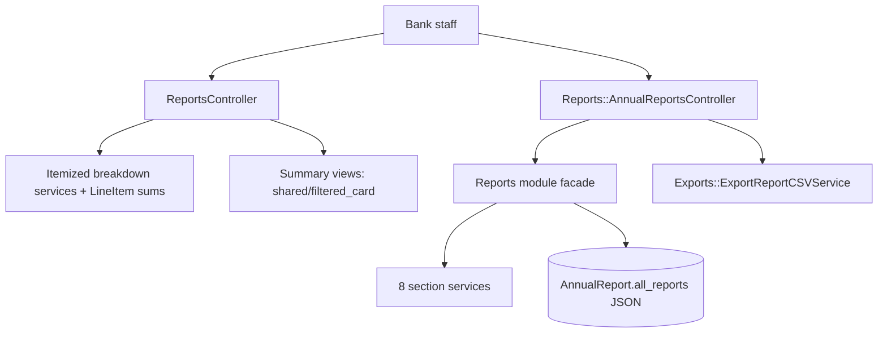
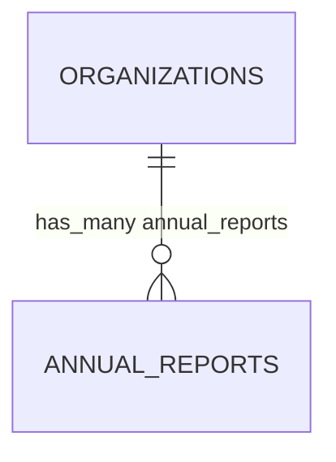

# Reports

> **Status**: ✅ Active
> **Generated**: 2026-10-24T00:00:00Z
> **Last Updated**: 2026-10-24T00:00:00Z
---

## Overview

### What It Does
The Reports feature equips a bank organization with two report families. First, nine operational summary pages — Donations (All Sources), Manufacturer Donations, Purchases, Product Drives, Distributions, Itemized Donations, Itemized Distributions, Itemized Requests, and an Activity Graph — all filtered by a user-selected date range and scoped to the current organization. Second, the NDBN Annual Report: for each completed year, eight calculated sections persisted as JSON on an `AnnualReport` record, viewable as HTML tables, recalculable on demand, and exportable as a CSV named `NdbnAnnuals-<year>-<date>.csv`.

### Why It Exists
Bank staff need day-to-day visibility into inflow (donations, purchases, drives), outflow (distributions, requests), and stock risk, and they must file standardized year-end figures with NDBN. This feature derives both from the organization's operational records, with the expensive annual computation cached.

### Key Capabilities
- Date-range-filtered summaries of donations, manufacturer donations, purchases, product drives, and distributions, each with a recent-activity list and quick-create buttons (**New Donation**, **New Purchase**, **New Distribution**)
- Item-level tables (donated / distributed / requested vs. Total On Hand) with red `table-danger` highlighting when an item is below its on-hand minimum
- Activity Graph: a Highcharts bar chart comparing "Received donations", "Purchased", and "Distributed" quantities for the period
- Annual report list from the organization's earliest reporting year through the last completed year, with "available in N months" messaging for the current year
- One-click **Recalculate Report** (flash: "Recalculated annual report!") and **Export Report** (CSV) on each annual report

---

## Architecture

### High-Level Design


### Components

#### Backend Components
| Component | File Path | Purpose |
|-----------|-----------|---------|
| ReportsController | `app/controllers/reports_controller.rb` | Nine summary actions; `before_action :setup_date_range_picker`; every query bounded by `helpers.selected_range` and `current_organization` |
| Reports::AnnualReportsController | `app/controllers/reports/annual_reports_controller.rb` | `index` (year list), `show` (HTML + CSV), `recalculate` (POST); `validate_show_params` 404s non-positive years |
| AnnualReport | `app/models/annual_report.rb` | Per-org, per-year persisted report; `each_report` iterator |
| Reports module | `app/services/reports.rb` | `all_reports` builds the 8 sections in fixed order; `retrieve_report` find-or-creates and caches |
| Reports::DiaperReportService | `app/services/reports/diaper_report_service.rb` | "Diapers": 19 entries incl. kit-packed diapers (raw SQL, `reporting_category = 'disposable_diapers'`), drive stats split real/virtual, donated vs. purchased percentages, spend, sources |
| Reports::WarehouseReportService | `app/services/reports/warehouse_report_service.rb` | "Warehouse and Storage": location count, square footage with missing-data note, largest site type with fallbacks |
| Reports::AdultIncontinenceReportService | `app/services/reports/adult_incontinence_report_service.rb` | "Adult Incontinence": loose + kit supplies, adults/month using `COALESCE(distribution_quantity, 50)` loose and default 1 for kits, % donated/bought, spend |
| Reports::PeriodSupplyReportService | `app/services/reports/period_supply_report_service.rb` | "Period Supplies": loose + kit supplies via shared `kit_items_calculation` applied to distributions, purchases, donations (categories pads/tampons/period_liners/period_underwear/period_other) |
| Reports::OtherProductsReportService | `app/services/reports/other_products_report_service.rb` | "Other Items": distributed quantity, % donated/bought, spend, sorted product list |
| Reports::PartnerInfoReportService | `app/services/reports/partner_info_report_service.rb` | "Partner Agencies and Service Area": profile count, per-agency-type tallies labeled via I18n scope `partners_profile`, unique sorted zip codes |
| Reports::ChildrenServedReportService | `app/services/reports/children_served_report_service.rb` | "Children Served": CEILING(quantity / COALESCE(distribution_quantity, 50)) over loose disposables + DISTINCT ON kit subquery; ÷12 monthly average; Y/N repackage & monthly-distribution flags |
| Reports::SummaryReportService | `app/services/reports/summary_report_service.rb` | "Year End Summary": YoY % change in donation count, money raised, disposable diaper donations; "+100%" when prior year zero |
| Exports::ExportReportCSVService | `app/services/exports/export_report_csv_service.rb` | Two rows: concatenated entry keys (headers) and values (data) across all sections |

#### Frontend Components
| Component | File Path | Purpose |
|-----------|-----------|---------|
| Summary cards | `app/views/reports/*_summary.html.erb` | `shared/filtered_card` with date filter, headline totals, recents, **See more...** footers |
| Itemized tables | `app/views/reports/itemized_*.html.erb` | Item/total/on-hand tables; empty-range alert messages |
| Activity graph | `app/views/reports/activity_graph.html.erb` | JSON chart config into `data-controller="highchart"` |
| Annual report pages | `app/views/reports/annual_reports/{index,show}.html.erb` | Year list card; per-section two-column tables; **Recalculate Report** / **Export Report** buttons |
| Row partials | `app/views/reports/_{donation,distribution,purchase,manufacturer,product_drive}.html.erb` | Linked recent rows with item totals and relative times |

### Technology Stack
- **Backend**: Rails controllers, PORO services with `ActionView::Helpers::NumberHelper`, parameterized raw SQL for kit aggregation
- **Frontend**: ERB, shared filtered-card partial, Stimulus-wired Highcharts
- **Database**: PostgreSQL — `EXTRACT(year FROM issued_at)`, `CEILING`, `DISTINCT ON`; JSON cache column

---

## Model Details

### AnnualReport

#### Associations
```ruby
belongs_to :organization, inverse_of: :annual_reports
```

#### Concerns
| Concern | Purpose |
|---------|---------|
| PaperTrail (`has_paper_trail`) | Versions every change to the stored report |

#### Callbacks
None.

#### Validations
```ruby
validates :year, numericality: { greater_than: 1900, less_than: 10_000 }
```

#### Key Methods
| Method | Returns | Purpose | Notes |
|--------|---------|---------|-------|
| `each_report` | yields `(String, Array<Hash>)` | Iterates sections yielding `hash['name']`, `hash['entries']` | String-keyed — correct for JSON-round-tripped data |

### Section service contract
All eight services share the constructor `(year:, organization:)` and a memoized `#report` returning `{name:, entries:}` where values are pre-formatted strings/numbers (`number_with_delimiter`, `number_to_currency`, rounded percentages, `Y`/`N`, comma-joined lists).

---

## Database Schema

### annual_reports

| Column | Type | Default | Notes |
|--------|------|---------|-------|
| `id` | `bigint` | — | Primary key |
| `all_reports` | `json` | — | Array of 8 `{name, entries}` hashes |
| `year` | `integer` | — | Validated: > 1900 and < 10,000 |
| `created_at` | `datetime` | — | not null |
| `updated_at` | `datetime` | — | not null |
| `organization_id` | `bigint` | — | Owner organization |

### Relationships


---

## API Endpoints

> Actions verified against controller methods; paths per the `reports_*` route helpers used in views.

| Method | Path | Action | Description | Notes |
|--------|------|--------|-------------|-------|
| `GET` | `/reports/donations_summary` | `donations_summary` | Donations in range; recents | **New Donation** button |
| `GET` | `/reports/manufacturer_donations_summary` | `manufacturer_donations_summary` | Manufacturer donations; top 10 manufacturers by donation date | |
| `GET` | `/reports/purchases_summary` | `purchases_summary` | Spend struct: total, diapers, period supplies, adult incontinence, other, total items, recents | **New Purchase** button |
| `GET` | `/reports/product_drives_summary` | `product_drives_summary` | Drives active, items received, money raised, recent drive donations | Controller loads same data as donations_summary |
| `GET` | `/reports/itemized_donations` | `itemized_donations` | Item / Total Donated / Total On Hand | |
| `GET` | `/reports/itemized_distributions` | `itemized_distributions` | Item / Total Distributed / Total On Hand | Red cell below minimum |
| `GET` | `/reports/distributions_summary` | `distributions_summary` | Items distributed; future-scheduled count; recents with partner names | **New Distribution** button |
| `GET` | `/reports/activity_graph` | `activity_graph` | Received/Purchased/Distributed totals for bar chart | Empty-range alert |
| `GET` | `/reports/itemized_requests` | `itemized_requests` | Item (+unit) / Total Requested / Total On Hand (`|| 0`) | Red cell below minimum |
| `GET` | `/reports/annual_reports` | `index` | Years `(earliest_reporting_year...current_year)`, exclusive of current | Shows months remaining (`12 - current month`) |
| `GET` | `/reports/annual_reports/:year` | `show` | Eight-section HTML; `.csv` format streams export | 404 unless `year.to_i.positive?` |
| `POST` | `/reports/annual_reports/:year/recalculate` | `recalculate` | Forces recompute; redirect with notice "Recalculated annual report!" | |

---

## Authorization

No Pundit policies exist in this feature's file set. Isolation is purely organizational scoping: every read goes through `current_organization` and annual reports are found/created per `(organization, year)`. Year params are validated positive before `show`/`recalculate`.

---

## Configuration

### Environment Variables
None.

### Config Files
- I18n translations under scope `partners_profile` supply agency-type labels in the partner section.

---

## Usage Examples

### Cache-or-compute an annual report
```ruby
# Source: app/services/reports.rb
def retrieve_report(year:, organization:, recalculate: false)
  report_attributes = { organization: organization, year: year }
  report = AnnualReport.find_or_create_by(report_attributes)
  if report.all_reports.blank? || recalculate
    calculated_reports = all_reports(**report_attributes)
    report.update!(all_reports: calculated_reports)
  end
  report
end
```

### Year-over-year percent formatting
```ruby
# Source: app/services/reports/summary_report_service.rb
def percent_difference(last, this)
  if last.zero?
    if this.zero?
      "0%"
    else
      "+100%"
    end
  else
    res = (((this - last) / last.to_f) * 100).round
    return "0%" if res.zero?

    res = "#{number_with_delimiter(res)}%"
    res = "+#{res}" unless res.start_with?('-')
    res
  end
end
```

### Activity graph data assembly
```ruby
# Source: app/controllers/reports_controller.rb
def received_distributed_data(range = selected_range)
  {
    "Received donations" => total_received_donations_unformatted(range),
    "Purchased" => total_purchased_unformatted(range),
    "Distributed" => total_distributed_unformatted(range)
  }
end
```

---

## Testing

Spec files fall outside this feature's documented file set and were not verified here.

---

## Known Issues & Caveats

| Issue | Location | Description |
|-------|----------|-------------|
| Symbol/string key boundary | `annual_report.rb` / `export_report_csv_service.rb` | Section services emit symbol keys; `each_report` and CSV read `['name']`/`['entries']` — depends on JSON round-trip through the DB |
| Duplicated controller data | `reports_controller.rb` (`product_drives_summary`) | Identical assignments to `donations_summary`; drive totals computed by view helpers instead |
| Integer division | `diaper_report_service.rb` (`money_from_drives`, `money_from_virtual_drives`) | `sum(:money_raised) / 100` truncates cents; other money uses `/ 100.0` |
| Guard/denominator mismatch | `diaper_report_service.rb` (`percent_disposable_diapers_purchased`, `percent_cloth_diapers_purchased`) | Zero-guard checks the purchased numerator, not the acquired denominator |
| Reused card id | itemized donations/distributions/requests views | All three pass `id: "purchases"` to `shared/filtered_card` |
| Stray closing tag | `donations_summary.html.erb` | Unmatched `</section>` |
| Inconsistent year coercion | `summary_report_service.rb` | Only this service applies `year.to_i` |

---

## Performance

### Optimization Strategies
- Kit-content aggregation done in single raw-SQL queries (diapers, adult incontinence, period supplies); children-served kit math uses a `DISTINCT ON` subquery
- Exception: adult-incontinence kits-per-month iterates kits in Ruby with per-kit queries
- Memoized service results (`@report ||=` and per-metric memoization)
- `includes(:partner)` on distribution queries used by summary/itemized reports

### Caching
- **Cache Layer**: `annual_reports.all_reports` JSON column (PostgreSQL)
- **TTL**: none; invalidated only by **Recalculate Report**

### Database Optimization
- Year scoping via `for_year` scopes and `EXTRACT(year FROM issued_at)` in raw SQL

---

## Troubleshooting

### Issue: Annual report doesn't reflect corrected records
**Symptoms:** Old figures after fixing past donations/distributions.
**Cause:** Report cached in `all_reports` on first calculation.
**Solution:** POST `recalculate` (the **Recalculate Report** button) to rebuild and persist.

### Issue: Current year absent from the annual report list
**Symptoms:** Latest listed year is last year.
**Cause:** The index range `(foundation_year...current_year)` deliberately excludes the running year.
**Solution:** By design; the page shows "available in N months".

### Issue: Summary card is empty
**Symptoms:** Alert such as "No distributions found for the selected date range."
**Cause:** No records within `selected_range`.
**Solution:** Change the card's date filter.

---

## Related Features

- **Donations** — inflow records behind donation summaries and annual donation/diaper figures
- **Purchases** — spend totals and the `amount_spent_on_*_cents` category columns
- **Distributions** — outflow totals, itemized breakdowns, children/adults served calculations
- **Product Drives** — drive counts, collected diapers, money raised (real and virtual)
- **Kits** — kit contents counted into annual diaper/AI/period-supply figures
- **Storage Locations** — warehouse section (count, square footage, largest type)
- **Partners** — profiles supply agency counts, types, and zip codes served

---

**Generated:** 2026-10-24T00:00:00Z
**Last Updated:** 2026-10-24T00:00:00Z
**Status:** ✅ Active
