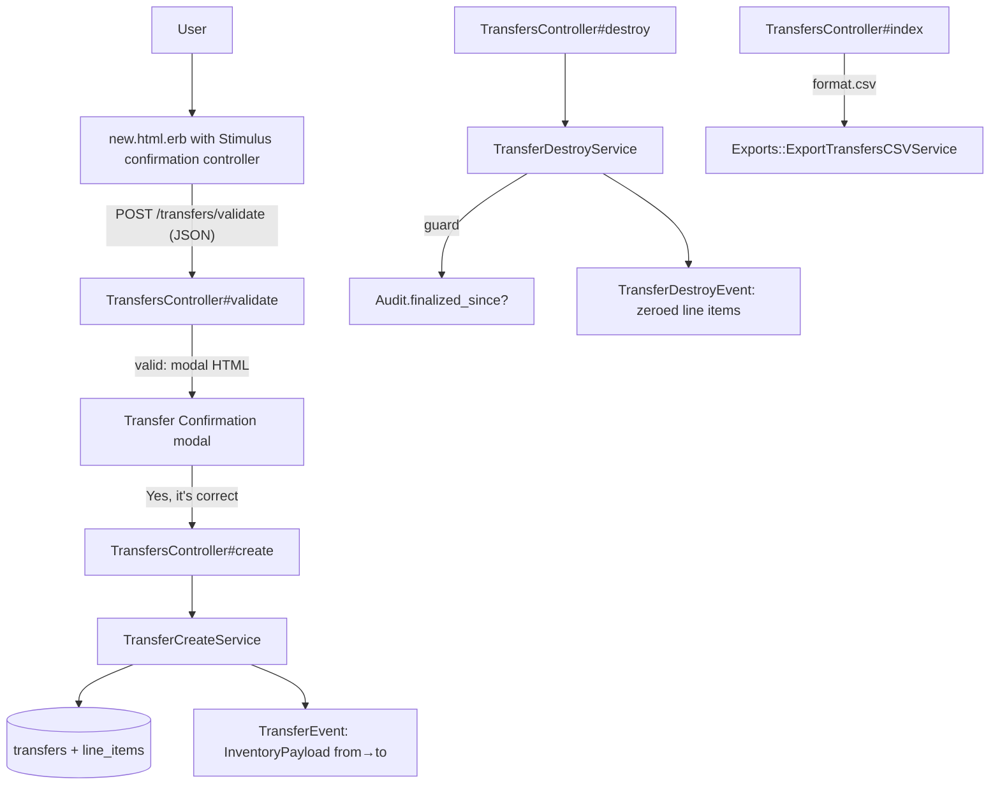
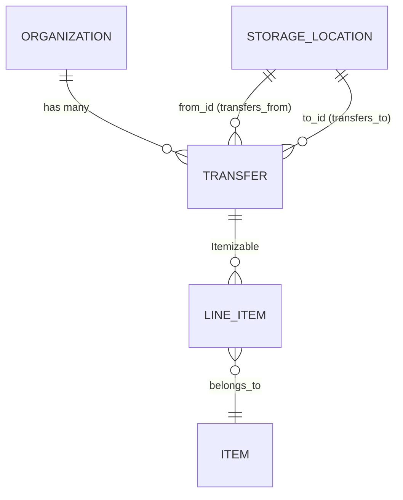

# Transfers

> **Status**: ✅ Active
> **Generated**: 2026-10-24T00:00:00Z
> **Last Updated**: 2026-10-24T00:00:00Z
---

## Overview

### What It Does
Transfers move quantities of inventory from one storage location to another inside a single organization. The feature is deliberately partial CRUD: users can create, list, view, and destroy transfers, but there is no edit/update action. Both the creation and the destruction of a transfer publish events to the event-sourced inventory system, which is what actually adjusts location quantities — a destroy publishes a reversal, returning the quantities to the source location.

### Why It Exists
Banks keep stock in several storage locations (warehouses, closets, vehicles). When goods physically move between locations, both ends must be updated atomically and auditably while the organization's net inventory stays unchanged.

### Key Capabilities
- Create a transfer with any number of item lines (quantity ≥ 1 each; duplicate item lines are merged via `combine!`), with barcode entry support
- Server-side pre-validation driving a confirmation modal before the real submit
- Enforce integrity rules: distinct from/to locations, both owned by the organization, source holds sufficient inventory
- Filterable history (source location, destination location, date range) with CSV export (one column per organization item)
- Destroy with automatic inventory reversal, blocked once a finalized audit touches either location

---

## Architecture

### High-Level Design


### Components

#### Backend Components
| Component | File Path | Purpose |
|-----------|-----------|---------|
| `TransfersController` | `app/controllers/transfers_controller.rb` | Actions: `index`, `new`, `create`, `show`, `destroy`, `validate` |
| `Transfer` | `app/models/transfer.rb` | Model: associations, scopes, 4 custom validations, PaperTrail |
| `TransferCreateService` | `app/services/transfer_create_service.rb` | Valid? → transaction(save + `TransferEvent.publish`); else raises with joined messages |
| `TransferDestroyService` | `app/services/transfer_destroy_service.rb` | Audit guard → transaction(`TransferDestroyEvent.publish` + `destroy!`); returns `Result` |
| `Exports::ExportTransfersCSVService` | `app/services/exports/export_transfers_csv_service.rb` | CSV generation: base + per-item columns |
| `TransferEvent` | `app/events/transfer_event.rb` | Movement event, `group_id: "transfer-<id>-<hex>"` |
| `TransferDestroyEvent` | `app/events/transfer_destroy_event.rb` | Reversal event, `group_id: "transfer-destroy-<id>-<hex>"` |

#### Frontend Components
| Component | File Path | Purpose |
|-----------|-----------|---------|
| Index view | `app/views/transfers/index.html.erb` | "Inventory Transfers" page: Transfer Filters card, table, Export Transfers + New Transfer buttons |
| Row partial | `app/views/transfers/_transfer_row.html.erb` | From, To, Date, Comment (`"none"` fallback), Total Moved, delete/view actions |
| New view | `app/views/transfers/new.html.erb` | simple_form (`id="new_transfer"`), from/to selects, comment, line-items fieldset with `data-capture-barcode="true"`, Add Another Item, modal shell `#transferConfirmationModal` |
| Validate modal partial | `app/views/transfers/_validate_modal.html.erb` | "Transfer Confirmation": item/quantity table, optional Note, buttons "No, I need to make changes" / "Yes, it's correct" |
| Show view | `app/views/transfers/show.html.erb` | "Transfer from X to Y on MM/DD/YYYY": item/quantity table, Total row, Comments row |

The form's Stimulus wiring: `data-controller="confirmation"`, `data-confirmation-pre-check-path-value="<%= validate_transfers_path(format: :json) %>"`, submit button bound to `click->confirmation#openModal`, modal confirm bound to `confirmation#submitForm`. The page also renders `barcode_items/barcode_modal`.

### Technology Stack
- **Backend**: Ruby on Rails controllers + service objects (`Result` pattern), PaperTrail versioning, event sourcing (`Event` subclasses + `EventTypes::InventoryPayload` / `EventTypes::EventLineItem`)
- **Frontend**: ERB, simple_form, Stimulus, Bootstrap modal, barcode capture
- **Database**: PostgreSQL; `transfers` table plus shared `line_items` via the `Itemizable` concern

---

## Model Details

### Transfer

#### Associations
```ruby
has_paper_trail
belongs_to :organization, inverse_of: :transfers
belongs_to :from, class_name: "StorageLocation", inverse_of: :transfers_from
belongs_to :to, class_name: "StorageLocation", inverse_of: :transfers_to

# to make it play nice with Itemizable - alias of `from`
belongs_to :storage_location, class_name: "StorageLocation", inverse_of: :transfers_from, foreign_key: :from_id
```

#### Concerns
| Concern | Purpose |
|---------|---------|
| `Itemizable` | Nested `line_items` with `line_items_attributes`, `combine!` (merges duplicate item rows), `total`, `sorted`, and `line_items_quantity_is_at_least` |
| `Filterable` | `class_filter(filter_params)` used by the index action |

`has_paper_trail` keeps a version history of transfer records.

#### Callbacks
None on the model. Event publication is handled in the create/destroy services, inside database transactions.

#### Scopes
| Scope | Definition |
|-------|------------|
| `from_location` | `->(location_id) { where(from_id: location_id) }` |
| `to_location` | `->(location_id) { where(to_id: location_id) }` |
| `during` | `->(range) { where(created_at: range) }` |

#### Validations
| Validation | Rule and error message |
|------------|------------------------|
| `storage_locations_belong_to_organization` | Both `from` and `to` must be in `organization.storage_locations`; otherwise "location must belong to organization" on the offending attribute |
| `storage_locations_must_be_different` | `from_id == to_id` → "location must be different than from location" on `:to` |
| `from_storage_quantities` | Builds `View::Inventory.new(organization_id)`; line items with `quantity > inventory.quantity_for(item_id:)` produce "location has insufficient inventory for <item names>" on `:from` |
| `line_items_quantity_is_positive` | Calls `line_items_quantity_is_at_least(1)` — every line item quantity must be ≥ 1 |

#### Key Methods
| Method | Returns | Purpose | Notes |
|--------|---------|---------|-------|
| `insufficient_items` | `Array<LineItem>` | Selects line items exceeding available inventory | Private; supplies names for the insufficiency error |

---

## Database Schema

### transfers

| Column | Type | Default | Notes |
|--------|------|---------|-------|
| `id` | `serial` | — | Primary key |
| `from_id` | `integer` | — | Source `StorageLocation` |
| `to_id` | `integer` | — | Destination `StorageLocation` |
| `comment` | `string` | — | Optional note; displayed and exported as "none" when blank |
| `created_at` | `datetime` | — | `null: false`; used for the `during` filter, list dates (`%F`), show heading (`%m/%d/%Y`), and CSV `Date` |
| `updated_at` | `datetime` | — | `null: false` |
| `organization_id` | `integer` | — | Indexed: `index_transfers_on_organization_id` |

### Relationships


---

## API Endpoints

Routes (`config/routes.rb:124`): `resources :transfers, only: %i(index create new show destroy)` plus `post :validate, on: :collection`. All controller actions verified to exist.

| Method | Path | Action | Description | Notes |
|--------|------|--------|-------------|-------|
| `GET` | `/transfers` | `index` | Filtered list: `class_filter(filter_params)` + `during(helpers.selected_range)`; eager-loads `line_items`, `from`, `to` | `format.csv` downloads `Transfers-<Time.zone.today>.csv` |
| `GET` | `/transfers/new` | `new` | New transfer + one built line item; collections `storage_locations.active.alphabetized`, `items.active.alphabetized` | |
| `POST` | `/transfers` | `create` | `line_items.combine!`, then `TransferCreateService.call`; success notice "#{total} items have been transferred from #{from.name} to #{to.name}!" | Rescue → `flash.now[:error] = e.message`, reload collections, re-render `new` |
| `GET` | `/transfers/:id` | `show` | Detail: `@total = line_items.total`, `@line_items = line_items.sorted` | |
| `DELETE` | `/transfers/:id` | `destroy` | `TransferDestroyService.new(transfer_id:).call`; success → "Successfully deleted Transfer ##{id}!", failure → error flash | Always `redirect_to transfers_path` |
| `POST` | `/transfers/validate` | `validate` | Pre-submit check: valid → `{valid: true, body: <_validate_modal HTML>}`; invalid → `{valid: false}` with status `unprocessable_content` (422) | Consumed by the Stimulus confirmation controller |

Strong parameters:
```ruby
params.require(:transfer).permit(:from_id, :to_id, :comment,
                                 line_items_attributes: %i(item_id quantity _destroy))
```
Index filter params permit `:from_location, :to_location`; the dropdown collections are `StorageLocation.with_transfers_from(current_organization)` / `with_transfers_to(current_organization)` (only locations with transfer history).

---

## Authorization (Pundit)

No Pundit policy exists for transfers. Authorization is organization scoping only — every query runs through `current_organization.transfers` — so any signed-in bank user of the organization can perform all six actions.

| Method | Permission | Conditions | Notes |
|--------|------------|------------|-------|
| — | Organization membership | All records scoped to `current_organization` | No per-action policy methods defined |

---

## Configuration

### Environment Variables
None specific to this feature.

### Config Files
None; only the route declarations in `config/routes.rb`.

---

## Usage Examples

### Transactional create with event publication
```ruby
# Source: app/services/transfer_create_service.rb
def call(transfer)
  if transfer.valid?
    ActiveRecord::Base.transaction do
      transfer.save
      TransferEvent.publish(transfer)
    end
  else
    raise StandardError.new(transfer.errors.full_messages.join(", "))
  end
end
```

### Guarded destroy with reversal
```ruby
# Source: app/services/transfer_destroy_service.rb
def call
  if Audit.finalized_since?(transfer, transfer.to_id, transfer.from_id)
    raise "We can't delete this transfer because its items were audited since you made the transfer."
  end

  transfer.transaction do
    TransferDestroyEvent.publish(transfer)
    transfer.destroy!
  end

  Result.new
rescue StandardError => e
  Result.new(error: e)
end
```

### Inventory payloads
```ruby
# Source: app/events/transfer_event.rb — movement from → to
data: EventTypes::InventoryPayload.new(
  items: EventTypes::EventLineItem.from_line_items(transfer.line_items,
    from: transfer.from.id,
    to: transfer.to.id)
)

# Source: app/events/transfer_destroy_event.rb — reversal (zeroed lines)
data: EventTypes::InventoryPayload.new(
  items: EventTypes::EventLineItem.zeroed_line_items(transfer.line_items,
    to: transfer.to.id,
    from: transfer.from.id)
)
```

### CSV layout
Base headers `From`, `To`, `Date` (`%F`), `Comment` (`transfer.comment || "none"`), `Total Moved` (`line_items.total`), followed by one header per distinct item name (`DISTINCT ON (LOWER(name))`, ordered `LOWER(name) ASC`), default `0`, with each line item's quantity added into its item's column.

---

## Testing

### Test Files
- `spec/models/transfer_spec.rb`
- `spec/controllers/transfers_controller_spec.rb`
- `spec/requests/transfers_requests_spec.rb`
- `spec/services/transfer_destroy_service_spec.rb`
- `spec/system/transfer_system_spec.rb`
- `spec/factories/transfers.rb`

---

## Known Issues & Caveats

| Issue | Location | Description |
|-------|----------|-------------|
| No edit/update action | `config/routes.rb:124` | Partial CRUD by design; the only correction path is destroy + re-create |
| Inactive items after failed create | `transfers_controller.rb#load_form_collections` | Re-render uses `items.alphabetized` (no `.active`), unlike `new` which filters to active items |
| CSV silently skips unmatched items | `export_transfers_csv_service.rb#build_row_data` | `next unless item_column_idx` drops line items whose name is not among the generated headers |
| Literal "none" comment | `_transfer_row.html.erb`, CSV service | Blank comments render as the string "none" in the table and export |
| Coarse audit guard | `transfer_destroy_service.rb` | Any finalized audit at either location after the transfer blocks deletion, even if the audited items differ |

---

## Performance

### Optimization Strategies
- `index` eager-loads `line_items`, `from`, `to`; `show` additionally `items` — avoids N+1 in tables
- CSV export reuses the filtered relation with `includes(line_items: :item)`
- Filter dropdowns restricted to locations that have transfer history (`with_transfers_from` / `with_transfers_to`)

### Caching
None for this feature.

### Database Optimization
- Index `index_transfers_on_organization_id` supports the organization scoping on every query

---

## Troubleshooting

### Issue: Create fails with "location has insufficient inventory for …"
**Symptoms:**
- Error flash on the re-rendered form, naming one or more items

**Cause:**
`from_storage_quantities` found line items whose quantity exceeds `View::Inventory#quantity_for(item_id:)`.

**Solution:**
Reduce the quantities or replenish the source location, then resubmit.

### Issue: Delete refused
**Symptoms:**
- Error flash: "We can't delete this transfer because its items were audited since you made the transfer."

**Cause:**
`Audit.finalized_since?(transfer, to_id, from_id)` returned true — a finalized audit touched either location after the transfer was created.

**Solution:**
Keep the record; correct inventory with a compensating transfer or an adjustment.

### Issue: Confirmation modal does not open on submit
**Symptoms:**
- `POST /transfers/validate` returns 422 with `{valid: false}`

**Cause:**
The pre-check found the transfer invalid.

**Solution:**
Fix the inputs (locations, quantities); a full submit will surface the exact validation messages in the error flash.

---

## Related Features

- **Storage Locations** — endpoints of every transfer; provide inventory levels, the active-location form collections, and the `with_transfers_from/to` filter collections
- **Inventory Events** — `TransferEvent` / `TransferDestroyEvent` payloads are consumed by the inventory aggregate to compute location quantities
- **Audits** — `Audit.finalized_since?` gates transfer deletion to protect finalized counts
- **Items / Line Items** — `Itemizable` supplies the nested line-item behavior, totals, and quantity validation

---

**Generated:** 2026-10-24T00:00:00Z
**Last Updated:** 2026-10-24T00:00:00Z
**Status:** ✅ Active
