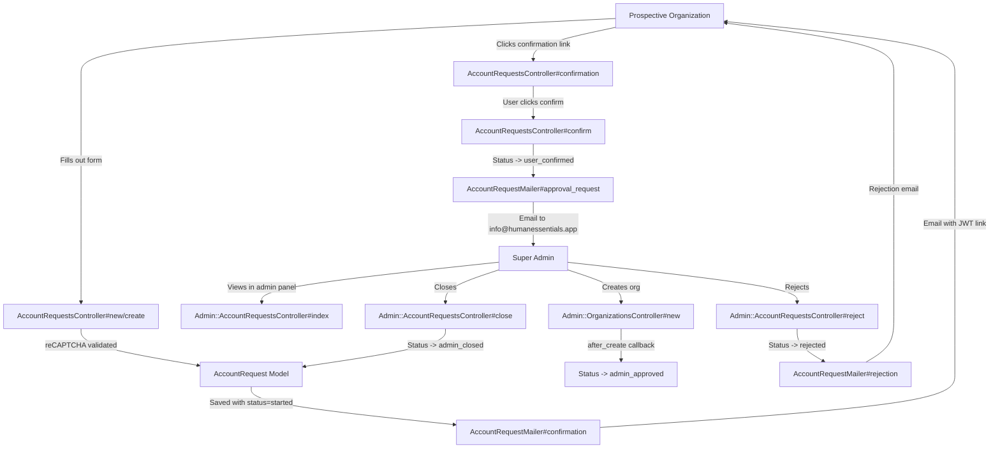
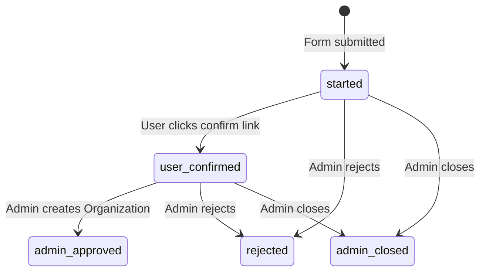
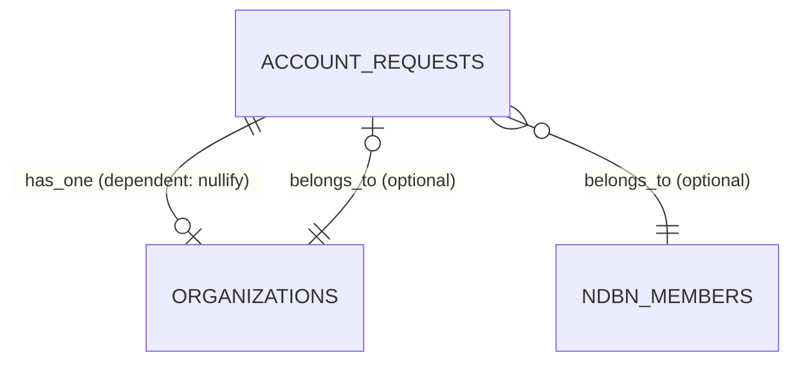

# Account Requests

> **Status**: Active
> **Generated**: 2026-06-13T00:00:00Z
> **Last Updated**: 2026-06-13T00:00:00Z

---

## Overview

### What It Does
Account Requests provides a public-facing registration flow that allows new essentials bank organizations to request an account on the Human Essentials platform. The feature implements a multi-step process: a prospective organization submits a request form (protected by reCAPTCHA), receives a confirmation email with a JWT-based identity token, confirms their email by clicking the link, which then notifies the Human Essentials admin team. Admins can then approve (by creating the organization), reject (with a reason sent via email), or close the request from the admin panel.

### Why It Exists
Human Essentials serves diaper banks and period supply banks across the US. New organizations need a controlled onboarding path so that the platform administrators can vet each request before granting access. This prevents unauthorized signups and ensures only legitimate essentials banks receive accounts.

### Key Capabilities
- Public account request form with reCAPTCHA protection
- JWT-based email confirmation flow (no database token column needed)
- Automated email notifications at each stage (confirmation to requester, approval request to admin, rejection to requester)
- Admin dashboard with paginated open/closed request lists
- Reject and close actions with mandatory reason tracking
- Status-based state machine (`started` -> `user_confirmed` -> `admin_approved` / `rejected` / `admin_closed`)
- Integration with Organization creation (auto-populates org attributes from the request)
- Optional NDBN member association for network identification
- Staging environment guard that redirects users to the production site

---

## Architecture

### High-Level Design



### Components

#### Backend Components

| Component | File Path | Purpose |
|-----------|-----------|---------|
| AccountRequestsController | `app/controllers/account_requests_controller.rb` | Public-facing controller for new requests and email confirmation flow |
| Admin::AccountRequestsController | `app/controllers/admin/account_requests_controller.rb` | Admin panel for listing, rejecting, and closing requests |
| AccountRequest | `app/models/account_request.rb` | Core model with status enum, JWT token generation, validations, and state transitions |
| AccountRequestMailer | `app/mailers/account_request_mailer.rb` | Sends confirmation, approval_request, and rejection emails |
| AdminController (base) | `app/controllers/admin_controller.rb` | Base controller requiring `Role::SUPER_ADMIN` for all admin actions |

#### Frontend Components

| Component | File Path | Purpose |
|-----------|-----------|---------|
| New request form | `app/views/account_requests/new.html.erb` | Public form with bank/partner radio toggle, simple_form fields, reCAPTCHA |
| Received page | `app/views/account_requests/received.html.erb` | Confirmation that the request was submitted |
| Confirmation page | `app/views/account_requests/confirmation.html.erb` | "Ready to get started?" page with confirm link |
| Confirm page | `app/views/account_requests/confirm.html.erb` | Final confirmation message after email verified |
| Invalid token page | `app/views/account_requests/invalid_token.html.erb` | Error page for expired/used/invalid tokens |
| Admin index | `app/views/admin/account_requests/index.html.erb` | Paginated tables for open and closed requests |
| Open request partial | `app/views/admin/account_requests/_open_account_request.html.erb` | Row partial for each open request with reject/close buttons |
| Rejection modal | `app/views/admin/account_requests/_rejection_modal.html.erb` | Bootstrap modal with reason field, dynamic URL via jQuery |
| For rejection page | `app/views/admin/account_requests/for_rejection.html.erb` | Standalone rejection page (accessed from admin email link) |
| Confirmation email (HTML) | `app/views/account_request_mailer/confirmation.html.erb` | Email with demo credentials, user guide links, and confirm URL |
| Confirmation email (text) | `app/views/account_request_mailer/confirmation.text.erb` | Plain text version of confirmation email |
| Approval request email (HTML) | `app/views/account_request_mailer/approval_request.html.erb` | Admin notification with request details and create/reject links |
| Approval request email (text) | `app/views/account_request_mailer/approval_request.text.erb` | Plain text version of admin notification |
| Rejection email (HTML) | `app/views/account_request_mailer/rejection.html.erb` | Rejection notification to requester with reason |
| Rejection email (text) | `app/views/account_request_mailer/rejection.text.erb` | Plain text version of rejection email |

### Technology Stack
- **Backend**: Ruby on Rails, Devise layout, JWT (ruby-jwt gem) for token generation
- **Frontend**: ERB templates, simple_form, Bootstrap modals, jQuery for dynamic modal behavior
- **Database**: PostgreSQL (bigint primary keys)
- **External Services**: reCAPTCHA (Google), SMTP for email delivery

---

## Model Details

### AccountRequest

#### Associations
```ruby
# Source: app/models/account_request.rb
belongs_to :ndbn_member, class_name: 'NDBNMember', optional: true
has_one :organization, dependent: :nullify
```

#### Concerns / Gems
| Concern/Gem | Purpose |
|-------------|---------|
| `has_paper_trail` | Tracks all changes to account request records for audit history |

#### Validations
```ruby
# Source: app/models/account_request.rb
validates :name, presence: true
validates :email, presence: true, uniqueness: true
validates :request_details, presence: true, length: { minimum: 50 }
validates :email, format: { with: URI::MailTo::EMAIL_REGEXP }
validates :organization_website, format: { with: URI::DEFAULT_PARSER.make_regexp, message: "should look like 'https://www.example.com'" }, allow_blank: true

validate :email_not_already_used_by_organization
validate :email_not_already_used_by_user
```

#### Custom Validations

**`email_not_already_used_by_organization`** -- Checks `Organization.find_by(email: email)` and adds an error if the email is already associated with a different organization (allows re-use if it's the same org via the `has_one` association).

**`email_not_already_used_by_user`** -- Checks `User.find_by(email: email)` and adds an error if the email belongs to an existing user in a different organization. Skips validation if the request status is `rejected` or `admin_closed`.

#### Enum

```ruby
# Source: app/models/account_request.rb
enum :status, %w[started user_confirmed admin_approved rejected admin_closed].map { |v| [v, v] }.to_h
```

This defines string-based enum values (not integers). The possible statuses are:
- `started` -- Initial state after form submission (default)
- `user_confirmed` -- User clicked the email confirmation link
- `admin_approved` -- Admin created the organization (set via Organization `after_create` callback)
- `rejected` -- Admin rejected with a reason
- `admin_closed` -- Admin closed without full rejection flow

#### Scopes
```ruby
# Source: app/models/account_request.rb
scope :requested, -> { where(status: %w[started user_confirmed]) }
scope :closed, -> { where(status: %w[admin_approved rejected admin_closed]) }
```

#### State Machine (Manual, Not AASM)



State transitions are enforced manually through instance methods rather than a formal state machine gem:

#### Key Methods

| Method | Returns | Purpose | Notes |
|--------|---------|---------|-------|
| `identity_token` | `String` | Generates a JWT encoding `{account_request_id: id}` signed with `Rails.application.secret_key_base` using HS256 | Raises if record not persisted |
| `self.get_by_identity_token(identity_token)` | `AccountRequest` or `nil` | Decodes JWT and finds the account request by ID | Returns `nil` on any decode error (invalid/tampered token) |
| `confirmed?` | `Boolean` | Returns `true` if status is `user_confirmed` or `admin_approved` | Used by controller to guard token-based actions |
| `processed?` | `Boolean` | Returns `true` if an organization has been created from this request | Checks `organization.present?` |
| `can_be_closed?` | `Boolean` | Returns `true` if status is `started` or `user_confirmed` | Guards the `close!` method |
| `confirm!` | `void` | Sets `confirmed_at` timestamp and status to `user_confirmed`, sends approval_request email to admin | Called from public controller |
| `reject!(reason)` | `void` | Sets status to `rejected` with rejection_reason, sends rejection email to requester | Called from admin controller |
| `close!(reason)` | `void` | Sets status to `admin_closed` with rejection_reason | Raises `'Cannot be closed from this state'` if not `can_be_closed?`. Does NOT send an email. |

---

## Database Schema

### account_requests

| Column | Type | Default | Null | Notes |
|--------|------|---------|------|-------|
| `id` | `bigint` | auto-increment | `NOT NULL` | Primary key |
| `name` | `string` | — | `NOT NULL` | Requester's full name |
| `email` | `string` | — | `NOT NULL` | Requester's email address (validated unique) |
| `organization_name` | `string` | — | `NOT NULL` | Name of the organization requesting an account |
| `organization_website` | `string` | — | nullable | URL of the organization's website |
| `confirmed_at` | `datetime` | — | nullable | Timestamp when user confirmed via email link |
| `request_details` | `text` | — | `NOT NULL` | Free-text description of the organization (min 50 chars) |
| `created_at` | `datetime` | — | `NOT NULL` | Record creation timestamp |
| `updated_at` | `datetime` | — | `NOT NULL` | Record update timestamp |
| `rejection_reason` | `string` | — | nullable | Reason provided by admin when rejecting or closing |
| `status` | `string` | `"started"` | `NOT NULL` | Current state of the request |
| `ndbn_member_id` | `bigint` | — | nullable | FK to `ndbn_members` table (optional NDBN membership) |

**Indexes:**
| Name | Columns | Type |
|------|---------|------|
| `index_account_requests_on_status` | `status` | B-tree |

### Relationships



The `organizations` table has an `account_request_id` integer column that references `account_requests.id`. When an organization is created from a request, the `Organization.after_create` callback sets the request's status to `admin_approved`.

---

## API Endpoints

### Public Routes

| Method | Path | Action | Description | Notes |
|--------|------|--------|-------------|-------|
| `GET` | `/account_requests/new` | `AccountRequestsController#new` | Display account request form | No auth required; skips `authenticate_user!` |
| `POST` | `/account_requests` | `AccountRequestsController#create` | Submit account request | reCAPTCHA validated; sends confirmation email |
| `GET` | `/account_requests/confirmation` | `AccountRequestsController#confirmation` | Display "ready to confirm?" page | Requires `?token=` param; redirects to `invalid_token` if token invalid/used |
| `GET` | `/account_requests/confirm` | `AccountRequestsController#confirm` | Execute email confirmation | Requires `?token=` param; transitions status to `user_confirmed` |
| `GET` | `/account_requests/received` | `AccountRequestsController#received` | Display "request received" page | Requires `?token=` param |
| `GET` | `/account_requests/invalid_token` | `AccountRequestsController#invalid_token` | Display invalid/expired token error | Static error page |

### Admin Routes

| Method | Path | Action | Description | Notes |
|--------|------|--------|-------------|-------|
| `GET` | `/admin/account_requests` | `Admin::AccountRequestsController#index` | List open and closed requests | Requires `Role::SUPER_ADMIN` |
| `GET` | `/admin/account_requests/for_rejection` | `Admin::AccountRequestsController#for_rejection` | Show single request for rejection (from email link) | Requires `?token=` param and `Role::SUPER_ADMIN` |
| `POST` | `/admin/account_requests/reject` | `Admin::AccountRequestsController#reject` | Reject a request with reason | Sends rejection email to requester |
| `POST` | `/admin/account_requests/close` | `Admin::AccountRequestsController#close` | Close a request with reason | No email sent; only works for `started`/`user_confirmed` statuses |

---

## Authorization

This feature uses two distinct authorization strategies:

### Public Controller (AccountRequestsController)
No Pundit policies. The controller explicitly skips all authentication:
```ruby
# Source: app/controllers/account_requests_controller.rb:2-4
skip_before_action :authorize_user
skip_before_action :authenticate_user!
skip_before_action :require_organization
```

Token-based access control is enforced via `set_account_request_from_token` which redirects to `invalid_token` if the JWT token is nil, already confirmed, or already processed.

### Admin Controller (Admin::AccountRequestsController)
Inherits from `AdminController` which enforces:
```ruby
# Source: app/controllers/admin_controller.rb:3
before_action :require_admin

def require_admin
  verboten! unless current_user.has_cached_role?(Role::SUPER_ADMIN)
end
```

Only users with the `SUPER_ADMIN` role can access any admin account request actions. No Pundit policy file exists for this resource.

---

## Configuration

### Environment Variables / External Dependencies
- **reCAPTCHA keys**: Required for the public form. Configured via the `recaptcha` gem (typically `RECAPTCHA_SITE_KEY` and `RECAPTCHA_SECRET_KEY` environment variables)
- **`Rails.application.secret_key_base`**: Used as the JWT signing secret for identity tokens
- **SMTP configuration**: Required for `deliver_later` calls on all three mailer methods
- **Admin notification email**: Hardcoded to `info@humanessentials.app` in `AccountRequestMailer#approval_request`

---

## Usage Examples

### Creating an Account Request (Controller Flow)
```ruby
# Source: app/controllers/account_requests_controller.rb:24-38
def create
  @account_request = AccountRequest.new(account_request_params)
  @bank_selected = true

  if !verify_recaptcha(model: @account_request)
    flash.now[:alert] = "Invalid captcha submission"
    render :new
  elsif @account_request.save
    AccountRequestMailer.confirmation(account_request_id: @account_request.id).deliver_later

    redirect_to received_account_requests_path(token: @account_request.identity_token),
                notice: 'Account request was successfully created.'
  else
    render :new
  end
end
```

### Email Confirmation and Admin Notification
```ruby
# Source: app/models/account_request.rb:70-73
def confirm!
  update!(confirmed_at: Time.current, status: 'user_confirmed')
  AccountRequestMailer.approval_request(account_request_id: id).deliver_later
end
```

### Organization Creation Integration
```ruby
# Source: app/models/organization.rb:108-110
after_create do
  account_request&.update!(status: "admin_approved")
end

# Source: app/models/organization.rb:153-161
def assign_attributes_from_account_request(account_request)
  assign_attributes(
    name: account_request.organization_name,
    url: account_request.organization_website,
    email: account_request.email,
    account_request_id: account_request.id
  )

  self
end
```

### JWT Token Generation and Decoding
```ruby
# Source: app/models/account_request.rb:49-53
def identity_token
  raise 'must have an id' unless persisted?

  JWT.encode({ account_request_id: id }, Rails.application.secret_key_base, 'HS256')
end

# Source: app/models/account_request.rb:38-47
def self.get_by_identity_token(identity_token)
  decrypted_token = JWT.decode(identity_token, Rails.application.secret_key_base, true, { algorithm: 'HS256' })
  account_request_id = decrypted_token[0]["account_request_id"]

  AccountRequest.find_by(id: account_request_id)
rescue StandardError
  # The identity_token was determined to not be valid
  # and returns nil to indicate no match found.
  nil
end
```

---

## Testing

### Test Files
- `spec/models/account_request_spec.rb` -- Model validations, state transitions, JWT token methods
- `spec/mailers/account_request_mailer_spec.rb` -- Mailer content and delivery tests
- `spec/requests/account_requests_spec.rb` -- Public controller request specs
- `spec/requests/admin/account_requests_requests_spec.rb` -- Admin controller request specs
- `spec/controllers/admin/account_requests_controller_spec.rb` -- Admin controller unit tests
- `spec/system/account_request_system_spec.rb` -- End-to-end browser tests for public flow
- `spec/system/admin/account_requests_system_spec.rb` -- End-to-end browser tests for admin flow
- `spec/routing/account_requests_routing_spec.rb` -- Route verification tests
- `spec/factories/account_request.rb` -- FactoryBot factory definition

---

## Known Issues & Caveats

| Issue | Location | Description |
|-------|----------|-------------|
| Hardcoded admin email | `app/mailers/account_request_mailer.rb:15` | Approval request emails are sent to `info@humanessentials.app` -- not configurable via environment variable or database setting |
| Hardcoded demo credentials in email | `app/views/account_request_mailer/confirmation.html.erb:31-33` | Demo site credentials (`org_admin1@example.com` / `password!`) are hardcoded in the confirmation email template |
| JWT tokens never expire | `app/models/account_request.rb:52` | The JWT payload contains no `exp` claim. Tokens remain valid indefinitely unless the request is confirmed or processed. Token invalidation is only enforced at the application level via `confirmed?` and `processed?` checks |
| No `close!` email notification | `app/models/account_request.rb:82-85` | The `close!` method does not send any email to the requester, unlike `reject!` which sends a rejection email. The requester has no way to know their request was closed |
| Staging environment blocks form | `app/views/account_requests/new.html.erb:1,84-97` | On staging, the entire form is replaced with a redirect link to the production URL. Uses `Rails.env.staging?` check |
| `confirmed?` semantics | `app/models/account_request.rb:57-58` | `confirmed?` returns `true` for both `user_confirmed` AND `admin_approved` statuses, which means an approved request is also "confirmed". This can be confusing since the method name suggests only email confirmation |
| Missing FK constraint | `db/schema.rb:508` | The `organizations.account_request_id` column is `integer` type while `account_requests.id` is `bigint`. There is no foreign key constraint defined in the schema |
| `</tr>` outside loop | `app/views/admin/account_requests/index.html.erb:93` | In the closed requests table, the closing `</tr>` tag is placed outside the `each` loop, resulting in malformed HTML |

---

## Performance

### Database Optimization
- **Index on `status`**: `index_account_requests_on_status` supports the `requested` and `closed` scopes used in the admin index page
- **Pagination**: Both open and closed request lists are paginated (15 per page) using Kaminari via separate `open_page` and `close_page` params

### Caching
No explicit caching is implemented for this feature. The admin index performs two separate queries per page load.

---

## Troubleshooting

### Common Issues

#### Issue: User gets "Sorry" invalid token page after clicking confirmation link
**Symptoms:**
- User clicks the confirmation link in their email but sees "The account request is either invalid, confirmed already, or processed already."

**Cause:**
The `set_account_request_from_token` before_action redirects to `invalid_token` if any of these are true:
1. The JWT token cannot be decoded (tampered or wrong secret_key_base)
2. The request is already `confirmed?` (status is `user_confirmed` or `admin_approved`)
3. The request is already `processed?` (an Organization has been created)

**Solution:**
Check the request's current status in the database. If the user already confirmed, no further action is needed. If the secret_key_base changed between token generation and use (e.g., after a deploy), the token is permanently invalid and a new request must be submitted.

#### Issue: Admin cannot close a request
**Symptoms:**
- Clicking "Close (Admin)" redirects back to the index with an error alert

**Cause:**
The `close!` method raises `'Cannot be closed from this state'` if the request is not in `started` or `user_confirmed` status. Requests that are already `admin_approved`, `rejected`, or `admin_closed` cannot be closed.

**Solution:**
Verify the request's current status. Only open requests (shown in the "Open Account Requests" table) can be closed.

---

## Related Features

- **[Admin Panel](./admin-panel.md)** -- Admin::AccountRequestsController inherits from AdminController which provides the super admin authorization layer
- **[Organizations](./organizations.md)** -- Organization model has a `belongs_to :account_request` association and auto-populates attributes via `assign_attributes_from_account_request`
- **[Users & Authentication](./users-authentication.md)** -- The public controller skips Devise authentication; admin controller requires authenticated super admin

---

**Generated:** 2026-06-13T00:00:00Z
**Last Updated:** 2026-06-13T00:00:00Z
**Status:** Active
