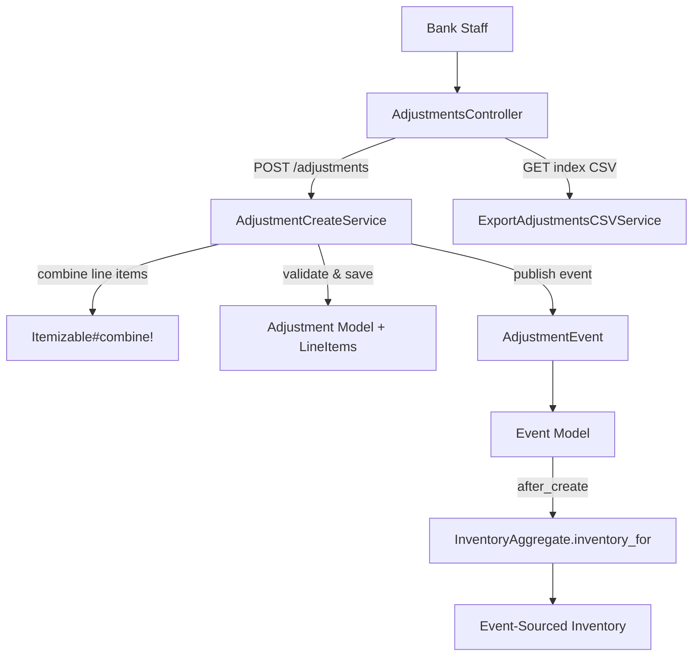
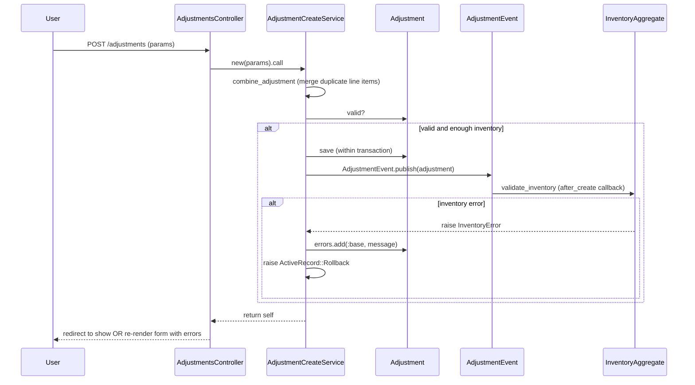
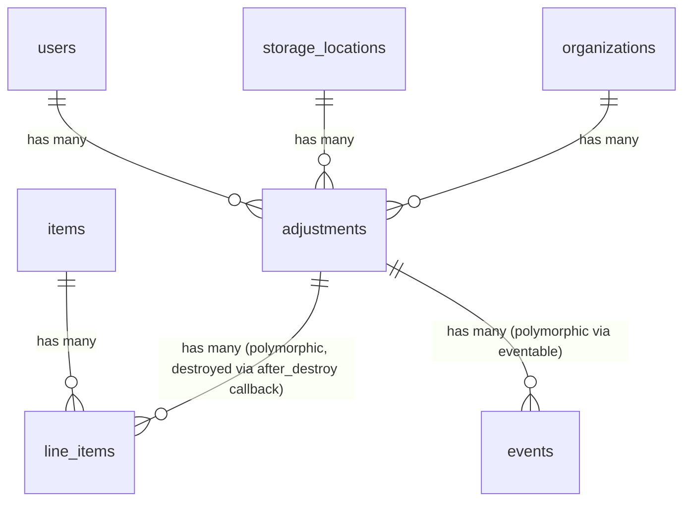

# Adjustments

> **Status**: Active
> **Generated**: 2026-06-13T00:00:00Z
> **Last Updated**: 2026-06-13T00:00:00Z

---

## Overview

### What It Does
Adjustments allow Essentials Bank staff to manually correct inventory quantities at a specific storage location. Each adjustment records one or more line items, where each line item increases (positive quantity) or decreases (negative quantity) the count of a particular item type. Adjustments are immutable once created -- they cannot be edited or updated after submission.

### Why It Exists
Physical inventory can diverge from system records due to counting errors, breakage, theft, mis-shelving, or other discrepancies. Adjustments provide a controlled, auditable mechanism for bank staff to reconcile the system inventory with the actual physical count at a storage location.

### Key Capabilities
- Create manual inventory corrections (positive or negative) at any active storage location
- Combine duplicate line items for the same item into a single net change automatically
- Filter adjustment history by storage location, user, and date range
- Export adjustments to CSV with per-item quantity columns
- Full audit trail via PaperTrail versioning and event-sourced inventory tracking

---

## Architecture

### High-Level Design


### Adjustment Creation Flow


### Components

#### Backend Components
| Component | File Path | Purpose |
|-----------|-----------|---------|
| AdjustmentsController | `app/controllers/adjustments_controller.rb` | Handles index, show, new, create actions |
| Adjustment | `app/models/adjustment.rb` | Core model with associations, scopes, validations |
| AdjustmentCreateService | `app/services/adjustment_create_service.rb` | Orchestrates creation: combines line items, validates, saves, publishes event |
| ExportAdjustmentsCSVService | `app/services/exports/export_adjustments_csv_service.rb` | Generates CSV export with per-item columns |
| AdjustmentEvent | `app/events/adjustment_event.rb` | Publishes inventory event for event-sourced tracking |
| Itemizable concern | `app/models/concerns/itemizable.rb` | Provides `has_many :line_items` and nested attributes support |
| Filterable concern | `app/models/concerns/filterable.rb` | Provides `class_filter` for scope-based filtering |
| Exportable concern | `app/models/concerns/exportable.rb` | Provides CSV generation interface |
| LineItem | `app/models/line_item.rb` | Polymorphic line item with item reference and quantity |

#### Frontend Components
| Component | File Path | Purpose |
|-----------|-----------|---------|
| Index view | `app/views/adjustments/index.html.erb` | Lists adjustments with filters and CSV export |
| New view | `app/views/adjustments/new.html.erb` | Form to create a new adjustment with dynamic line items |
| Show view | `app/views/adjustments/show.html.erb` | Displays adjustment details with added/removed items |

---

## Model Details

### Adjustment

#### Associations
```ruby
# Source: app/models/adjustment.rb
belongs_to :organization
belongs_to :storage_location
belongs_to :user

# Via Itemizable concern:
has_many :line_items, as: :itemizable, inverse_of: :itemizable
has_many :items, through: :line_items
has_many :inactive_items, -> { inactive }, through: :line_items, source: :item
has_many :item_categories, through: :items
```

Note: The `line_items` association does NOT use `dependent: :destroy` directly. Instead, the Itemizable concern uses an `after_destroy` callback to destroy line items:

```ruby
# Source: app/models/concerns/itemizable.rb
after_destroy do
  line_items.each(&:destroy)
end
```

#### Concerns
| Concern | Purpose |
|---------|---------|
| `Exportable` | Provides `csv_export_headers`, `csv_export_attributes`, `generate_csv` class methods for CSV export |
| `Itemizable` | Adds `has_many :line_items` (polymorphic), `accepts_nested_attributes_for :line_items`, `validates_associated :line_items`, line item combination via `combine!`, and quantity helpers |
| `Filterable` | Adds `class_filter(filtering_params)` class method that chains scopes from a params hash |
| `has_paper_trail` | PaperTrail versioning for audit trail |

#### Scopes
```ruby
# Source: app/models/adjustment.rb
scope :at_location, ->(location_id) { where(storage_location_id: location_id) }
scope :by_user, ->(user_id) { where(user_id: user_id) }
scope :during, ->(range) { where(adjustments: { created_at: range }) }
```

#### Validations
```ruby
# Source: app/models/adjustment.rb
validate :storage_locations_belong_to_organization

# Via Itemizable concern:
validates_associated :line_items
```

The private validation method `storage_locations_belong_to_organization` ensures the chosen storage location belongs to the same organization:

```ruby
# Source: app/models/adjustment.rb:47-53
def storage_locations_belong_to_organization
  return if organization.nil?

  unless organization.storage_locations.include?(storage_location)
    errors.add :storage_location, "storage location must belong to organization"
  end
end
```

#### Key Methods

| Method | Returns | Purpose | Notes |
|--------|---------|---------|-------|
| `split_difference` | `[Adjustment, Adjustment]` | Partitions line items into increasing and decreasing adjustments | Mutates original line items (see caveat below) |
| `self.generate_csv(adjustments)` | `String` or `nil` | Delegates to `ExportAdjustmentsCSVService` | Returns `nil` if adjustments is empty |

##### `split_difference` Detail

```ruby
# Source: app/models/adjustment.rb:30-36
def split_difference
  pre_adjustment = line_items.partition { |line_item| line_item.quantity.positive? }
  increasing_adjustment, decreasing_adjustment = pre_adjustment.map { |adjustment| Adjustment.new(line_items: adjustment) }

  decreasing_adjustment.line_items.each { |line_item| line_item.quantity *= -1 }   # This is changing the line items on the original adjustment!
  [increasing_adjustment, decreasing_adjustment]
end
```

### LineItem

#### Associations
```ruby
# Source: app/models/line_item.rb
belongs_to :itemizable, polymorphic: true, inverse_of: :line_items, optional: false
belongs_to :item
```

#### Concerns
| Concern | Purpose |
|---------|---------|
| `ItemQuantity` | Shared quantity concern |
| `has_paper_trail` | PaperTrail versioning |

#### Key Constants
```ruby
# Source: app/models/line_item.rb
MAX_INT = 2**31
MIN_INT = -2**31
```

---

## Database Schema

### adjustments

| Column | Type | Default | Notes |
|--------|------|---------|-------|
| `id` | `serial` (integer) | auto-increment | Primary key |
| `organization_id` | `integer` | — | FK to organizations |
| `storage_location_id` | `integer` | — | FK to storage_locations |
| `comment` | `text` | — | Free-text explanation for the adjustment |
| `created_at` | `datetime` | — | Not null |
| `updated_at` | `datetime` | — | Not null |
| `user_id` | `bigint` | — | FK to users (who created it) |

#### Indexes
| Name | Columns |
|------|---------|
| `index_adjustments_on_organization_id` | `organization_id` |
| `index_adjustments_on_storage_location_id` | `storage_location_id` |
| `index_adjustments_on_user_id` | `user_id` |

### line_items (polymorphic -- shared with donations, distributions, purchases, etc.)

| Column | Type | Default | Notes |
|--------|------|---------|-------|
| `id` | `serial` (integer) | auto-increment | Primary key |
| `itemizable_type` | `string` | — | Polymorphic type (e.g. `"Adjustment"`) |
| `itemizable_id` | `integer` | — | Polymorphic FK |
| `item_id` | `integer` | — | FK to items |
| `quantity` | `integer` | — | Positive = add, negative = remove |
| `created_at` | `datetime` | — | Not null |
| `updated_at` | `datetime` | — | Not null |

### Relationships


---

## API Endpoints

> Routes defined via `resources :adjustments, except: %i(edit update)` at line 103 of `config/routes.rb`.

| Method | Path | Action | Description | Notes |
|--------|------|--------|-------------|-------|
| `GET` | `/adjustments` | `index` | List adjustments with filters; CSV export via `.csv` format | Supports `filters[at_location]`, `filters[by_user]`, date range |
| `GET` | `/adjustments/new` | `new` | Render new adjustment form | Loads active storage locations and loose active items |
| `POST` | `/adjustments` | `create` | Create a new adjustment | Delegates to `AdjustmentCreateService` |
| `GET` | `/adjustments/:id` | `show` | Display a single adjustment | Shows line items as "Added" or "Removed" |
| `DELETE` | `/adjustments/:id` | `destroy` | — | Route exists but NO controller action is defined (see Known Issues) |

---

## Authorization

This feature does **not** use Pundit policies. Authorization is handled by the `ApplicationController#authorize_user` before_action, which requires the current user to have one of these roles:

| Role | Constant | Access |
|------|----------|--------|
| Super Admin | `Role::SUPER_ADMIN` | Full access |
| Org Admin | `Role::ORG_ADMIN` | Access scoped to their organization |
| Org User | `Role::ORG_USER` | Access scoped to their organization |

All actions are additionally scoped via `current_organization.adjustments` to prevent cross-organization data access.

---

## Configuration

No feature-specific environment variables or configuration files. The feature relies on:
- PaperTrail for versioning (configured globally)
- Kaminari for pagination (configured globally)
- The shared date range picker partial (`shared/date_range_picker`)

---

## Usage Examples

### Creating an Adjustment via the Service

```ruby
# Source: app/services/adjustment_create_service.rb:8-31
def initialize(adjustment_or_params)
  @adjustment = if adjustment_or_params.is_a?(Adjustment)
    adjustment_or_params
  else
    Adjustment.new(adjustment_or_params)
  end
end

def call
  # Combine line items for adjustment
  combine_adjustment
  # Check for validity, and save the actual adjustment

  if @adjustment.valid? && enough_inventory_for_decreases?
    ActiveRecord::Base.transaction do
      # Make the necessary changes in the db
      @adjustment.save
      AdjustmentEvent.publish(adjustment)
    rescue Errors::InsufficientAllotment, InventoryError => e
      @adjustment.errors.add(:base, e.message)
      raise ActiveRecord::Rollback
    end
  end
  self
end
```

### Controller Create Action

```ruby
# Source: app/controllers/adjustments_controller.rb:41-51
def create
  result = AdjustmentCreateService.new(adjustment_params.merge(organization: current_organization, user: current_user)).call
  @adjustment = result.adjustment
  if @adjustment.errors.none?
    flash[:notice] = "Adjustment was successful."
    redirect_to adjustment_path(@adjustment)
  else
    flash.now[:error] = @adjustment.errors.collect { |error| "#{error.attribute}: " + error.message }.join("<br />".html_safe)
    load_form_collections
    render :new
  end
end
```

### Event Publishing

```ruby
# Source: app/events/adjustment_event.rb:1-14
class AdjustmentEvent < Event
  # @param adjustment [Adjustment]
  def self.publish(adjustment)
    create(
      eventable: adjustment,
      group_id: "adjustment-#{adjustment.id}-#{SecureRandom.hex}",
      organization_id: adjustment.organization_id,
      event_time: Time.zone.now,
      data: EventTypes::InventoryPayload.new(
        items: EventTypes::EventLineItem.from_line_items(adjustment.line_items, to: adjustment.storage_location_id)
      )
    )
  end
end
```

### CSV Export

```ruby
# Source: app/services/exports/export_adjustments_csv_service.rb:4-8
def generate_csv(adjustments, organization)
  CSV.generate(headers: true) do |csv|
    generate_csv_data(adjustments, organization).each { |row| csv << row }
  end
end
```

CSV headers: `"Created date"`, `"Storage Area"`, `"Comment"`, `"Updates"`, followed by one column per item name in the organization (alphabetized).

---

## Testing

### Test Files
- `spec/models/adjustment_spec.rb` -- Model validations, scopes, `split_difference` method
- `spec/services/adjustment_create_service_spec.rb` -- Service: positive/negative adjustments, mixed same-item handling, inventory floor enforcement
- `spec/services/exports/export_adjustments_csv_service_spec.rb` -- CSV export
- `spec/requests/adjustments_requests_spec.rb` -- Request/integration specs for controller actions
- `spec/system/adjustment_system_spec.rb` -- End-to-end browser tests
- `spec/factories/adjustments.rb` -- Factory with `:with_items` trait

### Key Test Cases (from service spec)
- Positive adjustment increases inventory and creates `AdjustmentEvent`
- Negative adjustment decreases inventory and creates `AdjustmentEvent`
- Mixed adjustments to the same item are combined into a single net line item
- Adjustment below zero is rejected with error `"Could not reduce quantity"`
- Multi-item adjustments are handled correctly with per-item combination

---

## Known Issues & Caveats

| Issue | Location | Description |
|-------|----------|-------------|
| Route without action | `config/routes.rb:103` | `DELETE /adjustments/:id` route exists (via `resources :adjustments, except: %i(edit update)`) but the controller has no `destroy` action. Hitting this route will raise `AbstractController::ActionNotFound`. |
| `enough_inventory_for_decreases?` defined outside class | `app/services/adjustment_create_service.rb:39-45` | The method `enough_inventory_for_decreases?` is defined at the top level (outside the `AdjustmentCreateService` class body). It iterates negative line items but does not actually validate anything -- the loop body is `next unless line_item.quantity.negative?` with no subsequent check. Actual inventory validation happens via `AdjustmentEvent` -> `InventoryAggregate` after save. |
| `split_difference` mutates original | `app/models/adjustment.rb:34` | The comment in source says "This is changing the line items on the original adjustment!" -- calling `split_difference` mutates the quantity of decreasing line items on the original `Adjustment` object. |
| No edit/update capability | `config/routes.rb:103` | Adjustments are immutable by design (`except: %i(edit update)`). To correct a bad adjustment, a new adjustment must be created. |

---

## Performance

### Database Optimization
- Index on `organization_id` for org-scoped queries
- Index on `storage_location_id` for location filtering
- Index on `user_id` for user filtering
- Eager loading in index: `.includes(:line_items, :storage_location)` prevents N+1 queries

### Pagination
- Uses Kaminari pagination on the index page (`@paginated_adjustments = @adjustments...page(params[:page])`)

---

## Troubleshooting

### Common Issues

#### Issue: "Could not reduce quantity" error on create
**Symptoms:**
- Adjustment form re-renders with a base error about insufficient inventory

**Cause:**
The adjustment attempts to remove more of an item than currently exists at the storage location. The event-sourced inventory system (`InventoryAggregate`) raises an `InventoryError` during `AdjustmentEvent` creation, which is caught inside the transaction and rolled back.

**Solution:**
Check the current inventory at the target storage location and ensure the negative quantity does not exceed the available count for that item.

#### Issue: "storage location must belong to organization" validation error
**Symptoms:**
- Adjustment cannot be saved despite valid-looking data

**Cause:**
The selected `storage_location_id` does not belong to the adjustment's organization.

**Solution:**
Ensure the storage location is owned by the same organization. The form only shows active locations for the current organization, so this typically occurs via direct API calls or data manipulation.

#### Issue: "Cannot change inventory for an adjustment created before [date]"
**Symptoms:**
- Error raised during event creation mentioning a snapshot date

**Cause:**
The `Event#no_intervening_snapshot` validation detected a `SnapshotEvent` that was created between the adjustment's event_time and now, making the event invalid in the event-sourced timeline.

**Solution:**
Contact Human Essentials admin staff for assistance, as noted in the error message.

---

## Related Features

- **[Storage Locations](./storage-locations.md)** -- Adjustments target a specific storage location to modify its inventory
- **[Items](./items.md)** -- Line items reference item types managed by the items feature
- **[Inventory Events](./inventory-events.md)** -- `AdjustmentEvent` feeds into the event-sourced inventory aggregate
- **[Audits](./audits.md)** -- Audits verify physical counts; adjustments correct discrepancies found during audits
- **[Donations](./donations.md)** / **[Purchases](./purchases.md)** / **[Distributions](./distributions.md)** -- Other features that modify inventory via similar line-item and event patterns

---

**Generated:** 2026-06-13T00:00:00Z
**Last Updated:** 2026-06-13T00:00:00Z
**Status:** Active
