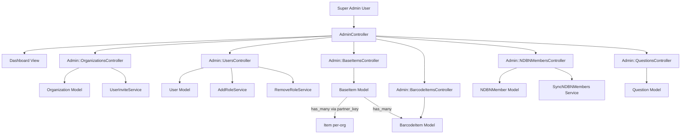
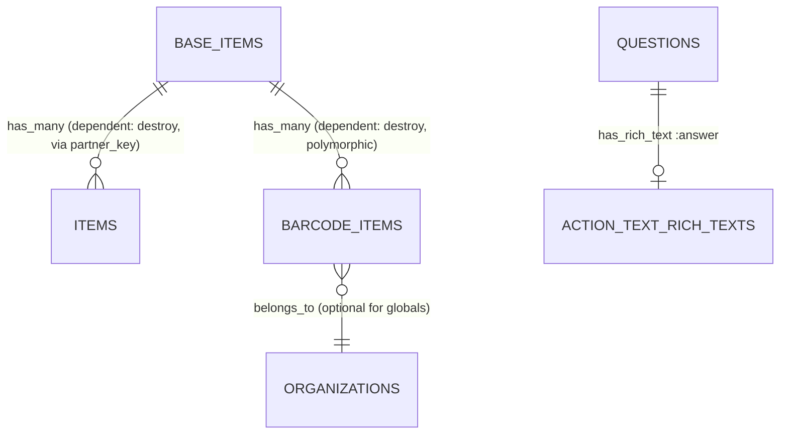

# Admin Panel

> **Status**: Active
> **Generated**: 2026-06-13T00:00:00Z
> **Last Updated**: 2026-06-13T00:00:00Z

---

## Overview

### What It Does
The Admin Panel is a super-admin-only area of the Human Essentials application that provides global management capabilities across all organizations. It gives super admins the ability to manage organizations, users (with role assignments), base items (the global item templates from which per-organization items are derived), global barcode items, NDBN (National Diaper Bank Network) member records, and FAQ-style questions. The panel also includes a dashboard with system-wide activity statistics.

### Why It Exists
Human Essentials is a multi-tenant application where many diaper banks (organizations) operate independently. A super-admin layer is required to onboard new organizations, manage the shared catalog of base items, handle user account issues across organizations, synchronize NDBN membership data, and monitor system-wide activity.

### Key Capabilities
- **Dashboard**: View weekly donation, distribution, request counts; recently added users/organizations; recently active users; top 10 uses of "Other" item category
- **Organization Management**: Create, view, list (with Filterrific), and delete organizations; seed items on creation; invite initial admin user
- **User Management**: Create, edit, list (with Filterrific), add/remove roles, resend invitations; search by name/email
- **Base Item Management**: Full CRUD for global base item templates that drive per-organization item catalogs
- **Global Barcode Management**: Full CRUD for barcodes linked to BaseItems (global barcodes shared across all organizations)
- **NDBN Member Sync**: Upload CSV to synchronize NDBN member records
- **Questions (FAQ) Management**: Full CRUD for FAQ entries with Action Text rich text answers

---

## Architecture

### High-Level Design



### Components

#### Backend Components

| Component | File Path | Purpose |
|-----------|-----------|---------|
| AdminController | `app/controllers/admin_controller.rb` | Parent controller for admin namespace; provides dashboard action and `require_admin` before_action |
| Admin::OrganizationsController | `app/controllers/admin/organizations_controller.rb` | CRUD for organizations (index, new, create, show, destroy) |
| Admin::UsersController | `app/controllers/admin/users_controller.rb` | CRUD for users plus role management (add_role, remove_role, resend_invitation, resource_ids) |
| Admin::BaseItemsController | `app/controllers/admin/base_items_controller.rb` | Full CRUD for base items |
| Admin::BarcodeItemsController | `app/controllers/admin/barcode_items_controller.rb` | Full CRUD for global barcode items |
| Admin::NDBNMembersController | `app/controllers/admin/ndbn_members_controller.rb` | Index and CSV upload for NDBN members |
| Admin::QuestionsController | `app/controllers/admin/questions_controller.rb` | Full CRUD for FAQ questions |
| BaseItem | `app/models/base_item.rb` | Global item template model with reporting category mapping |
| NDBNMember | `app/models/ndbn_member.rb` | NDBN membership record model |
| Question | `app/models/question.rb` | FAQ question model with Action Text rich text answer |
| BarcodeItem | `app/models/barcode_item.rb` | Polymorphic barcode model (global barcodes target BaseItem) |
| SyncNDBNMembers | `app/services/sync_ndbn_members.rb` | CSV parsing and upsert service for NDBN member data |
| UserInviteService | `app/services/user_invite_service.rb` | Used by organizations#create to invite the initial org admin |
| AddRoleService | `app/services/add_role_service.rb` | Used by users#add_role to assign roles |
| RemoveRoleService | `app/services/remove_role_service.rb` | Used by users#remove_role to revoke roles |

#### Frontend Components

| Component | File Path | Purpose |
|-----------|-----------|---------|
| Admin Dashboard View | `app/views/admin/dashboard.html.erb` | Dashboard with info boxes, recent users/orgs, top-10 Other, active users |
| Organization Views | `app/views/admin/organizations/` | index, show, new, edit (orphaned), index.js.erb (Filterrific) |
| User Views | `app/views/admin/users/` | index, new, edit, index.js.erb (Filterrific), partials for list/roles/form |
| Base Item Views | `app/views/admin/base_items/` | index, new, edit, show, partials for form/row/dropdown |
| Barcode Item Views | `app/views/admin/barcode_items/` | index, new, edit, show, partials for form/row/modal |
| NDBN Member Views | `app/views/admin/ndbn_members/` | index (with CSV upload form) |
| Question Views | `app/views/admin/questions/` | index, new, edit, partial for question form |

### Technology Stack
- **Backend**: Ruby on Rails, Filterrific (search/filter), Devise (invitations via `user.invite!`), PaperTrail (audit trail on BaseItem, NDBNMember, Question, BarcodeItem)
- **Frontend**: ERB templates, AdminLTE (Bootstrap-based), Font Awesome icons, simple_form
- **Database**: PostgreSQL
- **External Services**: None (NDBN data is imported via CSV upload, not API)

---

## Model Details

### BaseItem

#### Associations
```ruby
# Source: app/models/base_item.rb
has_many :items, dependent: :destroy, inverse_of: :base_item, foreign_key: :partner_key, primary_key: :partner_key
has_many :barcode_items, as: :barcodeable, dependent: :destroy
```

#### Concerns
| Concern | Purpose |
|---------|---------|
| `has_paper_trail` | Version tracking via PaperTrail gem |

#### Callbacks
| Callback | Method | Purpose |
|----------|--------|---------|
| `before_save` | `:set_reporting_category` | Auto-assigns `reporting_category` from `NAME_TO_REPORTING_CATEGORY` hash; defaults to `"other"` for unknown names; `nil` for "Kit" |

#### Validations
```ruby
# Source: app/models/base_item.rb
validates :name, presence: true, uniqueness: true
validates :partner_key, presence: true, uniqueness: true
```

#### Scopes
```ruby
# Source: app/models/base_item.rb
scope :by_partner_key, ->(partner_key) { where(partner_key: partner_key) }
scope :without_kit, -> { where.not(name: 'Kit') }
scope :alphabetized, -> { order(:name) }
```

#### Key Methods
| Method | Returns | Purpose | Notes |
|--------|---------|---------|-------|
| `to_h` | `Hash` | Returns `{ partner_key:, name:, reporting_category: }` | |
| `set_reporting_category` (private) | `String` or `nil` | Maps item name to reporting category via `NAME_TO_REPORTING_CATEGORY` constant | 42 entries in the mapping hash |

#### Constants
- `OTHER_REPORTING_CATEGORY = "other"` -- fallback reporting category
- `NAME_TO_REPORTING_CATEGORY` -- frozen hash mapping 42 base item names to categories: `"adult_incontinence"`, `"cloth_diapers"`, `"disposable_diapers"`, `"pads"`, `"tampons"`, `"period_liners"`, `"other"`, and `nil` (for Kit)

---

### NDBNMember

#### Associations
```ruby
# Source: app/models/ndbn_member.rb (no explicit associations)
# Note: self.primary_key = "ndbn_member_id"
```

#### Concerns
| Concern | Purpose |
|---------|---------|
| `has_paper_trail` | Version tracking via PaperTrail gem |

#### Validations
```ruby
# Source: app/models/ndbn_member.rb
validates :ndbn_member_id, presence: true
validates :account_name, presence: true
validates :ndbn_member_id, uniqueness: true
```

#### Key Methods
| Method | Returns | Purpose | Notes |
|--------|---------|---------|-------|
| `full_name` | `String` | Returns `"#{ndbn_member_id} - #{account_name}"` | Used for display in dropdowns |

---

### Question

#### Associations
```ruby
# Source: app/models/question.rb
has_rich_text :answer
```

#### Concerns
| Concern | Purpose |
|---------|---------|
| `has_paper_trail` | Version tracking via PaperTrail gem |
| `has_rich_text :answer` | Action Text rich text body for the answer field |

#### Validations
```ruby
# Source: app/models/question.rb
validates :answer, presence: true
validates :title, presence: true
```

#### Scopes & Filterrific
```ruby
# Source: app/models/question.rb
scope :search_title, ->(query) { where("title ilike ?", "%#{query}%").includes([:rich_text_answer]) }

filterrific(
  available_filters: [
    :search_title
  ]
)
```

---

### BarcodeItem (global barcodes only)

The admin panel manages **global** BarcodeItems -- those with `barcodeable_type: "BaseItem"`. Per-organization barcodes (`barcodeable_type: "Item"`) are managed elsewhere.

#### Associations
```ruby
# Source: app/models/barcode_item.rb
belongs_to :organization, optional: true
belongs_to :barcodeable, polymorphic: true, counter_cache: :barcode_count
belongs_to :item, polymorphic: true, counter_cache: :barcode_count, foreign_key: :barcodeable_id, foreign_type: :barcodeable_type
belongs_to :base_item, polymorphic: true, counter_cache: :barcode_count, foreign_key: :barcodeable_id, foreign_type: :barcodeable_type
```

#### Concerns
| Concern | Purpose |
|---------|---------|
| `has_paper_trail` | Version tracking via PaperTrail gem |
| `Filterable` | Shared filtering concern |
| `Exportable` | Shared CSV export concern |

#### Validations
```ruby
# Source: app/models/barcode_item.rb
validates :organization, presence: true, unless: proc { |b| b.barcodeable_type == "BaseItem" }
validates :value, presence: true
validate  :unique_barcode_value
validates :quantity, presence: true
validates :quantity, numericality: { only_integer: true, greater_than: 0 }
```

#### Key Scopes
```ruby
# Source: app/models/barcode_item.rb
scope :global, -> { where(barcodeable_type: "BaseItem") }
```

---

## Database Schema

### base_items

| Column | Type | Default | Notes |
|--------|------|---------|-------|
| `id` | `bigint` | auto | Primary key |
| `name` | `string` | | Item template name, unique |
| `category` | `string` | | Category grouping |
| `barcode_count` | `integer` | | Counter cache for associated barcode_items |
| `item_count` | `integer` | | Counter cache for associated items |
| `partner_key` | `string` | | Unique key used as foreign key for Item association |
| `reporting_category` | `string` | | Auto-set by `before_save` callback from NAME_TO_REPORTING_CATEGORY |
| `size` | `string` | | Size descriptor |
| `created_at` | `datetime` | | Not null |
| `updated_at` | `datetime` | | Not null |

### ndbn_members

| Column | Type | Default | Notes |
|--------|------|---------|-------|
| `ndbn_member_id` | `bigint` | | **Primary key** (custom, not auto-increment `id`) |
| `account_name` | `string` | | Not null |
| `created_at` | `datetime` | | Not null |
| `updated_at` | `datetime` | | Not null |

### questions

| Column | Type | Default | Notes |
|--------|------|---------|-------|
| `id` | `bigint` | auto | Primary key |
| `title` | `string` | | Not null |
| `created_at` | `datetime` | | Not null |
| `updated_at` | `datetime` | | Not null |

> Note: The `answer` field is stored via Action Text in the `action_text_rich_texts` table, not directly on the `questions` table.

### barcode_items (global subset)

| Column | Type | Default | Notes |
|--------|------|---------|-------|
| `id` | `integer` (serial) | auto | Primary key |
| `value` | `string` | | The barcode string |
| `barcodeable_id` | `integer` | | Polymorphic FK to BaseItem or Item |
| `barcodeable_type` | `string` | `"Item"` | `"BaseItem"` for global barcodes |
| `quantity` | `integer` | | Items per barcode scan |
| `organization_id` | `integer` | | NULL for global barcodes |
| `created_at` | `datetime` | | Not null |
| `updated_at` | `datetime` | | Not null |

**Indexes:**
- `index_barcode_items_on_barcodeable_type_and_barcodeable_id`
- `index_barcode_items_on_organization_id`

### Relationships



---

## API Endpoints

> All admin routes are nested under the `/admin` namespace and require the `super_admin` role.

### Dashboard

| Method | Path | Action | Description | Notes |
|--------|------|--------|-------------|-------|
| `GET` | `/admin` | `admin#dashboard` | Root admin redirect | Alias route |
| `GET` | `/admin/dashboard` | `admin#dashboard` | Admin dashboard with stats | |

### Organizations

| Method | Path | Action | Description | Notes |
|--------|------|--------|-------------|-------|
| `GET` | `/admin/organizations` | `index` | List organizations (Filterrific, paginated) | Responds to HTML and JS |
| `GET` | `/admin/organizations/new` | `new` | New organization form | Accepts `?token=` for AccountRequest pre-fill |
| `POST` | `/admin/organizations` | `create` | Create organization + invite admin user | Seeds items, publishes SnapshotEvent |
| `GET` | `/admin/organizations/:id` | `show` | View organization details + users | |
| `DELETE` | `/admin/organizations/:id` | `destroy` | Delete organization | |

> Routes exclude `edit` and `update` actions (`resources :organizations, except: %i[edit update]`).

### Users

| Method | Path | Action | Description | Notes |
|--------|------|--------|-------------|-------|
| `GET` | `/admin/users` | `index` | List users (Filterrific: search_name, search_email) | Responds to HTML and JS |
| `GET` | `/admin/users/new` | `new` | New user form | |
| `POST` | `/admin/users` | `create` | Create user with role via UserInviteService | |
| `GET` | `/admin/users/:id/edit` | `edit` | Edit user form | |
| `PATCH/PUT` | `/admin/users/:id` | `update` | Update user attributes | |
| `GET` | `/admin/users/:id` | `show` | Show user | Route exists but no `show` action in controller |
| `DELETE` | `/admin/users/:id` | `destroy` | Delete user | Route exists but no `destroy` action in controller |
| `DELETE` | `/admin/users/:user_id/remove_role` | `remove_role` | Remove a role from a user | Uses RemoveRoleService |
| `POST` | `/admin/users/:user_id/add_role` | `add_role` | Add a role to a user | Uses AddRoleService |
| `POST` | `/admin/users/:user_id/resend_invitation` | `resend_invitation` | Resend Devise invitation email | Calls `user.invite!` |
| `GET` | `/admin/users/resource_ids` | `resource_ids` | JSON endpoint for AJAX resource lookup | Returns `{ results: [{ id:, text: }] }` |

### Base Items

| Method | Path | Action | Description | Notes |
|--------|------|--------|-------------|-------|
| `GET` | `/admin/base_items` | `index` | List all base items (alphabetized) | |
| `GET` | `/admin/base_items/new` | `new` | New base item form | |
| `POST` | `/admin/base_items` | `create` | Create base item | |
| `GET` | `/admin/base_items/:id` | `show` | Show base item with associated per-org items | Eager loads `items: [:organization]` |
| `GET` | `/admin/base_items/:id/edit` | `edit` | Edit base item form | |
| `PATCH/PUT` | `/admin/base_items/:id` | `update` | Update base item | |
| `DELETE` | `/admin/base_items/:id` | `destroy` | Delete base item | Blocked if items exist or if it's the Kit base item |

### Barcode Items (Global)

| Method | Path | Action | Description | Notes |
|--------|------|--------|-------------|-------|
| `GET` | `/admin/barcode_items` | `index` | List global barcode items | |
| `GET` | `/admin/barcode_items/new` | `new` | New barcode form | |
| `POST` | `/admin/barcode_items` | `create` | Create global barcode | Forces `barcodeable_type: "BaseItem"` |
| `GET` | `/admin/barcode_items/:id` | `show` | Show barcode details | |
| `GET` | `/admin/barcode_items/:id/edit` | `edit` | Edit barcode form | |
| `PATCH/PUT` | `/admin/barcode_items/:id` | `update` | Update barcode | |
| `DELETE` | `/admin/barcode_items/:id` | `destroy` | Delete barcode | |

### NDBN Members

| Method | Path | Action | Description | Notes |
|--------|------|--------|-------------|-------|
| `GET` | `/admin/ndbn_members` | `index` | List NDBN members (ordered by ndbn_member_id) | |
| `POST` | `/admin/ndbn_members/upload_csv` | `upload_csv` | Upload CSV to sync NDBN members | Expects headers: "NDBN Member Number", "Member Name" |

### Questions

| Method | Path | Action | Description | Notes |
|--------|------|--------|-------------|-------|
| `GET` | `/admin/questions` | `index` | List all questions | |
| `GET` | `/admin/questions/new` | `new` | New question form | |
| `POST` | `/admin/questions` | `create` | Create question | |
| `GET` | `/admin/questions/:id/edit` | `edit` | Edit question form | |
| `PATCH/PUT` | `/admin/questions/:id` | `update` | Update question | |
| `DELETE` | `/admin/questions/:id` | `destroy` | Delete question | |

---

## Authorization

The admin panel does **not** use Pundit policies. Authorization is handled entirely through a `before_action` in the parent `AdminController`:

```ruby
# Source: app/controllers/admin_controller.rb:3-8
before_action :require_admin
skip_before_action :require_organization

def require_admin
  verboten! unless current_user.has_cached_role?(Role::SUPER_ADMIN)
end
```

All controllers under `Admin::` inherit from `AdminController`, so every action requires `Role::SUPER_ADMIN`. The `skip_before_action :require_organization` is necessary because super admins operate outside any single organization context.

---

## Configuration

### Environment Variables
No admin-panel-specific environment variables. The panel relies on standard Rails and Devise configuration.

### Config Files
- `config/routes.rb` (lines 59-82) -- Admin namespace route definitions

---

## Usage Examples

### Creating an Organization from an Account Request

```ruby
# Source: app/controllers/admin/organizations_controller.rb:17-29
def new
  @organization = Organization.new
  account_request = params[:token] && AccountRequest.get_by_identity_token(params[:token])

  @user = User.new
  return unless account_request

  if account_request.processed?
    flash[:error] = "The account request had already been processed and cannot be used again"
  else
    @organization.assign_attributes_from_account_request(account_request)
    @user.assign_attributes(email: account_request.email, name: account_request.name)
  end
end
```

### Syncing NDBN Members via CSV Upload

```ruby
# Source: app/services/sync_ndbn_members.rb:2-21
def self.upload(member_file)
  begin
    member_entries = parse_csv(member_file)
  rescue ParseError => e
    return [e.message]
  end

  member_entries.flat_map do |row|
    member_id, account_name = row["NDBN Member Number"], row["Member Name"]
    ndbn_member = NDBNMember.find_or_initialize_by(ndbn_member_id: member_id)
    ndbn_member.account_name = account_name
    ndbn_member.save

    # "some string".to_i == 0
    ndbn_member.errors.add(:ndbn_member_id, "id must be an integer") if member_id.to_i.zero?

    ndbn_member.errors.full_messages.flat_map do |msg|
      "Issue with '#{member_id},#{account_name}'-> #{msg}"
    end
  end
end
```

Expected CSV format:
```
NDBN Member Number,Member Name
1234,Example Diaper Bank
5678,Another Organization
```

### Base Item Destroy Guard

```ruby
# Source: app/controllers/admin/base_items_controller.rb:43-52
def destroy
  @base_item = BaseItem.includes(:items).find(params[:id])
  if @base_item.id == KitCreateService.find_or_create_kit_base_item!.id
    redirect_to admin_base_items_path, alert: "You cannot delete the Kits base item. This is reserved for all Kits."
  elsif @base_item.items.empty? && @base_item.destroy
    redirect_to admin_base_items_path, notice: "Base Item deleted!"
  else
    redirect_to admin_base_items_path, alert: "Failed to delete Base Item. Are there still items attached?"
  end
end
```

### User Role Management

```ruby
# Source: app/controllers/admin/users_controller.rb:58-76
def resource_ids
  klass = case params[:resource_type]
  when "org_admin", "org_user"
    Organization
  when "partner"
    Partner
  else
    raise "Unknown resource type #{params[:resource_type]}"
  end

  objects = klass.where("name ILIKE ?", "%#{params[:q]}%").order("lower(name)").select(:id, :name)
  object_json = objects.map do |obj|
    {
      id: obj.id,
      text: obj.name
    }
  end
  render json: { results: object_json }
end
```

---

## Testing

### Test Files

**Request Specs:**
- `spec/requests/admin_requests_spec.rb`
- `spec/requests/admin/base_items_requests_spec.rb`
- `spec/requests/admin/barcode_items_requests_spec.rb`
- `spec/requests/admin/ndbn_members_spec.rb`
- `spec/requests/admin/organizations_requests_spec.rb`
- `spec/requests/admin/users_requests_spec.rb`
- `spec/requests/admin/questions_spec.rb`

**Controller Specs:**
- `spec/controllers/admins_controller_spec.rb`

**Model Specs:**
- `spec/models/base_item_spec.rb`
- `spec/models/ndbn_member_spec.rb`
- `spec/models/question_spec.rb`

**Service Specs:**
- `spec/services/sync_ndbn_members_spec.rb`

**System Specs:**
- `spec/system/admin/base_items_system_spec.rb`
- `spec/system/admin/barcode_items_system_spec.rb`
- `spec/system/admin/ndbn_members_system_spec.rb`
- `spec/system/admin/organizations_system_spec.rb`
- `spec/system/admin/users_system_spec.rb`
- `spec/system/question_system_spec.rb`

**Fixtures:**
- `spec/fixtures/ndbn-small-import.csv`
- `spec/fixtures/ndbn-invalid-header-import.csv`
- `spec/fixtures/ndbn-invalid-import.csv`
- `spec/fixtures/ndbn-many-errors-import.csv`

**Factories:**
- `spec/factories/base_items.rb`
- `spec/factories/ndbn_members.rb`
- `spec/factories/questions.rb`

---

## Known Issues & Caveats

| Issue | Location | Description |
|-------|----------|-------------|
| Orphaned edit view | `app/views/admin/organizations/edit.html.erb` | An `edit.html.erb` view file exists for admin organizations, but the route explicitly excludes `edit` and `update` (`resources :organizations, except: %i[edit update]`) and the controller has no `edit` or `update` actions. This view is dead code. |
| Routes without actions | `config/routes.rb:65` | `resources :users` generates `show` and `destroy` routes, but `Admin::UsersController` has no `show` or `destroy` action methods. These routes will raise `AbstractController::ActionNotFound`. |
| Undefined `punctuate` method | `app/controllers/admin/questions_controller.rb:15,29` | The controller calls `@question.punctuate(@question.errors.to_a)` but no `punctuate` method is defined on `Question`, `ApplicationRecord`, or any included concern. This will raise `NoMethodError` when a validation error occurs during question create/update. |
| Undefined `ParseError` constant | `app/services/sync_ndbn_members.rb:5,25,31,36` | `SyncNDBNMembers` raises and rescues `ParseError`, but no `ParseError` class is defined anywhere in the application code. This likely relies on Ruby's built-in `CSV::MalformedCSVError` being aliased or a missing class definition. If `ParseError` is not defined at load time, this will raise `NameError`. |
| Bug in NDBN sync validation order | `app/services/sync_ndbn_members.rb:13-16` | The service calls `ndbn_member.save` first (line 13), then adds a validation error for non-integer IDs afterward (line 16). The error is added *after* save, so it will appear in the return value but the record may already be persisted with invalid data. |
| `filter_params` method unused | `app/controllers/admin/barcode_items_controller.rb:61-64` | The private `filter_params` method is defined but never called by any action in the controller. |
| Dashboard "View All Orders" links | `app/views/admin/dashboard.html.erb:110,149` | Two "View All Orders" buttons link to `#` (no-op). There is no orders concept in this application. |
| Dashboard "View All Items" link mislabeled | `app/views/admin/dashboard.html.erb:191,237` | The "Recently Active Users" section footer has a "View All Items" link pointing to `admin_base_items_path` instead of `admin_users_path`. |

---

## Performance

### Optimization Strategies
- **Filterrific** on organizations index and users index provides server-side search/filter with pagination (Kaminari)
- **Eager loading** in `Admin::BaseItemsController#show`: `BaseItem.includes(items: [:organization])`
- **Eager loading** in `Admin::UsersController#index`: `User.includes(roles: :resource)`
- **Eager loading** in `AdminController#dashboard`: `User.includes(:organization)` for active users

### Database Optimization
- `index_barcode_items_on_barcodeable_type_and_barcodeable_id` -- polymorphic lookup
- `index_barcode_items_on_organization_id` -- organization scoping
- No explicit indexes on `base_items` table (queries rely on `alphabetized` scope which orders by `name`)

---

## Troubleshooting

### Common Issues

#### Issue: "The account request had already been processed and cannot be used again"
**Symptoms:**
- Clicking an account request approval link shows this error on the new organization form

**Cause:**
The AccountRequest token has already been used to create an organization.

**Solution:**
Create the organization manually without a token, or find the existing organization that was already created from this request.

#### Issue: "You cannot delete the Kits base item"
**Symptoms:**
- Attempting to delete a base item results in this alert

**Cause:**
The base item is the reserved "Kit" base item used by `KitCreateService.find_or_create_kit_base_item!`. It cannot be deleted.

**Solution:**
This is by design. The Kit base item is a system-reserved record.

#### Issue: NDBN CSV upload errors
**Symptoms:**
- Upload redirects with error messages about incorrect headers or invalid data

**Cause:**
The CSV must have exactly two headers: `NDBN Member Number` and `Member Name`. Any deviation (extra columns, misspellings, BOM characters) will fail.

**Solution:**
Ensure the CSV file has exactly the headers `NDBN Member Number,Member Name` and that member IDs are valid integers.

---

## Related Features

- **[organizations](./organizations.md)** -- Organization model and org-level settings managed by org admins (admin panel manages at global level)
- **[users-authentication](./users-authentication.md)** -- User model, Devise authentication, and role system that the admin panel's user management builds upon
- **[items](./items.md)** -- Per-organization Item records that inherit from BaseItem templates managed here
- **[barcode-items](./barcode-items.md)** -- Per-organization barcode items; the admin panel manages global (BaseItem) barcodes
- **[account-requests](./account-requests.md)** -- Account request workflow that feeds into admin organization creation
- **[broadcast-announcements](./broadcast-announcements.md)** -- Also managed under the admin namespace (separate feature)

---

**Generated:** 2026-06-13T00:00:00Z
**Last Updated:** 2026-06-13T00:00:00Z
**Status:** Active
