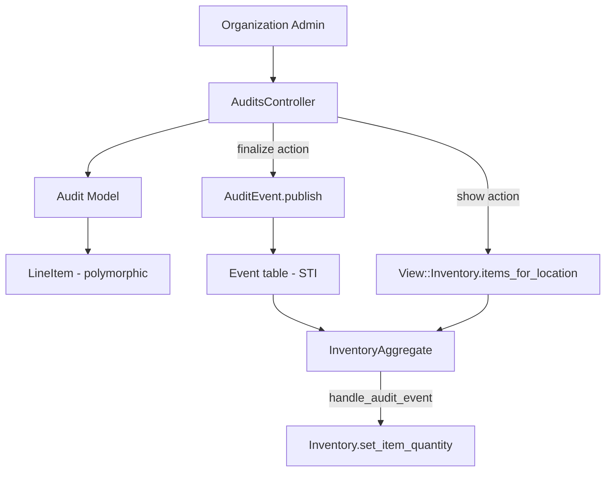
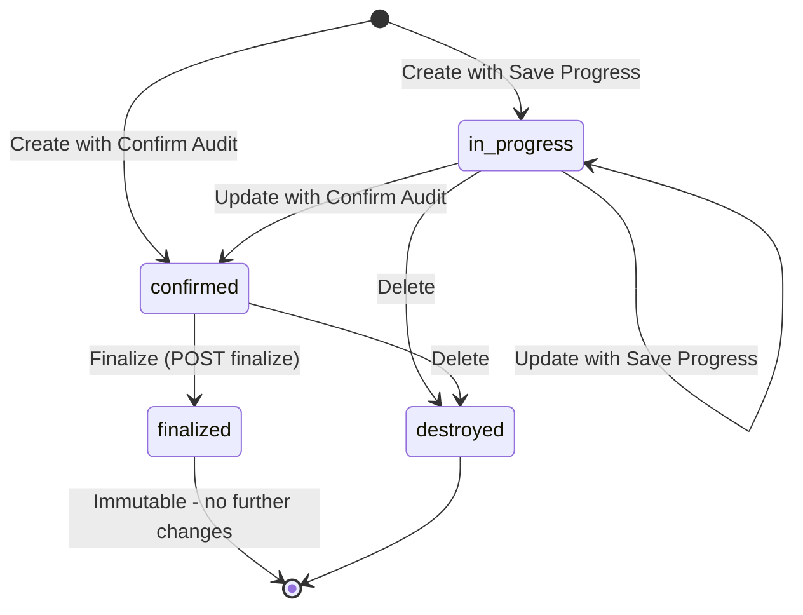
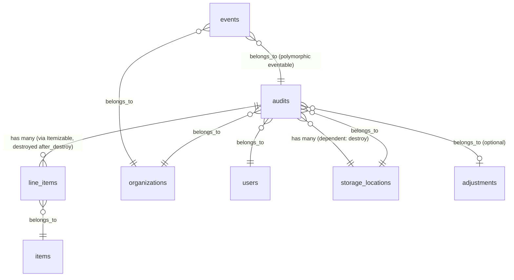

# Audits

> **Status**: Active
> **Generated**: 2026-06-13T00:00:00Z
> **Last Updated**: 2026-06-13T00:00:00Z

---

## Overview

### What It Does
Audits allow organization administrators to reconcile the physical inventory at a storage location against the digital records in the system. Users create an audit by selecting a storage location, entering the actual quantities of items present, and then finalizing the audit to permanently adjust the system's inventory to match reality.

### Why It Exists
Inventory drift is inevitable in supply bank operations -- items get miscounted, lost, damaged, or moved without proper tracking. Audits provide a formal mechanism for organization admins to correct the digital inventory so it matches the physical count, ensuring data integrity for downstream operations like distributions, donations, and reporting.

### Key Capabilities
- Create inventory audits against any active storage location
- Save audit progress and resume later (in_progress state)
- Confirm an audit after review (confirmed state)
- Finalize an audit to permanently adjust inventory via the event-sourcing system (finalized state)
- Compare audited quantities against current inventory records on the show page
- Filter audits by storage location on the index page
- Export audits to CSV
- Barcode scanning support for adding line items
- Duplicate item detection with merge modal (client-side JS)

---

## Architecture

### High-Level Design



### Audit Lifecycle Flow



### Components

#### Backend Components
| Component | File Path | Purpose |
|-----------|-----------|---------|
| AuditsController | `app/controllers/audits_controller.rb` | Full CRUD + finalize action for audits |
| Audit | `app/models/audit.rb` | Core model with status enum, validations, CSV export |
| AuditEvent | `app/events/audit_event.rb` | Publishes inventory-setting event on finalization |
| AuditPayload | `app/events/event_types/audit_payload.rb` | Typed payload struct for audit events |
| InventoryAggregate | `app/events/inventory_aggregate.rb` | Handles AuditEvent by calling `set_item_quantity` |
| View::Inventory | `app/models/view/inventory.rb` | Provides `items_for_location` used in show view |

#### Frontend Components
| Component | File Path | Purpose |
|-----------|-----------|---------|
| Audit form | `app/views/audits/_form.html.erb` | Shared form partial with line items and barcode support |
| Index view | `app/views/audits/index.html.erb` | Lists audits with filters and CSV export |
| Show view | `app/views/audits/show.html.erb` | Displays audit vs. inventory comparison table |
| New view | `app/views/audits/new.html.erb` | New audit page with instructional callout |
| Edit view | `app/views/audits/edit.html.erb` | Edit page for in-progress audits |

### Technology Stack
- **Backend**: Ruby on Rails, PaperTrail (versioning), Dry::Struct (event payloads)
- **Frontend**: ERB templates, simple_form, Stimulus controllers (`form-input`, `audit-duplicates`), barcode scanner modal
- **Database**: PostgreSQL
- **Event System**: Custom event-sourcing via `Event` STI hierarchy + `InventoryAggregate`

---

## Model Details

### Audit

#### Associations
```ruby
# Source: app/models/audit.rb
belongs_to :user
belongs_to :organization
belongs_to :storage_location
belongs_to :adjustment, optional: true

# Via Itemizable concern:
has_many :line_items, as: :itemizable, inverse_of: :itemizable
has_many :items, through: :line_items
has_many :inactive_items, -> { inactive }, through: :line_items, source: :item
has_many :item_categories, through: :items
```

#### Concerns
| Concern | Purpose |
|---------|---------|
| `Exportable` | Provides CSV export class methods (`csv_export_headers`, `generate_csv`, `normalize_csv_attribute`) |
| `Itemizable` | Adds polymorphic `has_many :line_items`, nested attributes, `total_quantity`, `value_per_itemizable`, `line_items_quantity_is_at_least` validation helper, and deferred line item destruction via `after_destroy` callback |
| `Filterable` | Adds `class_filter` class method for scope-based filtering from controller params |

#### Callbacks
| Callback | Method | Purpose |
|----------|--------|---------|
| `after_destroy` | (from Itemizable) | Destroys associated line_items after the audit is destroyed |

Note: `has_paper_trail` is declared, enabling version tracking on the Audit model.

#### State Machine
```ruby
# Source: app/models/audit.rb:30
enum :status, { in_progress: 0, confirmed: 1, finalized: 2 }
```

This is a Rails enum, not AASM. It generates predicate methods (`in_progress?`, `confirmed?`, `finalized?`) and bang methods (`in_progress!`, `confirmed!`, `finalized!`). State transitions are not constrained by the enum itself -- any status can transition to any other status. The controller enforces the lifecycle:
- `edit` action redirects unless `in_progress?`
- `destroy` action redirects if `finalized?`
- `finalize` action publishes an `AuditEvent` and sets status to `finalized!`
- `save_audit_status_and_redirect` sets `in_progress!` or `confirmed!` based on which submit button was clicked

#### Validations
| Validation | Method | Purpose |
|------------|--------|---------|
| Custom | `line_items_quantity_is_not_negative` | Ensures all line item quantities are >= 0 (delegates to `line_items_quantity_is_at_least(0)` from Itemizable) |
| Custom | `line_items_unique_by_item_id` | Prevents duplicate items in the same audit |
| Custom | `user_is_organization_admin_of_the_organization` | Ensures the user has `Role::ORG_ADMIN` on the audit's organization |
| Rails | `validates_associated :line_items` | (from Itemizable) Validates all line items |

#### Scopes
| Scope | Purpose |
|-------|---------|
| `at_location(location_id)` | Filters audits by `storage_location_id` |

#### Key Methods
| Method | Returns | Purpose | Notes |
|--------|---------|---------|-------|
| `self.finalized_since?(itemizable, *location_ids)` | `Boolean` | Checks if any finalized audit exists for the same items at the given locations after the itemizable's `created_at` | Used by other features to detect intervening audits |
| `self.generate_csv(audits)` | `String` | Generates CSV with dynamic item columns based on audited items | Overrides the Exportable default to produce a pivot-style CSV |
| `self.csv_export_headers` | `Array<String>` | Returns `["Audit Date", "Audit Status", "Storage Location Name"]` | Base headers before item columns |

### AuditEvent

```ruby
# Source: app/events/audit_event.rb
class AuditEvent < Event
  serialize :data, coder: EventTypes::StructCoder.new(EventTypes::AuditPayload)

  def self.publish(audit)
    create(
      eventable: audit,
      group_id: "audit-#{audit.id}-#{SecureRandom.hex}",
      organization_id: audit.organization_id,
      event_time: Time.zone.now,
      data: EventTypes::AuditPayload.new(
        storage_location_id: audit.storage_location_id,
        items: EventTypes::EventLineItem.from_line_items(audit.line_items, to: audit.storage_location_id)
      )
    )
  end
end
```

Key behavior: Unlike other inventory events that use `move_item` (additive/subtractive), the `AuditEvent` handler in `InventoryAggregate` calls `set_item_quantity` which **sets the absolute quantity** for each audited item at the storage location. This means the audit overwrites the current inventory value rather than applying a delta.

### AuditPayload

```ruby
# Source: app/events/event_types/audit_payload.rb
module EventTypes
  class AuditPayload < InventoryPayload
    attribute :storage_location_id, Types::Integer
  end
end
```

Inherits `items` attribute (array of `EventLineItem`) from `InventoryPayload`.

---

## Database Schema

### audits

| Column | Type | Default | Notes |
|--------|------|---------|-------|
| `id` | `bigint` | auto-increment | Primary key |
| `user_id` | `bigint` | | FK to users table |
| `organization_id` | `bigint` | | FK to organizations table |
| `adjustment_id` | `bigint` | | FK to adjustments table (optional) |
| `storage_location_id` | `bigint` | | FK to storage_locations table |
| `status` | `integer` | `0` (in_progress) | NOT NULL. Enum: 0=in_progress, 1=confirmed, 2=finalized |
| `created_at` | `datetime` | | NOT NULL |
| `updated_at` | `datetime` | | NOT NULL |

**Indexes:**
- `index_audits_on_adjustment_id`
- `index_audits_on_organization_id`
- `index_audits_on_storage_location_id`
- `index_audits_on_user_id`

### line_items (polymorphic -- shared with other Itemizable models)

| Column | Type | Default | Notes |
|--------|------|---------|-------|
| `id` | `serial` | auto-increment | Primary key |
| `quantity` | `integer` | | |
| `item_id` | `integer` | | FK to items table |
| `itemizable_id` | `integer` | | Polymorphic FK |
| `itemizable_type` | `string` | | Polymorphic type (e.g., "Audit") |
| `created_at` | `datetime` | | NOT NULL |
| `updated_at` | `datetime` | | NOT NULL |

**Indexes:**
- `index_line_items_on_itemizable_id_and_itemizable_type`

### events (STI -- AuditEvent rows stored here)

| Column | Type | Default | Notes |
|--------|------|---------|-------|
| `id` | `bigint` | auto-increment | Primary key |
| `type` | `string` | | NOT NULL. STI discriminator (e.g., "AuditEvent") |
| `event_time` | `datetime` | | NOT NULL |
| `data` | `jsonb` | | Serialized AuditPayload |
| `eventable_id` | `bigint` | | Polymorphic FK to audit |
| `eventable_type` | `string` | | "Audit" |
| `organization_id` | `bigint` | | FK to organizations |
| `user_id` | `bigint` | | FK to users |
| `group_id` | `string` | | Grouping key for event replay |
| `created_at` | `datetime` | | NOT NULL |
| `updated_at` | `datetime` | | NOT NULL |

**Indexes:**
- `index_events_on_organization_id_and_event_time`
- `index_events_on_user_id`

### Relationships



---

## API Endpoints

| Method | Path | Action | Description | Notes |
|--------|------|--------|-------------|-------|
| `GET` | `/audits` | `index` | List audits with optional storage location filter | Supports HTML and CSV formats |
| `GET` | `/audits/new` | `new` | New audit form | |
| `POST` | `/audits` | `create` | Create a new audit | Status set to `in_progress` or `confirmed` based on submit button |
| `GET` | `/audits/:id` | `show` | Show audit with inventory comparison | |
| `GET` | `/audits/:id/edit` | `edit` | Edit form for in-progress audits | Redirects to index if not `in_progress` |
| `PATCH/PUT` | `/audits/:id` | `update` | Update audit line items | Destroys all existing line items first, then recreates |
| `DELETE` | `/audits/:id` | `destroy` | Delete an audit | Redirects if `finalized` -- cannot delete finalized audits |
| `POST` | `/audits/:audit_id/finalize` | `finalize` | Finalize audit and publish AuditEvent | Only meaningful for `confirmed` audits (enforced by UI, not controller) |

Routes definition:
```ruby
# Source: config/routes.rb:105-107
resources :audits do
  post :finalize
end
```

---

## Authorization

Audits use a simple `before_action :authorize_admin` guard rather than Pundit policies.

```ruby
# Source: app/controllers/application_controller.rb:83-86
def authorize_admin
  verboten! unless current_user.has_cached_role?(Role::SUPER_ADMIN) ||
    current_user.has_cached_role?(Role::ORG_ADMIN, current_organization)
end
```

| Role | Access |
|------|--------|
| `Role::SUPER_ADMIN` | Full access to all audit actions |
| `Role::ORG_ADMIN` | Full access to audits within their organization |
| `Role::ORG_USER` | Access denied -- redirected with "Access Denied" flash |
| `Role::PARTNER` | Access denied |

Additionally, the `Audit` model validates that the `user` must have `Role::ORG_ADMIN` on the audit's organization:
```ruby
# Source: app/models/audit.rb:46-51
def user_is_organization_admin_of_the_organization
  return if organization.nil?
  unless user.has_role?(Role::ORG_ADMIN, organization)
    errors.add :user, "user must be an organization admin of the organization"
  end
end
```

---

## Configuration

No environment variables or special configuration files are required for the audits feature. It relies on:
- Standard Rails database configuration
- PaperTrail for model versioning (globally configured)
- The event-sourcing system (`InventoryAggregate`) which is shared infrastructure

---

## Usage Examples

### Creating an Audit (Controller)
```ruby
# Source: app/controllers/audits_controller.rb:58-73
def create
  @audit = current_organization.audits.new(audit_params)
  @audit.user = current_user
  if @audit.save
    save_audit_status_and_redirect(params)
  else
    handle_audit_errors
    set_storage_locations
    set_items
    @audit.line_items.build if @audit.line_items.empty?
    render :new
  end
rescue Errors::InsufficientAllotment, InventoryError => e
  flash.now[:error] = e.message
  render :new
end
```

### Finalizing an Audit (Controller + Event)
```ruby
# Source: app/controllers/audits_controller.rb:30-36
def finalize
  AuditEvent.publish(@audit)
  @audit.finalized!
  redirect_to audit_path(@audit), notice: "Audit is Finalized."
rescue => e
  redirect_back_or_to(audits_path, alert: "Could not finalize audit: #{e.message}")
end
```

### How the Audit Event Sets Inventory (InventoryAggregate)
```ruby
# Source: app/events/inventory_aggregate.rb:103-109
def handle_audit_event(payload, inventory)
  payload.items.each do |line_item|
    inventory.set_item_quantity(item_id: line_item.item_id,
      quantity: line_item.quantity,
      location: line_item.to_storage_location)
  end
end
```

```ruby
# Source: app/events/inventory_aggregate.rb:144-146
on AuditEvent do |event, inventory, validate: false, previous_event: nil|
  handle_audit_event(event.data, inventory)
end
```

### CSV Export
```ruby
# Source: app/models/audit.rb:54-68
def self.generate_csv(audits)
  audited_items = audits.flat_map { |audit| audit.line_items.map(&:name) }.uniq
  headers = csv_export_headers + audited_items

  CSV.generate(write_headers: true, headers: headers) do |csv|
    audits.map do |audit|
      audit_hash = audited_items.index_with(0)
      audit.line_items.each { |li| audit_hash[li.name] = li.quantity }

      row = [audit.updated_at.strftime("%B %d %Y"), audit.status, audit.storage_location.name] + audit_hash.values

      csv << row.map { |attr| normalize_csv_attribute(attr) }
    end
  end
end
```

---

## Testing

### Test Files
- `spec/models/audit_spec.rb` -- Model validations, scopes, `finalized_since?`, CSV generation, versioning
- `spec/requests/audits_requests_spec.rb` -- Request specs for all controller actions (index HTML/CSV, show, new, edit, create, finalize, destroy)
- `spec/system/audit_system_spec.rb` -- Full system/integration tests with JS: normal user access denial, audit creation with barcode scanning, save progress, confirm, finalize, delete, filter by location, duplicate item merge modal, inventory adjustment verification

### Key Test Cases
- Normal users (non-admin) are denied access to all audit pages
- Audits can be created with `save_progress` (in_progress) or `confirm_audit` (confirmed) param
- Edit redirects to index if audit is not `in_progress`
- Finalized audits cannot be deleted (count stays the same)
- Confirmed audits cannot be deleted via UI but can via controller (confirmed status deletion is tested)
- Finalizing updates the storage location's inventory by the difference between audit quantity and existing quantity
- CSV export produces correct headers and data
- Duplicate line items are rejected by model validation
- JS duplicate detection modal merges quantities client-side

---

## Known Issues & Caveats

| Issue | Location | Description |
|-------|----------|-------------|
| No controller guard on finalize status | `audits_controller.rb:30` | The `finalize` action does not check that the audit is in `confirmed` status before finalizing. The UI only shows the "Finalize Audit" button for confirmed audits, but a direct POST to the finalize endpoint could finalize an `in_progress` audit. |
| Destructive update pattern | `audits_controller.rb:39` | The `update` action calls `@audit.line_items.destroy_all` before `@audit.update`, meaning if the update fails validation, the old line items are already gone. |
| adjustment_id column unused | `audit.rb:20` / `db/schema.rb:101` | The `belongs_to :adjustment, optional: true` association and `adjustment_id` column exist but are never set anywhere in the codebase. The `accepts_nested_attributes_for :adjustment` is also declared but never used. This appears to be a vestige of an older design where audits created adjustments directly. |
| Broad rescue in finalize | `audits_controller.rb:34` | `rescue => e` catches all exceptions, not just expected ones like `InventoryError`. |
| No pagination on index | `audits_controller.rb:8` | The index query loads all audits for the organization without pagination. |

---

## Performance

### Database Optimization
- **Indexes on audits:** `organization_id`, `storage_location_id`, `user_id`, `adjustment_id`
- **Index on line_items:** Composite `(itemizable_id, itemizable_type)` for polymorphic lookups
- **Index on events:** Composite `(organization_id, event_time)` for event replay queries

### Potential Concerns
- The `show` action calls `View::Inventory.items_for_location` with `include_omitted: true`, which replays the full event history via `InventoryAggregate.inventory_for` to compute current inventory quantities. For organizations with large event histories, this could be slow.
- The `index` action uses `includes(:line_items, :storage_location)` to avoid N+1 queries.
- CSV export (`generate_csv`) loads all line items into memory and pivots them into columns.

---

## Troubleshooting

### Common Issues

#### Issue: "Could not finalize audit" error
**Symptoms:**
- Redirect back with alert message after clicking "Finalize Audit"

**Cause:**
The `AuditEvent.publish` call triggers `validate_inventory` in the `Event` base model's `after_create` callback. If the resulting inventory state has errors (e.g., an intervening snapshot event), an `InventoryError` is raised.

**Solution:**
Check the events table for `SnapshotEvent` records that may have been created between the audit's creation and finalization. Contact Human Essentials admin staff as directed by the error message.

#### Issue: "Access Denied" when visiting audits
**Symptoms:**
- Redirect to dashboard with "Access Denied" flash

**Cause:**
Only users with `Role::ORG_ADMIN` or `Role::SUPER_ADMIN` can access audits. Regular `ORG_USER` users are denied.

**Solution:**
Ensure the user has the organization admin role assigned.

#### Issue: Cannot edit a confirmed audit
**Symptoms:**
- Clicking edit redirects to the audits index

**Cause:**
The `edit` action checks `@audit.in_progress?` and redirects if false. Confirmed and finalized audits cannot be edited.

**Solution:**
Delete the confirmed audit and create a new one, or finalize the existing one.

---

## Related Features

- **[Adjustments](./adjustments.md)** -- Manual inventory adjustments; audits originally had a link to adjustments via `adjustment_id` (now unused)
- **[Storage Locations](./storage-locations.md)** -- Audits target a specific storage location; `StorageLocation` has `has_many :audits, dependent: :destroy` and a `with_audits_for` scope
- **[Items](./items.md)** -- Audit line items reference items; only active items are shown in the audit form
- **[Inventory Events](./inventory-events.md)** -- `AuditEvent` is part of the event-sourcing system; `InventoryAggregate` handles it with `set_item_quantity` (absolute set, not delta)
- **[Barcode Items](./barcode-items.md)** -- The audit form includes barcode scanning support via the shared barcode modal partial

---

**Generated:** 2026-06-13T00:00:00Z
**Last Updated:** 2026-06-13T00:00:00Z
**Status:** Active
