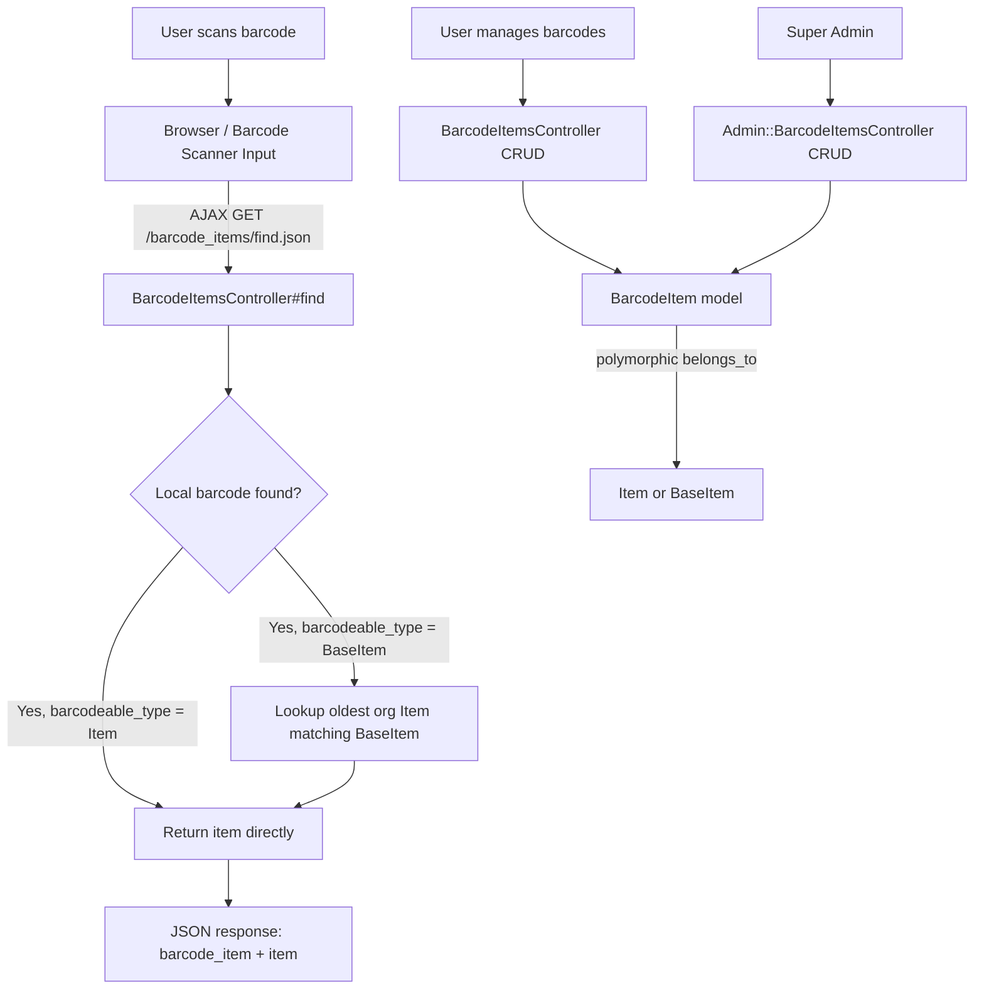
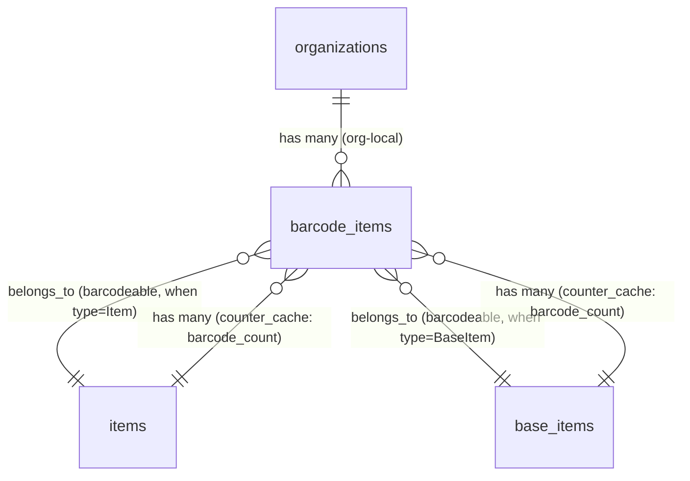
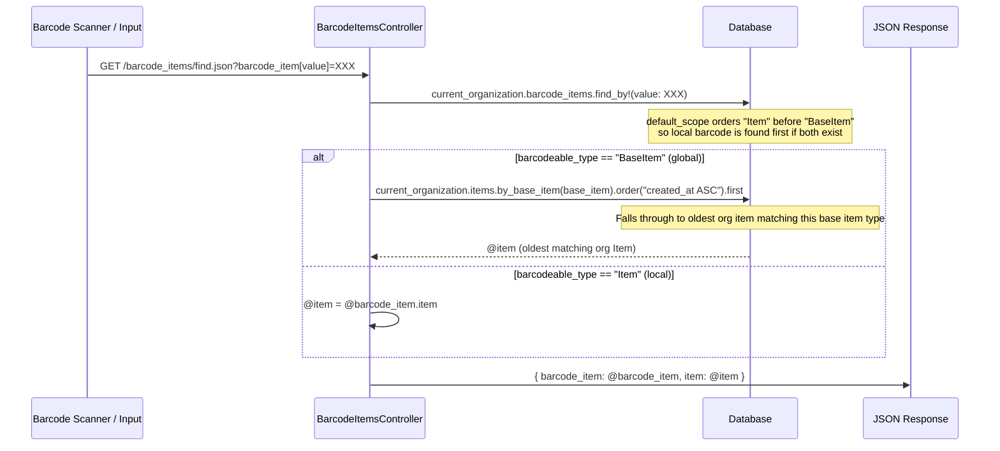

# Barcode Items

> **Status**: Active
> **Generated**: 2026-06-13T00:00:00Z
> **Last Updated**: 2026-06-13T00:00:00Z

---

## Overview

### What It Does
The barcode-items feature allows organizations to scan and manage barcode lookups for inventory items. Each barcode record maps a physical barcode value to a specific item and a quantity (representing, for example, how many units are in a box bearing that barcode). The system supports two tiers of barcodes: **organization-local barcodes** (tied to an organization's `Item`) and **global barcodes** (tied to a system-wide `BaseItem`, managed by super admins).

### Why It Exists
Diaper banks and essentials banks receive large quantities of goods in standardized packaging. By scanning a barcode, staff can instantly identify the item type and quantity per box, dramatically speeding up donation intake, purchase recording, and distribution workflows. The two-tier system lets super admins pre-populate common product barcodes globally while individual organizations can add their own custom mappings.

### Key Capabilities
- Create, read, update, and delete barcode-to-item mappings scoped to an organization
- Look up a barcode value via JSON API (`find` action) with automatic fallthrough from local to global barcodes
- Filter barcodes by item, base item partner key, or barcode value
- Export barcode listings to CSV
- Download a barcode font file (LibreBarcode128) for rendering barcodes in the browser
- Inline barcode creation via a modal (used on donation/distribution forms)
- Global barcode management by super admins through the admin panel
- Full audit trail via PaperTrail versioning

---

## Architecture

### High-Level Design



### Components

#### Backend Components

| Component | File Path | Purpose |
|-----------|-----------|---------|
| BarcodeItemsController | `app/controllers/barcode_items_controller.rb` | Full CRUD + `find` (JSON lookup) + `font` (font download) for org-scoped barcodes |
| Admin::BarcodeItemsController | `app/controllers/admin/barcode_items_controller.rb` | CRUD for global barcodes (BaseItem-linked), super admin only |
| BarcodeItem | `app/models/barcode_item.rb` | Core model with polymorphic association, validations, scopes, CSV export |
| Filterable concern | `app/models/concerns/filterable.rb` | Provides `class_filter` for scope-based filtering on index |
| Exportable concern | `app/models/concerns/exportable.rb` | Provides `generate_csv` and CSV export framework |

#### View Components

| Component | File Path | Purpose |
|-----------|-----------|---------|
| Index page | `app/views/barcode_items/index.html.erb` | Lists barcodes with filters and CSV export |
| New page | `app/views/barcode_items/new.html.erb` | New barcode form |
| Edit page | `app/views/barcode_items/edit.html.erb` | Edit barcode form |
| Show page | `app/views/barcode_items/show.html.erb` | Barcode detail view |
| Form partial | `app/views/barcode_items/_form.html.erb` | Shared form (quantity, item association, barcode value) |
| Row partial | `app/views/barcode_items/_barcode_item_row.html.erb` | Table row for index listing |
| Barcode lookup partial | `app/views/barcode_items/_barcode_item_lookup.html.erb` | Input field for barcode scanning (used inline on other forms) |
| Barcode modal partial | `app/views/barcode_items/_barcode_modal.html.erb` | Modal for creating barcodes inline during donations/distributions |
| Create JS response | `app/views/barcode_items/create.js.erb` | JS response that hides modal, clears form, triggers toastr notification |
| Admin index | `app/views/admin/barcode_items/index.html.erb` | Admin listing of global barcodes |
| Admin new | `app/views/admin/barcode_items/new.html.erb` | Admin new global barcode form |
| Admin edit | `app/views/admin/barcode_items/edit.html.erb` | Admin edit global barcode form |
| Admin show | `app/views/admin/barcode_items/show.html.erb` | Admin global barcode detail |
| Admin form partial | `app/views/admin/barcode_items/_form.html.erb` | Admin shared form partial |
| Admin row partial | `app/views/admin/barcode_items/_barcode_item_row.html.erb` | Admin table row partial |
| Admin modal partial | `app/views/admin/barcode_items/_barcode_modal.html.erb` | Admin modal partial |

### Technology Stack
- **Backend**: Ruby on Rails (ApplicationController, AdminController)
- **Frontend**: ERB templates, AdminLTE (card layout), SimpleForm, jQuery (barcode scan handling)
- **Database**: PostgreSQL (serial integer primary keys)
- **Versioning**: PaperTrail (`has_paper_trail`)

---

## Model Details

### BarcodeItem

**File**: `app/models/barcode_item.rb`

#### Associations
```ruby
belongs_to :organization, optional: true
belongs_to :barcodeable, polymorphic: true, counter_cache: :barcode_count

# Aliases of barcodeable for convenience
belongs_to :item, polymorphic: true, counter_cache: :barcode_count, foreign_key: :barcodeable_id, foreign_type: :barcodeable_type
belongs_to :base_item, polymorphic: true, counter_cache: :barcode_count, foreign_key: :barcodeable_id, foreign_type: :barcodeable_type
```

The `counter_cache: :barcode_count` increments/decrements the `barcode_count` integer column on either the `items` or `base_items` table depending on `barcodeable_type`.

#### Concerns

| Concern | Purpose |
|---------|---------|
| `Filterable` | Provides `class_filter(params)` class method that chains named scopes based on filter parameter hash |
| `Exportable` | Provides `generate_csv(data)` class method and requires `csv_export_headers` / `csv_export_attributes` |

#### Versioning
```ruby
has_paper_trail
```
All changes to BarcodeItem records are tracked via PaperTrail for audit purposes.

#### Validations

| Validation | Field | Rule |
|------------|-------|------|
| `validates :organization, presence: true` | `organization` | Required unless `barcodeable_type == "BaseItem"` (global barcodes) |
| `validates :value, presence: true` | `value` | Barcode string must be present |
| `validate :unique_barcode_value` | `value` | Custom: global barcodes unique globally; org barcodes unique within org |
| `validates :quantity, presence: true` | `quantity` | Must be present |
| `validates :quantity, numericality: { only_integer: true, greater_than: 0 }` | `quantity` | Must be a positive integer |

#### Default Scope
```ruby
default_scope { order("barcodeable_type DESC, created_at ASC") }
```
This ordering places local barcodes (`barcodeable_type: "Item"`) before global barcodes (`barcodeable_type: "BaseItem"`) because "Item" > "BaseItem" in descending string sort. Within each type, barcodes are ordered by creation date ascending. This is critical for the `find` action: when a local and global barcode share the same value, `find_by!` returns the local one first.

#### Scopes

| Scope | Purpose |
|-------|---------|
| `barcodeable_id(id)` | Filter by specific barcodeable_id |
| `by_item_partner_key(key)` | Join to `items` table, filter by partner_key (for org barcodes) |
| `by_base_item_partner_key(key)` | Join to `base_items` table, filter by partner_key (for global barcodes) |
| `by_value(value)` | Filter by exact barcode value string |
| `global` | Only global barcodes (`barcodeable_type: "BaseItem"`) |

#### Key Methods

| Method | Returns | Purpose | Notes |
|--------|---------|---------|-------|
| `to_h` | `Hash` | Returns `{ barcodeable_id:, barcodeable_type:, quantity: }` | Used when converting barcode scan to line item data |
| `global?` | `Boolean` | Returns `true` if `barcodeable_type == "BaseItem"` | Distinguishes global vs org-local barcodes |
| `csv_export_attributes` | `Array` | Returns `[barcodeable.name, quantity, value]` | For CSV export |
| `self.csv_export_headers` | `Array` | Returns `["Item Type", "Quantity in the Box", "Barcode"]` | CSV column headers |

#### Custom Validation: `unique_barcode_value`
```ruby
# Source: app/models/barcode_item.rb:78-83
def unique_barcode_value
  if (global?  && BarcodeItem.where.not(id: id).find_by(value: value, barcodeable_type: "BaseItem")) ||
     (!global? && BarcodeItem.where.not(id: id).find_by(value: value, organization:     organization))
    errors.add(:value, "That barcode value already exists")
  end
end
```
Global barcodes must have a unique value among all global barcodes. Organization barcodes must have a unique value within their organization but may share values with global barcodes or barcodes in other organizations.

---

## Database Schema

### barcode_items

| Column | Type | Default | Notes |
|--------|------|---------|-------|
| `id` | `serial` (integer) | auto-increment | Primary key |
| `value` | `string` | — | The barcode string (e.g., UPC code) |
| `barcodeable_id` | `integer` | — | FK to either `items.id` or `base_items.id` |
| `quantity` | `integer` | — | Number of units represented by this barcode |
| `created_at` | `datetime` | — | Not null |
| `updated_at` | `datetime` | — | Not null |
| `organization_id` | `integer` | — | FK to `organizations.id`; NULL for global barcodes |
| `barcodeable_type` | `string` | `"Item"` | Polymorphic type: `"Item"` (org-local) or `"BaseItem"` (global) |

### Indexes

| Index Name | Columns | Purpose |
|------------|---------|---------|
| `index_barcode_items_on_barcodeable_type_and_barcodeable_id` | `barcodeable_type, barcodeable_id` | Polymorphic association lookup |
| `index_barcode_items_on_organization_id` | `organization_id` | Organization-scoped queries |

### Relationships



---

## API Endpoints

### Organization Routes (`/barcode_items`)

| Method | Path | Action | Description | Notes |
|--------|------|--------|-------------|-------|
| `GET` | `/barcode_items` | `index` | List org barcodes with filters; supports HTML and CSV formats | Filters: `barcodeable_id`, `by_item_partner_key`, `by_value` |
| `GET` | `/barcode_items/new` | `new` | New barcode form | |
| `POST` | `/barcode_items` | `create` | Create org barcode | Responds to HTML, JSON, and JS formats |
| `GET` | `/barcode_items/:id` | `show` | Show barcode detail | Scoped to current organization |
| `GET` | `/barcode_items/:id/edit` | `edit` | Edit barcode form | Scoped to current organization |
| `PATCH/PUT` | `/barcode_items/:id` | `update` | Update barcode | Scoped to current organization |
| `DELETE` | `/barcode_items/:id` | `destroy` | Delete barcode | Cannot delete global barcodes; cannot delete other orgs' barcodes |
| `GET` | `/barcode_items/find` | `find` | JSON lookup by barcode value | Collection route; returns `{ barcode_item, item }` |
| `GET` | `/barcode_items/font` | `font` | Download LibreBarcode128 TTF font file | Serves `public/fonts/LibreBarcode128-Regular.ttf` |

### Admin Routes (`/admin/barcode_items`)

| Method | Path | Action | Description | Notes |
|--------|------|--------|-------------|-------|
| `GET` | `/admin/barcode_items` | `index` | List global barcodes | Super admin only |
| `GET` | `/admin/barcode_items/new` | `new` | New global barcode form | |
| `POST` | `/admin/barcode_items` | `create` | Create global barcode | Forces `barcodeable_type: "BaseItem"` |
| `GET` | `/admin/barcode_items/:id` | `show` | Show global barcode detail | |
| `GET` | `/admin/barcode_items/:id/edit` | `edit` | Edit global barcode | |
| `PATCH/PUT` | `/admin/barcode_items/:id` | `update` | Update global barcode | |
| `DELETE` | `/admin/barcode_items/:id` | `destroy` | Delete global barcode | |

---

## Authorization

This feature does not use Pundit policies. Authorization is handled through:

1. **ApplicationController**: The org-scoped `BarcodeItemsController` inherits from `ApplicationController`, which requires a signed-in user with an organization. All queries are scoped via `current_organization.barcode_items`, preventing cross-org access.

2. **AdminController**: The `Admin::BarcodeItemsController` inherits from `AdminController`, which restricts access to users with the `SUPER_ADMIN` role.

3. **Destroy guard**: The `destroy` action in `BarcodeItemsController` explicitly raises if the barcode is `nil` (not found in current org) or `global?`, preventing non-admins from deleting global barcodes:

```ruby
# Source: app/controllers/barcode_items_controller.rb:87-98
def destroy
  begin
    barcode = current_organization.barcode_items.find(params[:id])
    raise if barcode.nil? || barcode.global?

    barcode.destroy!
  rescue StandardError
    flash[:error] = "Sorry, you don't have permission to delete this barcode."
  end
  flash[:notice] = "Barcode deleted!"
  redirect_to barcode_items_path
end
```

---

## Barcode Lookup Flow (find action)

The `find` action is the most important endpoint in this feature, used during donation/distribution entry to resolve a scanned barcode to an item and quantity.



Key behavior: When a global barcode is found, the controller resolves it to the **oldest** organization-specific `Item` that matches the `BaseItem` (per issue #593). This ensures the barcode maps to a concrete item the organization tracks.

---

## Configuration

### No environment variables required

This feature has no external service dependencies or environment-variable-driven configuration.

### Font File
- `public/fonts/LibreBarcode128-Regular.ttf` — Served by the `font` action for client-side barcode rendering

---

## Usage Examples

### Inline Barcode Modal (used on donation/distribution forms)

The `_barcode_modal.html.erb` partial renders a Bootstrap modal that can be embedded on any form that needs barcode entry. When a barcode is created via the modal, `create.js.erb` fires:

```javascript
// Source: app/views/barcode_items/create.js.erb:1-18
$('#newBarcode').modal('hide');
source_field = $('#trigger-field-id').val();

// Clear out the fields, capturing the quantity and item_id
item_id = $('#barcode_item_barcodeable_id').val();
quantity = $('#barcode_item_quantity').val();
$('#barcode_item_quantity').val('');
$('#barcode_item_barcodeable_id').val('');
$('#barcode_item_value').val('');
$('#trigger-field-id').val('');

// Notify the user
toastr.success("Barcode Added to Inventory");

// Trigger the capture_entry/barcode_item_lookup functions with a return keypress
// which fills in the item name and quantity, adds new item, and changes focus
return_keypress = $.Event( "keypress", { which: 13 } )
$("input.__barcode_item_lookup").last().trigger(return_keypress);
```

### CSV Export

The index action supports CSV format. Requesting `GET /barcode_items.csv` generates a CSV with these headers:

```ruby
# Source: app/models/barcode_item.rb:60-62
def self.csv_export_headers
  ["Item Type", "Quantity in the Box", "Barcode"]
end
```

Each row outputs:
```ruby
# Source: app/models/barcode_item.rb:64-69
def csv_export_attributes
  [
    barcodeable.name,
    quantity,
    value
  ]
end
```

---

## Testing

### Test Files

| File | Type | Description |
|------|------|-------------|
| `spec/models/barcode_item_spec.rb` | Model spec | Validations, scopes, filters, counter cache, destroy behavior, versioning |
| `spec/requests/barcode_items_requests_spec.rb` | Request spec | CRUD actions, find (JSON), CSV export, edit/show 404 for global barcodes, destroy permissions |
| `spec/requests/admin/barcode_items_requests_spec.rb` | Request spec | Admin CRUD for global barcodes |
| `spec/system/barcode_item_system_spec.rb` | System spec | End-to-end browser tests for barcode management |
| `spec/system/admin/barcode_items_system_spec.rb` | System spec | End-to-end admin barcode management |
| `spec/factories/barcode_items.rb` | Factory | Two factories: `:barcode_item` (org-local) and `:global_barcode_item` (BaseItem-linked) |
| `spec/support/barcode_helper.rb` | Support helper | Shared test utilities for barcode tests |

### Key Test Cases
- Global barcodes do not require an organization; org barcodes do
- Barcode values are unique within organization but can overlap across organizations
- Barcode values are unique within global scope
- Multiple barcodes can point to the same item
- The `find` action returns local barcodes for the current org and global barcodes
- The `find` action returns 404 for barcodes belonging to other organizations
- Destroying a barcode does not destroy the associated item
- Edit/show of global barcodes returns 404 for org users (scoped to `current_organization`)
- Non-superadmins cannot delete global barcodes
- Counter cache (`barcode_count`) increments on Item/BaseItem when barcodes are created

---

## Known Issues & Caveats

| Issue | Location | Description |
|-------|----------|-------------|
| Flash notice always set on destroy | `barcode_items_controller.rb:96` | `flash[:notice] = "Barcode deleted!"` is set even when the destroy fails and `flash[:error]` is also set. Both flash messages will appear. |
| Admin create uses `create` then `save` | `admin/barcode_items_controller.rb:28` | `BarcodeItem.create(...)` already persists the record; calling `.save` again is redundant (though harmless). Should be `BarcodeItem.new(...)` followed by `.save`. |
| Default scope on all queries | `barcode_item.rb:29` | `default_scope` applies to ALL queries, which can cause unexpected ordering in joins and aggregations. The ordering is relied upon by `find_by!` in the `find` action. |
| Polymorphic alias associations | `barcode_item.rb:49-50` | `belongs_to :item` and `belongs_to :base_item` are declared as aliases of `barcodeable` with the same `foreign_key`/`foreign_type`. Calling `barcode.item` on a global barcode or `barcode.base_item` on a local barcode will return the wrong type without error. |
| No pagination on index | `barcode_items_controller.rb:11` | The index loads all barcode items for the org without pagination, which could be slow for organizations with many barcodes. |
| `filter_params` unused keys in admin | `admin/barcode_items_controller.rb:61-64` | Admin controller defines `filter_params` accepting `less_than_quantity`, `greater_than_quantity`, `equal_to_quantity`, `base_item_id` but these scopes do not exist on BarcodeItem; the method appears unused. |
| Rescue catches all StandardError | `barcode_items_controller.rb:93` | `rescue StandardError` in destroy catches all exceptions including `ActiveRecord::RecordNotFound`, masking the real error with a generic permissions message. |

---

## Performance

### Database Optimization
- **Composite index**: `index_barcode_items_on_barcodeable_type_and_barcodeable_id` supports polymorphic lookups
- **Organization index**: `index_barcode_items_on_organization_id` supports org-scoped queries
- **Counter cache**: `barcode_count` on `items` and `base_items` avoids COUNT queries when displaying barcode counts
- **No index on `value` column**: The `find` action queries `WHERE value = ?` but there is no index on `value`. This could become a performance issue as the barcode_items table grows.

---

## Related Features

- **[Items](items.md)** — BarcodeItem maps to `Item` (org-local barcodes); `Item` has `barcode_count` counter cache
- **[Admin Panel](admin-panel.md)** — Global barcode management via `Admin::BarcodeItemsController`
- **[Donations](donations.md)** — Barcode lookup modal and scanner input are embedded in donation entry forms
- **[Distributions](distributions.md)** — Barcode lookup modal and scanner input are embedded in distribution entry forms

---

**Generated**: 2026-06-13T00:00:00Z
**Last Updated**: 2026-06-13T00:00:00Z
**Status**: Active
