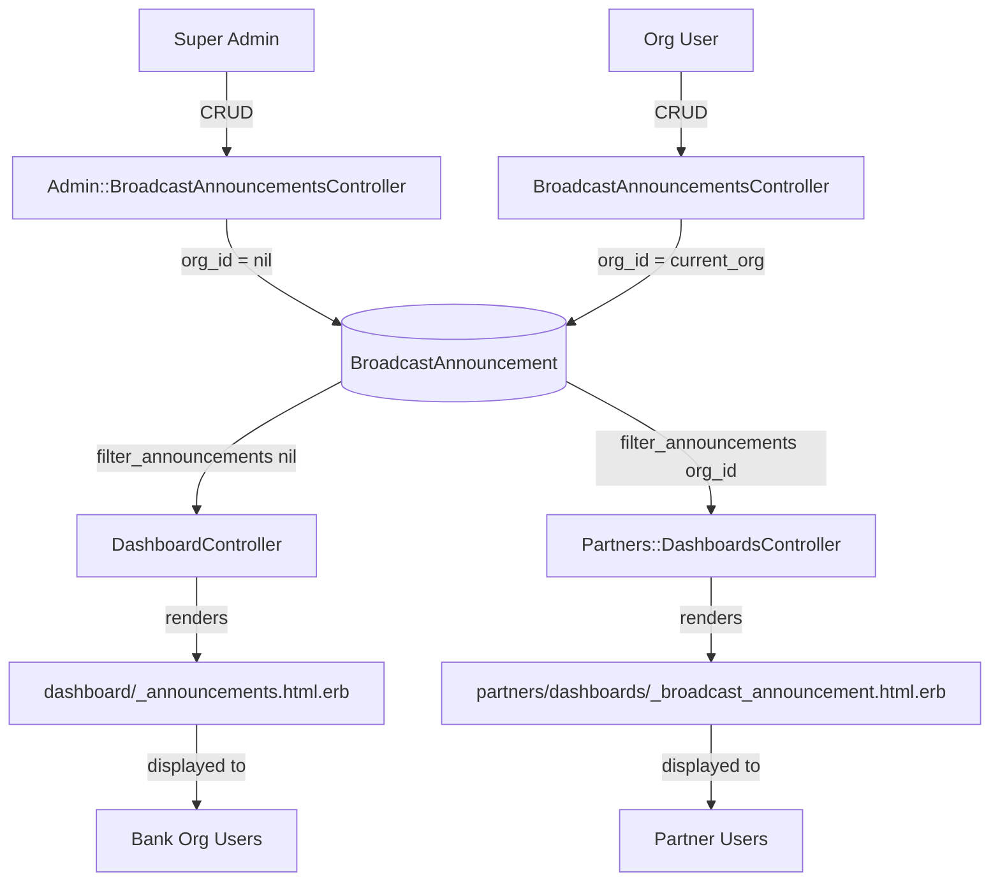
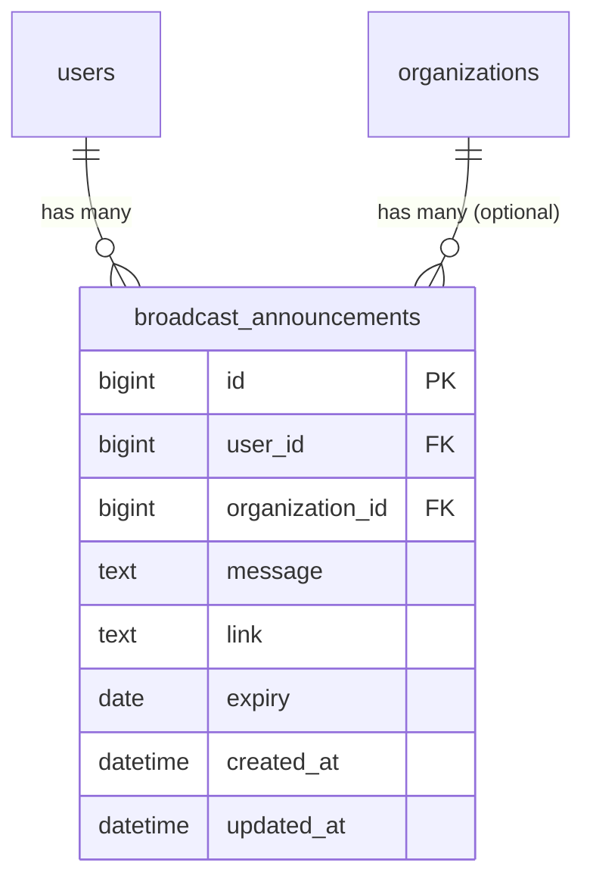

# Broadcast Announcements

> **Status**: Active
> **Generated**: 2026-06-13T00:00:00Z
> **Last Updated**: 2026-06-13T00:00:00Z

---

## Overview

### What It Does
Broadcast Announcements allows two levels of users to send messages to downstream audiences. Super admins can create system-wide announcements that appear on every organization's bank-side dashboard (announcements with `organization_id = nil`). Organization-level users can create announcements scoped to their organization, which appear on the partner portal dashboard for partners belonging to that organization.

### Why It Exists
Human Essentials is a multi-tenant platform connecting essentials banks with partner agencies. Both platform operators (super admins) and individual bank organizations need a way to communicate time-sensitive information -- policy changes, scheduled downtime, event reminders, or urgent notices -- to their respective audiences without relying on external email or messaging tools.

### Key Capabilities
- Super admins create system-wide announcements visible to all organizations on their bank dashboards
- Organization users create org-scoped announcements visible to their partners on the partner portal dashboard
- Announcements support an optional link for additional information
- Announcements support an optional expiry date; expired announcements are automatically filtered out of dashboard views
- Full CRUD operations at both the admin and organization levels
- Version tracking via PaperTrail for audit history
- Organization-scoped access control prevents cross-organization manipulation

---

## Architecture

### High-Level Design



### Components

#### Backend Components
| Component | File Path | Purpose |
|-----------|-----------|---------|
| BroadcastAnnouncementsController | `app/controllers/broadcast_announcements_controller.rb` | Org-level CRUD for announcements scoped to current organization |
| Admin::BroadcastAnnouncementsController | `app/controllers/admin/broadcast_announcements_controller.rb` | Super admin CRUD for system-wide announcements (org_id = nil) |
| BroadcastAnnouncement | `app/models/broadcast_announcement.rb` | Model with validations, expiry logic, and filtering scope |
| DashboardController | `app/controllers/dashboard_controller.rb` | Loads system-wide announcements (line 18) for bank dashboard display |
| Partners::DashboardsController | `app/controllers/partners/dashboards_controller.rb` | Loads org-scoped announcements (line 32) for partner dashboard display |

#### Frontend Components (Views)
| Component | File Path | Purpose |
|-----------|-----------|---------|
| Org index | `app/views/broadcast_announcements/index.html.erb` | Lists all org-scoped announcements with edit/delete actions |
| Org form | `app/views/broadcast_announcements/_form.html.erb` | Shared form for new/edit with message, link, expiry fields |
| Org row partial | `app/views/broadcast_announcements/_broadcast_announcement.html.erb` | Table row rendering a single announcement |
| Org new | `app/views/broadcast_announcements/new.html.erb` | New announcement page (renders _form) |
| Org edit | `app/views/broadcast_announcements/edit.html.erb` | Edit announcement page (renders _form) |
| Admin index | `app/views/admin/broadcast_announcements/index.html.erb` | Lists all system-wide announcements |
| Admin form | `app/views/admin/broadcast_announcements/_form.html.erb` | Shared admin form; receives `admin_form_url` local |
| Admin row partial | `app/views/admin/broadcast_announcements/_broadcast_announcement.html.erb` | Table row for admin announcement |
| Admin new | `app/views/admin/broadcast_announcements/new.html.erb` | New admin announcement page |
| Admin edit | `app/views/admin/broadcast_announcements/edit.html.erb` | Edit admin announcement page |
| Dashboard announcements | `app/views/dashboard/_announcements.html.erb` | Renders system-wide announcements on bank dashboard |
| Partner dashboard announcements | `app/views/partners/dashboards/_broadcast_announcement.html.erb` | Renders org-scoped announcements on partner dashboard |

### Technology Stack
- **Backend**: Ruby on Rails, ApplicationController (org-level), AdminController (admin-level)
- **Frontend**: ERB templates, SimpleForm for form rendering, AdminLTE CSS framework
- **Database**: PostgreSQL (bigint primary keys, indexed foreign keys)
- **Versioning**: PaperTrail gem for change tracking

---

## Model Details

### BroadcastAnnouncement

**Source:** `app/models/broadcast_announcement.rb`

#### Associations
```ruby
# Copy verbatim from model file
belongs_to :user
belongs_to :organization, optional: true
```

Note: `organization` is optional. When `organization_id` is `nil`, the announcement is system-wide (created by super admins). When set, it is scoped to that organization.

Neither association declares a `dependent:` option -- announcements are not automatically destroyed when the parent user or organization is deleted.

#### Concerns
| Concern | Purpose |
|---------|---------|
| `has_paper_trail` | Tracks all changes to announcement records for audit history (PaperTrail gem) |

#### Validations
```ruby
# Source: app/models/broadcast_announcement.rb:18-19
validates :link, format: URI::DEFAULT_PARSER.make_regexp(%w[http https]), allow_blank: true
validates :message, presence: true
```

- `link` must be a valid HTTP or HTTPS URL if provided; blank is allowed
- `message` is required

#### Callbacks
No explicit callbacks defined. PaperTrail hooks are added via `has_paper_trail`.

#### Key Methods

| Method | Returns | Purpose | Notes |
|--------|---------|---------|-------|
| `expired?` | `Boolean` | Returns `true` if expiry date is in the past | Returns `false` if `expiry` is `nil` (never expires) |
| `self.filter_announcements(parent_org)` | `ActiveRecord::Relation` | Filters announcements by org, excludes expired, orders by `created_at` DESC | Used by both DashboardController and Partners::DashboardsController |

##### `expired?` (instance method)
```ruby
# Source: app/models/broadcast_announcement.rb:21-24
def expired?
  return false if expiry.nil?
  expiry < Time.zone.today
end
```

##### `self.filter_announcements` (class method)
```ruby
# Source: app/models/broadcast_announcement.rb:26-30
def self.filter_announcements(parent_org)
  BroadcastAnnouncement.where(organization_id: parent_org)
    .where("expiry IS NULL or expiry >= ?", Time.zone.today)
    .order(created_at: :desc)
end
```

When called with `nil` (from `DashboardController`), this returns system-wide announcements. When called with an organization ID (from `Partners::DashboardsController`), it returns org-scoped announcements.

---

## Database Schema

### broadcast_announcements

| Column | Type | Default | Null | Notes |
|--------|------|---------|------|-------|
| `id` | `bigint` | auto-increment | NOT NULL | Primary key |
| `user_id` | `bigint` | — | NOT NULL | FK to `users` table; the user who created the announcement |
| `message` | `text` | — | — | The announcement body text |
| `link` | `text` | — | — | Optional URL for more information |
| `expiry` | `date` | — | — | Optional expiration date; `NULL` means never expires |
| `created_at` | `datetime` | — | NOT NULL | Rails timestamp |
| `updated_at` | `datetime` | — | NOT NULL | Rails timestamp |
| `organization_id` | `bigint` | — | — | FK to `organizations`; `NULL` = system-wide announcement |

### Indexes
| Index Name | Column(s) |
|------------|-----------|
| `index_broadcast_announcements_on_organization_id` | `organization_id` |
| `index_broadcast_announcements_on_user_id` | `user_id` |

### Foreign Keys
| Column | References | Notes |
|--------|------------|-------|
| `user_id` | `users(id)` | Defined in schema via `add_foreign_key "broadcast_announcements", "users"` |
| `organization_id` | — | No foreign key constraint defined in schema (only an index) |

### Relationships


---

## API Endpoints

### Organization-Level Routes (`resources :broadcast_announcements`)

| Method | Path | Action | Description | Notes |
|--------|------|--------|-------------|-------|
| `GET` | `/broadcast_announcements` | `index` | List announcements for current org | Scoped to `current_organization.id` |
| `GET` | `/broadcast_announcements/new` | `new` | Render new announcement form | |
| `POST` | `/broadcast_announcements` | `create` | Create org-scoped announcement | Sets `organization_id` via hidden field |
| `GET` | `/broadcast_announcements/:id/edit` | `edit` | Render edit form | Scoped find prevents cross-org access |
| `PATCH/PUT` | `/broadcast_announcements/:id` | `update` | Update an announcement | Scoped find prevents cross-org access |
| `DELETE` | `/broadcast_announcements/:id` | `destroy` | Delete an announcement | Scoped find prevents cross-org access |
| `GET` | `/broadcast_announcements/:id` | `show` | -- | Route exists (via `resources`) but NO `show` action in controller |

### Admin-Level Routes (`admin/broadcast_announcements`)

| Method | Path | Action | Description | Notes |
|--------|------|--------|-------------|-------|
| `GET` | `/admin/broadcast_announcements` | `index` | List system-wide announcements | Filters where `organization_id IS NULL` |
| `GET` | `/admin/broadcast_announcements/new` | `new` | Render new announcement form | |
| `POST` | `/admin/broadcast_announcements` | `create` | Create system-wide announcement | No `organization_id` set |
| `GET` | `/admin/broadcast_announcements/:id/edit` | `edit` | Render edit form | Uses unscoped `find` |
| `PATCH/PUT` | `/admin/broadcast_announcements/:id` | `update` | Update an announcement | |
| `DELETE` | `/admin/broadcast_announcements/:id` | `destroy` | Delete an announcement | |
| `GET` | `/admin/broadcast_announcements/:id` | `show` | -- | Route exists (via `resources`) but NO `show` action in controller |

---

## Authorization

This feature does NOT use Pundit policies. Access control is implemented as follows:

### Organization-Level Controller
- Inherits from `ApplicationController`, which provides `current_organization` scoping and requires a signed-in user
- The `set_broadcast_announcement` callback scopes the `find` to `current_organization.id`, raising `ActiveRecord::RecordNotFound` (404) if the announcement belongs to a different organization:

```ruby
# Source: app/controllers/broadcast_announcements_controller.rb:47-49
def set_broadcast_announcement
  @broadcast_announcement = BroadcastAnnouncement.where(organization_id: current_organization.id).find(params[:id])
end
```

### Admin-Level Controller
- Inherits from `AdminController`, which already has a `before_action :require_admin` check
- Additionally defines its own `require_admin` as a `before_action`:

```ruby
# Source: app/controllers/admin/broadcast_announcements_controller.rb:5-7
def require_admin
  verboten! unless current_user.has_cached_role?(Role::SUPER_ADMIN)
end
```

- Only users with `Role::SUPER_ADMIN` can access any admin broadcast announcement action
- Non-super-admin users are redirected to the dashboard

---

## Configuration

No environment variables or special configuration files are required for this feature. Announcements are stored directly in the database and displayed via standard Rails views.

---

## Usage Examples

### Creating an Org-Scoped Announcement (Form Submission)
The org-level form submits with the current user and organization IDs as hidden fields:

```ruby
# Source: app/views/broadcast_announcements/_form.html.erb:13-14
<%= f.hidden_field :user_id, value: current_user.id %>
<%= f.hidden_field :organization_id, value: current_organization.id %>
```

### Displaying Announcements on the Bank Dashboard
System-wide announcements (where `organization_id IS NULL`) are loaded by the DashboardController and rendered as a collapsible card:

```ruby
# Source: app/controllers/dashboard_controller.rb:17-18
# passing nil here filters the announcements that didn't come from an organization
@broadcast_announcements = BroadcastAnnouncement.filter_announcements(nil)
```

```erb
<%# Source: app/views/dashboard/_announcements.html.erb:14-28 %>
<% @broadcast_announcements.each do |announcement| %>
  <li class="list-group-item">
    <strong><%= if announcement.created_at.strftime("%Y") == DateTime.now.strftime("%Y")
                  announcement.created_at.strftime("%B %d")
                else
                  announcement.created_at.strftime("%B %d %Y")
                end %></strong>
    <br>
    <%= announcement.message %>
    <% unless announcement.link == '' %>
      <br>
      <a href="<%= announcement.link %>" class="btn btn-primary">more info</a>
    <% end %>
  </li>
<% end %>
```

### Displaying Announcements on the Partner Dashboard
Org-scoped announcements are loaded for the partner's parent organization:

```ruby
# Source: app/controllers/partners/dashboards_controller.rb:32
@broadcast_announcements = BroadcastAnnouncement.filter_announcements(@parent_org)
```

```erb
<%# Source: app/views/partners/dashboards/show.html.erb:2 %>
<%= render 'broadcast_announcement' if @broadcast_announcements.any? %>
```

---

## Testing

### Test Files
- `spec/models/broadcast_announcement_spec.rb` -- Model validations, `expired?`, `filter_announcements` scope
- `spec/requests/broadcast_announcements_spec.rb` -- Org-level CRUD request specs + cross-org access denial
- `spec/requests/admin/broadcast_announcements_spec.rb` -- Admin-level CRUD request specs + non-admin rejection
- `spec/factories/broadcast_announcements.rb` -- FactoryBot factory

### Key Test Cases

**Model specs** (`spec/models/broadcast_announcement_spec.rb`):
- Validates `belongs_to :organization` is optional
- Validates `belongs_to :user` is required
- Validates `message` presence
- Rejects invalid links (e.g., `"notalink"`)
- Accepts valid links (e.g., `"https://google.com"`)
- `expired?` returns `true` for past expiry, `false` for today or nil
- `filter_announcements` scopes by organization, excludes expired, sorts by `created_at` DESC
- PaperTrail versioning is enabled (`is_expected.to be_versioned`)

**Request specs** (`spec/requests/broadcast_announcements_spec.rb`):
- Full CRUD lifecycle (index, new, edit, create, update, destroy)
- Cross-organization access returns 404 for edit, update, and destroy

**Admin request specs** (`spec/requests/admin/broadcast_announcements_spec.rb`):
- Full CRUD lifecycle for super admins
- Organization admin users are redirected to dashboard for `new` and `create`

---

## Known Issues & Caveats

| Issue | Location | Description |
|-------|----------|-------------|
| Route without action | `config/routes.rb:279` | `GET /broadcast_announcements/:id` (`show`) route is defined via `resources` but no `show` action exists in `BroadcastAnnouncementsController` -- will raise `AbstractController::ActionNotFound` |
| Route without action | `config/routes.rb:78` | `GET /admin/broadcast_announcements/:id` (`show`) route is defined via `resources` but no `show` action exists in `Admin::BroadcastAnnouncementsController` |
| No foreign key on organization_id | `db/schema.rb` | `organization_id` has an index but no `add_foreign_key` constraint, meaning orphaned announcements can exist if an organization is deleted |
| Hidden field user_id in form | `app/views/broadcast_announcements/_form.html.erb:13` | `user_id` is submitted as a hidden form field and accepted via strong params; a malicious user could modify this to impersonate another user as the announcement author |
| Hidden field organization_id in form | `app/views/broadcast_announcements/_form.html.erb:14` | `organization_id` is submitted as a hidden form field and accepted via strong params; a malicious user could tamper with this to create announcements for other organizations (no server-side override) |
| Admin form also permits organization_id | `app/controllers/admin/broadcast_announcements_controller.rb:57` | Admin strong params permit `organization_id`, but the admin index only shows announcements where `organization_id IS NULL`; if an admin accidentally sets an org ID, the announcement disappears from the admin index |
| No pagination | `app/controllers/broadcast_announcements_controller.rb:5` | Index loads all announcements for the org with no pagination; could be slow for organizations with many historical announcements |
| `.reverse` in views | `app/views/broadcast_announcements/index.html.erb:47` | Uses Ruby `.reverse` on the loaded collection instead of an SQL `ORDER BY`, loading all records into memory before reversing |
| Announcement date display logic | `app/views/dashboard/_announcements.html.erb:16-19` | Date formatting uses `DateTime.now` (system timezone) alongside `announcement.created_at` which may cause inconsistencies across timezones |

---

## Performance

### Database Optimization
- **Index on `organization_id`**: `index_broadcast_announcements_on_organization_id` -- supports the `WHERE organization_id = ?` queries in both controllers and `filter_announcements`
- **Index on `user_id`**: `index_broadcast_announcements_on_user_id` -- supports the `belongs_to :user` association lookup

### Potential Improvements
- Add pagination to both index actions to avoid loading all records
- Replace `.reverse` in views with SQL `ORDER BY` clause
- Restrict `user_id` and `organization_id` from strong params and set them server-side

---

## Troubleshooting

### Common Issues

#### Issue: Announcement does not appear on dashboard
**Symptoms:**
- Announcement was created but is not visible on the bank or partner dashboard

**Cause:**
The `filter_announcements` scope excludes announcements where `expiry < Time.zone.today`. If the expiry date was set to today or a past date at creation time, it will not appear.

**Solution:**
Check the announcement's `expiry` field. Set it to a future date or leave it blank (nil) for no expiration.

#### Issue: Admin-created announcement not visible in admin index
**Symptoms:**
- Super admin created an announcement but it does not appear in `/admin/broadcast_announcements`

**Cause:**
The admin index filters with `WHERE organization_id IS NULL`. If an `organization_id` was accidentally set during creation (possible since the form permits it), the announcement will not appear in the admin list.

**Solution:**
Query the database directly for the announcement and set `organization_id` to `NULL`.

#### Issue: Non-super-admin redirected when accessing admin announcements
**Symptoms:**
- User is redirected to the dashboard when trying to access `/admin/broadcast_announcements`

**Cause:**
The `require_admin` before_action checks for `Role::SUPER_ADMIN`. Organization admins and regular users are denied access.

**Solution:**
This is expected behavior. Only super admins can manage system-wide announcements.

---

## Related Features

- **[Dashboard](./dashboard.md)** -- System-wide announcements are rendered on the bank dashboard via `_announcements.html.erb` partial
- **[Partner Portal](./partner-portal.md)** -- Org-scoped announcements are rendered on the partner dashboard via `_broadcast_announcement.html.erb` partial
- **[Admin Panel](./admin-panel.md)** -- Admin broadcast announcements controller inherits from `AdminController` and lives under the admin namespace

---

**Generated:** 2026-06-13T00:00:00Z
**Last Updated:** 2026-06-13T00:00:00Z
**Status:** Active
