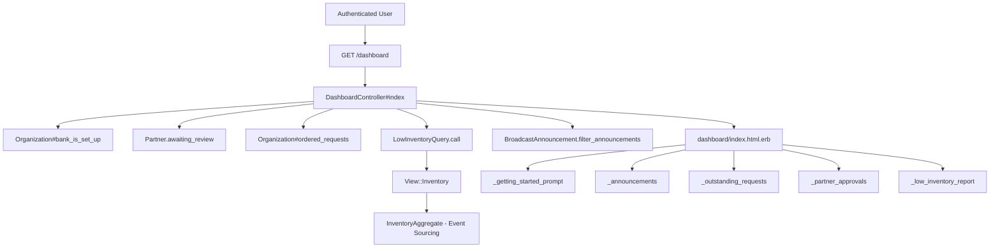
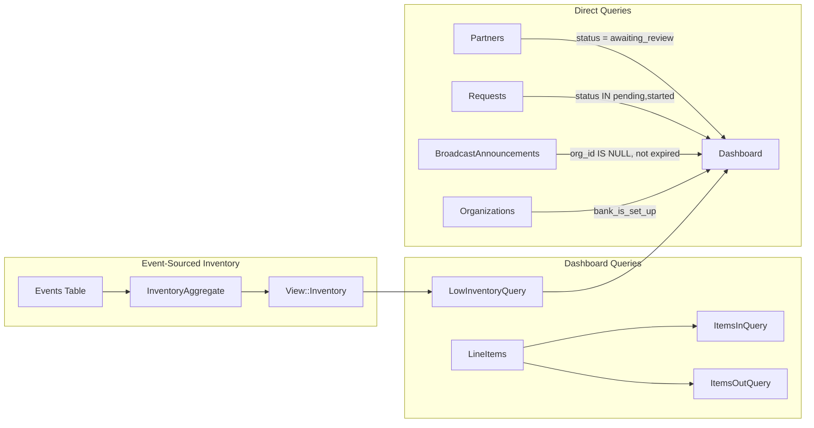

# Dashboard

> **Status**: Active
> **Generated**: 2026-06-13T00:00:00Z
> **Last Updated**: 2026-06-13T00:00:00Z

---

## Overview

### What It Does
The Dashboard is the primary landing page for organization (bank) users after login. It provides an at-a-glance summary of the organization's operational state, including outstanding partner requests, partners awaiting approval review, bank-wide low inventory alerts, and system-wide broadcast announcements. For new organizations that have not yet completed setup, it also shows a getting-started guide with step-by-step onboarding links.

### Why It Exists
Diaper banks and essentials banks need a single entry point that surfaces the most actionable information immediately: requests waiting to be fulfilled, partners needing approval, and inventory items that have fallen below configured thresholds. Without a unified dashboard, users would have to navigate multiple pages to determine what needs attention.

### Key Capabilities
- Display outstanding (pending/started) partner requests with date, partner name, requestor, and comments
- Show partners awaiting approval review with primary contact details and a link to review their profile
- Present a bank-wide low inventory report comparing on-hand quantities against minimum and recommended thresholds
- Render system-wide broadcast announcements (those not scoped to a specific organization)
- Show a dismissible getting-started guide for organizations that have not yet completed initial setup

---

## Architecture

### High-Level Design



### Components

#### Backend Components
| Component | File Path | Purpose |
|-----------|-----------|---------|
| DashboardController | `app/controllers/dashboard_controller.rb` | Prepares all dashboard data for the view |
| DashboardHelper | `app/helpers/dashboard_helper.rb` | Formatting helpers for totals and user display |
| LowInventoryQuery | `app/queries/low_inventory_query.rb` | Computes items below minimum or recommended quantity thresholds |
| ItemsInQuery | `app/queries/items_in_query.rb` | Aggregates incoming items per storage location (donations, purchases, positive adjustments, incoming transfers) |
| ItemsInTotalQuery | `app/queries/items_in_total_query.rb` | Sums total incoming quantity per storage location |
| ItemsOutQuery | `app/queries/items_out_query.rb` | Aggregates outgoing items per storage location (distributions, negative adjustments, outgoing transfers) |
| ItemsOutTotalQuery | `app/queries/items_out_total_query.rb` | Sums total outgoing quantity per storage location |

#### View Components
| Component | File Path | Purpose |
|-----------|-----------|---------|
| Index page | `app/views/dashboard/index.html.erb` | Main dashboard layout rendering all partials |
| Getting Started | `app/views/dashboard/_getting_started_prompt.html.erb` | Onboarding guide for new organizations |
| Announcements | `app/views/dashboard/_announcements.html.erb` | System-wide broadcast announcements |
| Outstanding Requests | `app/views/dashboard/_outstanding_requests.html.erb` | Table of pending/started partner requests |
| Partner Approvals | `app/views/dashboard/_partner_approvals.html.erb` | Table of partners awaiting approval review |
| Low Inventory | `app/views/dashboard/_low_inventory_report.html.erb` | Table of items below inventory thresholds |

### Technology Stack
- **Backend**: Ruby on Rails controller with query objects
- **Frontend**: ERB templates with AdminLTE 3 (Bootstrap 4) card components
- **Database**: PostgreSQL with event-sourced inventory (via `InventoryAggregate`)
- **External Services**: None

---

## Model Details

The dashboard feature does not define its own ActiveRecord model. It aggregates data from several other models:

### LowInventoryQuery

This is a plain Ruby class (not an ActiveRecord model) that uses a `Data.define` struct for results.

#### Data Structure
```ruby
# Source: app/queries/low_inventory_query.rb:2
LowInventoryItem = Data.define(:id, :name, :on_hand_minimum_quantity, :on_hand_recommended_quantity, :total_quantity)
```

#### Key Methods
| Method | Returns | Purpose | Notes |
|--------|---------|---------|-------|
| `.call(organization, inventory)` | `Array<LowInventoryItem>` | Returns items where quantity is below minimum or recommended threshold | Sorted alphabetically by name; returns `[]` if organization is blank |

#### Logic
```ruby
# Source: app/queries/low_inventory_query.rb:4-24
def self.call(organization, inventory = View::Inventory.new(organization.id))
  return [] if organization.blank?

  items = inventory.all_items.uniq(&:item_id)

  low_inventory_items = []
  items.each do |item|
    quantity = inventory.quantity_for(item_id: item.id)
    if quantity < item.on_hand_minimum_quantity.to_i || quantity < item.on_hand_recommended_quantity.to_i
      low_inventory_items.push(LowInventoryItem.new(
        id: item.id,
        name: item.name,
        on_hand_minimum_quantity: item.on_hand_minimum_quantity,
        on_hand_recommended_quantity: item.on_hand_recommended_quantity,
        total_quantity: quantity
      ))
    end
  end

  low_inventory_items.sort_by { |item| item.name }
end
```

### ItemsInQuery / ItemsInTotalQuery

Query objects that aggregate incoming items (donations, purchases, positive adjustments, incoming transfers) for a specific storage location.

```ruby
# Source: app/queries/items_in_query.rb:9-11
def initialize(organization:, storage_location:, filter_params: nil)
  @organization = organization
  @storage_location = storage_location
  @filter_params = filter_params
end
```

`ItemsInQuery#call` returns grouped results with `quantity`, `item_id`, and `name` columns.
`ItemsInTotalQuery#call` returns a single numeric sum.

Both use raw SQL joins across `donations`, `purchases`, `adjustments`, and `transfers` tables to compute totals where:
- `donations.storage_location_id` matches
- `purchases.storage_location_id` matches
- `adjustments.storage_location_id` matches AND `line_items.quantity > 0`
- `transfers.to_id` matches

### ItemsOutQuery / ItemsOutTotalQuery

Query objects that aggregate outgoing items (distributions, negative adjustments, outgoing transfers) for a specific storage location.

Both use raw SQL joins across `distributions`, `adjustments`, and `transfers` tables where:
- `distributions.storage_location_id` matches
- `adjustments.storage_location_id` matches AND `line_items.quantity < 0`
- `transfers.from_id` matches

`ItemsOutQuery#call` returns grouped results; `ItemsOutTotalQuery#call` returns a single sum. Negative quantities in adjustments are inverted (`-1 * quantity`) for the sum.

---

## Database Schema

The dashboard feature does not own any database tables. It reads from the following tables via associated models and query objects:

- **organizations** -- `bank_is_set_up` column (boolean, default: false) controls the getting-started prompt
- **partners** -- `status` enum (0=uninvited, 1=invited, 2=awaiting_review, 3=approved, 5=recertification_required, 6=deactivated) used to filter partners awaiting review
- **requests** -- `status` enum filtered for `:pending` and `:started` values
- **items** -- `on_hand_minimum_quantity` and `on_hand_recommended_quantity` columns compared against event-sourced inventory totals
- **broadcast_announcements** -- filtered by `organization_id IS NULL` and non-expired
- **line_items** -- joined with donations, purchases, distributions, adjustments, and transfers for in/out queries

### Data Flow



---

## API Endpoints

| Method | Path | Action | Description | Notes |
|--------|------|--------|-------------|-------|
| `GET` | `/dashboard` | `DashboardController#index` | Renders the organization dashboard | Responds to HTML and JS formats |

### Route Definition
```ruby
# Source: config/routes.rb:258
get "dashboard", to: "dashboard#index"
```

Note: The dashboard is NOT the application root route. The root route is `static#index` (line 281 of routes.rb). After login, users are typically redirected to the dashboard via Devise's `after_sign_in_path_for`.

---

## Authorization

This application does not use Pundit policies. Authorization is handled at the `ApplicationController` level:

```ruby
# Source: app/controllers/application_controller.rb:7-8
before_action :authenticate_user!
before_action :authorize_user
```

All dashboard access requires:
1. An authenticated user (Devise `authenticate_user!`)
2. The `authorize_user` before_action (defined in `ApplicationController`)
3. A valid `current_organization` (via `require_organization` before_action)

There is no feature-specific authorization -- any authenticated user with an associated organization can view the dashboard.

---

## Configuration

### Environment Variables
No dashboard-specific environment variables.

### Settings
The `organization.bank_is_set_up` boolean controls whether the getting-started prompt is displayed. It defaults to `false` and is set to `true` when the user clicks "Dismiss" on the getting-started card, which sends `PATCH /manage` with `organization[bank_is_set_up] = true`.

---

## Usage Examples

### Controller: Preparing Dashboard Data
```ruby
# Source: app/controllers/dashboard_controller.rb:1-26
# Prepares data to be shown to the users for their dashboard.
class DashboardController < ApplicationController
  respond_to :html, :js

  def index
    @org_is_set_up = current_organization.bank_is_set_up
    @partners_awaiting_review = current_organization.partners.awaiting_review
    @outstanding_requests = current_organization
      .ordered_requests
      .includes(:partner_user, :partner)
      .where(status: %i[pending started])
      .order(:created_at)
      .limit(25)

    @low_inventory_report = LowInventoryQuery.call(current_organization, inventory)

    # passing nil here filters the announcements that didn't come from an organization
    @broadcast_announcements = BroadcastAnnouncement.filter_announcements(nil)
  end

  private

  def inventory
    @inventory ||= View::Inventory.new(current_organization.id)
  end
end
```

### Helper: Formatting Totals
```ruby
# Source: app/helpers/dashboard_helper.rb:1-28
# Encapsulates methods used on the Dashboard that need some business logic
module DashboardHelper
  def total_on_hand(total = nil)
    number_with_delimiter(total || "-1")
  end

  def total_distributed(range = selected_range)
    number_with_delimiter total_distributed_unformatted(range)
  end

  def future_distributed
    number_with_delimiter future_distributed_unformatted
  end

  def recently_added_user_display_text(user)
    user.name.blank? ? user.email : user.display_name
  end

  private

  def total_distributed_unformatted(range = selected_range)
    LineItem.active.where(itemizable: current_organization.distributions.during(range)).sum(:quantity)
  end

  def future_distributed_unformatted
    LineItem.active.where(itemizable: current_organization.distributions.future).sum(:quantity)
  end
end
```

### Announcement Filtering
```ruby
# Source: app/models/broadcast_announcement.rb:26-30
def self.filter_announcements(parent_org)
  BroadcastAnnouncement.where(organization_id: parent_org)
    .where("expiry IS NULL or expiry >= ?", Time.zone.today)
    .order(created_at: :desc)
end
```

When called with `nil` (as in the dashboard controller), this returns announcements where `organization_id IS NULL` -- i.e., system-wide announcements not scoped to any particular organization.

### Organization#ordered_requests
```ruby
# Source: app/models/organization.rb:164-166
def ordered_requests
  requests.order(status: :asc, updated_at: :desc)
end
```

---

## Testing

### Test Files
- `spec/requests/dashboard_requests_spec.rb` -- Request specs for dashboard controller
- `spec/system/dashboard_system_spec.rb` -- System/integration tests for dashboard UI
- `spec/helpers/dashboard_helper_spec.rb` -- Unit tests for dashboard helper methods
- `spec/queries/low_inventory_query_spec.rb` -- Unit tests for low inventory query
- `spec/queries/items_in_query_spec.rb` -- Unit tests for items-in query
- `spec/queries/items_in_total_query_spec.rb` -- Unit tests for items-in total query
- `spec/queries/items_out_query_spec.rb` -- Unit tests for items-out query
- `spec/queries/items_out_total_query_spec.rb` -- Unit tests for items-out total query
- `spec/support/pages/organization_dashboard_page.rb` -- Page object for system tests

---

## Known Issues & Caveats

| Issue | Location | Description |
|-------|----------|-------------|
| Fallback value `-1` | `app/helpers/dashboard_helper.rb:4` | `total_on_hand` defaults to displaying `"-1"` when no total is passed. This is likely a sentinel value rather than a meaningful default. |
| `filter_params` unused | `app/queries/items_in_query.rb:12`, `items_out_query.rb:12`, `items_in_total_query.rb:12`, `items_out_total_query.rb:12` | All four query objects accept `filter_params` in their constructor but never use them in the query. This parameter is dead code. |
| Rubocop suppression | All four query objects | Each has `# rubocop:disable Naming/MemoizedInstanceVariableName` because the memoized `@items` ivar does not match the method name `call`. |
| Helper methods potentially unused | `app/helpers/dashboard_helper.rb:7-17` | `total_distributed`, `future_distributed`, and `recently_added_user_display_text` are defined but are not called from the current dashboard view templates. They may be used by other views or may be legacy code. |
| Outstanding requests limit | `app/controllers/dashboard_controller.rb:13` | Outstanding requests are hard-limited to 25. Organizations with more than 25 pending requests will not see all of them on the dashboard. |
| Double ordering | `app/controllers/dashboard_controller.rb:9-12` | `ordered_requests` applies `order(status: :asc, updated_at: :desc)`, and then the controller chains `.order(:created_at)`. The second `order` call appends to (does not replace) the first, resulting in `ORDER BY status ASC, updated_at DESC, created_at ASC`. |

---

## Performance

### Optimization Strategies
- Outstanding requests query uses `.includes(:partner_user, :partner)` to avoid N+1 queries when rendering the table
- Outstanding requests are limited to 25 records
- `LowInventoryQuery` uses event-sourced `View::Inventory` which reads from pre-aggregated inventory state rather than computing from raw line items
- `View::Inventory` is memoized in the controller via `@inventory ||=`

### Database Optimization
- The items in/out queries use raw SQL joins for performance, avoiding ActiveRecord association loading overhead
- Results from query objects are memoized via `@items ||=`

---

## Troubleshooting

### Common Issues

#### Issue: Getting Started Prompt Keeps Appearing
**Symptoms:**
- The getting-started guide card appears every time the dashboard is loaded, even after clicking Dismiss.

**Cause:**
The `bank_is_set_up` column on the organization record is still `false`. The dismiss button sends `PATCH /manage` to update `organization[bank_is_set_up]` to `true`.

**Solution:**
Verify the PATCH request succeeds. Check that the `organizations_controller` (or whatever handles `/manage`) permits the `bank_is_set_up` parameter in strong params.

#### Issue: Low Inventory Report Shows No Items Despite Low Stock
**Symptoms:**
- The low inventory card says "Inventory is at recommended levels" even though stock is visibly low.

**Cause:**
Items must have `on_hand_minimum_quantity` or `on_hand_recommended_quantity` set to a non-zero value. The query compares `quantity < item.on_hand_minimum_quantity.to_i` -- if these fields are nil, `.to_i` returns `0`, and the item will never appear as low.

**Solution:**
Set minimum and/or recommended quantity thresholds on each item via the item management page.

---

## Related Features

- **[Reports](./reports.md)** -- Detailed summary and annual reports for deeper analysis
- **[Historical Trends](./historical-trends.md)** -- Time-series charts for distributions, purchases, and donations
- **[Requests](./requests.md)** -- Full request management (the dashboard shows the top 25 outstanding)
- **[Partners](./partners.md)** -- Partner management including approval workflow shown on dashboard
- **[Broadcast Announcements](./broadcast-announcements.md)** -- System-wide announcements displayed on dashboard
- **[Storage Locations](./storage-locations.md)** -- Inventory management; low inventory thresholds defined per item
- **[Inventory Events](./inventory-events.md)** -- Event-sourcing infrastructure powering View::Inventory used by LowInventoryQuery

---

**Generated:** 2026-06-13T00:00:00Z
**Last Updated:** 2026-06-13T00:00:00Z
**Status:** Active
