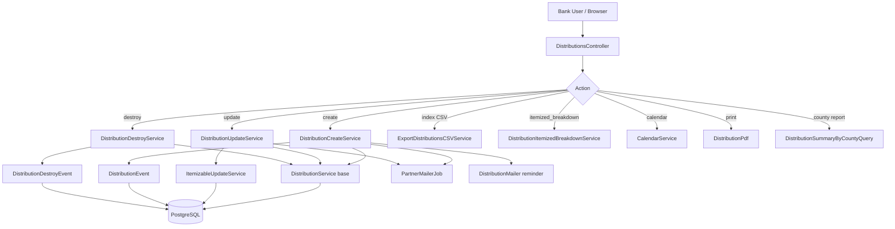
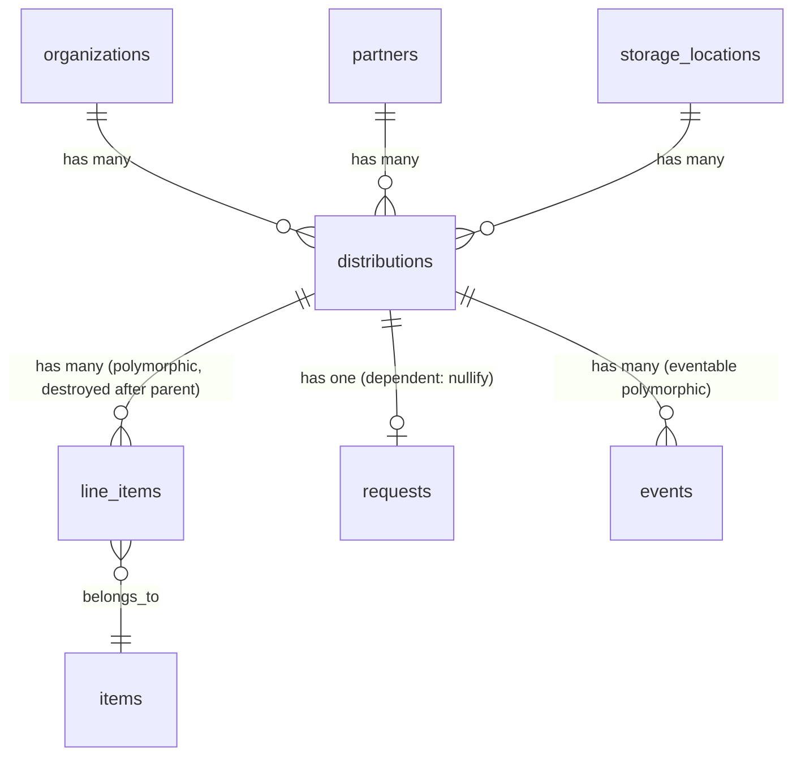
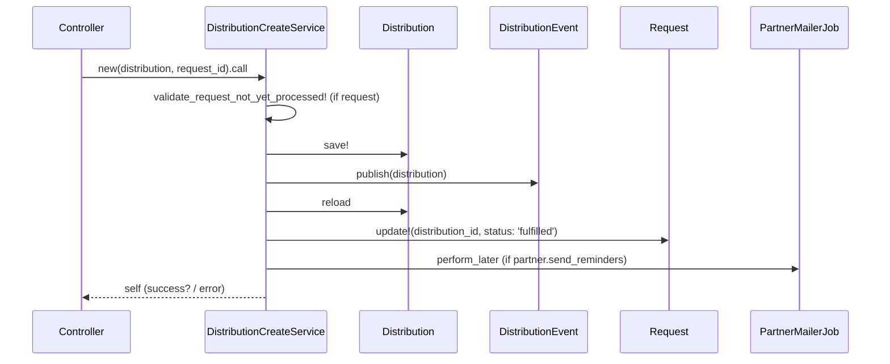

# Distributions

> **Status**: Active
> **Generated**: 2026-06-13T00:00:00Z
> **Last Updated**: 2026-06-13T00:00:00Z

---

## Overview

### What It Does
Distributions are the primary mechanism for inventory to leave a diaper bank (essentials bank). A distribution records outgoing supplies sent to a partner organization from a specific storage location, tracks the line items (quantities of each item type), manages delivery logistics, and handles partner notifications. Distributions support scheduling, pickup-day views, calendar exports (ICS), PDF manifests, CSV exports, county-based reporting, and email reminders.

### Why It Exists
Diaper banks need to track which partner organizations received what supplies, when, from which storage location, and by what delivery method. This provides accountability for inventory, supports reporting to funders, and enables partners to receive timely notifications about upcoming distributions.

### Key Capabilities
- Create, read, update, and destroy distributions with line items deducted from storage location inventory
- Fulfill partner requests by converting them into distributions
- Track delivery method (pick up, delivery, shipped) with optional shipping cost
- Generate PDF manifests with partner contact info, line items, and optional signature fields
- Export distributions to CSV with per-item columns, in-kind values, and package counts
- Provide an ICS calendar feed for distribution schedules (unauthenticated endpoint)
- View pickup-day summaries showing all distributions for a given date
- Send email notifications to partners on creation and update, with reminder emails the day before
- Report distribution totals by county using partner served-area percentages
- Validate distributions client-side before creation (modal confirmation flow)
- Mark distributions as "picked up" (complete)
- Itemized breakdown CSV comparing distributed quantities to current on-hand inventory

---

## Architecture

### High-Level Design



### Components

#### Backend Components
| Component | File Path | Purpose |
|-----------|-----------|---------|
| DistributionsController | `app/controllers/distributions_controller.rb` | Full CRUD plus print, validate, schedule, calendar, picked_up, pickup_day, itemized_breakdown |
| DistributionsByCountyController | `app/controllers/distributions_by_county_controller.rb` | County-level distribution summary report |
| Distribution | `app/models/distribution.rb` | Core model with state machine, scopes, delivery methods, validations |
| DistributionService | `app/services/distribution_service.rb` | Base service class with transaction handling, error management, Result-like interface |
| DistributionCreateService | `app/services/distribution_create_service.rb` | Creates distribution, publishes event, fulfills request, sends notification |
| DistributionUpdateService | `app/services/distribution_update_service.rb` | Updates distribution via ItemizableUpdateService, detects content/schedule changes |
| DistributionDestroyService | `app/services/distribution_destroy_service.rb` | Publishes destroy event, destroys distribution record |
| DistributionContentChangeService | `app/services/distribution_content_change_service.rb` | Diffs old vs new line items to detect updates and removals |
| DistributionTotalsService | `app/services/distribution_totals_service.rb` | Calculates quantity and value totals per distribution using window functions |
| DistributionItemizedBreakdownService | `app/services/distribution_itemized_breakdown_service.rb` | Itemized breakdown of distributed items vs current on-hand inventory |
| CalendarService | `app/services/calendar_service.rb` | Generates ICS calendar feed for distributions |
| DeadlineService | `app/services/deadline_service.rb` | Calculates next deadline date for partner request submissions |
| ExportDistributionsCSVService | `app/services/exports/export_distributions_csv_service.rb` | Generates CSV export with base columns plus per-item columns |
| DistributionEvent | `app/events/distribution_event.rb` | Publishes inventory event when distribution is created/updated |
| DistributionDestroyEvent | `app/events/distribution_destroy_event.rb` | Publishes zeroed inventory event when distribution is destroyed |
| DistributionHelper | `app/helpers/distribution_helper.rb` | Pickup day params, hashed calendar path, shipping cost formatting |
| DistributionMailer | `app/mailers/distribution_mailer.rb` | Partner notification email and reminder email |
| DistributionPdf | `app/pdfs/distribution_pdf.rb` | Prawn-based PDF manifest generation |
| DistributionSummaryByCountyQuery | `app/queries/distribution_summary_by_county_query.rb` | Raw SQL query for county-level distribution breakdown |
| ItemizableUpdateService | `app/services/itemizable_update_service.rb` | Shared service that handles line item updates with event sourcing |

#### View Files
| File | Purpose |
|------|---------|
| `app/views/distributions/index.html.erb` | Paginated distribution list with filters |
| `app/views/distributions/new.html.erb` | New distribution form |
| `app/views/distributions/edit.html.erb` | Edit distribution form |
| `app/views/distributions/show.html.erb` | Distribution detail view |
| `app/views/distributions/schedule.html.erb` | Calendar schedule view (HTML) |
| `app/views/distributions/schedule.json.jbuilder` | Calendar schedule data (JSON) |
| `app/views/distributions/pickup_day.html.erb` | Pickup day summary view |
| `app/views/distributions/print.html.erb` | Print view (triggers PDF) |
| `app/views/distributions/validate.html.erb` | Confirmation modal content |
| `app/views/distributions/_form.html.erb` | Shared form partial |
| `app/views/distributions/_distribution_row.html.erb` | Index table row partial |
| `app/views/distributions/_distribution_item_row.html.erb` | Item row partial |
| `app/views/distributions/_distribution_item_total.html.erb` | Item total partial |
| `app/views/distributions/_distribution_total.html.erb` | Distribution total partial |
| `app/views/distributions/_daily_item_row.html.erb` | Daily item row for pickup day |
| `app/views/distributions/_pickup_day_row.html.erb` | Pickup day row partial |
| `app/views/distributions_by_county/report.html.erb` | County report view |
| `app/views/distribution_mailer/partner_mailer.html.erb` | Partner notification email template |
| `app/views/distribution_mailer/reminder_email.html.erb` | Reminder email template |

### Technology Stack
- **Backend**: Ruby on Rails (ApplicationController, ActiveRecord, Turbo Streams)
- **Frontend**: ERB templates, Turbo/Hotwire (turbo_stream responses in create/update)
- **Database**: PostgreSQL (window functions in totals, raw SQL in county query)
- **PDF Generation**: Prawn (via prawn-rails)
- **Calendar**: icalendar gem for ICS feed generation
- **Email**: Action Mailer with delayed delivery (deliver_later)
- **Event Sourcing**: Custom Event model hierarchy for inventory tracking

---

## Model Details

### Distribution

#### Associations
```ruby
# Source: app/models/distribution.rb
belongs_to :storage_location
belongs_to :partner
belongs_to :organization
has_one :request, dependent: :nullify
accepts_nested_attributes_for :request
# Via Itemizable concern:
has_many :line_items, as: :itemizable, inverse_of: :itemizable
has_many :items, through: :line_items
has_many :inactive_items, -> { inactive }, through: :line_items, source: :item
has_many :item_categories, through: :items
```

#### Concerns
| Concern | Purpose |
|---------|---------|
| `Itemizable` | Adds `has_many :line_items` (polymorphic), `has_many :items` through, `accepts_nested_attributes_for :line_items`, `combine!`, `total`, `total_value`, `quantities_by_name`, `quantities_by_category`, `sorted`, `assign_insufficiency_errors`, `value_per_itemizable`, `total_quantity`, `line_item_values` |
| `Exportable` | Adds `csv_export_headers`, `csv_export`, `generate_csv` class methods and `csv_export_attributes` instance method |
| `IssuedAt` | Adds `issued_at` validation (presence, not before 2000, not more than 1 year in future), scopes `by_issued_at` and `for_year` |
| `Filterable` | Adds `class_filter` class method for chaining named scopes from filter params |
| `ItemsHelper` | Adds helper methods for item display (dollar_value, cents_to_dollar, etc.) |

#### Versioning
```ruby
has_paper_trail
```

#### Callbacks
| Callback | Method | Purpose |
|----------|--------|---------|
| `before_save` | `:combine_distribution` | Combines duplicate line items by calling `line_items.combine!` |
| `before_save` | `:reset_shipping_cost` | Sets `shipping_cost` to nil unless delivery_method is "shipped" |
| `before_destroy` | `:check_no_intervening_snapshot` | Raises error if a SnapshotEvent occurred after this distribution, preventing deletion |
| `after_destroy` | (from Itemizable) | Destroys all associated line_items after the distribution is destroyed |

#### State Machine (enum-based)
```ruby
# Source: app/models/distribution.rb:48
enum :state, { scheduled: 5, complete: 10 }
```
Note: The `picked_up` controller action calls `distribution.complete!` to transition from `scheduled` to `complete`. There is no AASM; this uses Rails built-in enum with bang methods.

#### Delivery Method (enum-based)
```ruby
# Source: app/models/distribution.rb:49
enum :delivery_method, { pick_up: 0, delivery: 1, shipped: 2 }
```

#### Validations
```ruby
validates :delivery_method, presence: true
validate :line_items_quantity_is_positive          # each line item quantity >= 1
validates :shipping_cost, numericality: { greater_than_or_equal_to: 0 }, allow_blank: true, if: :shipped?
# From IssuedAt:
validates :issued_at, presence: true
validate :issued_at_cannot_be_before_2000
validate :issued_at_cannot_be_further_than_1_year
# From Itemizable:
validates_associated :line_items
```

#### Scopes
```ruby
scope :active, -> { joins(:line_items).joins(:items).where(items: { active: true }) }
scope :with_diapers, -> { joins(line_items: :item).merge(Item.disposable_diapers.or(Item.cloth_diapers)) }
scope :with_period_supplies, -> { joins(line_items: :item).merge(Item.period_supplies) }
scope :by_item_id, ->(item_id) { includes(:items).where(items: { id: item_id }) }
scope :by_item_category_id, ->(item_category_id) { includes(:items).where(items: { item_category_id: item_category_id }) }
scope :by_reporting_category, ->(reporting_category) { includes(:items).where(items: { reporting_category: reporting_category }) }
scope :by_partner, ->(partner_id) { where(partner_id: partner_id) }
scope :by_location, ->(storage_location_id) { where(storage_location_id: storage_location_id) }
scope :by_state, ->(state) { where(state: state) }
scope :recent, ->(count = 3) { order(issued_at: :desc).limit(count) }
scope :future, -> { where(issued_at: Time.zone.tomorrow..) }
scope :during, ->(range) { where(distributions: { issued_at: range }) }
scope :this_week, -> { where("issued_at > :start_date AND issued_at <= :end_date", ...) }
scope :in_last_12_months, -> { where("issued_at > :start_date AND issued_at <= :end_date", ...) }
scope :apply_filters, ->(filters, date_range) { class_filter(filters.merge(during: date_range)) }
```

#### Key Methods
| Method | Returns | Purpose | Notes |
|--------|---------|---------|-------|
| `distributed_at` | `String` | Formats `issued_at` as date or date+time depending on whether it's midnight | Uses `is_midnight` helper |
| `combine_duplicates` | `void` | Calls `line_items.combine!` to merge duplicate item line items | |
| `copy_line_items(donation_id)` | `void` | Copies line items from a Donation into this distribution | |
| `copy_from_donation(donation_id, storage_location_id)` | `void` | Pre-populates distribution from a donation | |
| `copy_from_request(request)` | `void` | Pre-populates distribution from a partner Request, including partner, comment, agency_rep | Skips quantity for custom-unit requests |
| `initialize_request_items` | `void` | Adds zero-quantity line items for any request items not already in the distribution | Used on edit page |
| `csv_export_attributes` | `Array` | Returns array of values for CSV export | |
| `future?` | `Boolean` | True if `issued_at` is after today | |
| `past?` | `Boolean` | True if `issued_at` is before today | |
| `partner_name` | `String` | Delegated to `partner.name` | |

---

## Database Schema

### distributions

| Column | Type | Default | Notes |
|--------|------|---------|-------|
| `id` | `serial` (integer) | auto-increment | Primary key |
| `comment` | `text` | `NULL` | Free-text comment |
| `created_at` | `datetime` | NOT NULL | Record creation timestamp |
| `updated_at` | `datetime` | NOT NULL | Record update timestamp |
| `storage_location_id` | `integer` | `NULL` | FK to `storage_locations` |
| `partner_id` | `integer` | `NULL` | FK to `partners` |
| `organization_id` | `integer` | `NULL` | FK to `organizations` |
| `issued_at` | `datetime` | `NULL` | When the distribution is scheduled/issued |
| `agency_rep` | `string` | `NULL` | Name/email of agency representative |
| `state` | `integer` | `5` (scheduled) | Enum: 5=scheduled, 10=complete |
| `reminder_email_enabled` | `boolean` | `false` | Whether to send day-before reminder |
| `delivery_method` | `integer` | `0` (pick_up) | Enum: 0=pick_up, 1=delivery, 2=shipped |
| `shipping_cost` | `decimal(8,2)` | `NULL` | Cost of shipping (only for shipped method) |

#### Indexes
| Name | Columns |
|------|---------|
| `index_distributions_on_issued_at` | `issued_at` |
| `index_distributions_on_organization_id` | `organization_id` |
| `index_distributions_on_partner_id` | `partner_id` |
| `index_distributions_on_storage_location_id` | `storage_location_id` |

### Relationships


---

## API Endpoints

### Distribution CRUD & Actions

| Method | Path | Action | Description | Notes |
|--------|------|--------|-------------|-------|
| `GET` | `/distributions` | `index` | List distributions with filters, pagination. Also responds to CSV. | Filters: by_item_id, by_item_category_id, by_reporting_category, by_partner, by_state, by_location, date_range |
| `GET` | `/distributions/new` | `new` | New distribution form | Accepts `request_id`, `donation_id`, `storage_location_id` params |
| `POST` | `/distributions` | `create` | Create a distribution | Turbo Stream response. Publishes DistributionEvent, fulfills request, sends notification |
| `GET` | `/distributions/:id` | `show` | Show distribution detail | Includes line items, total quantity, package count |
| `GET` | `/distributions/:id/edit` | `edit` | Edit distribution form | Restricted: must be org admin OR distribution must be scheduled+future |
| `PATCH/PUT` | `/distributions/:id` | `update` | Update distribution | Detects content changes, may resend notification |
| `DELETE` | `/distributions/:id` | `destroy` | Destroy distribution and reclaim inventory | Publishes DistributionDestroyEvent |
| `GET` | `/distributions/:id/print` | `print` | Generate and send PDF manifest | Returns inline PDF |
| `POST` | `/distributions/validate` | `validate` | Validate distribution before creation | Returns JSON `{valid: true/false, body: html}` for confirmation modal |
| `GET` | `/distributions/calendar` | `calendar` | ICS calendar feed | Unauthenticated (skips authenticate_user!, authorize_user, require_organization). Uses encrypted org ID hash. |
| `GET` | `/distributions/schedule` | `schedule` | Schedule view | Responds to HTML and JSON (with start/end date params) |
| `GET` | `/distributions/pickup_day` | `pickup_day` | Pickup day summary | Shows all distributions and aggregated items for a date |
| `GET` | `/distributions/itemized_breakdown` | `itemized_breakdown` | Itemized breakdown CSV | CSV only, compares distributed vs on-hand |
| `PATCH` | `/distributions/:id/picked_up` | `picked_up` | Mark distribution as complete | Transitions state from scheduled to complete |

### County Report

| Method | Path | Action | Description | Notes |
|--------|------|--------|-------------|-------|
| `GET` | `/distributions_by_county/report` | `report` | Distribution summary by county | Uses raw SQL with CTEs, partner served-area percentages |

---

## Authorization

There is no dedicated `DistributionPolicy` file. Authorization is handled at the controller level:

- Standard actions require authentication (`authenticate_user!`) and organization authorization (`authorize_user`, `require_organization`) -- these are `before_action` filters from `ApplicationController`.
- The `calendar` action explicitly skips all three auth filters (`skip_before_action :authenticate_user!, :authorize_user, :require_organization`), relying instead on an encrypted hash parameter for organization identification.
- The `edit` action has an additional guard: only org admins (`current_user.has_cached_role?(Role::ORG_ADMIN, current_organization)`) can edit completed or past distributions. Non-admins can only edit distributions that are not complete AND are in the future.

---

## Service Layer Detail

### DistributionService (Base Class)

```ruby
# Source: app/services/distribution_service.rb
class DistributionService
  attr_reader :error

  def perform_distribution_service(&block)
    distribution.transaction do
      yield block
    end
  rescue ActiveRecord::RecordNotFound => e
    # ...
  rescue Errors::InsufficientAllotment => e
    distribution.line_items.assign_insufficiency_errors(e.insufficient_items)
    # ...
  rescue StandardError => e
    # ...
  ensure
    return self
  end

  def success?
    error.nil?
  end
end
```

All three distribution service subclasses (Create, Update, Destroy) inherit from this base. The `perform_distribution_service` method wraps the operation in a transaction and catches three exception types: `RecordNotFound`, `InsufficientAllotment`, and generic `StandardError`. The `ensure` block always returns `self`, providing a Result-like interface where callers check `result.success?` and `result.error`.

### DistributionCreateService Flow



### DistributionUpdateService Flow

The update service stores old line items, delegates to `ItemizableUpdateService.call` for the actual update (which handles line item deletion/recreation, event publishing, and snapshot/audit conflict detection), then checks if a notification needs to be resent based on date, delivery method, or content changes.

### DistributionContentChangeService

Compares old and new line item hashes to produce two lists:
- `updates`: items whose quantity changed (with old and new quantities)
- `removed`: items that were in the old distribution but not the new one

---

## PDF Generation

`DistributionPdf` uses Prawn to generate a multi-page PDF manifest including:
- Organization logo, name, address, email
- Partner name and primary contact info
- Delivery address (from partner profile, uses program address if available)
- Issue date and distribution ID
- Optional year-to-date items received (if `organization.ytd_on_distribution_printout`)
- Line item table with two layouts:
  - **With request**: columns for Items Received, Requested, Received, Value/item, In-Kind Value, Packages
  - **Without request**: columns for Items Received, Value/item, In-Kind Value, Quantity, Packages
- Hideable columns based on org settings: `hide_value_columns_on_receipt`, `hide_package_column_on_receipt`
- Optional signature fields for "Received By" and "Delivered By" (if `organization.signature_for_distribution_pdf`)
- Footer with page numbers and Human Essentials branding

---

## Email Notifications

### Partner Notification (`DistributionMailer#partner_mailer`)
- Sent on distribution creation (via `PartnerMailerJob`) and on update (if content/date/method changed)
- Attaches PDF manifest
- Uses organization's custom `default_email_text` with interpolation (delivery_method, distribution_date, partner_name, comment)
- CC'd to partner email; also CC'd to pick-up email addresses if delivery method is pick_up
- Skipped if distribution is past or partner is deactivated

### Reminder Email (`DistributionMailer#reminder_email`)
- Scheduled via `deliver_later(wait_until: distribution.issued_at - 1.day)`
- Sent to requester email (or partner email if no request)
- Skipped if distribution is past, partner doesn't want reminders, or partner is deactivated
- Contains distribution date and delivery method

---

## Calendar (ICS) Service

`CalendarService.calendar(organization_id)` generates an iCalendar feed:
- Includes distributions from the past year
- Each event: 15-minute duration, summary "Pickup from {partner name}", location is storage_location address
- Handles multiple time zones per storage location
- Accessed via encrypted organization ID hash (no authentication required)

---

## Configuration

### Organization-Level Settings (affect distribution behavior)
- `default_email_text` - Action Text rich text for partner notification emails
- `ytd_on_distribution_printout` - Boolean, shows year-to-date items on PDF
- `signature_for_distribution_pdf` - Boolean, adds signature fields to PDF
- `hide_value_columns_on_receipt` - Boolean, hides value columns on PDF
- `hide_package_column_on_receipt` - Boolean, hides package column on PDF
- `include_in_kind_values_in_exported_files` - Boolean, adds in-kind value columns to CSV
- `include_packages_in_distribution_export` - Boolean, adds package columns to CSV
- `deadline_day` - Integer, day of month for partner request deadline
- `email` - String, used as "from" email for partner notifications

### Feature Flags
- `enable_packs` (Flipper) - When enabled, request quantities are displayed with custom unit names in PDF

---

## Usage Examples

### Creating a Distribution from a Partner Request
```ruby
# Source: app/controllers/distributions_controller.rb:99-151
dist = Distribution.new(distribution_params.merge(organization: current_organization))
result = DistributionCreateService.new(dist, request_id).call

if result.success?
  session[:created_distribution_id] = result.distribution.id
  @distribution = result.distribution
  perform_inventory_check
  schedule_reminder_email(result.distribution) if @distribution.reminder_email_enabled
  # ...
end
```

### Pre-populating from a Request
```ruby
# Source: app/models/distribution.rb:130-145
def copy_from_request(request)
  self.request = request
  self.organization_id = request.organization_id
  self.partner_id = request.partner_id
  self.agency_rep = request.partner_user&.formatted_email
  self.comment = request.comments
  self.issued_at = Time.zone.today + 1.day
  request.item_requests.each do |item_request|
    line_items.new(
      requested_item: item_request,
      # if there is a custom unit, don't prefill with the quantity - they have to enter it
      quantity: item_request.request_unit.present? ? nil : item_request.quantity,
      item_id: item_request.item_id
    )
  end
end
```

### Event Publishing on Create
```ruby
# Source: app/events/distribution_event.rb:3-13
def self.publish(distribution)
  create(
    eventable: distribution,
    group_id: "dist-#{distribution.id}-#{SecureRandom.hex}",
    organization_id: distribution.organization_id,
    event_time: Time.zone.now,
    data: EventTypes::InventoryPayload.new(
      items: EventTypes::EventLineItem.from_line_items(distribution.line_items, from: distribution.storage_location_id)
    )
  )
end
```

---

## Testing

### Test Files
- `spec/models/distribution_spec.rb` - Model validations, scopes, associations, methods
- `spec/requests/distributions_requests_spec.rb` - Controller integration tests (request specs)
- `spec/services/distribution_create_service_spec.rb` - Create service unit tests
- `spec/services/distribution_update_service_spec.rb` - Update service unit tests
- `spec/services/distribution_destroy_service_spec.rb` - Destroy service unit tests
- `spec/services/distribution_content_change_service_spec.rb` - Content diff service tests
- `spec/services/distribution_itemized_breakdown_service_spec.rb` - Itemized breakdown tests
- `spec/services/calendar_service_spec.rb` - ICS calendar generation tests
- `spec/services/deadline_service_spec.rb` - Deadline calculation tests
- `spec/services/exports/export_distributions_csv_service_spec.rb` - CSV export tests
- `spec/mailers/distribution_mailer_spec.rb` - Mailer tests
- `spec/pdfs/distribution_pdf_spec.rb` - PDF generation tests
- `spec/queries/distribution_summary_by_county_query_spec.rb` - County query tests

---

## Known Issues & Caveats

| Issue | Location | Description |
|-------|----------|-------------|
| FIXME comment | `distributions_controller.rb:71` | `# FIXME: one of these needs to be removed but it's unclear which at this point` -- refers to `@statuses` assignment, suggesting dead or duplicate code |
| Hardcoded URL in ICS | `calendar_service.rb:30` | `e.url = "https://humanessentials.app/diaper_bank/distributions/schedule"` -- hardcoded URL that may not match actual deployment |
| Calendar event duration | `calendar_service.rb:27` | All calendar events are exactly 15 minutes regardless of actual pickup duration |
| Edit restriction error message | `distributions_controller.rb:201-202` | Error message says "current date must be later than today" which is confusing -- it means the distribution's scheduled date must be in the future |
| Unauthenticated calendar endpoint | `distributions_controller.rb:12-14` | The `calendar` action skips all authentication, relying solely on an encrypted hash parameter. If the secret_key_base is compromised, all organization calendars are exposed. |
| Secret key truncation | `distributions_controller.rb:258` and `distribution_helper.rb:19` | Uses `Rails.application.secret_key_base[0..31]` (first 32 chars) for encryption, not the full key |
| `perform_now` vs `perform_later` | `distributions_controller.rb:291` | `send_notification` calls `PartnerMailerJob.perform_now` (synchronous in the request cycle), while the create service uses `perform_later`. This means update notifications block the request. |
| Snapshot conflict on edit | `distributions_controller.rb:192` | `@changes_disallowed` is set when an intervening snapshot exists, but this is only used in the view -- a user could potentially bypass via direct PATCH request (though `ItemizableUpdateService` also checks) |

---

## Performance

### Database Optimization
- **Indexes**: `issued_at`, `organization_id`, `partner_id`, `storage_location_id` are all indexed
- **Window Functions**: `DistributionTotalsService` uses `SUM(...) OVER (PARTITION BY distributions.id)` to calculate totals in a single query
- **Raw SQL**: `DistributionSummaryByCountyQuery` uses a CTE-based raw SQL query with `client_share` percentage calculations for efficient county breakdown
- **Eager Loading**: Index action uses `.includes(:partner, :storage_location)` and show uses `.includes(:storage_location, line_items: :item)` to avoid N+1 queries
- **Pagination**: Index uses Kaminari pagination (`.page(params[:page])`)

### Potential Bottlenecks
- CSV export loads all distributions with line items into memory (noted in `ExportDistributionsCSVService` comments as needing background job for large datasets)
- `DistributionItemizedBreakdownService` loads all inventory items for on-hand comparison
- `CalendarService` loads all distributions from the past year in one query

---

## Troubleshooting

### Common Issues

#### Issue: "Cannot update distribution because there has been an intervening snapshot"
**Symptoms:**
- Update fails with error about intervening snapshot

**Cause:**
A `SnapshotEvent` was created after this distribution, meaning the event-sourced inventory has been re-baselined. Modifying this distribution would create an inconsistency.

**Solution:**
Destroy the distribution and create a new one with the desired values. Only distributions created after the most recent snapshot can be modified.

#### Issue: "Cannot change the storage location because there has been an intervening audit"
**Symptoms:**
- Update fails when trying to change storage location

**Cause:**
An audit was finalized on the old or new storage location since this distribution was created.

**Solution:**
As the error message states: reclaim (destroy) the distribution and create a new one from the desired storage location.

#### Issue: Partner not receiving distribution emails
**Symptoms:**
- Partner does not receive notification or reminder emails

**Cause:**
Multiple possible causes:
1. Partner's `send_reminders` is false
2. Partner is deactivated
3. Distribution is in the past (both `partner_mailer` and `reminder_email` check `distribution.past?`)
4. `reminder_email_enabled` is false on the distribution

**Solution:**
Check partner settings and distribution dates. Reminder emails are scheduled via `deliver_later` and require the job queue to be running.

---

## Related Features

- **[Requests](./requests.md)** - Partner requests that can be fulfilled by creating distributions
- **[Partners](./partners.md)** - Partner organizations that receive distributions
- **[Storage Locations](./storage-locations.md)** - Inventory locations from which distributions are issued
- **[Items](./items.md)** - Item types tracked in distribution line items
- **[Inventory Events](./inventory-events.md)** - Event sourcing system that DistributionEvent/DistributionDestroyEvent publish to
- **[Reports](./reports.md)** - Summary reports that aggregate distribution data
- **[Historical Trends](./historical-trends.md)** - Historical trend charts for distribution patterns

---

**Generated:** 2026-06-13T00:00:00Z
**Last Updated:** 2026-06-13T00:00:00Z
**Status:** Active
