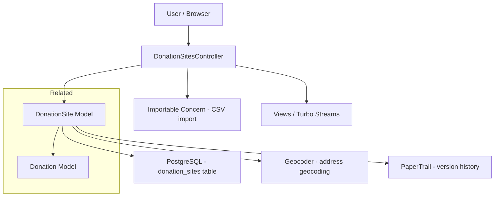
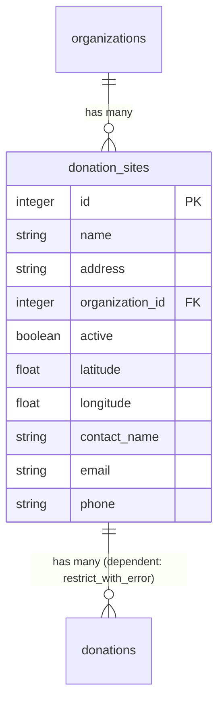

# Donation Sites

> **Status**: Active
> **Generated**: 2026-06-13T00:00:00Z
> **Last Updated**: 2026-06-13T00:00:00Z

---

## Overview

### What It Does
Donation Sites represent physical drop-off locations where community members can bring donated supplies (diapers, period supplies, etc.) to a diaper bank organization. The feature provides full CRUD management of these site records, including the ability to deactivate/reactivate sites, import sites in bulk via CSV, and export the current list as CSV.

### Why It Exists
Diaper banks receive donations from multiple community drop-off points. Tracking these locations allows organizations to associate incoming donations with specific sites, generate reports on donation volume by location, and maintain an up-to-date directory of active collection points for the public.

### Key Capabilities
- Create, read, update donation site records with name, address, contact info
- Soft-deactivate and reactivate sites (no hard delete)
- Bulk import donation sites from CSV files
- Export donation sites to CSV (active-only or all)
- Automatic geocoding of addresses to latitude/longitude
- Audit trail via PaperTrail versioning
- Turbo Stream support for inline creation from the donations form

---

## Architecture

### High-Level Design


### Components

#### Backend Components
| Component | File Path | Purpose |
|-----------|-----------|---------|
| DonationSitesController | `app/controllers/donation_sites_controller.rb` | Full CRUD + deactivate/reactivate + CSV import/export |
| DonationSite Model | `app/models/donation_site.rb` | Domain model with validations, scopes, CSV logic |
| Importable Concern | `app/controllers/concerns/importable.rb` | Provides `import_csv` controller action for bulk CSV import |
| Geocodable Concern | `app/models/concerns/geocodable.rb` | Geocodes address to lat/lng after validation |
| Exportable Concern | `app/models/concerns/exportable.rb` | Provides `generate_csv` and `csv_export` class methods |

#### Frontend Components (Views)
| Component | File Path | Purpose |
|-----------|-----------|---------|
| Index | `app/views/donation_sites/index.html.erb` | Lists donation sites in a table with filter/export/import controls |
| Show | `app/views/donation_sites/show.html.erb` | Displays site details and associated donations |
| New | `app/views/donation_sites/new.html.erb` | New donation site form page |
| Edit | `app/views/donation_sites/edit.html.erb` | Edit donation site form page |
| Form partial | `app/views/donation_sites/_form.html.erb` | Shared SimpleForm for name, address, contact_name, email, phone |
| Row partial | `app/views/donation_sites/_donation_site_row.html.erb` | Table row with view/edit/deactivate/reactivate buttons |
| New modal partial | `app/views/donation_sites/_new_modal.html.erb` | Turbo Frame modal for creating a donation site inline |
| Turbo Stream create | `app/views/donation_sites/create.turbo_stream.erb` | Appends new site as `<option>` to donation form select |

### Technology Stack
- **Backend**: Ruby on Rails, SimpleForm, PaperTrail, Geocoder
- **Frontend**: ERB templates, Turbo Streams, AdminLTE (Bootstrap-based)
- **Database**: PostgreSQL

---

## Model Details

### DonationSite

**File**: `app/models/donation_site.rb`

#### Associations
```ruby
# Source: app/models/donation_site.rb:23-30
belongs_to :organization
has_many :donations, dependent: :restrict_with_error
```

The `dependent: :restrict_with_error` on `donations` prevents deletion of a donation site that has associated donations. The destroy will fail and populate `errors` with "Cannot delete record because dependent donations exist".

#### Concerns
| Concern | Purpose |
|---------|---------|
| `Geocodable` | Adds `geocoded_by :address` and an `after_validation :geocode` callback that geocodes the address when it changes (skipped in development) |
| `Exportable` | Provides `self.generate_csv(data)` and `self.csv_export(data)` class methods, plus requires `csv_export_headers` and `csv_export_attributes` to be defined |

#### Other Inclusions
```ruby
# Source: app/models/donation_site.rb:20
has_paper_trail
```
PaperTrail tracks all changes to DonationSite records, enabling version history and audit trail.

#### Validations
```ruby
# Source: app/models/donation_site.rb:25-28
validates :name, :address, presence: true
validates :name, uniqueness: {scope: :organization_id, message: "must be unique within the organization"}
validates :contact_name, length: {minimum: 3}, allow_blank: true
validates :email, format: {with: URI::MailTo::EMAIL_REGEXP, message: "is not a valid email format"}, allow_blank: true
```

- `name` and `address` are required
- `name` must be unique per organization
- `contact_name` must be at least 3 characters if provided
- `email` must match `URI::MailTo::EMAIL_REGEXP` if provided
- `phone` has no validation

#### Callbacks
| Callback | Method | Purpose |
|----------|--------|---------|
| `after_validation` | `:geocode` | Geocodes address to lat/lng via Geocoder (from `Geocodable` concern). Only runs when `address` is present and changed, and not in development environment. |

#### Scopes
```ruby
# Source: app/models/donation_site.rb:35-37
scope :active, -> { where(active: true) }
scope :alphabetized, -> { order(:name) }
```

#### Key Methods
| Method | Returns | Purpose | Notes |
|--------|---------|---------|-------|
| `self.import_csv(csv, organization)` | `Array<String>` | Imports rows from parsed CSV, returns array of error strings for failed rows | Sets `organization_id` from parameter |
| `self.csv_export_headers` | `Array<String>` | Returns `["Name", "Address", "Contact Name", "Email", "Phone"]` | Used by Exportable concern |
| `csv_export_attributes` | `Array` | Returns `[name, address, contact_name, email, phone]` | Instance method for CSV row |
| `deactivate!` | `true` | Sets `active` to `false` via `update!` | Raises on validation failure |
| `reactivate!` | `true` | Sets `active` to `true` via `update!` | Raises on validation failure |

---

## Database Schema

### donation_sites

| Column | Type | Default | Notes |
|--------|------|---------|-------|
| `id` | `serial` (integer) | auto-increment | Primary key |
| `name` | `string` | `nil` | Required. Unique per organization. |
| `address` | `string` | `nil` | Required. Used for geocoding. |
| `created_at` | `datetime` | — | Not null |
| `updated_at` | `datetime` | — | Not null |
| `organization_id` | `integer` | `nil` | Foreign key to organizations |
| `latitude` | `float` | `nil` | Set by Geocoder |
| `longitude` | `float` | `nil` | Set by Geocoder |
| `contact_name` | `string` | `nil` | Optional |
| `email` | `string` | `nil` | Optional |
| `phone` | `string` | `nil` | Optional |
| `active` | `boolean` | `true` | Soft-delete flag |

### Indexes
| Index Name | Columns | Notes |
|------------|---------|-------|
| `index_donation_sites_on_latitude_and_longitude` | `latitude`, `longitude` | Composite index for geo queries |
| `index_donation_sites_on_organization_id` | `organization_id` | Foreign key lookup |

### Relationships


---

## API Endpoints

All routes are scoped under the organization context and require authentication via Devise (`before_action :authenticate_user!` in `ApplicationController`).

**Route definition** (from `config/routes.rb:157-165`):
```ruby
resources :donation_sites, except: [:destroy] do
  collection do
    post :import_csv
  end
  member do
    put :deactivate
    put :reactivate
  end
end
```

| Method | Path | Action | Description | Notes |
|--------|------|--------|-------------|-------|
| `GET` | `/donation_sites` | `index` | List donation sites (active only by default) | Supports `include_inactive_donation_sites` param; responds to HTML and CSV formats |
| `GET` | `/donation_sites/new` | `new` | New donation site form | Renders modal partial for Turbo Frame requests |
| `POST` | `/donation_sites` | `create` | Create a donation site | Responds to Turbo Stream (appends option to select) and HTML |
| `GET` | `/donation_sites/:id` | `show` | Show donation site details and associated donations | |
| `GET` | `/donation_sites/:id/edit` | `edit` | Edit donation site form | |
| `PATCH/PUT` | `/donation_sites/:id` | `update` | Update a donation site | |
| `POST` | `/donation_sites/import_csv` | `import_csv` | Bulk import from CSV file | Provided by `Importable` concern |
| `PUT` | `/donation_sites/:id/deactivate` | `deactivate` | Soft-deactivate a donation site | Sets `active = false` |
| `PUT` | `/donation_sites/:id/reactivate` | `reactivate` | Reactivate a donation site | Sets `active = true` |

Note: There is no `destroy` action. Donation sites are soft-deactivated instead of deleted. The `resources` declaration uses `except: [:destroy]`.

---

## Authorization

This application does not use Pundit policies. Authorization is handled in `ApplicationController` via:

```ruby
# Source: app/controllers/application_controller.rb:8
before_action :authorize_user
```

All `DonationSitesController` actions require an authenticated user who belongs to the current organization. Records are scoped through `current_organization.donation_sites` in every action, preventing cross-organization access.

---

## Configuration

### Geocoding
Geocoding is provided by the Geocoder gem. The `Geocodable` concern skips geocoding in the development environment:

```ruby
# Source: app/models/concerns/geocodable.rb:6-7
geocoded_by :address
after_validation :geocode, if: ->(obj) { obj.address.present? && obj.address_changed? && !Rails.env.development? }
```

No feature-specific environment variables are required.

---

## Usage Examples

### Creating a Donation Site (Controller)
```ruby
# Source: app/controllers/donation_sites_controller.rb:17-36
def create
  @donation_site = current_organization.donation_sites.new(donation_site_params)
  respond_to do |format|
    if @donation_site.save
      format.turbo_stream
      format.html do
        redirect_to donation_sites_path,
                    notice: "Donation site #{@donation_site.name} added!"
      end
    else
      flash.now[:error] = "Something didn't work quite right -- try again?"
      if request.format.turbo_stream?
        format.html { render partial: "donation_sites/new_modal", status: :unprocessable_content }
      end

      format.html do
        render action: :new
      end
    end
  end
end
```

### Turbo Stream Response (inline creation from Donations form)
When a donation site is created via Turbo Stream (e.g., from a modal on the donations form), the response appends the new site as a select option:

```erb
<%# Source: app/views/donation_sites/create.turbo_stream.erb %>
<%= turbo_stream.append "donation_donation_site_id" do %>
  <option value="<%= @donation_site.id %>" selected>
    <%= @donation_site.name %>
  </option>
<% end %>
```

### CSV Import (Model)
```ruby
# Source: app/models/donation_site.rb:39-51
def self.import_csv(csv, organization)
  errors = []
  csv.each_with_index do |row, index|
    loc = DonationSite.new(row.to_hash)
    loc.organization_id = organization
    if loc.save
      Rails.logger.info "Successfully imported: #{loc.name}"
    else
      errors << "Row #{index + 2}, #{row.to_hash["name"]} - #{loc.errors.full_messages.join(", ")}"
    end
  end
  errors
end
```

### Deactivate / Reactivate
```ruby
# Source: app/models/donation_site.rb:61-67
def deactivate!
  update!(active: false)
end

def reactivate!
  update!(active: true)
end
```

### Index Filtering (Controller)
```ruby
# Source: app/controllers/donation_sites_controller.rb:6-15
def index
  @donation_sites = current_organization.donation_sites.alphabetized
  @include_inactive_donation_sites = params[:include_inactive_donation_sites]
  @donation_sites = @donation_sites.active if @include_inactive_donation_sites.blank?

  respond_to do |format|
    format.html
    format.csv { send_data DonationSite.generate_csv(@donation_sites), filename: "DonationSites-#{Time.zone.today}.csv" }
  end
end
```

---

## Testing

### Test Files
- `spec/models/donation_site_spec.rb` -- Model validations, CSV import/export, geocoding, active scope, deletion restrictions, versioning
- `spec/requests/donation_sites_requests_spec.rb` -- Request specs for index (HTML + CSV), deactivate, reactivate
- `spec/system/donation_site_system_spec.rb` -- System/integration tests for index ordering, create (required + all fields), edit, CSV export with inactive filter
- `spec/controllers/donation_sites_controller_spec.rb` -- Controller specs for index, new, edit, show, CSV import (shared example)
- `spec/factories/donation_sites.rb` -- Factory definition

### Test Fixture CSV Files
- `spec/fixtures/files/donation_sites.csv`
- `spec/fixtures/files/valid_donation_sites.csv`
- `spec/fixtures/files/invalid_donation_sites.csv`
- `spec/fixtures/files/duplicated_name_donation_sites.csv`

### Key Test Scenarios Covered
- Alphabetical ordering on index
- Active-only filtering (default) vs. including inactive sites
- CSV export respects active/inactive filter
- Deactivate toggles `active` from true to false
- Reactivate toggles `active` from false to true
- Cannot destroy a donation site that has associated donations (`restrict_with_error`)
- Can destroy a donation site with no donations
- CSV import: valid file, invalid file (missing required fields), duplicated names
- Geocoding populates latitude/longitude
- PaperTrail versioning enabled
- Create with required fields only and with all fields
- Edit each field individually
- Validation errors shown on empty required fields

---

## Known Issues & Caveats

| Issue | Location | Description |
|-------|----------|-------------|
| Nested `simple_form_for` | `app/views/donation_sites/_form.html.erb:1,12` | The form partial calls `simple_form_for` twice -- once on line 1 and again on line 12. The outer form wraps the inner one, which is the one that actually renders the fields. This is likely a bug or leftover code; the outer form tag produces a redundant `<form>` element. |
| No-op `filter_params` | `app/controllers/donation_sites_controller.rb:100-103` | `filter_params` is defined as a helper method but always returns an empty hash `{}`. It is referenced in the index view for the CSV export link but has no actual filtering logic. |
| Geocoding skipped in dev | `app/models/concerns/geocodable.rb:7` | The geocoding callback explicitly skips the development environment (`!Rails.env.development?`), so latitude/longitude will always be `nil` in local development. |
| No phone validation | `app/models/donation_site.rb` | The `phone` field has no format or length validation, unlike `email` and `contact_name`. |
| No `destroy` route or action | `config/routes.rb:157` | Donation sites cannot be hard-deleted through the UI. The route is excluded with `except: [:destroy]`. Deactivation is the intended removal mechanism. This is by design, not a bug. |
| `organization_id` set as raw integer | `app/models/donation_site.rb:43` | In `import_csv`, `loc.organization_id = organization` receives the raw organization ID integer rather than an Organization object. This works but differs from the typical `belongs_to` assignment pattern. |

---

## Performance

### Database Optimization
- **Composite geo index**: `index_donation_sites_on_latitude_and_longitude` enables efficient geographic queries
- **Organization index**: `index_donation_sites_on_organization_id` enables efficient scoping by organization
- **Active scope**: `scope :active, -> { where(active: true) }` filters at database level rather than in Ruby

### Potential Concerns
- The `show` view iterates over `@donation_site.donations` without pagination or eager loading. For sites with many donations, this could cause N+1 queries (each donation accesses `storage_location` and `line_items`).

---

## Troubleshooting

### Common Issues

#### Issue: "Cannot delete record because dependent donations exist"
**Symptoms:**
- Attempting to destroy a DonationSite record raises an error

**Cause:**
The `has_many :donations, dependent: :restrict_with_error` association prevents deletion when donations reference this site.

**Solution:**
Use `deactivate!` instead of `destroy`. The application intentionally uses soft-deactivation rather than hard deletion for donation sites that have been used.

#### Issue: Latitude/Longitude are nil in development
**Symptoms:**
- DonationSite records have `nil` for `latitude` and `longitude` in local development

**Cause:**
The `Geocodable` concern skips geocoding in the development environment to avoid unnecessary API calls.

**Solution:**
This is intentional behavior. To test geocoding locally, temporarily modify the condition in `app/models/concerns/geocodable.rb` or use the test environment with stubbed geocoder responses (as done in the test suite).

#### Issue: CSV import fails with "Check headers in file!"
**Symptoms:**
- Uploading a CSV file shows the error "Check headers in file!"

**Cause:**
The CSV file has nil/empty headers, or the file is malformed. The `Importable` concern checks `csv.first.headers.all? { |header| !header.nil? }`.

**Solution:**
Ensure the CSV file has proper column headers in the first row. Expected headers: `name`, `address`, `contact_name`, `email`, `phone`.

---

## Related Features

- **[Donations](./donations.md)** -- Donation records reference a `donation_site_id`. The donation form allows inline creation of donation sites via Turbo Stream modal.
- **[Product Drives](./product-drives.md)** -- Similar community-facing collection concept but organized as time-bound campaigns rather than permanent locations.
- **[Manufacturers](./manufacturers.md)** -- Analogous CRUD resource for manufacturer records (another donation source type).
- **[Storage Locations](./storage-locations.md)** -- Where donated items are stored after being received from donation sites.

---

**Generated:** 2026-06-13T00:00:00Z
**Last Updated:** 2026-06-13T00:00:00Z
**Status:** Active
