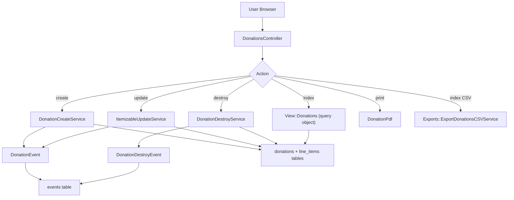
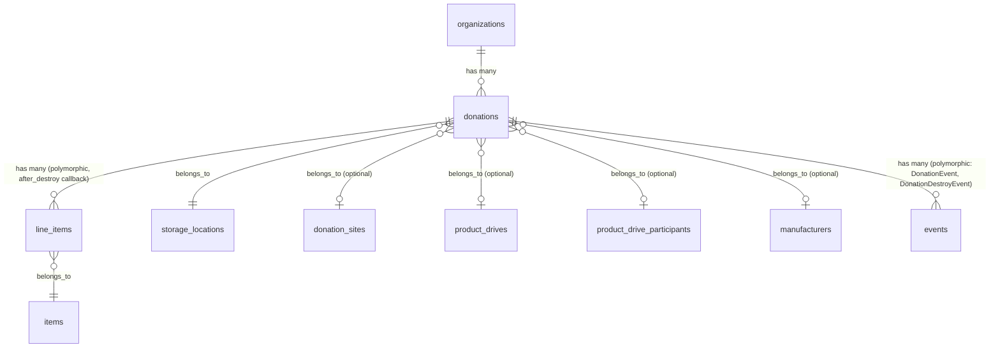
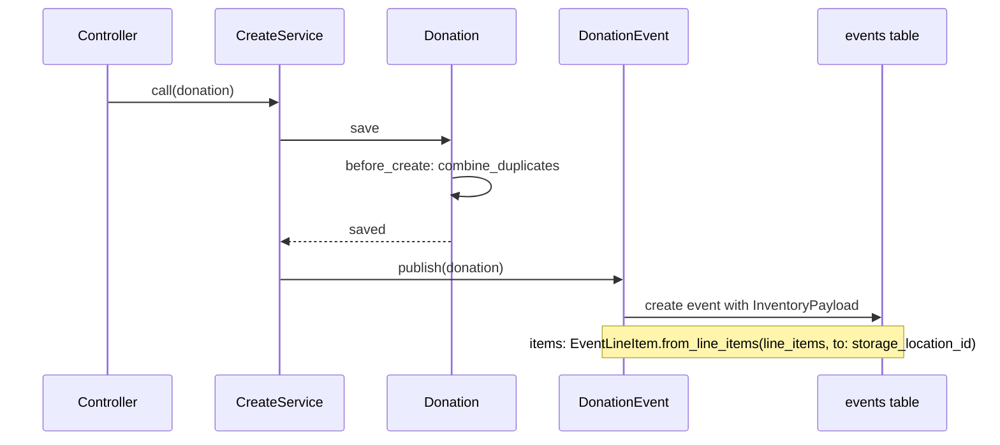

# Donations

> **Status**: Active
> **Generated**: 2026-06-13T00:00:00Z
> **Last Updated**: 2026-06-13T00:00:00Z

---

## Overview

### What It Does
Donations represent one of the primary ways essentials banks receive incoming inventory. The feature allows organizations to record donations from four distinct sources -- product drives, manufacturers, donation sites, and miscellaneous -- track the items and quantities received, assign them to a storage location, and optionally record money raised alongside the physical goods. Each donation produces an event-sourced inventory record and can be exported to CSV, printed as a PDF receipt, filtered, and paginated.

### Why It Exists
Essentials banks (diaper banks, period supply banks, etc.) need to accurately track every incoming supply to maintain correct inventory levels across storage locations. Donations are the most common inbound channel, and the system must support multiple sourcing workflows (community drives, manufacturer partnerships, drop-off sites) while keeping an auditable history of what was received, when, and from whom.

### Key Capabilities
- Create, view, edit, and delete donation records with line items
- Four source types: Product Drive, Manufacturer, Donation Site, Misc. Donation
- Event-sourced inventory tracking via `DonationEvent` / `DonationDestroyEvent`
- PDF receipt generation with organization branding and donor information
- CSV export with per-item quantity columns and optional in-kind value columns
- Rich filtering by storage location, source, product drive, participant, manufacturer, donation site, item category, and date range
- Paginated index with running totals (page-level and grand totals)
- Itemized breakdown service for reporting
- Paper Trail audit logging on the Donation model
- Snapshot-aware edit/delete guards (prevents changes when intervening inventory snapshots exist)

---

## Architecture

### High-Level Design



### Components

#### Backend Components

| Component | File Path | Purpose |
|-----------|-----------|---------|
| DonationsController | `app/controllers/donations_controller.rb` | CRUD + print actions for donations |
| Donation | `app/models/donation.rb` | Core model with associations, validations, scopes |
| View::Donations | `app/models/view/donations.rb` | Data.define query object for the index page |
| DonationCreateService | `app/services/donation_create_service.rb` | Wraps save + event publish in a transaction |
| DonationDestroyService | `app/services/donation_destroy_service.rb` | Wraps destroy + event publish in a transaction |
| DonationItemizedBreakdownService | `app/services/donation_itemized_breakdown_service.rb` | Aggregates donated items with current on-hand quantities |
| ItemizableUpdateService | `app/services/itemizable_update_service.rb` | Shared service for updating any Itemizable (used for donation updates) |
| ExportDonationsCSVService | `app/services/exports/export_donations_csv_service.rb` | Generates CSV with base columns + per-item quantity columns |
| DonationEvent | `app/events/donation_event.rb` | Publishes inventory-in event for created/updated donations |
| DonationDestroyEvent | `app/events/donation_destroy_event.rb` | Publishes zeroed inventory event on donation deletion |
| DonationsHelper | `app/helpers/donations_helper.rb` | View helpers for totals, money, product drive stats |
| DonationPdf | `app/pdfs/donation_pdf.rb` | Prawn-based PDF receipt generator |

#### View Templates

| Template | File Path | Purpose |
|----------|-----------|---------|
| index | `app/views/donations/index.html.erb` | Filterable, paginated donation list with totals |
| new | `app/views/donations/new.html.erb` | New donation form with modal links for creating related records |
| edit | `app/views/donations/edit.html.erb` | Edit form with audit/snapshot warnings |
| show | `app/views/donations/show.html.erb` | Detail view with line items, actions, comment |
| _donation_form | `app/views/donations/_donation_form.html.erb` | Shared form partial (source, site, drive, manufacturer, storage, money, items) |
| _donation_row | `app/views/donations/_donation_row.html.erb` | Table row partial for the index listing |
| _donation_item_row | `app/views/donations/_donation_item_row.html.erb` | Table row partial for line items on the show page |
| add_item | `app/views/donations/add_item.html.erb` | Placeholder view (stub) |
| remove_item | `app/views/donations/remove_item.html.erb` | Placeholder view (stub) |

### Technology Stack
- **Backend**: Ruby on Rails (ApplicationController, ActiveRecord, service objects)
- **Frontend**: ERB templates, AdminLTE 3, SimpleForm, Stimulus (`form-input`, `donations-modal` controllers)
- **Database**: PostgreSQL (serial PKs, bigint FKs, jsonb events)
- **PDF Generation**: Prawn via PrawnRails
- **CSV Export**: Ruby CSV standard library
- **Audit Trail**: PaperTrail gem (`has_paper_trail`)
- **Pagination**: Kaminari (`paginate`)

---

## Model Details

### Donation

#### Associations
```ruby
# Source: app/models/donation.rb
belongs_to :organization
belongs_to :donation_site, optional: true
belongs_to :product_drive_participant, optional: proc { |d| d.from_product_drive? }
belongs_to :product_drive, optional: true
belongs_to :manufacturer, optional: proc { |d| d.from_manufacturer? }
belongs_to :storage_location

# Via Itemizable concern:
has_many :line_items, as: :itemizable, inverse_of: :itemizable
has_many :items, through: :line_items
has_many :inactive_items, -> { inactive }, through: :line_items, source: :item
has_many :item_categories, through: :items
```

Note: The `Itemizable` concern does NOT use `dependent: :destroy` on `line_items`. Instead, it uses an `after_destroy` callback that iterates and destroys each line item individually, to ensure storage location inventory is decremented before line items are removed.

#### Concerns

| Concern | Purpose |
|---------|---------|
| `Itemizable` | Adds `has_many :line_items` (polymorphic), `has_many :items through: :line_items`, `accepts_nested_attributes_for :line_items`, `validates_associated :line_items`, helper methods `value_per_itemizable`, `total_quantity`, `line_item_values`, `has_inactive_item?`, `inactive_items`. Also adds `combine!`, `sorted`, `total`, `total_value`, `quantities_by_category`, `quantities_by_name` on the `line_items` association. |
| `Exportable` | Adds class methods `csv_export_headers`, `csv_export`, `generate_csv` and instance method `csv_export_attributes` (both raise "not implemented" by default -- subclasses must override). |
| `Filterable` | Adds `class_filter(filtering_params)` class method that chains scopes from a hash of `{scope_name: value}` pairs. |
| `IssuedAt` | Adds `issued_at` presence validation, `issued_at_cannot_be_before_2000` and `issued_at_cannot_be_further_than_1_year` custom validations, plus scopes `by_issued_at` and `for_year`. |

#### Constants
```ruby
# Source: app/models/donation.rb:22-25
SOURCES = { product_drive: "Product Drive",
            manufacturer: "Manufacturer",
            donation_site: "Donation Site",
            misc: "Misc. Donation" }.freeze
```

#### Callbacks

| Callback | Method | Purpose |
|----------|--------|---------|
| `before_create` | `:combine_duplicates` | Merges line items with the same `item_id` by summing quantities |
| `before_destroy` | `:check_no_intervening_snapshot` | Raises if a `SnapshotEvent` exists after this donation, preventing deletion |
| `after_destroy` | (from Itemizable) | Destroys all associated line items individually |

#### Validations

| Validation | Field | Condition |
|------------|-------|-----------|
| `presence` | `donation_site` | Only if `source == "Donation Site"` |
| `presence` | `product_drive` | Only if `source == "Product Drive"` |
| `presence` | `manufacturer` | Only if `source == "Manufacturer"` |
| `presence + inclusion` | `source` | Must be one of `SOURCES.values` |
| `numericality >= 0` | `money_raised` | `allow_nil: true` |
| custom | line items | Each line item quantity must be >= 1 |
| `presence` | `issued_at` | From `IssuedAt` concern |
| custom | `issued_at` | Cannot be before year 2000 (from `IssuedAt`) |
| custom | `issued_at` | Cannot be more than 1 year in the future (from `IssuedAt`) |
| `validates_associated` | `line_items` | From `Itemizable` concern |

#### Scopes

| Scope | Purpose |
|-------|---------|
| `at_storage_location(id)` | Filter by storage location |
| `from_donation_site(id)` | Filter by donation site |
| `by_product_drive(id)` | Filter by product drive |
| `by_product_drive_participant(id)` | Filter by product drive participant |
| `from_manufacturer(id)` | Filter by manufacturer |
| `by_category(name)` | Filter by item category name (ILIKE) |
| `during(range)` | Filter by `issued_at` within a date range |
| `by_source(source)` | Filter by source string or symbol |
| `recent(count)` | Order by `issued_at` DESC, limit to count (default 3) |
| `active` | Joins through line_items to items where `items.active = true` |
| `by_issued_at(issued_at)` | From IssuedAt -- filter by month |
| `for_year(year)` | From IssuedAt -- filter by year |

#### Key Methods

| Method | Returns | Purpose |
|--------|---------|---------|
| `from_product_drive?` | `Boolean` | Checks if source is "Product Drive" |
| `from_manufacturer?` | `Boolean` | Checks if source is "Manufacturer" |
| `from_donation_site?` | `Boolean` | Checks if source is "Donation Site" |
| `source_view` | `String` | Display string: for product drives shows participant or drive name |
| `details` | `String` | Returns name of source entity, or truncated comment for misc |
| `money_raised_in_dollars` | `BigDecimal` | Converts `money_raised` (cents integer) to dollars |
| `donation_site_view` | `String` | Returns donation site name or "N/A" |
| `storage_view` | `String` | Returns storage location name or "N/A" |
| `in_kind_value_money` | `Float` | Total in-kind value as Money float |
| `value_per_itemizable` | `Integer` | Sum of all line item values (from Itemizable) |
| `total_quantity` | `Integer` | Sum of all line item quantities (from Itemizable) |

---

## Database Schema

### donations

| Column | Type | Default | Notes |
|--------|------|---------|-------|
| `id` | `integer` (serial) | auto-increment | Primary key |
| `source` | `string` | — | One of: "Product Drive", "Manufacturer", "Donation Site", "Misc. Donation" |
| `donation_site_id` | `integer` | — | FK to `donation_sites` |
| `created_at` | `datetime` | — | `null: false`, precision: nil |
| `updated_at` | `datetime` | — | `null: false`, precision: nil |
| `storage_location_id` | `integer` | — | FK to `storage_locations` |
| `comment` | `text` | — | Free-text comment |
| `organization_id` | `integer` | — | FK to `organizations` |
| `product_drive_participant_id` | `integer` | — | FK to `product_drive_participants` |
| `issued_at` | `datetime` | — | User-specified issue date, precision: nil |
| `money_raised` | `integer` | — | Stored in cents |
| `manufacturer_id` | `bigint` | — | FK to `manufacturers` |
| `product_drive_id` | `bigint` | — | FK to `product_drives` |

**Indexes:**
- `index_donations_on_donation_site_id`
- `index_donations_on_manufacturer_id`
- `index_donations_on_organization_id`
- `index_donations_on_product_drive_id`
- `index_donations_on_storage_location_id`

### line_items (polymorphic, shared with distributions/purchases/transfers/adjustments/audits)

| Column | Type | Default | Notes |
|--------|------|---------|-------|
| `id` | `integer` (serial) | auto-increment | Primary key |
| `quantity` | `integer` | — | Number of items |
| `item_id` | `integer` | — | FK to `items` |
| `itemizable_id` | `integer` | — | Polymorphic FK |
| `itemizable_type` | `string` | — | Polymorphic type (e.g. "Donation") |
| `created_at` | `datetime` | — | `null: false`, precision: nil |
| `updated_at` | `datetime` | — | `null: false`, precision: nil |

**Indexes:**
- `index_line_items_on_itemizable_id_and_itemizable_type`

### events (STI, shared -- donation events use type `DonationEvent` / `DonationDestroyEvent`)

| Column | Type | Default | Notes |
|--------|------|---------|-------|
| `id` | `bigint` | auto-increment | Primary key |
| `type` | `string` | — | `null: false`, STI discriminator |
| `event_time` | `datetime` | — | `null: false` |
| `data` | `jsonb` | — | `EventTypes::InventoryPayload` serialized |
| `eventable_id` | `bigint` | — | Polymorphic FK |
| `eventable_type` | `string` | — | Polymorphic type |
| `created_at` | `datetime` | — | `null: false` |
| `updated_at` | `datetime` | — | `null: false` |
| `organization_id` | `bigint` | — | FK to `organizations` |
| `user_id` | `bigint` | — | FK to `users` |
| `group_id` | `string` | — | Groups related events (e.g. `"donation-{id}-{hex}"`) |

**Indexes:**
- `index_events_on_organization_id_and_event_time`
- `index_events_on_user_id`

### Relationships



---

## API Endpoints

| Method | Path | Action | Description | Notes |
|--------|------|--------|-------------|-------|
| `GET` | `/donations` | `index` | List donations with filters, pagination; also serves CSV export via `format: :csv` | |
| `GET` | `/donations/new` | `new` | New donation form | |
| `POST` | `/donations` | `create` | Create a donation and publish DonationEvent | |
| `GET` | `/donations/:id` | `show` | View donation details and line items | |
| `GET` | `/donations/:id/edit` | `edit` | Edit donation form with snapshot/audit warnings | |
| `PATCH/PUT` | `/donations/:id` | `update` | Update donation via ItemizableUpdateService | |
| `DELETE` | `/donations/:id` | `destroy` | Delete donation via DonationDestroyService | Admin only (`before_action :authorize_admin`) |
| `GET` | `/donations/:id/print` | `print` | Generate and return PDF receipt | |
| `PATCH` | `/donations/:id/add_item` | `add_item` | Route exists | No controller action -- view is a stub placeholder |
| `PATCH` | `/donations/:id/remove_item` | `remove_item` | Route exists | No controller action -- view is a stub placeholder |

---

## Authorization

There is no Pundit policy file for Donation (`app/policies/donation_policy.rb` does not exist). Authorization is handled at the controller level:

| Mechanism | Location | Rule |
|-----------|----------|------|
| `before_action :authorize_admin` | `DonationsController`, `only: [:destroy]` | Only organization admins can delete donations |
| Organization scoping | All actions | Donations are always scoped via `current_organization.donations` |
| Role check in view | `show.html.erb:78` | Delete button only rendered if `current_user.has_cached_role?(Role::ORG_ADMIN, current_organization)` |
| Inactive item guard | `show.html.erb:84-88` | Edit/delete buttons disabled if donation contains inactive items |

---

## Service Details

### DonationCreateService

```ruby
# Source: app/services/donation_create_service.rb
module DonationCreateService
  class << self
    def call(donation)
      Donation.transaction do
        unless donation.save
          raise donation.errors.full_messages.join("\n")
        end
        DonationEvent.publish(donation)
      end
    end
  end
end
```

Wraps the donation save and event publication in a single database transaction. If the save fails, raises with validation error messages.

### DonationDestroyService

```ruby
# Source: app/services/donation_destroy_service.rb (key methods)
def call
  ActiveRecord::Base.transaction do
    organization = Organization.find(organization_id)
    donation = organization.donations.find(donation_id)
    DonationDestroyEvent.publish(donation)
    donation.destroy!
  end
rescue ActiveRecord::RecordNotFound => e
  set_error(e)
rescue Errors::InsufficientAllotment, InventoryError => e
  set_error(e)
rescue StandardError => e
  set_error(e)
ensure
  return self
end
```

Uses a result-object pattern: call `service.call` then check `service.success?` and `service.error`. Publishes a `DonationDestroyEvent` (with zeroed line items) before destroying the record. Handles `InsufficientAllotment` and `InventoryError` gracefully.

### ItemizableUpdateService (shared)

Used by the controller's `update` action. Key behaviors:
- If only non-line-item attributes changed and a snapshot intervenes, updates attributes only
- Checks for inactive items in the new line items and raises if any found
- Verifies no intervening audit on affected storage locations
- Checks for intervening snapshots if inventory quantities changed
- Deletes all existing line items and replaces with new ones from params
- Publishes appropriate event (`DonationEvent` for donations)

### Event Publishing



**DonationEvent** stores items moving TO a storage location (inventory increase).
**DonationDestroyEvent** stores zeroed line items (inventory decrease/reversal).

---

## Configuration

### Organization Settings Affecting Donations
- `hide_value_columns_on_receipt` -- When true, the PDF receipt hides "Value/item" and "In-Kind Value" columns
- `include_in_kind_values_in_exported_files` -- When true, CSV export includes per-item in-kind value columns alongside quantity columns

### Money Handling
- `money_raised` is stored as an integer in **cents**
- The form accepts `money_raised_in_dollars` and the controller converts: `(dollars.to_d * 100).to_s`
- The controller strips `$`, `,`, and `.` characters from raw `money_raised` input

---

## Usage Examples

### Creating a Donation (Controller Flow)
```ruby
# Source: app/controllers/donations_controller.rb:33-47
def create
  @donation = current_organization.donations.new(donation_params)

  begin
    DonationCreateService.call(@donation)
    flash[:notice] = "Donation created and logged!"
    redirect_to donations_path
  rescue => e
    load_form_collections
    @donation.line_items.build if @donation.line_items.count.zero?
    flash.now[:error] = "There was an error starting this donation: #{e.message}"
    Rails.logger.error "[!] DonationsController#create Error: #{e.message}"
    render action: :new
  end
end
```

### Filtering Donations on Index
```ruby
# Source: app/models/view/donations.rb:28-58
def self.from_params(params:, organization:, helpers:)
  filters = filter_params(params)
  donations = organization.donations
    .includes(:storage_location,
      :donation_site,
      :product_drive,
      :manufacturer,
      line_items: [:item])
    .order(created_at: :desc)
    .class_filter(filters)
    .during(helpers.selected_range)

  paginated_donations = donations.page(params[:page])
  # ...builds View::Donations data object with filter metadata
end
```

### PDF Receipt Generation
```ruby
# Source: app/controllers/donations_controller.rb:5-16
def print
  @donation = current_organization.donations.find(params[:id])
  respond_to do |format|
    format.any do
      pdf = DonationPdf.new(current_organization, @donation)
      send_data pdf.compute_and_render,
        filename: format("%s %s.pdf", @donation.source, sortable_date(@donation.created_at)),
        type: "application/pdf",
        disposition: "inline"
    end
  end
end
```

---

## Testing

### Test Files
- `spec/models/donation_spec.rb` -- Model validations, associations, scopes, methods
- `spec/requests/donations_requests_spec.rb` -- Request specs for all controller actions
- `spec/services/donation_create_service_spec.rb` -- Service unit tests
- `spec/services/donation_destroy_service_spec.rb` -- Service unit tests
- `spec/system/donation_system_spec.rb` -- Full system/integration tests (JS: true)
- `spec/helpers/donations_helper_spec.rb` -- Helper method tests

---

## Known Issues & Caveats

| Issue | Location | Description |
|-------|----------|-------------|
| Stub views for add_item / remove_item | `app/views/donations/add_item.html.erb`, `remove_item.html.erb` | Routes `PATCH /donations/:id/add_item` and `PATCH /donations/:id/remove_item` exist in `config/routes.rb:237-238`, and views contain only placeholder text ("Find me in app/views/donations/..."). No corresponding controller actions exist in `DonationsController`. These appear to be dead routes/views. |
| No Pundit policy | — | Unlike some features, Donation has no `DonationPolicy`. Authorization is done via `before_action :authorize_admin` (destroy only) and organization scoping. All non-admin users with org access can create/edit donations. |
| Money stripping removes decimal point | `donations_controller.rb:116` | `clean_donation_money_raised` strips `.` from `money_raised` via `gsub(/[$,.]/, "")`. If a user enters a raw cents value with a decimal, the decimal is silently removed. However, the form uses `money_raised_in_dollars` path which correctly multiplies by 100. |
| `has_paper_trail` on model | `donation.rb:21` | PaperTrail is enabled but there is no UI to view version history of donations. |
| Conditional optional associations use procs | `donation.rb:31,33` | `belongs_to :product_drive_participant, optional: proc { \|d\| d.from_product_drive? }` -- the `optional` option receives a proc. This means the association is required when `from_product_drive?` is false (which is inverted logic). In practice, this is harmless because the `strip_unnecessary_params` method in the controller removes the ID when the source doesn't match, and there's no separate validation requiring it. |

---

## Performance

### Database Optimization
**Indexes on `donations` table:**
- `index_donations_on_donation_site_id`
- `index_donations_on_manufacturer_id`
- `index_donations_on_organization_id`
- `index_donations_on_product_drive_id`
- `index_donations_on_storage_location_id`

**Index on `line_items` table:**
- `index_line_items_on_itemizable_id_and_itemizable_type` (composite, supports polymorphic lookups)

### Eager Loading
- Index action: `includes(:storage_location, :donation_site, :product_drive, :manufacturer, line_items: [:item])`
- Show action: `includes(line_items: :item)`
- CSV export: `includes(:storage_location, :donation_site, :product_drive, :product_drive_participant, line_items: [:item])`
- PDF: `includes(line_items: [:item])`

### Pagination
- Uses Kaminari (`donations.page(params[:page])`) on the index view
- Page-level and grand totals computed separately

---

## Troubleshooting

### Common Issues

#### Issue: "Cannot delete donation -- intervening snapshot"
**Symptoms:**
- Attempting to destroy a donation raises an error about intervening snapshots

**Cause:**
The `before_destroy` callback `check_no_intervening_snapshot` checks `SnapshotEvent.intervening(self)` and raises if any snapshot event occurred after the donation was created.

**Solution:**
This is by design. Donations created before an inventory snapshot cannot be deleted to preserve inventory integrity. The user must create an adjustment instead.

#### Issue: Edit form shows "changes disallowed" for line items
**Symptoms:**
- Line items on the edit form cannot be modified; the "Add Another Item" button is hidden

**Cause:**
The controller sets `@changes_disallowed = SnapshotEvent.intervening(@donation).present?`. When true, the form partial receives `changes_disallowed: true` and disables line item editing.

**Solution:**
Only non-inventory attributes (comment, money_raised, issued_at) can be changed after an intervening snapshot. To correct quantities, create an adjustment.

#### Issue: Audit warning on edit page
**Symptoms:**
- A yellow warning banner appears on the edit page about a finalized audit

**Cause:**
`@audit_performed_and_finalized = Audit.finalized_since?(@donation, @donation.storage_location_id) && !@changes_disallowed` is true when an audit has been finalized at the donation's storage location since the donation was created.

**Solution:**
The user can still edit, but should also create an inventory adjustment if changing quantities, since the audit has already verified physical counts.

---

## Related Features

- **[Distributions](./distributions.md)** -- The show page offers a "Start a new Distribution" button linking to `new_distribution_path(donation_id: @donation.id, storage_location_id: @donation.storage_location_id)`
- **[Product Drives](./product-drives.md)** -- Donations can be sourced from product drives; the form allows selecting a drive and participant
- **[Donation Sites](./donation-sites.md)** -- Donations can be sourced from donation sites; the form allows selecting or creating a new site
- **[Manufacturers](./manufacturers.md)** -- Donations can be sourced from manufacturers
- **[Storage Locations](./storage-locations.md)** -- Every donation must target a storage location for inventory tracking
- **[Items](./items.md)** -- Line items reference the organization's item catalog
- **[Inventory Events](./inventory-events.md)** -- `DonationEvent` and `DonationDestroyEvent` are part of the event-sourcing infrastructure
- **[Historical Trends](./historical-trends.md)** -- Historical donation trends are displayed via `historical_trends/donations#index`
- **[Reports](./reports.md)** -- Donations feed into summary reports, itemized donation reports, and annual reports

---

**Generated:** 2026-06-13T00:00:00Z
**Last Updated:** 2026-06-13T00:00:00Z
**Status:** Active
