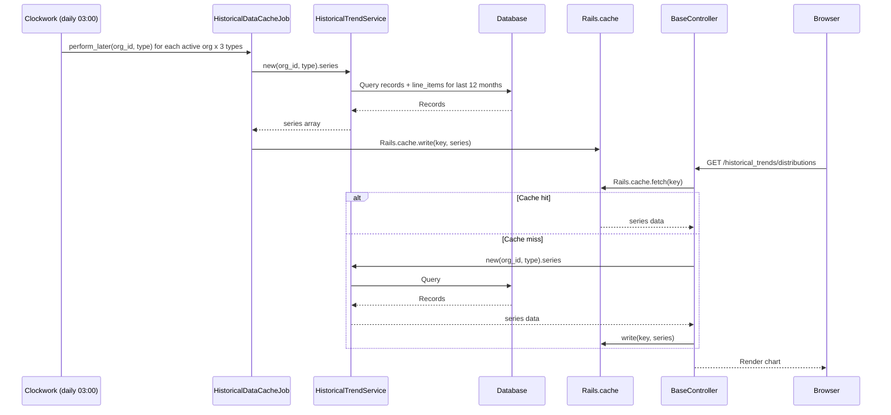

# Historical Trends

> **Status**: Active
> **Generated**: 2026-06-13T00:00:00Z
> **Last Updated**: 2026-06-13T00:00:00Z

---

## Overview

### What It Does
Historical Trends provides monthly column charts that visualize the quantity of items distributed, purchased, and donated over the last 12 months. Each chart breaks down totals by individual item name, allowing organization staff to see per-item monthly volumes at a glance. The data is pre-cached daily via a background job and rendered using Highcharts through a Stimulus controller.

### Why It Exists
Essentials banks need to understand seasonal demand patterns, track growth in donations and distributions, and make procurement decisions based on historical volume data. This feature gives organizations a visual time-series view without requiring manual report generation.

### Key Capabilities
- Monthly column charts for Distributions, Purchases, and Donations over a rolling 12-month window
- Per-item breakdown with individual series that can be toggled on/off
- Daily background caching of trend data to avoid expensive queries on page load
- Select All / Deselect All buttons for bulk series visibility control

---

## Architecture

### High-Level Design

```mermaid
graph TD
    A[Clockwork Scheduler<br>clock.rb] -->|Daily at 03:00| B[HistoricalDataCacheJob]
    B --> C[HistoricalTrendService]
    C --> D[Database<br>distributions/purchases/donations + line_items]
    C -->|series data| E[Rails.cache]

    F[User Browser] -->|GET /historical_trends/*| G[HistoricalTrends::*Controller]
    G -->|inherits| H[HistoricalTrends::BaseController]
    H -->|Rails.cache.fetch| E
    H -->|cache miss| C
    G -->|@series, @title| I[index.html.erb View]
    I -->|renders| J[shared/_highcharts partial]
    J -->|Stimulus| K[highchart_controller.js]
    K -->|Highcharts.chart| L[Column Chart in Browser]
```

### Components

#### Backend Components
| Component | File Path | Purpose |
|-----------|-----------|---------|
| BaseController | `app/controllers/historical_trends/base_controller.rb` | Shared `cached_series` method that reads from Rails.cache or falls back to HistoricalTrendService |
| DistributionsController | `app/controllers/historical_trends/distributions_controller.rb` | Serves the monthly distributions chart |
| PurchasesController | `app/controllers/historical_trends/purchases_controller.rb` | Serves the monthly purchases chart |
| DonationsController | `app/controllers/historical_trends/donations_controller.rb` | Serves the monthly donations chart |
| HistoricalTrendService | `app/services/historical_trend_service.rb` | Queries the database and builds the 12-month per-item series array |
| HistoricalTrendsHelper | `app/helpers/historical_trends_helper.rb` | Provides `last_12_months` method for x-axis category labels |
| HistoricalDataCacheJob | `app/jobs/historical_data_cache_job.rb` | Background job that pre-warms the Rails.cache for each org and type |
| Clockwork Scheduler | `clock.rb` | Enqueues HistoricalDataCacheJob daily at 03:00 for every active organization |

#### Frontend Components
| Component | File Path | Purpose |
|-----------|-----------|---------|
| Highchart Stimulus Controller | `app/javascript/controllers/highchart_controller.js` | Initializes Highcharts chart from JSON config, provides selectAll/deselectAll actions |
| Shared Highcharts Partial | `app/views/shared/_highcharts.html.erb` | Renders the chart container div with Stimulus data attributes and toggle buttons |
| Distributions View | `app/views/historical_trends/distributions/index.html.erb` | Builds Highcharts JSON config for distributions |
| Purchases View | `app/views/historical_trends/purchases/index.html.erb` | Builds Highcharts JSON config for purchases |
| Donations View | `app/views/historical_trends/donations/index.html.erb` | Builds Highcharts JSON config for donations |

### Technology Stack
- **Backend**: Ruby on Rails, Rails.cache (cache store), Clockwork (scheduler), ActiveJob
- **Frontend**: Highcharts (charting library), Stimulus (JS framework via @hotwired/stimulus)
- **Database**: PostgreSQL (queries against distributions/purchases/donations + line_items + items tables)

---

## Service Details

### HistoricalTrendService

The core service that builds the chart data series. It accepts an organization ID and a type string (`"Distribution"`, `"Purchase"`, or `"Donation"`).

#### Constructor
```ruby
# Source: app/services/historical_trend_service.rb:2-4
def initialize(organization_id, type)
  @organization = Organization.find(organization_id)
  @type = type
end
```

#### `series` Method
```ruby
# Source: app/services/historical_trend_service.rb:9-38
def series
  type_symbol = @type.tableize.to_sym # :distributions, :donations, :purchases
  records_for_type = @organization.send(type_symbol)
    .includes(items: :line_items)
    .where(issued_at: 1.year.ago.beginning_of_month..Time.current)

  array_of_items = []

  records_for_type.each do |record|
    index = record.issued_at.month - Date.current.month - 1

    record.line_items.each do |line_item|
      name = line_item.item.name
      quantity = line_item.quantity
      next if quantity.zero?

      existing_item = array_of_items.find { |item| item[:name] == name }
      if existing_item
        quantity_per_month = existing_item[:data]
        quantity_per_month[index] += quantity
      else
        quantity_per_month = Array.new(12, 0)
        quantity_per_month[index] += quantity
        array_of_items << {name:, data: quantity_per_month, visible: false}
      end
    end
  end

  array_of_items.sort_by { |item| item[:name] }
end
```

**Return format:**
```ruby
# Each element represents one item type with its 12-month quantity distribution
[
  {name: "Adult Briefs (XXL)", data: [0, 0, 0, 0, 0, 0, 0, 0, 0, 416, 0, 0], visible: false},
  {name: "Diapers (Size 3)", data: [100, 200, 0, 0, 50, 0, 0, 0, 0, 0, 300, 150], visible: false}
]
```

The `visible: false` default means all series start hidden in the chart -- users must click individual legend items to show them.

### HistoricalTrendsHelper

```ruby
# Source: app/helpers/historical_trends_helper.rb:1-33
module HistoricalTrendsHelper
  MONTHS = [
    "Jan",
    "Feb",
    "Mar",
    "Apr",
    "May",
    "Jun",
    "Jul",
    "Aug",
    "Sep",
    "Oct",
    "Nov",
    "Dec"
  ]

  def last_12_months
    current_month = Time.zone.now.month
    current_year = Time.zone.now.year
    last_year = current_year - 1
    return_array = MONTHS.rotate(current_month)
    return_array.each_with_index do |month, index|
      # Last current_month entries are in the current year, earlier entries are
      # in the previous year.
      return_array[index] = if index >= (MONTHS.length - current_month)
        "#{month} #{current_year}"
      else
        "#{month} #{last_year}"
      end
    end
    return_array
  end
end
```

Returns an array of 12 month-year strings, e.g. `["Jul 2025", "Aug 2025", ..., "Jun 2026"]`.

---

## Caching Architecture

### Cache Key Pattern
```
{organization_id}-historical-{type}-data
```
Where `type` is one of `Distribution`, `Purchase`, or `Donation`.

### Cache Flow



### BaseController Cache Method
```ruby
# Source: app/controllers/historical_trends/base_controller.rb:1-5
class HistoricalTrends::BaseController < ApplicationController
  def cached_series(type)
    Rails.cache.fetch("#{current_organization.id}-historical-#{type}-data") { HistoricalTrendService.new(current_organization.id, type).series }
  end
end
```

### Background Job
```ruby
# Source: app/jobs/historical_data_cache_job.rb:1-7
class HistoricalDataCacheJob < ApplicationJob
  def perform(org_id:, type:)
    organization = Organization.find_by(id: org_id)

    Rails.cache.write("#{organization.id}-historical-#{type}-data", HistoricalTrendService.new(organization.id, type).series)
  end

  def queue_name = "low_priority"
end
```

### Clockwork Scheduler Entry
```ruby
# Source: clock.rb:12-22
DATA_TYPES = %w[Distribution Purchase Donation]
every(1.day, "Cache historical data", at: "03:00") do
  Organization.is_active.each do |org|
    DATA_TYPES.each do |type|
      Rails.logger.info("Queuing up #{type} cache data for #{org.name}")
      HistoricalDataCacheJob.perform_later(org_id: org.id, type: type)
    end
  end

  Rails.logger.info("Done!")
end
```

This means `3 * N` jobs are enqueued daily, where N is the number of active organizations.

---

## API Endpoints

| Method | Path | Action | Description | Notes |
|--------|------|--------|-------------|-------|
| `GET` | `/historical_trends/distributions` | `HistoricalTrends::DistributionsController#index` | Monthly distributions chart | Renders Highcharts column chart |
| `GET` | `/historical_trends/purchases` | `HistoricalTrends::PurchasesController#index` | Monthly purchases chart | Renders Highcharts column chart |
| `GET` | `/historical_trends/donations` | `HistoricalTrends::DonationsController#index` | Monthly donations chart | Renders Highcharts column chart |

All three routes are defined as standalone GET routes in `config/routes.rb` (lines 260-262), not as resourceful routes.

---

## Authorization

No feature-specific Pundit policies exist for historical trends. Authorization is handled entirely by `ApplicationController`:

| Filter | Method | Purpose |
|--------|--------|---------|
| `before_action` | `:authenticate_user!` | Devise authentication -- requires signed-in user |
| `before_action` | `:authorize_user` | Checks user belongs to organization |
| `before_action` | `:require_organization` | Ensures current_organization is set |

Any authenticated user within an organization can access all three historical trends pages. There is no role-based restriction.

---

## Configuration

### Environment Variables
No feature-specific environment variables. The feature depends on:
- **Rails cache store** -- whatever is configured in `config/environments/*.rb` (typically Redis in production)
- **Clockwork process** -- must be running for daily cache warming (`clock.rb`)

### Subtitle Note
All three views display the subtitle `"Cached Data, may be up to 24 hours old"` to inform users that data may not reflect real-time changes.

---

## View Template

All three view templates (`distributions/index.html.erb`, `purchases/index.html.erb`, `donations/index.html.erb`) are identical except they use different `@series` and `@title` values set by their respective controllers. The shared template structure:

```erb
<%
    config = {
      chart: {
        type: 'column',
        height: 850
      },
      title: {
        text: @title
      },
      subtitle: {
        text: "Cached Data, may be up to 24 hours old"
      },
      xAxis: {
        categories: last_12_months,
        crosshair: true
      },
      yAxis: {
        min: 0,
        title: {
          text: "Line Items"
        }
      },
      tooltip: {
        style: {
          zIndex: 100
        },
        shared: true,
        useHTML: true
      },
      plotOptions: {
        column: {
          pointPadding: 0.2,
          borderWidth: 0
        }
      },
      series: @series
    }.to_json
%>
<%= render partial: "shared/highcharts", locals: { config: config } %>
```

The shared partial (`app/views/shared/_highcharts.html.erb`):
```erb
<div data-controller="highchart" data-highchart-config-value="<%= config %>">
  <div data-highchart-target="chart"></div>
  <div class="pl-3">
    <button type="button" class="btn btn-sm btn-secondary" data-action="click->highchart#selectAll">Select All</button>
    <button type="button" class="btn btn-sm btn-info" data-action="click->highchart#deselectAll">Deselect All</button>
  </div>
</div>
```

### Stimulus Controller (Highcharts)

```javascript
// Source: app/javascript/controllers/highchart_controller.js
import { Controller } from "@hotwired/stimulus"
import Highcharts from 'highcharts';

export default class extends Controller {
  static targets = [ "chart", "selectAllButton", "deselectAllButton"]
  static values = {
    config: Object
  }

  connect() {
    this.chart = Highcharts.chart(this.chartTarget, this.configValue);
  }

  deselectAll() {
    this.chart.series.forEach((s) => {
      s.setVisible(false, false);
    })
    this.chart.redraw();
  }

  selectAll() {
    this.chart.series.forEach((s) => {
      s.setVisible(true, false);
    })
    this.chart.redraw();
  }
}
```

Note: `selectAllButton` and `deselectAllButton` are declared as targets but never referenced in the partial -- the buttons use `data-action` attributes directly.

---

## Testing

### Test Files
| File | Type | Tests |
|------|------|-------|
| `spec/services/historical_trend_service_spec.rb` | Unit | Verifies series output format and monthly data aggregation |
| `spec/helpers/historical_trends_helper_spec.rb` | Unit | Verifies `last_12_months` returns correct month-year labels for various dates |
| `spec/jobs/historical_data_cache_job_spec.rb` | Unit | Verifies job queues on `low_priority` and writes to Rails.cache correctly |

No system/request specs exist for the historical trends controllers.

---

## Known Issues & Caveats

| Issue | Location | Description |
|-------|----------|-------------|
| Month index calculation | `historical_trend_service.rb:18` | `index = record.issued_at.month - Date.current.month - 1` uses Ruby's negative array indexing. When `issued_at.month` equals `Date.current.month`, index is `-1` (last element), which is correct. But this relies on Ruby's negative index wrapping behavior and can be confusing to maintain. |
| Eager load mismatch | `historical_trend_service.rb:12` | `.includes(items: :line_items)` eager loads `items` through the association, but the iteration at line 20 calls `record.line_items` directly (not through items), potentially causing N+1 queries on `line_item.item.name` at line 21. |
| All series hidden by default | `historical_trend_service.rb:32` | Every series has `visible: false`, meaning the chart renders blank until the user clicks "Select All" or individual legend items. This may confuse first-time users. |
| Identical view templates | `app/views/historical_trends/*/index.html.erb` | All three view files are identical. This is a DRY violation -- could be a single shared partial with the config passed from the controller. |
| No cache expiry | `historical_data_cache_job.rb:4` | `Rails.cache.write` is called without a TTL/expiry. If the Clockwork job stops running, stale data persists indefinitely. The `BaseController#cached_series` also uses `Rails.cache.fetch` without expiry. |
| Unused Stimulus targets | `highchart_controller.js:10` | `selectAllButton` and `deselectAllButton` are declared as static targets but are never used in the controller code. The buttons use `data-action` instead. |
| No error handling in job | `historical_data_cache_job.rb:3` | `Organization.find_by` returns `nil` if not found, which would cause a `NoMethodError` on `organization.id` at line 5. Should use `find` or add a nil guard. |

---

## Performance

### Optimization Strategies
- **Daily pre-caching**: The Clockwork scheduler runs at 03:00 daily, warming the cache for all active organizations so page loads read from cache rather than hitting the database.
- **Low-priority queue**: `HistoricalDataCacheJob` runs on `"low_priority"` queue to avoid blocking time-sensitive jobs.
- **Batch redraw**: The Stimulus controller sets visibility on all series with `redraw: false` and calls `this.chart.redraw()` once at the end, avoiding repeated re-renders.

### Caching
- **Cache Layer**: Rails.cache (typically Redis in production)
- **TTL**: None explicitly set -- relies on daily job overwrite
- **Cache Keys**: `{org_id}-historical-Distribution-data`, `{org_id}-historical-Purchase-data`, `{org_id}-historical-Donation-data`

### Database Queries
The service issues one query per type per organization:
```ruby
@organization.send(type_symbol)
  .includes(items: :line_items)
  .where(issued_at: 1.year.ago.beginning_of_month..Time.current)
```
This scans all records in the 12-month window with eager loading. For organizations with high volume, this could be expensive, which is why the data is pre-cached.

---

## Troubleshooting

### Common Issues

#### Issue: Chart shows no data (blank chart)
**Symptoms:**
- Chart renders with axes and title but no columns visible

**Cause:**
All series default to `visible: false`. This is expected behavior -- users must click "Select All" or individual legend items.

**Solution:**
Click the "Select All" button below the chart, or click individual item names in the chart legend.

#### Issue: Data appears stale or missing recent transactions
**Symptoms:**
- Recent donations/distributions/purchases not reflected in chart

**Cause:**
Data is cached daily at 03:00. The subtitle explicitly warns: "Cached Data, may be up to 24 hours old". If the Clockwork process is not running, data may be much older.

**Solution:**
1. Verify the Clockwork process is running: check process list or Heroku worker dyno
2. Manually trigger a cache refresh in Rails console:
```ruby
HistoricalDataCacheJob.perform_later(org_id: org.id, type: "Distribution")
```

#### Issue: NoMethodError on nil organization in cache job
**Symptoms:**
- Job fails with `undefined method 'id' for nil:NilClass`

**Cause:**
`Organization.find_by(id: org_id)` returns nil if the organization was deleted between scheduling and execution.

**Solution:**
Add a nil guard in the job, or change `find_by` to `find` to raise `ActiveRecord::RecordNotFound` which ActiveJob can retry.

---

## Related Features

- **[Distributions](./distributions.md)** -- Source data for the distributions trend chart
- **[Purchases](./purchases.md)** -- Source data for the purchases trend chart
- **[Donations](./donations.md)** -- Source data for the donations trend chart
- **[Reports](./reports.md)** -- Complementary feature providing tabular/summary reports rather than visual trends
- **[Dashboard](./dashboard.md)** -- Organization dashboard with summary stats (different from historical time-series)

---

**Generated:** 2026-06-13T00:00:00Z
**Last Updated:** 2026-06-13T00:00:00Z
**Status:** Active
