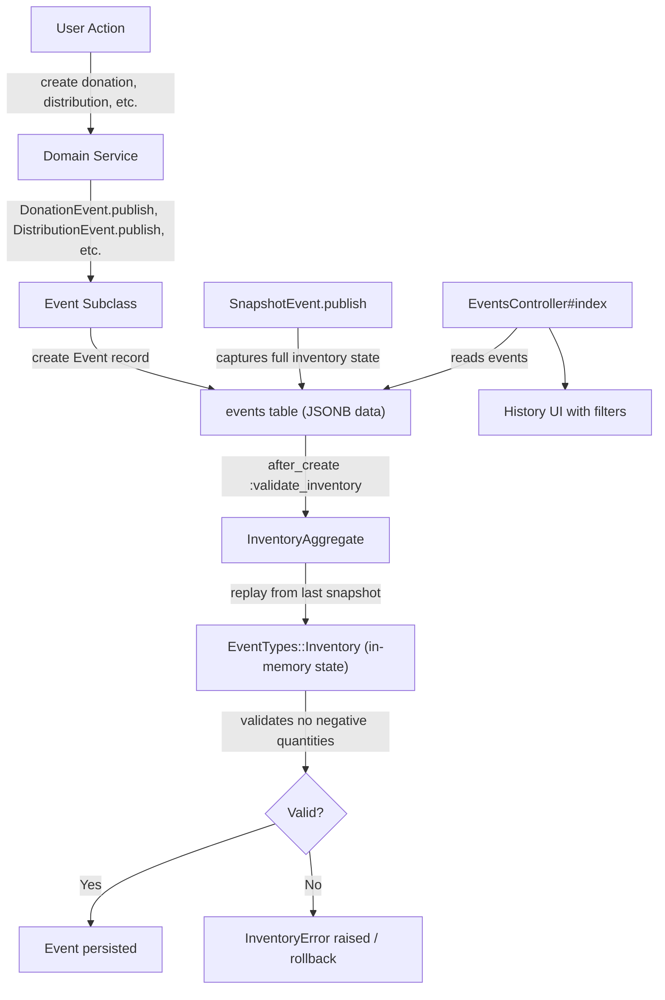
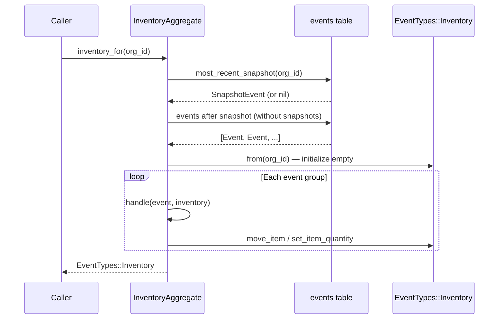
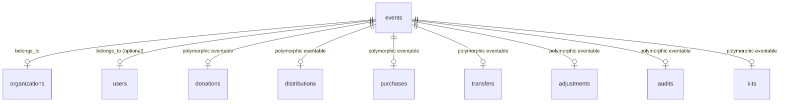

# Inventory Events

> **Status**: Active
> **Generated**: 2026-06-13T00:00:00Z
> **Last Updated**: 2026-06-13T00:00:00Z

---

## Overview

### What It Does
Inventory Events is the core event-sourcing infrastructure that tracks every inventory-affecting action in Human Essentials. Rather than maintaining mutable inventory counters, the system records immutable events (donations, distributions, purchases, transfers, adjustments, audits, kit allocations) and replays them to compute the current inventory state. A `SnapshotEvent` mechanism periodically captures the full inventory state so that replay does not need to start from the beginning of time.

### Why It Exists
Traditional CRUD-based inventory tracking loses the history of how inventory reached its current state. Event sourcing provides a complete audit trail of every inventory change, enables point-in-time inventory queries, supports correction of historical records (via `UpdateExistingEvent`), and allows validation that inventory never goes negative at any point in the event sequence.

### Key Capabilities
- Event-sourced inventory tracking with full audit trail
- Polymorphic event model supporting multiple inventory action types via STI (Single Table Inheritance)
- Snapshot-based optimization to avoid replaying entire event history
- Inventory state reconstruction at any point in time via `InventoryAggregate.inventory_for`
- Correction of historical records with `UpdateExistingEvent` diff computation
- Validation that inventory quantities never go negative during replay
- Filterable event history UI with date range, event type, storage location, and item filters

---

## Architecture

### High-Level Design



### Event Replay Flow



### Components

#### Backend Components
| Component | File Path | Purpose |
|-----------|-----------|---------|
| Event (base model) | `app/models/event.rb` | STI base class for all inventory events; scopes, serialization, validation |
| EventsController | `app/controllers/events_controller.rb` | Read-only index action for the History UI |
| InventoryAggregate | `app/events/inventory_aggregate.rb` | Event replay engine; reconstructs inventory from events |
| InventoryError | `app/events/inventory_error.rb` | Error class raised when inventory validation fails |
| InventoryActionError | `app/events/inventory_action_error.rb` | Error for specific item/location validation failures |
| SnapshotEvent | `app/events/snapshot_event.rb` | Captures full inventory state as a checkpoint |
| UpdateExistingEvent | `app/events/update_existing_event.rb` | Records corrections to previously-created inventory actions |
| EventTypes::Inventory | `app/events/event_types/inventory.rb` | Dry::Struct representing full organization inventory state |
| EventTypes::InventoryPayload | `app/events/event_types/inventory_payload.rb` | Dry::Struct for event data payload (array of line items) |
| EventTypes::EventItem | `app/events/event_types/event_item.rb` | Dry::Struct for an item quantity at a storage location |
| EventTypes::EventLineItem | `app/events/event_types/event_line_item.rb` | Dry::Struct for a line item with from/to locations |
| EventTypes::EventStorageLocation | `app/events/event_types/event_storage_location.rb` | Dry::Struct for a storage location's item inventory |
| EventTypes::StructCoder | `app/events/event_types/struct_coder.rb` | Serializer/deserializer for Dry::Struct to/from JSONB |
| EventTypes::AuditPayload | `app/events/event_types/audit_payload.rb` | Extends InventoryPayload with storage_location_id for audits |

#### View Components
| Component | File Path | Purpose |
|-----------|-----------|---------|
| Events index | `app/views/events/index.html.erb` | History page with filter form and paginated event table |
| Event row partial | `app/views/events/_event_row.html.erb` | Renders a single event row (delegates to snapshot partial for SnapshotEvents) |
| Snapshot event row | `app/views/events/_snapshot_event_row.html.erb` | Renders a snapshot event with all storage locations and their items |

### Technology Stack
- **Backend**: Ruby on Rails with STI (Single Table Inheritance) for event types
- **Data Modeling**: [Dry::Struct](https://dry-rb.org/gems/dry-struct) for immutable value objects
- **Serialization**: Custom `StructCoder` for ActiveRecord `serialize` to JSONB
- **Database**: PostgreSQL with JSONB column for event data
- **Frontend**: Server-rendered ERB with Kaminari pagination

---

## Model Details

### Event

#### Associations
```ruby
# Source: app/models/event.rb
belongs_to :eventable, polymorphic: true
belongs_to :user, optional: true
belongs_to :organization
```

#### Concerns
| Concern | Purpose |
|---------|---------|
| `Filterable` | Adds `class_filter` class method for applying named scopes from filter params |

#### Scopes
```ruby
# Source: app/models/event.rb
scope :for_organization, ->(organization_id) { where(organization_id: organization_id).order(:event_time, :id) }
scope :without_snapshots, -> { where("type != 'SnapshotEvent'") }
scope :during, ->(range) { where(events: {created_at: range}) }
scope :by_type, ->(type) { where(type: type) }
scope :by_item, ->(item_id) {
  joins("left join lateral jsonb_array_elements(data->'items') AS item ON true")
    .where("type = 'SnapshotEvent' OR (item->>'item_id')=? ", item_id)
}
scope :by_storage_location, ->(loc_id) {
  joins("left join lateral jsonb_array_elements(data->'items') AS item ON true")
    .where("type = 'SnapshotEvent' OR (item->>'from_storage_location')=? OR (item->>'to_storage_location')=?", loc_id, loc_id)
}
```

#### Serialization
```ruby
# Source: app/models/event.rb
serialize :data, coder: EventTypes::StructCoder.new(EventTypes::InventoryPayload)
```

Note: `SnapshotEvent` overrides this with:
```ruby
# Source: app/events/snapshot_event.rb
serialize :data, coder: EventTypes::StructCoder.new(EventTypes::Inventory)
```

#### Callbacks
| Callback | Method | Purpose |
|----------|--------|---------|
| `before_create` | (inline block) | Sets `user_id` from `PaperTrail.request.whodunnit` |
| `after_create` | `:validate_inventory` | Replays all events to validate no negative inventory |

#### Validations
| Validation | Method | Purpose |
|------------|--------|---------|
| `validate` (on: :create) | `:no_intervening_snapshot` | Prevents creating events for records whose `created_at` is before a more recent snapshot |

#### Key Methods
| Method | Returns | Purpose | Notes |
|--------|---------|---------|-------|
| `self.types_for_select` | `Array<Option>` | Returns event subclass names formatted for select dropdowns | Strips "Event" suffix and titleizes |
| `self.most_recent_snapshot(organization_id)` | `SnapshotEvent` | Finds the latest usable snapshot (one not invalidated by a post-snapshot correction) | Uses raw SQL with lateral subquery |
| `validate_inventory` | void | Replays events and raises `InventoryError` if quantities go negative | Called after_create |
| `no_intervening_snapshot` | void | Adds validation error if a SnapshotEvent was created after the eventable's `created_at` | Skips for SnapshotEvent and Kit eventables |

### SnapshotEvent

Subclass of `Event`. Serializes full `EventTypes::Inventory` state rather than `InventoryPayload`.

#### Key Methods
| Method | Returns | Purpose | Notes |
|--------|---------|---------|-------|
| `self.intervening(record)` | `SnapshotEvent` or `nil` | Finds any snapshot created at or after `record.created_at` | Used by `no_intervening_snapshot` validation |
| `self.publish(organization)` | `SnapshotEvent` | Computes current inventory and persists as a snapshot | Sets eventable to the organization itself |

### UpdateExistingEvent

Subclass of `Event`. Used when an existing donation/distribution/purchase/transfer is edited after creation.

#### Key Methods
| Method | Returns | Purpose | Notes |
|--------|---------|---------|-------|
| `self.item_quantities(line_items, storage_location, direction)` | `Hash<Integer, EventLineItem>` | Builds a hash of item_id to EventLineItem for diffing | Direction determines from/to location assignment |
| `self.diff(previous, current)` | `Array<EventLineItem>` | Computes the delta between previous and current line items | Handles added, removed, and changed items |
| `self.direction(itemizable)` | `Symbol` | Returns `:from` for Distribution, `:to` for everything else | Distributions reduce inventory; others add |
| `self.publish(itemizable, previous_line_items, original_storage_location)` | `UpdateExistingEvent` | Creates a diff event for an edited record | Handles storage location changes by reversing old + applying new |

### EventTypes::Inventory (Dry::Struct)

In-memory representation of the full inventory state for an organization.

#### Attributes
| Attribute | Type | Purpose |
|-----------|------|---------|
| `organization_id` | `Integer` | The organization this inventory belongs to |
| `storage_locations` | `Hash<Integer, EventStorageLocation>` | Map of storage location ID to its inventory |

#### Key Methods
| Method | Returns | Purpose | Notes |
|--------|---------|---------|-------|
| `self.from(organization_id)` | `Inventory` | Creates empty inventory with all org storage locations | Loads locations from DB |
| `set_item_quantity(item_id:, quantity:, location:)` | void | Directly sets an item's quantity at a location | Used by audit events |
| `move_item(item_id:, quantity:, from_location:, to_location:, validate:)` | void | Moves quantity between locations (add to one, reduce from other) | Handles negative quantities by swapping from/to |

### EventTypes::EventStorageLocation (Dry::Struct)

#### Attributes
| Attribute | Type | Purpose |
|-----------|------|---------|
| `id` | `Integer` | Storage location ID |
| `items` | `Hash<Integer, EventItem>` | Map of item ID to EventItem |

#### Key Methods
| Method | Returns | Purpose | Notes |
|--------|---------|---------|-------|
| `reset!` | void | Clears all items | |
| `set_inventory(item_id, quantity)` | void | Sets item quantity directly | |
| `reduce_inventory(item_id, quantity, validate:)` | void | Subtracts quantity; raises `InventoryActionError` if insufficient and validate is true | |
| `add_inventory(item_id, quantity)` | void | Adds quantity to an item | |

### EventTypes::EventLineItem (Dry::Struct)

#### Attributes
| Attribute | Type | Purpose |
|-----------|------|---------|
| `quantity` | `Integer` | Quantity (can be positive or negative) |
| `item_id` | `Integer` | Item ID |
| `item_value_in_cents` | `Integer` | Monetary value per item in cents |
| `from_storage_location` | `Integer?` | Source storage location (nil if adding inventory) |
| `to_storage_location` | `Integer?` | Destination storage location (nil if removing inventory) |

#### Key Methods
| Method | Returns | Purpose | Notes |
|--------|---------|---------|-------|
| `same_item?(line_item)` | `Boolean` | Checks if two line items refer to the same item at same locations | Compares `from_storage_location`, `to_storage_location`, and `item_id` |
| `negative` | `EventLineItem` | Returns a copy with negated quantity | Used for reversal in UpdateExistingEvent |
| `self.from_line_item(line_item, from:, to:, quantity:)` | `EventLineItem` | Converts an ActiveRecord LineItem to an EventLineItem | Handles negative quantities by swapping from/to |
| `self.from_line_items(line_items, from:, to:)` | `Array<EventLineItem>` | Batch conversion of line items | |
| `self.zeroed_line_items(line_items, from:, to:)` | `Array<EventLineItem>` | Creates line items with quantity 0 | Used for initialization |

### EventTypes::EventItem (Dry::Struct)

#### Attributes
| Attribute | Type | Purpose |
|-----------|------|---------|
| `item_id` | `Integer` | Item ID |
| `quantity` | `Integer` | Current quantity |
| `storage_location_id` | `Integer?` | Optional storage location ID |

### EventTypes::InventoryPayload (Dry::Struct)

#### Attributes
| Attribute | Type | Purpose |
|-----------|------|---------|
| `items` | `Array<EventLineItem>` | List of line items in this event |

### EventTypes::AuditPayload (Dry::Struct)

Extends `InventoryPayload`.

#### Additional Attributes
| Attribute | Type | Purpose |
|-----------|------|---------|
| `storage_location_id` | `Integer` | The storage location being audited |

---

## Database Schema

### events

| Column | Type | Default | Notes |
|--------|------|---------|-------|
| `id` | `bigint` | auto-increment | Primary key |
| `type` | `string` | — | **NOT NULL**. STI discriminator (e.g., `DonationEvent`, `SnapshotEvent`, `UpdateExistingEvent`) |
| `event_time` | `datetime` | — | **NOT NULL**. Logical time of the event |
| `data` | `jsonb` | — | Serialized `InventoryPayload` or `Inventory` (for snapshots) |
| `eventable_id` | `bigint` | — | Polymorphic association ID |
| `eventable_type` | `string` | — | Polymorphic association type (e.g., `Donation`, `Distribution`, `Organization`) |
| `created_at` | `datetime` | — | **NOT NULL**. Record creation time |
| `updated_at` | `datetime` | — | **NOT NULL**. Record update time |
| `organization_id` | `bigint` | — | Foreign key to organizations |
| `user_id` | `bigint` | — | Foreign key to users (set from PaperTrail whodunnit) |
| `group_id` | `string` | — | Groups related events for deduplication during replay |

### Indexes

| Name | Columns | Notes |
|------|---------|-------|
| `index_events_on_organization_id_and_event_time` | `organization_id`, `event_time` | Composite index for org-scoped time-ordered queries |
| `index_events_on_user_id` | `user_id` | For user lookups |

### Relationships


---

## API Endpoints

| Method | Path | Action | Description | Notes |
|--------|------|--------|-------------|-------|
| `GET` | `/events` | `index` | Lists paginated event history with filters | Supports `filters[by_type]`, `filters[by_storage_location]`, `filters[by_item]`, `filters[date_range]`, `eventable_id` + `eventable_type` params |

The route is defined as:
```ruby
# Source: config/routes.rb:101
resources :events, only: %i(index)
```

---

## Authorization

No dedicated `EventPolicy` file exists. The `EventsController` inherits from `ApplicationController`, which provides organization-scoped access control. Any authenticated user within the organization can view the event history.

---

## Configuration

### Environment Variables
None specific to inventory events.

### Dependencies
- **dry-struct** / **dry-types**: Used for all `EventTypes::*` value objects
- **PaperTrail**: `PaperTrail.request.whodunnit` is used in the `before_create` callback to set `user_id`
- **Kaminari**: Pagination in the events index view

---

## InventoryAggregate — Event Handler Registration

The `InventoryAggregate` module is the central replay engine. It uses a DSL (`on`) to register handler blocks for each event type:

```ruby
# Source: app/events/inventory_aggregate.rb:126-151

# ignore previous events
on KitAllocateEvent, KitDeallocateEvent do |event, inventory, validate: false, previous_event: nil|
  handle_inventory_event(event.data, inventory, validate: validate)
rescue InventoryError => e
  e.event = event
  raise e
end

# diff previous event
on DonationEvent, DistributionEvent, AdjustmentEvent, PurchaseEvent,
  TransferEvent, DistributionDestroyEvent, DonationDestroyEvent,
  PurchaseDestroyEvent, TransferDestroyEvent,
  UpdateExistingEvent do |event, inventory, validate: false, previous_event: nil|
  handle_inventory_event(event.data, inventory, validate: validate, previous_event: previous_event)
rescue InventoryError => e
  e.event = event
  raise e
end

on AuditEvent do |event, inventory, validate: false, previous_event: nil|
  handle_audit_event(event.data, inventory)
end

on SnapshotEvent do |event, inventory, validate: false, previous_event: nil|
  inventory.storage_locations.clear
  inventory.storage_locations.merge!(event.data.storage_locations)
end
```

### Handler Categories

| Handler Group | Event Types | Behavior |
|---------------|------------|----------|
| Kit events (no diff) | `KitAllocateEvent`, `KitDeallocateEvent` | Applies inventory changes without considering previous event state |
| Standard events (with diff) | `DonationEvent`, `DistributionEvent`, `AdjustmentEvent`, `PurchaseEvent`, `TransferEvent`, `*DestroyEvent`, `UpdateExistingEvent` | Diffs against previous event for the same eventable to compute net change |
| Audit events | `AuditEvent` | Directly sets item quantities (overwrite, not delta) |
| Snapshot events | `SnapshotEvent` | Replaces entire inventory state |

### Event Grouping

Events are grouped by `group_id` during replay. Within each group, only the event with the latest `updated_at` is processed. This means that if an event is updated (corrected), the latest version is used. `UpdateExistingEvent` is exempted from this grouping logic and always processed individually.

---

## Usage Examples

### Publishing a Donation Event
```ruby
# Source: app/events/donation_event.rb:3-13
def self.publish(donation)
  create(
    eventable: donation,
    group_id: "donation-#{donation.id}-#{SecureRandom.hex}",
    organization_id: donation.organization_id,
    event_time: Time.zone.now,
    data: EventTypes::InventoryPayload.new(
      items: EventTypes::EventLineItem.from_line_items(donation.line_items, to: donation.storage_location_id)
    )
  )
end
```

### Publishing a Distribution Event (removes inventory)
```ruby
# Source: app/events/distribution_event.rb:3-13
def self.publish(distribution)
  create(
    eventable: distribution,
    group_id: "dist-#{distribution.id}-#{SecureRandom.hex}",
    organization_id: distribution.organization_id,
    event_time: Time.zone.now,
    data: EventTypes::InventoryPayload.new(
      items: EventTypes::EventLineItem.from_line_items(distribution.line_items, from: distribution.storage_location_id)
    )
  )
end
```

### Computing Current Inventory
```ruby
# Source: app/events/inventory_aggregate.rb:17
inventory = InventoryAggregate.inventory_for(organization.id)
# Returns an EventTypes::Inventory with storage_locations hash
```

### Computing Inventory at a Point in Time
```ruby
# Source: app/events/inventory_aggregate.rb:17
inventory = InventoryAggregate.inventory_for(organization.id, event_time: 1.week.ago)
```

### Publishing a Snapshot
```ruby
# Source: app/events/snapshot_event.rb:13-20
SnapshotEvent.publish(organization)
```

### Publishing an Update to an Existing Record
```ruby
# Source: app/events/update_existing_event.rb:43-61
UpdateExistingEvent.publish(itemizable, previous_line_items, original_storage_location)
```

---

## Testing

### Test Files
- `spec/models/event_spec.rb` — Tests for `types_for_select`, `most_recent_snapshot`, and `no_intervening_snapshot` validation
- `spec/events/inventory_aggregate_spec.rb` — Tests for event replay with donations, distributions, and inventory state assertions

### Key Test Cases
- Verifies `most_recent_snapshot` returns the latest usable snapshot (not one invalidated by post-snapshot corrections)
- Verifies `no_intervening_snapshot` prevents creating events for records predating a snapshot
- Verifies donation events correctly add inventory to storage locations
- Verifies distribution events correctly remove inventory from storage locations

---

## Known Issues & Caveats

| Issue | Location | Description |
|-------|----------|-------------|
| Raw SQL for snapshot lookup | `app/models/event.rb:75-88` | `most_recent_snapshot` uses a raw SQL query with `$1` bind parameter instead of ActiveRecord query builder |
| N+1-adjacent view lookups | `app/views/events/_event_row.html.erb:22,27,32,38` | Storage locations and items are found via `.find` on in-memory arrays (loaded in controller), not true N+1 but O(n*m) |
| No authorization policy | — | No `EventPolicy` exists; access is controlled only by organization scoping in the controller |
| `by_item` / `by_storage_location` include snapshots | `app/models/event.rb:24-31` | The `by_item` and `by_storage_location` scopes use `OR type = 'SnapshotEvent'` which means snapshots always appear regardless of item/location filter |
| PaperTrail coupling | `app/models/event.rb:40-41` | `user_id` is set from `PaperTrail.request.whodunnit` in `before_create`, creating a hard dependency on PaperTrail being configured |
| Snapshot row layout | `app/views/events/_snapshot_event_row.html.erb` | Snapshot events render all storage location data in the "From Location" column (`<td>`) while "To Location" and "Items" columns are empty (`&nbsp;`) |
| `group_id` includes random hex | `app/events/donation_event.rb:6`, etc. | Each event gets a unique `group_id` with `SecureRandom.hex`, meaning grouping only applies when an event is explicitly created with the same `group_id` |

---

## Performance

### Optimization Strategies
- **Snapshot-based replay**: `most_recent_snapshot` allows the system to skip replaying all historical events. Only events after the latest usable snapshot are replayed.
- **Event grouping by `group_id`**: Within a group, only the latest event (by `updated_at`) is processed, avoiding redundant replay of superseded events.

### Database Optimization
- **Composite index** on `(organization_id, event_time)` supports the primary query pattern of loading events for an organization ordered by time.
- **Index on `user_id`** for user-scoped lookups.
- **JSONB `data` column** with lateral joins for item and storage location filtering (via `jsonb_array_elements`).

### Caching
No explicit caching layer. Inventory is recomputed from events on each call to `inventory_for`. Snapshots serve as a form of checkpoint-based caching.

---

## Troubleshooting

### Common Issues

#### Issue: "Cannot change inventory for an [type] created before [date]"
**Symptoms:**
- `ActiveRecord::RecordInvalid` when trying to create an event for a donation/distribution/etc.

**Cause:**
A `SnapshotEvent` exists with an `event_time` at or after the eventable's `created_at`. The `no_intervening_snapshot` validation prevents modifying records that predate a snapshot.

**Solution:**
The record cannot be modified through the normal event flow. Contact admin staff or create a new snapshot that accounts for the correction.

#### Issue: "Could not reduce quantity by X - current quantity is Y"
**Symptoms:**
- `InventoryError` raised during event creation or inventory validation.

**Cause:**
An event would cause a storage location's item quantity to go negative when replaying the full event history.

**Solution:**
Check the event data for correctness. This often occurs when editing a distribution to increase quantities beyond what was available at that point in the event timeline.

#### Issue: "Storage location [id] not found!"
**Symptoms:**
- RuntimeError during inventory replay.

**Cause:**
An event references a storage location that does not exist in the inventory state (and validation is enabled).

**Solution:**
Verify the storage location exists and belongs to the organization. This can happen if a storage location was deleted or deactivated after events were recorded.

---

## Related Features

- **[Donations](./donations.md)** — Publishes `DonationEvent` and `DonationDestroyEvent`
- **[Distributions](./distributions.md)** — Publishes `DistributionEvent` and `DistributionDestroyEvent`
- **[Purchases](./purchases.md)** — Publishes `PurchaseEvent` and `PurchaseDestroyEvent`
- **[Transfers](./transfers.md)** — Publishes `TransferEvent` and `TransferDestroyEvent`
- **[Adjustments](./adjustments.md)** — Publishes `AdjustmentEvent`
- **[Audits](./audits.md)** — Publishes `AuditEvent` (sets inventory directly, no diff)
- **[Kits](./kits.md)** — Publishes `KitAllocateEvent` and `KitDeallocateEvent`
- **[Storage Locations](./storage-locations.md)** — Inventory state is per-storage-location

---

**Generated:** 2026-06-13T00:00:00Z
**Last Updated:** 2026-06-13T00:00:00Z
**Status:** Active
