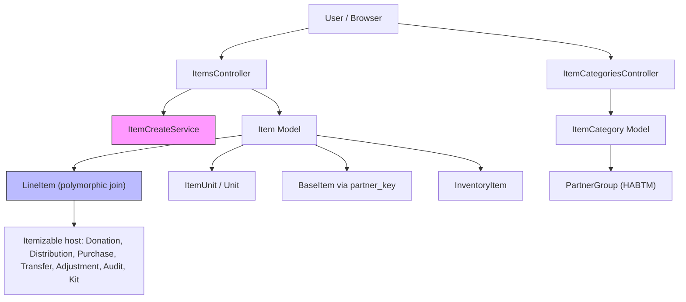
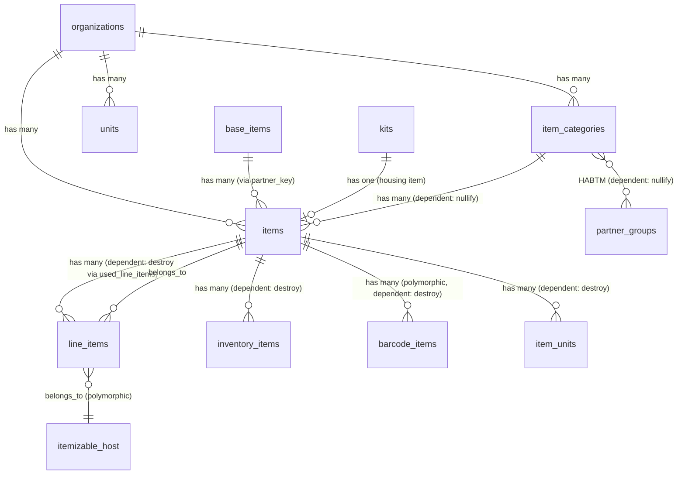
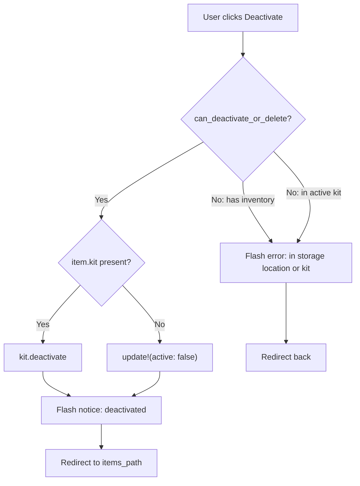

# Items

> **Status**: Active
> **Generated**: 2026-06-13T00:00:00Z
> **Last Updated**: 2026-06-13T00:00:00Z

---

## Overview

### What It Does
The Items feature manages the catalog of item types (e.g., diapers, period supplies, incontinence products) that an organization tracks. Each item type belongs to an organization, is linked to a system-wide `BaseItem` via `partner_key`, and can be organized into categories (`ItemCategory`). Items appear on every transaction in the system as `LineItem` records -- donations, distributions, purchases, transfers, adjustments, audits, and kits all reference items through the polymorphic `line_items` table.

The feature also manages custom request units (`Unit` / `ItemUnit`) gated behind the `:enable_packs` Flipper feature flag, allowing organizations to define non-standard units (e.g., "packs", "cases") that partners can use when requesting supplies.

### Why It Exists
Essentials banks need a standardized yet customizable item catalog. The National Diaper Bank Network (NDBN) requires reporting by specific categories (disposable diapers, pads, tampons, etc.), so each item carries a `reporting_category` enum that maps to NDBN reporting standards. Organizations need per-item configuration for distribution quantities, minimum/recommended on-hand levels, monetary value tracking, package sizes, and partner visibility controls.

### Key Capabilities
- Full CRUD for item types scoped to an organization
- Item categorization via `ItemCategory` with HABTM link to partner groups
- NDBN reporting category enum for standardized reporting
- Soft-deactivation (active/inactive) with guards preventing deactivation of items that have inventory or are part of active kits
- Hard deletion only when item has never been used in any transaction
- CSV export of items with inventory quantities
- Custom request units per item (feature-flagged via `:enable_packs`)
- Per-item configuration: value in cents, package size, distribution quantity, on-hand minimum/recommended quantities, partner visibility
- Line items as the polymorphic join between items and all transactional models
- PaperTrail audit logging on Item, ItemCategory, and LineItem

---

## Architecture

### High-Level Design



### Components

#### Backend Components

| Component | File Path | Purpose |
|-----------|-----------|---------|
| ItemsController | `app/controllers/items_controller.rb` | Full CRUD + deactivate, restore, remove_category actions |
| ItemCategoriesController | `app/controllers/item_categories_controller.rb` | CRUD for item categories (except index) |
| Item | `app/models/item.rb` | Core item model with scopes, validations, lifecycle methods |
| ItemCategory | `app/models/item_category.rb` | Grouping model for items, linked to partner groups |
| ItemUnit | `app/models/item_unit.rb` | Per-item custom request unit (feature-flagged) |
| Unit | `app/models/unit.rb` | Organization-level request unit definition |
| LineItem | `app/models/line_item.rb` | Polymorphic join model connecting items to transactional records |
| ItemCreateService | `app/services/item_create_service.rb` | Service object wrapping item creation + optional request unit sync |
| ItemsHelper | `app/helpers/items_helper.rb` | Dollar formatting, request unit selection, quantity threshold check |
| Filterable concern | `app/models/concerns/filterable.rb` | Provides `class_filter` for scope-based filtering on index |
| Exportable concern | `app/models/concerns/exportable.rb` | CSV export infrastructure |
| Valuable concern | `app/models/concerns/valuable.rb` | `value_in_cents` validation and `value_in_dollars` conversion |
| Itemizable concern | `app/models/concerns/itemizable.rb` | Line item management for host models (combine!, totals, nested attributes) |
| ItemQuantity concern | `app/models/concerns/item_quantity.rb` | `value_per_line_item` and package count calculations for LineItem |

#### Frontend Components (Views)

| Component | File Path | Purpose |
|-----------|-----------|---------|
| Items index | `app/views/items/index.html.erb` | Tabbed index with 5 tabs: Item List, Item Categories, Quantity & Location, Inventory, Kits |
| Items form | `app/views/items/_form.html.erb` | Shared new/edit form with all item fields |
| Item show | `app/views/items/show.html.erb` | Item detail with storage locations and barcodes |
| Item list partial | `app/views/items/_item_list.html.erb` | Tab content for the item list |
| Item categories partial | `app/views/items/_item_categories.html.erb` | Tab content for categories |
| Items quantity/location | `app/views/items/_items_quantity_and_location.html.erb` | Tab content for quantity by location |
| Items inventory | `app/views/items/_items_inventory.html.erb` | Tab content for inventory view |
| Kits partial | `app/views/items/_kits.html.erb` | Tab content for kits |
| Item row | `app/views/items/_item_row.html.erb` | Single item row in list |
| Item row inventory | `app/views/items/_item_row_inventory.html.erb` | Item row for inventory tab |
| Item row qty/storages | `app/views/items/_item_row_quantity_and_storages.html.erb` | Item row for quantity & location tab |
| Storage column | `app/views/items/_storage_column.html.erb` | Per-storage column in inventory grid |
| Item new | `app/views/items/new.html.erb` | New item page |
| Item edit | `app/views/items/edit.html.erb` | Edit item page |
| Category form | `app/views/item_categories/_form.html.erb` | Shared new/edit form for categories |
| Category show | `app/views/item_categories/show.html.erb` | Category detail with member items |
| Category new | `app/views/item_categories/new.html.erb` | New category page |
| Category edit | `app/views/item_categories/edit.html.erb` | Edit category page |
| Line item fields | `app/views/line_items/_line_item_fields.html.erb` | Nested fields partial used by all transactional forms |

### Technology Stack
- **Backend**: Ruby on Rails, PaperTrail (audit), Flipper (feature flags)
- **Frontend**: ERB views, AdminLTE layout, Select2 (item dropdowns), Bootstrap tabs
- **Database**: PostgreSQL (integer PKs for items/line_items, bigint for item_categories/item_units/units)

---

## Model Details

### Item

#### Associations
```ruby
# Source: app/models/item.rb
belongs_to :organization
belongs_to :base_item, counter_cache: :item_count, primary_key: :partner_key, foreign_key: :partner_key, inverse_of: :items, optional: true
belongs_to :kit, optional: true
belongs_to :item_category, optional: true

has_many :used_line_items, dependent: :destroy, class_name: "LineItem"
has_many :inventory_items, dependent: :destroy
has_many :barcode_items, as: :barcodeable, dependent: :destroy
has_many :donations, through: :used_line_items, source: :itemizable, source_type: "::Donation"
has_many :distributions, through: :used_line_items, source: :itemizable, source_type: "::Distribution"
has_many :request_units, class_name: "ItemUnit", dependent: :destroy
```

Note: The `Itemizable` concern also adds:
```ruby
# Source: app/models/concerns/itemizable.rb
has_many :line_items, as: :itemizable, inverse_of: :itemizable
has_many :items, through: :line_items
has_many :inactive_items, -> { inactive }, through: :line_items, source: :item
has_many :item_categories, through: :items
```
These apply when Item itself is used as an Itemizable host (kits contain line_items pointing at component items).

#### Concerns
| Concern | Purpose |
|---------|---------|
| `Filterable` | Provides `class_filter(params)` for scope-based index filtering |
| `Exportable` | CSV export infrastructure: `csv_export_headers`, `generate_csv`, `normalize_csv_attribute` |
| `Valuable` | Validates `value_in_cents >= 0`, provides `value_in_dollars` getter/setter |
| `Itemizable` | Adds `line_items` association (as polymorphic host), `accepts_nested_attributes_for :line_items`, `total_quantity`, `value_per_itemizable`, `line_item_values`, `has_inactive_item?`, `inactive_items` |

Also: `has_paper_trail` for audit logging.

#### Callbacks
| Callback | Method | Purpose |
|----------|--------|---------|
| `after_initialize` | `:set_default_distribution_quantity` | Sets `distribution_quantity` to 1 for kit items, 50 for regular items (new records only) |
| `after_update` | `:update_associated_kit_name` | Syncs the kit's name when item name changes (only when `kit.present?`) |
| `before_destroy` | `:validate_destroy` | Prevents deletion if item has been used; calls `throw(:abort)` to cancel |
| `after_destroy` (from Itemizable) | block | Destroys associated line_items after parent destroy |

#### Validations
```ruby
# Source: app/models/item.rb
validates :additional_info, length: { maximum: 500 }
validates :name, uniqueness: { scope: :organization, case_sensitive: false, message: "- An item with that name already exists (could be an inactive item)" }
validates :name, presence: true
validates :distribution_quantity, numericality: { greater_than: 0 }, allow_blank: true
validates :on_hand_recommended_quantity, numericality: { greater_than_or_equal_to: 0 }, allow_blank: true
validates :on_hand_minimum_quantity, numericality: { greater_than_or_equal_to: 0 }
validates :package_size, numericality: { greater_than_or_equal_to: 0 }, allow_blank: true
validates :reporting_category, presence: true, unless: proc { |i| i.kit }
validate -> { line_items_quantity_is_at_least(1) }
# From Valuable concern:
validates :value_in_cents, numericality: { greater_than_or_equal_to: 0 }
```

#### Enum
```ruby
# Source: app/models/item.rb
enum :reporting_category, {
  adult_incontinence: "adult_incontinence",
  cloth_diapers: "cloth_diapers",
  disposable_diapers: "disposable_diapers",
  pads: "pads",
  period_liners: "period_liners",
  period_other: "period_other",
  period_underwear: "period_underwear",
  tampons: "tampons",
  other_categories: "other"
}, instance_methods: false, validate: { allow_nil: true }
```

#### Scopes
```ruby
# Source: app/models/item.rb
scope :active, -> { where(active: true) }
scope :housing_a_kit, -> { where.not(kit_id: nil) }
scope :loose, -> { where(kit_id: nil) }
scope :inactive, -> { where.not(active: true) }
scope :visible, -> { where(visible_to_partners: true) }
scope :alphabetized, -> { order(:name) }
scope :by_base_item, ->(base_item) { where(base_item: base_item) }
scope :by_reporting_category, ->(reporting_category) { where(reporting_category: reporting_category) }
scope :by_partner_key, ->(partner_key) { where(partner_key: partner_key) }
scope :period_supplies, -> {
  where(reporting_category: [:pads, :tampons, :period_liners, :period_underwear, :period_other])
}
```

#### Key Methods
| Method | Returns | Purpose | Notes |
|--------|---------|---------|-------|
| `can_delete?(inventory, kits)` | `Boolean` | Checks if item can be hard-deleted | Requires: no inventory, not in kit, no line_items, no barcodes, no requests, no kit association |
| `can_deactivate_or_delete?(inventory, kits)` | `Boolean` | Checks if item can be deactivated | Only checks: no inventory, not in active kit |
| `deactivate!` | void | Soft-deactivates item or delegates to kit.deactivate | Raises if cannot deactivate |
| `validate_destroy` | void | Before-destroy guard | Calls `throw(:abort)` if `can_delete?` is false |
| `has_inventory?(inventory)` | `Boolean` | Checks if item has positive quantity in any storage location | Uses `View::Inventory` |
| `in_request?` | `Boolean` | Checks if item appears in any Request | Queries `Request.by_request_item_id(id)` |
| `is_in_kit?(kits)` | `Boolean` | Checks if item is a component of any active kit | Accepts optional preloaded kits array |
| `sync_request_units!(unit_ids)` | void | Replaces item's request units from org-level unit IDs | Clears existing, creates new from org units matching IDs |
| `default_quantity` | `Integer` | Returns `distribution_quantity` or 50 | Used as default in forms |
| `self.reactivate(item_ids)` | void | Bulk reactivates items by ID | Class method, wraps `update(active: true)` |
| `self.reporting_categories_for_select` | `Array<Option>` | Returns enum values as Option objects for select dropdowns | |
| `self.generate_csv_from_inventory(items, inventory)` | `String` | Generates CSV with Name, Barcodes, Quantity columns | Uses `View::Inventory` for quantities |
| `reporting_category_humanized` | `String` | Titleized reporting category value | |
| `other?` | `Boolean` | Checks if `partner_key == "other"` | |
| `to_i` | `Integer` | Returns `id` | Convenience for methods accepting id or object |
| `to_h` | `Hash` | Returns `{ name:, item_id: }` | |

### ItemCategory

#### Associations
```ruby
# Source: app/models/item_category.rb
belongs_to :organization
has_many :items, -> { order(name: :asc) }, inverse_of: :item_category, dependent: :nullify
has_and_belongs_to_many :partner_groups, dependent: :nullify
```

#### Concerns
| Concern | Purpose |
|---------|---------|
| `has_paper_trail` | Audit logging |

#### Callbacks
| Callback | Method | Purpose |
|----------|--------|---------|
| `before_destroy` | `:ensure_no_associated_partner_groups` | Prevents deletion if linked to any partner groups; calls `throw(:abort)` |

#### Validations
```ruby
# Source: app/models/item_category.rb
validates :name, presence: true, uniqueness: { scope: :organization_id }
validates :description, length: { maximum: 250 }
```

### ItemUnit

#### Associations
```ruby
# Source: app/models/item_unit.rb
belongs_to :item
```

#### Validations
```ruby
# Source: app/models/item_unit.rb
validate do
  names = item.organization.request_units.map(&:name)
  unless names.include?(name)
    errors.add(:name, "is not supported by the organization")
  end
end
```

### Unit

#### Associations
```ruby
# Source: app/models/unit.rb
belongs_to :organization
```

#### Validations
```ruby
# Source: app/models/unit.rb
validates :name,
  uniqueness: {scope: :organization},
  format: {without: /\Aunits?\z/i, message: "'unit' is reserved."}
```

### LineItem

#### Associations
```ruby
# Source: app/models/line_item.rb
belongs_to :itemizable, polymorphic: true, inverse_of: :line_items, optional: false
belongs_to :item
```

#### Concerns
| Concern | Purpose |
|---------|---------|
| `ItemQuantity` | Provides `value_per_line_item`, `has_packages`, `package_count` |
| `has_paper_trail` | Audit logging |

#### Validations
```ruby
# Source: app/models/line_item.rb
validates :quantity, numericality: { only_integer: true, message: "is not a number. Note: commas are not allowed" }
validate :quantity_must_be_a_number_within_range
```

#### Constants
```ruby
# Source: app/models/line_item.rb
MAX_INT = 2**31
MIN_INT = -2**31
```

#### Key Methods
| Method | Returns | Purpose | Notes |
|--------|---------|---------|-------|
| `name` | `String` | Delegated to `item.name` | `delegate :name, to: :item` |
| `quantity_must_be_a_number_within_range` | void | Validates quantity within 32-bit integer range | Custom validation |
| `value_per_line_item` (from ItemQuantity) | `Integer` | `(item.value_in_cents \|\| 0) * quantity` | |
| `has_packages` (from ItemQuantity) | `Float\|nil` | `quantity / item.package_size.to_f` | Returns nil if no package_size |
| `package_count` (from ItemQuantity) | `String\|nil` | Formatted package count | Uses `format("%g", ...)` |

#### Attributes
```ruby
# Source: app/models/line_item.rb
attr_accessor :requested_item  # Used in distributions initialized from requests
```

---

## Database Schema

### items

| Column | Type | Default | Notes |
|--------|------|---------|-------|
| `id` | `integer` | auto | Primary key (serial) |
| `name` | `string` | | |
| `created_at` | `datetime` | | not null |
| `updated_at` | `datetime` | | not null |
| `barcode_count` | `integer` | | Counter cache |
| `organization_id` | `integer` | | FK to organizations |
| `active` | `boolean` | `true` | Soft-delete flag |
| `partner_key` | `string` | | FK to base_items.partner_key |
| `value_in_cents` | `integer` | `0` | Monetary value per unit |
| `package_size` | `integer` | | Units per package |
| `distribution_quantity` | `integer` | | Default quantity per individual |
| `on_hand_minimum_quantity` | `integer` | `0` | not null; low-inventory alert threshold |
| `on_hand_recommended_quantity` | `integer` | | Target stock level |
| `visible_to_partners` | `boolean` | `true` | not null; controls partner portal visibility |
| `kit_id` | `integer` | | FK to kits (non-nil means this item "houses" a kit) |
| `item_category_id` | `integer` | | FK to item_categories |
| `additional_info` | `text` | | Bank-only notes (500 char max) |
| `reporting_category` | `string` | | NDBN enum value |

**Indexes:**
- `index_items_on_kit_id` on `kit_id`
- `index_items_on_organization_id` on `organization_id`
- `index_items_on_partner_key` on `partner_key`

**Check constraints:**
- `distribution_quantity_nonnegative`: `distribution_quantity >= 0`

### item_categories

| Column | Type | Default | Notes |
|--------|------|---------|-------|
| `id` | `bigint` | auto | Primary key |
| `name` | `string` | | not null |
| `description` | `text` | | |
| `organization_id` | `integer` | | not null; FK to organizations |
| `created_at` | `datetime` | | not null |
| `updated_at` | `datetime` | | not null |

**Indexes:**
- `index_item_categories_on_name_and_organization_id` on `[name, organization_id]` (unique)

### item_categories_partner_groups (join table)

| Column | Type | Default | Notes |
|--------|------|---------|-------|
| `id` | `bigint` | auto | Primary key |
| `partner_group_id` | `bigint` | | not null |
| `item_category_id` | `bigint` | | not null |
| `created_at` | `datetime` | | not null |
| `updated_at` | `datetime` | | not null |

**Indexes:**
- `index_item_categories_partner_groups_on_item_category_id` on `item_category_id`
- `index_item_categories_partner_groups_on_partner_group_id` on `partner_group_id`

### item_units

| Column | Type | Default | Notes |
|--------|------|---------|-------|
| `id` | `bigint` | auto | Primary key |
| `name` | `string` | | not null |
| `item_id` | `bigint` | | FK to items |
| `created_at` | `datetime` | | not null |
| `updated_at` | `datetime` | | not null |

**Indexes:**
- `index_item_units_on_item_id` on `item_id`

### units

| Column | Type | Default | Notes |
|--------|------|---------|-------|
| `id` | `bigint` | auto | Primary key |
| `name` | `string` | | not null |
| `organization_id` | `bigint` | | FK to organizations |
| `created_at` | `datetime` | | not null |
| `updated_at` | `datetime` | | not null |

**Indexes:**
- `index_units_on_organization_id` on `organization_id`

### line_items

| Column | Type | Default | Notes |
|--------|------|---------|-------|
| `id` | `integer` | auto | Primary key (serial) |
| `quantity` | `integer` | | |
| `item_id` | `integer` | | FK to items |
| `itemizable_id` | `integer` | | Polymorphic FK |
| `itemizable_type` | `string` | | Polymorphic type |
| `created_at` | `datetime` | | not null |
| `updated_at` | `datetime` | | not null |

**Indexes:**
- `index_line_items_on_itemizable_id_and_itemizable_type` on `[itemizable_id, itemizable_type]`

### Relationships



---

## API Endpoints

### Items (`/items`)

| Method | Path | Action | Description | Notes |
|--------|------|--------|-------------|-------|
| `GET` | `/items` | `index` | List items with filtering, pagination, CSV export | Supports `format: :csv` |
| `GET` | `/items/new` | `new` | New item form | |
| `POST` | `/items` | `create` | Create item via `ItemCreateService` | Syncs request units if `:enable_packs` enabled |
| `GET` | `/items/:id` | `show` | Item detail with storage locations and barcodes | |
| `GET` | `/items/:id/edit` | `edit` | Edit item form | |
| `PATCH/PUT` | `/items/:id` | `update` | Update item | Guards against deactivating items with inventory/kit |
| `DELETE` | `/items/:id` | `destroy` | Hard-delete item | Only if `can_delete?` returns true |
| `DELETE` | `/items/:id/deactivate` | `deactivate` | Soft-deactivate item | Delegates to `kit.deactivate` for kit items |
| `PATCH` | `/items/:id/restore` | `restore` | Reactivate a deactivated item | Calls `Item.reactivate([item.id])` in transaction |
| `PATCH` | `/items/:id/remove_category` | `remove_category` | Remove item from its category | Sets `item_category` to nil |

### Item Categories (`/item_categories`)

| Method | Path | Action | Description | Notes |
|--------|------|--------|-------------|-------|
| `GET` | `/item_categories/new` | `new` | New category form | |
| `POST` | `/item_categories` | `create` | Create category | |
| `GET` | `/item_categories/:id` | `show` | Category detail with items | |
| `GET` | `/item_categories/:id/edit` | `edit` | Edit category form | |
| `PATCH/PUT` | `/item_categories/:id` | `update` | Update category | |
| `DELETE` | `/item_categories/:id` | `destroy` | Delete category | Only if no associated items |

Note: No `index` route for item_categories (it is `except: [:index]`). Categories are shown as a tab within the items index.

---

## Authorization (Pundit)

No dedicated policy files exist for Item or ItemCategory. Authorization is handled at the controller level:

- All item actions require an authenticated user belonging to the `current_organization` (enforced by `ApplicationController`).
- The `on_hand_minimum_quantity` and `on_hand_recommended_quantity` fields in the form are only visible to users with the `Role::ORG_ADMIN` role (checked via `current_user.has_cached_role?(Role::ORG_ADMIN, current_organization)` in the view).

---

## Configuration

### Feature Flags
| Flag | Gate | Purpose |
|------|------|---------|
| `:enable_packs` | Flipper | Enables custom request units (Unit/ItemUnit) on item create/update forms and show page |

### Environment Variables
No feature-specific environment variables. Uses standard Rails database and application configuration.

---

## Usage Examples

### Creating an Item via ItemCreateService
```ruby
# Source: app/services/item_create_service.rb:1-27
class ItemCreateService
  def initialize(organization_id:, item_params:, request_unit_ids: [])
    @organization_id = organization_id
    @request_unit_ids = request_unit_ids
    @item_params = item_params
  end

  def call
    new_item = organization.items.new(item_params)
    new_item.save!
    if Flipper.enabled?(:enable_packs)
      new_item.sync_request_units!(@request_unit_ids)
    end

    Result.new(value: new_item)
  rescue StandardError => e
    Result.new(error: e)
  end

  private

  attr_reader :organization_id, :item_params

  def organization
    @organization ||= Organization.find(organization_id)
  end
end
```

### Item Deactivation Flow



### Item Deletion Guard
```ruby
# Source: app/models/item.rb:117-137
def can_delete?(inventory = nil, kits = nil)
  can_deactivate_or_delete?(inventory, kits) && used_line_items.none? && !barcode_count&.positive? && !in_request? && kit.blank?
end

def can_deactivate_or_delete?(inventory = nil, kits = nil)
  inventory ||= View::Inventory.new(organization_id)
  !has_inventory?(inventory) && !is_in_kit?(kits)
end

def validate_destroy
  unless can_delete?
    errors.add(:base, "Cannot delete item - it has already been used!")
    throw(:abort)
  end
end
```

### Syncing Request Units
```ruby
# Source: app/models/item.rb:191-196
def sync_request_units!(unit_ids)
  request_units.clear
  organization.request_units.where(id: unit_ids).pluck(:name).each do |name|
    request_units.create!(name:)
  end
end
```

### Line Item Combination (Itemizable concern)
```ruby
# Source: app/models/concerns/itemizable.rb:36-57
def combine!
  return if size.zero?
  combined = {}
  parent_id = first.itemizable_id
  each do |line_item|
    next unless line_item.valid?
    next unless line_item.quantity != 0
    combined[line_item.item_id] ||= 0
    combined[line_item.item_id] += line_item.quantity
  end
  clear
  combined.each do |item_id, qty|
    build(quantity: qty, item_id: item_id, itemizable_id: parent_id)
  end
end
```

---

## Testing

### Test Files
- `spec/models/item_spec.rb`
- `spec/models/item_category_spec.rb`
- `spec/models/item_unit_spec.rb`
- `spec/models/line_item_spec.rb`
- `spec/requests/items_requests_spec.rb`
- `spec/requests/item_categories_requests_spec.rb`

---

## Known Issues & Caveats

| Issue | Location | Description |
|-------|----------|-------------|
| Name uniqueness includes inactive | `app/models/item.rb:42` | Name uniqueness is scoped to organization but includes inactive items. The error message hints at this: "could be an inactive item". Creating an item with the same name as a deactivated item will fail. |
| `distribution_quantity` check constraint vs model default | `db/schema.rb:439` / `app/models/item.rb:200-201` | Database has `distribution_quantity >= 0` check constraint, but model sets default to 50 (or 1 for kits). The model validation requires `greater_than: 0`, meaning 0 is rejected by Rails but allowed by the DB constraint. |
| `barcode_count` is a denormalized counter | `app/models/item.rb:8` | `barcode_count` column exists on items but the `counter_cache` is not declared on the `barcode_items` association in this model. It is declared on `BarcodeItem` side. If barcodes are manipulated outside normal Rails callbacks, this count can drift. |
| `base_item` FK via `partner_key` string | `app/models/item.rb:37` | The `belongs_to :base_item` uses `partner_key` string as both primary and foreign key instead of integer IDs. This is unusual and means the relationship depends on string matching. |
| Rescue-all in `update_item_and_request_units` | `app/controllers/items_controller.rb:198-206` | The `rescue` clause catches all exceptions without logging, silently returning false. Errors during request unit sync are swallowed. |
| `item_params` cleans values by mutation | `app/controllers/items_controller.rb:147-158` | `clean_item_value_in_cents` and `clean_item_value_in_dollars` mutate `params` hash directly with `gsub`. The `@item_params` memoization prevents double-cleaning but the mutation pattern is fragile. |
| No index route for item_categories | `config/routes.rb:206` | Item categories have `except: [:index]`, so there is no standalone index page. Categories are only viewable via the Items index tab. |
| `item_category` destroy guard is incomplete | `app/controllers/item_categories_controller.rb:37-44` | Controller checks `items.exists?` before destroy, but model also has `before_destroy :ensure_no_associated_partner_groups`. Both guards run, but the controller's item check returns early with a flash alert (no `throw(:abort)`), so if items are removed between the check and the `destroy` call, the model callback for partner groups still runs. |

---

## Performance

### Database Optimization

**Indexes on `items`:**
- `index_items_on_kit_id`
- `index_items_on_organization_id`
- `index_items_on_partner_key`

**Indexes on `line_items`:**
- `index_line_items_on_itemizable_id_and_itemizable_type` (composite)

**Indexes on `item_categories`:**
- `index_item_categories_on_name_and_organization_id` (unique)

**Indexes on `item_units`:**
- `index_item_units_on_item_id`

**Missing index note:** There is no index on `line_items.item_id`. Given that `Item` has `has_many :used_line_items` and the `active` scope on LineItem joins items, an index on `item_id` could improve query performance for items with many line items.

### Query Optimization
- The items index uses `.includes(:kit, :line_items, :request_units, :item_category)` to eager-load associations.
- `View::Inventory` is used for inventory calculations, which is a read-model/view layer rather than direct inventory_items queries.
- `ItemsByStorageCollectionAndQuantityQuery` is a dedicated query object for the inventory-by-storage grid.

---

## Troubleshooting

### Common Issues

#### Issue: Cannot deactivate an item
**Symptoms:**
- Flash error: "Can't deactivate this item - it is currently assigned to either an active kit or a storage location!"

**Cause:**
The item has positive inventory in at least one storage location, or the item is a component of an active kit.

**Solution:**
1. Transfer or adjust all inventory of the item to zero across all storage locations.
2. If the item is part of a kit, deactivate the kit first, or remove the item from the kit.
3. Then retry deactivation.

#### Issue: Cannot delete an item
**Symptoms:**
- Flash error: "Cannot delete item - it has already been used!"

**Cause:**
The item has been referenced by at least one line_item (donation, distribution, etc.), has barcodes, appears in a request, or is a kit housing item.

**Solution:**
Deletion is only possible for items that have never been used in any transaction. Use deactivation instead for items with history.

#### Issue: Item name collision with inactive item
**Symptoms:**
- Validation error: "Name - An item with that name already exists (could be an inactive item)"

**Cause:**
Name uniqueness is enforced across all items (active and inactive) within an organization.

**Solution:**
Either restore and rename the existing inactive item, or choose a different name for the new item.

---

## Related Features

- **[Kits](./kits.md)** -- Kits bundle items together; each kit has a corresponding "housing" item with `kit_id` set
- **[Barcode Items](./barcode-items.md)** -- Barcodes link to items via polymorphic `barcodeable` association
- **[Storage Locations](./storage-locations.md)** -- `InventoryItem` connects items to storage locations with quantities
- **[Donations](./donations.md)** -- Donations contain line_items referencing items
- **[Distributions](./distributions.md)** -- Distributions contain line_items referencing items
- **[Purchases](./purchases.md)** -- Purchases contain line_items referencing items
- **[Transfers](./transfers.md)** -- Transfers contain line_items referencing items
- **[Adjustments](./adjustments.md)** -- Adjustments contain line_items referencing items
- **[Audits](./audits.md)** -- Audits contain line_items referencing items
- **[Partner Groups](./partner-groups.md)** -- Partner groups link to item_categories via HABTM, controlling which items partners can request
- **[Requests](./requests.md)** -- Partner requests reference items; `in_request?` checks this
- **[Admin Panel](./admin-panel.md)** -- BaseItem management (system-wide item catalog that org items link to via partner_key)
- **[Reports](./reports.md)** -- Reporting uses `reporting_category` enum for NDBN-compliant reports

---

**Generated:** 2026-06-13T00:00:00Z
**Last Updated:** 2026-06-13T00:00:00Z
**Status:** Active
