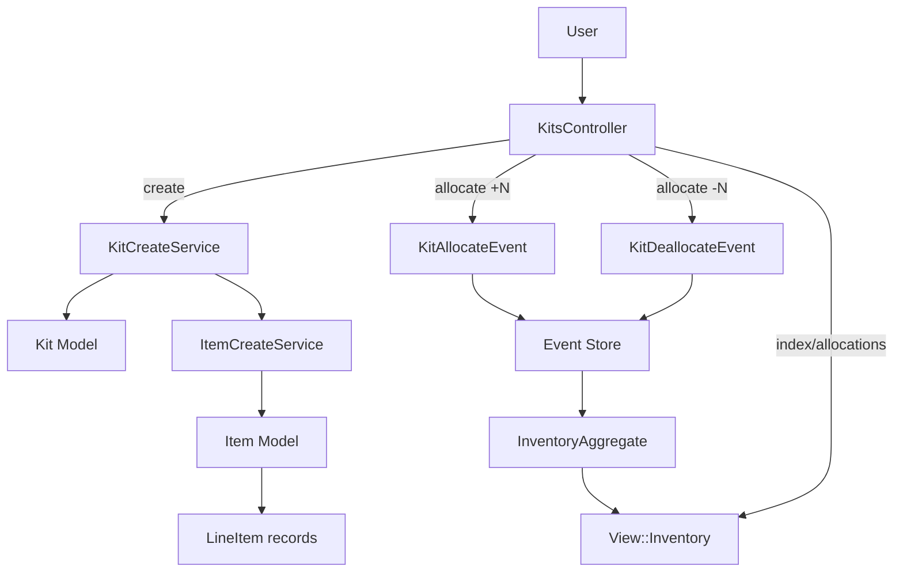
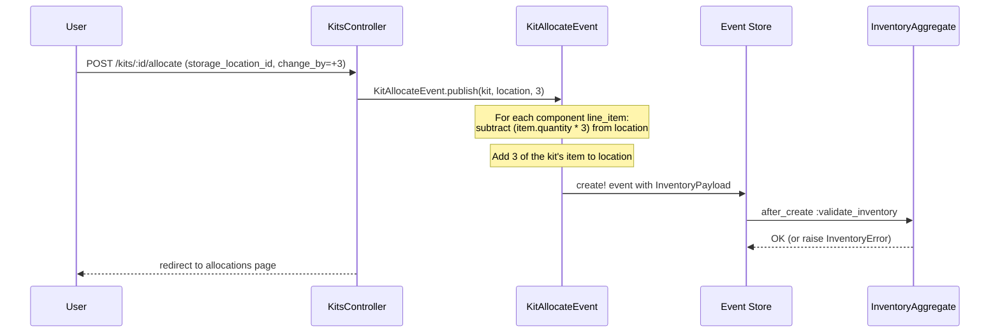
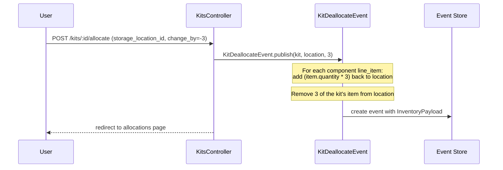
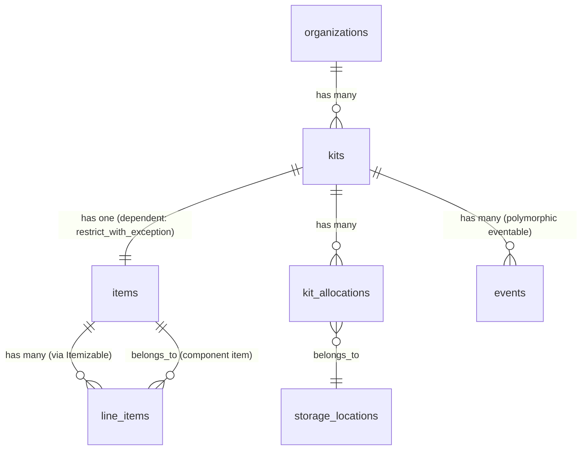

# Kits

> **Status**: Active
> **Generated**: 2026-06-13T00:00:00Z
> **Last Updated**: 2026-06-13T00:00:00Z

---

## Overview

### What It Does
Kits allow organizations to bundle multiple inventory items into a single reusable unit. A kit is a named template that defines a fixed composition of items (e.g., "Newborn Kit" containing 20 diapers, 5 wipes, and 2 onesies). Once created, kits can be allocated to storage locations, which atomically moves the component items out of loose inventory and creates kit-level inventory entries. Kits can also be deallocated, reversing the process.

### Why It Exists
Diaper banks and essentials organizations frequently distribute standardized bundles of items. Rather than manually assembling distributions item-by-item, kits let staff pre-define common bundles. This simplifies inventory management, speeds up distribution workflows, and ensures consistency across partner requests.

### Key Capabilities
- Create named kits composed of one or more items with specified quantities
- Allocate kits to storage locations (consumes component items, creates kit inventory)
- Deallocate kits from storage locations (returns component items, removes kit inventory)
- Activate/deactivate kits (with safety checks for remaining allocations and inactive items)
- Filter kits by name and active/inactive status
- Control partner visibility per kit
- Track dollar value per kit

---

## Architecture

### High-Level Design



### Kit Allocation Flow

When a user allocates N kits to a storage location, two things happen atomically via the event system:



### Kit Deallocation Flow

Deallocation is the reverse: component items return to the storage location, kit-level inventory decreases.



### Components

#### Backend Components
| Component | File Path | Purpose |
|-----------|-----------|---------|
| KitsController | `app/controllers/kits_controller.rb` | Handles CRUD, allocation, deactivation, reactivation |
| Kit | `app/models/kit.rb` | Kit model with activation/deactivation logic |
| KitCreateService | `app/services/kit_create_service.rb` | Transactional kit + item creation |
| KitAllocateEvent | `app/events/kit_allocate_event.rb` | Event-sourced kit allocation (component items out, kit item in) |
| KitDeallocateEvent | `app/events/kit_deallocate_event.rb` | Event-sourced kit deallocation (component items in, kit item out) |
| KitsHelper | `app/helpers/kits_helper.rb` | Deactivate button with tooltip logic |
| ItemCreateService | `app/services/item_create_service.rb` | Creates the Item record that represents the kit in inventory |

#### Frontend Components
| Component | File Path | Purpose |
|-----------|-----------|---------|
| Kit index view | `app/views/kits/index.html.erb` | Lists kits with filter form |
| Kit table partial | `app/views/kits/_table.html.erb` | Renders kit rows with items, allocations, and action buttons |
| Kit form partial | `app/views/kits/_form.html.erb` | Form for creating a new kit with line items |
| New kit view | `app/views/kits/new.html.erb` | New kit page wrapper |
| Allocations view | `app/views/kits/allocations.html.erb` | Kit allocation management with change summary and inline JS |

### Technology Stack
- **Backend**: Ruby on Rails, Event Sourcing (custom `Event` model with `Dry::Struct` payloads)
- **Frontend**: ERB templates, jQuery (inline `<script>` for allocation UI), AdminLTE layout
- **Database**: PostgreSQL with `kit_allocation_type` enum
- **Auditing**: PaperTrail (`has_paper_trail` on Kit model)

---

## Model Details

### Kit

#### Associations
```ruby
# Source: app/models/kit.rb
belongs_to :organization
has_one :item, dependent: :restrict_with_exception
```

**Note**: `dependent: :restrict_with_exception` means a kit cannot be destroyed if its associated Item record still exists. The Item record links the kit to the inventory system via line items.

#### Concerns
| Concern | Purpose |
|---------|---------|
| `Filterable` | Adds `class_filter` class method that applies named scopes from a params hash |
| `Valuable` | Adds `value_in_dollars` / `value_in_dollars=` accessors that convert to/from `value_in_cents`; validates `value_in_cents >= 0` |

#### Auditing
```ruby
# Source: app/models/kit.rb:15
has_paper_trail
```

#### Scopes
```ruby
# Source: app/models/kit.rb:22-24
scope :active, -> { where(active: true) }
scope :alphabetized, -> { order(:name) }
scope :by_name, ->(name) { where("name ILIKE ?", "%#{name}%") }
```

#### Validations
```ruby
# Source: app/models/kit.rb:26-27
validates :name, presence: true
validates :name, uniqueness: { scope: :organization }
```
Plus from `Valuable`:
```ruby
# Source: app/models/concerns/valuable.rb:5
validates :value_in_cents, numericality: { greater_than_or_equal_to: 0 }
```

#### Callbacks
None defined directly on Kit (deactivation/reactivation are explicit method calls, not callbacks).

#### Key Methods

| Method | Returns | Purpose | Notes |
|--------|---------|---------|-------|
| `can_deactivate?(inventory = nil)` | `Boolean` | Checks if kit quantity is zero across all storage locations | Accepts optional `View::Inventory` to avoid re-querying |
| `deactivate` | N/A | Sets `active: false` on both the Kit and its associated Item | Uses `update!` -- raises on failure |
| `can_reactivate?` | `Boolean` | Returns true only if none of the kit's component items are inactive | Prevents reactivating a kit whose components can't be tracked |
| `reactivate` | N/A | Sets `active: true` on both the Kit and its associated Item | Uses `update!` -- raises on failure |

```ruby
# Source: app/models/kit.rb:31-34
def can_deactivate?(inventory = nil)
  inventory ||= View::Inventory.new(organization_id)
  inventory.quantity_for(item_id: item.id).zero?
end

# Source: app/models/kit.rb:36-39
def deactivate
  update!(active: false)
  item.update!(active: false)
end

# Source: app/models/kit.rb:44-46
def can_reactivate?
  item.line_items.joins(:item).where(items: { active: false }).none?
end

# Source: app/models/kit.rb:48-51
def reactivate
  update!(active: true)
  item.update!(active: true)
end
```

### Item (Kit's associated record)

Each Kit has exactly one Item record (with `kit_id` foreign key). This Item acts as the kit's representation in the inventory system. The Item itself has line items that define the kit's composition.

```ruby
# Source: app/models/item.rb:38
belongs_to :kit, optional: true
```

The Item's `line_items` (polymorphic via `Itemizable`) define which actual items and quantities make up the kit.

### KitAllocateEvent

Inherits from `Event`. Published when allocating kits to a storage location.

```ruby
# Source: app/events/kit_allocate_event.rb:2-19
def self.event_line_items(kit, storage_location, quantity)
  items = kit.item.line_items.map do |item|
    EventTypes::EventLineItem.new(
      quantity: item.quantity * quantity,
      item_id: item.item_id,
      item_value_in_cents: item.item.value_in_cents,
      from_storage_location: storage_location,
      to_storage_location: nil
    )
  end
  items.push(EventTypes::EventLineItem.new(
    quantity: quantity,
    item_id: kit.item.id,
    item_value_in_cents: kit.item.value_in_cents,
    to_storage_location: storage_location,
    from_storage_location: nil
  ))
  items
end
```

**Key behavior**: For each component item, `from_storage_location` is set (items leave the location). For the kit item itself, `to_storage_location` is set (kit enters the location). Uses `create!` (raises on failure).

### KitDeallocateEvent

Inherits from `Event`. Published when deallocating kits from a storage location.

```ruby
# Source: app/events/kit_deallocate_event.rb:2-19
def self.event_line_items(kit, storage_location, quantity)
  items = kit.item.line_items.map do |item|
    EventTypes::EventLineItem.new(
      quantity: item.quantity * quantity,
      item_id: item.item_id,
      item_value_in_cents: item.item.value_in_cents,
      to_storage_location: storage_location,
      from_storage_location: nil
    )
  end
  items.push(EventTypes::EventLineItem.new(
    quantity: quantity,
    item_id: kit.item.id,
    item_value_in_cents: kit.item.value_in_cents,
    from_storage_location: storage_location,
    to_storage_location: nil
  ))
  items
end
```

**Key behavior**: The reverse of allocation. Component items go `to_storage_location` (returned), kit item goes `from_storage_location` (removed). Uses `create` (does NOT raise on failure -- note the difference from `KitAllocateEvent`).

### KitCreateService

Orchestrates transactional creation of a Kit plus its associated Item record.

```ruby
# Source: app/services/kit_create_service.rb:4-8
KIT_BASE_ITEM_ATTRS = {
  name: 'Kit',
  category: 'kit',
  partner_key: 'kit'
}
```

**Flow**:
1. Validates organization exists and kit params are valid
2. Opens a transaction
3. Creates the Kit record
4. Validates at least one line item is present
5. Finds or creates a BaseItem with partner_key `'kit'`
6. Delegates to `ItemCreateService` to create the Item record with the kit's line items and `kit_id`
7. On any error, rolls back the entire transaction

---

## Database Schema

### kits

| Column | Type | Default | Notes |
|--------|------|---------|-------|
| `id` | `bigint` | auto | Primary key |
| `name` | `string` | — | NOT NULL |
| `organization_id` | `integer` | — | NOT NULL, FK to organizations |
| `created_at` | `datetime` | — | NOT NULL |
| `updated_at` | `datetime` | — | NOT NULL |
| `active` | `boolean` | `true` | — |
| `visible_to_partners` | `boolean` | `true` | NOT NULL |
| `value_in_cents` | `integer` | `0` | — |

**Indexes**:
- `index_kits_on_name_and_organization_id` (UNIQUE) -- enforces name uniqueness per org
- `index_kits_on_organization_id`

### kit_allocations

| Column | Type | Default | Notes |
|--------|------|---------|-------|
| `id` | `bigint` | auto | Primary key |
| `organization_id` | `bigint` | — | NOT NULL, FK to organizations |
| `storage_location_id` | `bigint` | — | NOT NULL, FK to storage_locations |
| `kit_id` | `bigint` | — | NOT NULL, FK to kits |
| `created_at` | `datetime` | — | NOT NULL |
| `updated_at` | `datetime` | — | NOT NULL |
| `kit_allocation_type` | `enum(kit_allocation_type)` | `'inventory_in'` | NOT NULL; values: `inventory_in`, `inventory_out` |

**Indexes**:
- `index_kit_allocations_on_kit_id`
- `index_kit_allocations_on_organization_id`
- `index_kit_allocations_on_storage_location_id`

### items (relevant columns for kits)

The `items` table has a `kit_id` column (integer, nullable, indexed at `index_items_on_kit_id`) that links an Item record to its parent Kit.

### events (shared table for all event types)

Kit events are stored in the polymorphic `events` table with `type` = `'KitAllocateEvent'` or `'KitDeallocateEvent'` and `eventable_type` = `'Kit'`.

### Relationships



---

## API Endpoints

| Method | Path | Action | Description | Notes |
|--------|------|--------|-------------|-------|
| `GET` | `/kits` | `index` | List all kits with optional filters | Defaults to active only; `include_inactive_items` param shows all |
| `GET` | `/kits/new` | `new` | New kit form | |
| `POST` | `/kits` | `create` | Create a new kit | Delegates to `KitCreateService` |
| `GET` | `/kits/:id` | `show` | Show a kit | Redirects to `allocations` action |
| `GET` | `/kits/:id/allocations` | `allocations` | View kit allocation details and adjustment form | Member route |
| `POST` | `/kits/:id/allocate` | `allocate` | Allocate or deallocate kits at a storage location | Positive = allocate, negative = deallocate |
| `PUT` | `/kits/:id/deactivate` | `deactivate` | Deactivate a kit and its item | |
| `PUT` | `/kits/:id/reactivate` | `reactivate` | Reactivate a kit and its item | Fails if component items are inactive |

**Note**: There is no `edit` or `update` action. Kit composition is immutable after creation (as stated in the form: "You will not be able to change the composition of the kit once saved").

---

## Authorization

This application does not use Pundit policies. Authorization is handled at the controller level via `current_organization` scoping -- all kit queries are scoped to `current_organization.kits`, ensuring users can only access kits belonging to their organization.

---

## Configuration

### Environment Variables
No kit-specific environment variables.

### Feature Flags
- `enable_packs` (Flipper) -- Used by `ItemCreateService` to conditionally sync request units. Not directly kit-specific but affects the item creation during kit creation.

---

## Usage Examples

### Creating a Kit via KitCreateService
```ruby
# Source: app/services/kit_create_service.rb:21-57
def call
  return self unless valid?

  organization.transaction do
    # Create the Kit record
    line_items = kit_params.delete(:line_items_attributes)
    @kit = Kit.new(kit_params_with_organization)
    @kit.save!
    if line_items.blank?
      @kit.errors.add(:base, 'At least one item is required')
      raise ActiveRecord::RecordInvalid.new(@kit)
    end

    # Find or create the BaseItem for all items housing kits
    item_housing_a_kit_base_item = KitCreateService.find_or_create_kit_base_item!

    # Create the item
    item_creation = ItemCreateService.new(
      organization_id: organization.id,
      item_params: {
        line_items_attributes: line_items,
        name: kit.name,
        partner_key: item_housing_a_kit_base_item.partner_key,
        kit_id: kit.id
      }
    )

    item_creation_result = item_creation.call
    unless item_creation_result.success?
      raise item_creation_result.error
    end
  rescue StandardError => e
    errors.add(:base, e.message)
    raise ActiveRecord::Rollback
  end

  self
end
```

### Allocating Kits (Controller)
```ruby
# Source: app/controllers/kits_controller.rb:70-85
def allocate
  @kit = current_organization.kits.find(params[:id])
  @storage_location = current_organization.storage_locations.active.find(kit_adjustment_params[:storage_location_id])
  @change_by = kit_adjustment_params[:change_by].to_i
  begin
    if @change_by.positive?
      KitAllocateEvent.publish(@kit, @storage_location.id, @change_by)
    else
      KitDeallocateEvent.publish(@kit, @storage_location.id, -@change_by)
    end
  rescue => e
    flash[:error] = e.message
  end

  redirect_to allocations_kit_path(id: @kit.id)
end
```

### Deactivate Button Helper
```ruby
# Source: app/helpers/kits_helper.rb:2-15
def deactivate_kit_button(kit, inventory)
  options = {class: "deactivate-kit-button"}
  span_options = {}
  unless kit.can_deactivate?(inventory)
    msg = "Can't deactivate while a storage location still has kits."
    options[:enabled] = false
    span_options = {title: msg, class: "tooltip-target"}
  end
  tag.span(**span_options) do
    deactivate_button_to(deactivate_kit_path(kit),
      options.merge({text: "Deactivate",
        confirm: confirm_deactivate_msg(kit.name), size: "xs"}))
  end
end
```

---

## Testing

### Test Files

Test file discovery via glob timed out due to repo size. Expected test file locations based on Rails conventions:

- `spec/models/kit_spec.rb`
- `spec/controllers/kits_controller_spec.rb` or `spec/requests/kits_spec.rb`
- `spec/services/kit_create_service_spec.rb`
- `spec/events/kit_allocate_event_spec.rb`
- `spec/events/kit_deallocate_event_spec.rb`
- `spec/helpers/kits_helper_spec.rb`
- `spec/system/kit_system_spec.rb` (if system tests exist)

---

## Known Issues & Caveats

| Issue | Location | Description |
|-------|----------|-------------|
| Immutable kit composition | `app/views/kits/_form.html.erb:38` | Kits cannot be edited after creation -- no `edit` or `update` controller actions exist. The form warns: "You will not be able to change the composition of the kit once saved." |
| Asymmetric `create!` vs `create` | `app/events/kit_allocate_event.rb:23` vs `kit_deallocate_event.rb:23` | `KitAllocateEvent.publish` uses `create!` (raises on failure), while `KitDeallocateEvent.publish` uses `create` (silently fails). This means a failed deallocation event may not raise an error. |
| Snapshot validation bypass for Kit | `app/models/event.rb:48` | The `no_intervening_snapshot` validation explicitly skips Kit eventables (`return if eventable.is_a?(Kit)`), allowing kit events to be created even when a snapshot intervenes. |
| `show` action is a redirect | `app/controllers/kits_controller.rb:2-4` | `show` immediately redirects to `allocations` -- there is no dedicated show view. |
| `kit_allocations` table vs events | `db/schema.rb:442-452` | The `kit_allocations` table exists in the schema but no model or usage was found in the mapped kit files. It may be legacy or used elsewhere. |
| Deactivation not atomic | `app/models/kit.rb:36-39` | `deactivate` calls `update!` twice (once for kit, once for item) without wrapping in a transaction. If the second `update!` fails, the kit would be deactivated but its item would remain active. Same issue applies to `reactivate`. |
| Fallback view path in allocations | `app/views/kits/allocations.html.erb:63-69` | The allocations view has a fallback branch for `@item_inventories` that is never set by the controller (controller only sets `@inventory`). This appears to be dead code. |

---

## Performance

### Database Optimization
- **Unique index**: `index_kits_on_name_and_organization_id` -- prevents duplicate kit names per org at the database level
- **Organization index**: `index_kits_on_organization_id` -- fast lookup by org
- **Kit ID on items**: `index_items_on_kit_id` -- fast join from items to kits
- **Kit allocations indexes**: Indexed on `kit_id`, `organization_id`, and `storage_location_id`

### Query Optimization
The `index` action eager-loads associations to reduce N+1 queries:
```ruby
# Source: app/controllers/kits_controller.rb:7
@kits = current_organization.kits.includes(item: {line_items: :item}).class_filter(filter_params)
```

---

## Troubleshooting

### Common Issues

#### Issue: "Can't deactivate while a storage location still has kits"
**Symptoms:**
- The deactivate button is disabled with a tooltip message

**Cause:**
The kit still has allocated inventory at one or more storage locations. `can_deactivate?` checks that the kit's item quantity is zero across all locations.

**Solution:**
Deallocate all kit inventory from all storage locations via the Allocations page before deactivating.

#### Issue: "Cannot reactivate kit - it has inactive items!"
**Symptoms:**
- Reactivate button redirects with an alert message

**Cause:**
One or more of the kit's component items have been deactivated. Reactivating the kit would allow inventory changes on inactive items.

**Solution:**
Reactivate all component items first (via the Items management page), then reactivate the kit.

#### Issue: Kit creation fails with inventory validation error
**Symptoms:**
- Flash error: "Sorry, we weren't able to save the kit. Validation failed: ..."

**Cause:**
The `KitCreateService` wraps creation in a transaction. If the Item creation fails (e.g., duplicate name, invalid line items), the entire transaction rolls back.

**Solution:**
Check that the kit name is unique within the organization and that all selected items and quantities are valid.

---

## Related Features

- **[Items](./items.md)** -- Each kit creates an associated Item record; kit composition is defined via the item's line items
- **[Storage Locations](./storage-locations.md)** -- Kits are allocated to/deallocated from storage locations
- **[Inventory Events](./inventory-events.md)** -- Kit allocation/deallocation uses the event-sourcing system (`KitAllocateEvent`, `KitDeallocateEvent`)
- **[Distributions](./distributions.md)** -- Allocated kits appear as distributable items at storage locations

---

**Generated:** 2026-06-13T00:00:00Z
**Last Updated:** 2026-06-13T00:00:00Z
**Status:** Active
