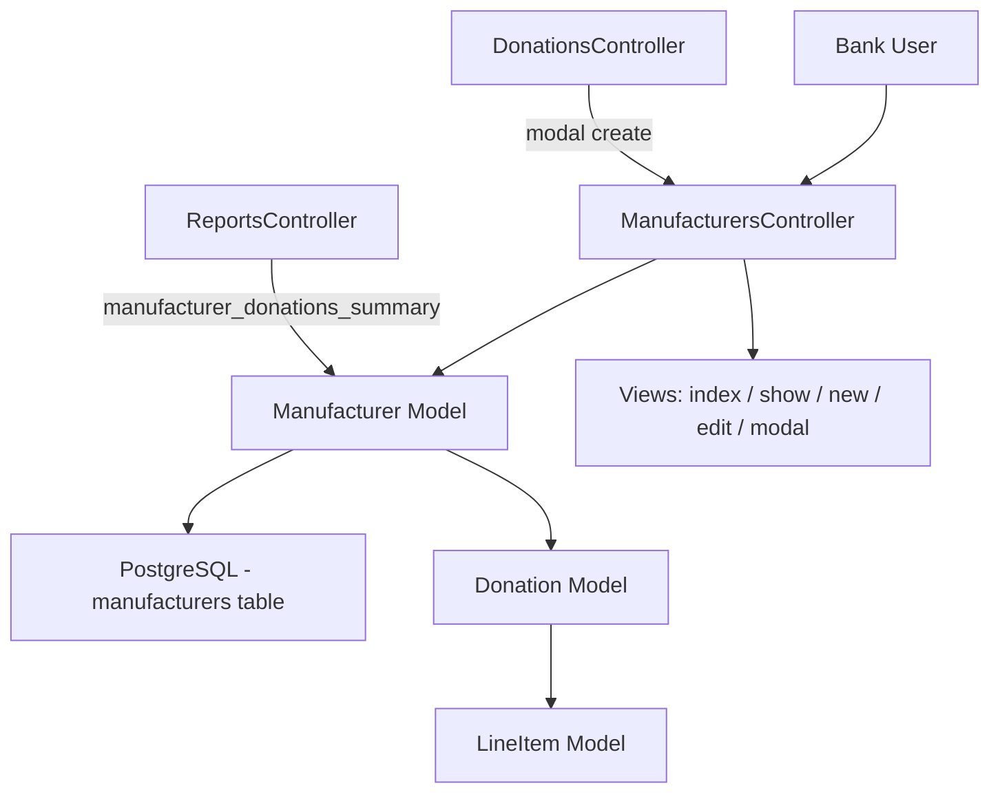
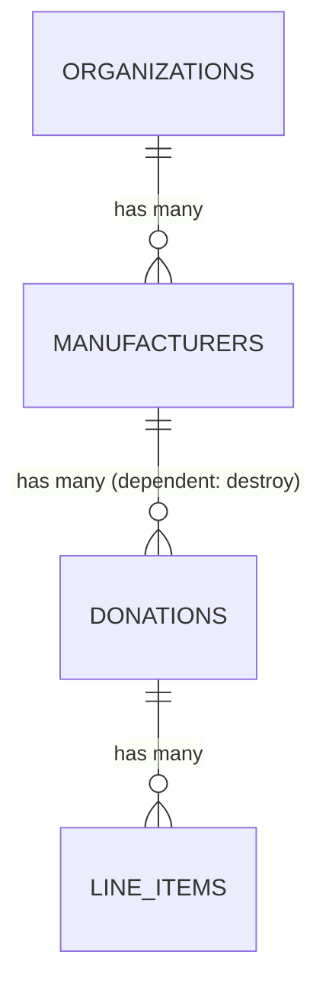

# Manufacturers

> **Status**: Active
> **Generated**: 2026-06-13T00:00:00Z
> **Last Updated**: 2026-06-13T00:00:00Z

---

## Overview

### What It Does
The Manufacturers feature allows essentials bank organizations to manage records of companies that donate goods directly. Each manufacturer belongs to a single organization and can be associated with multiple donations. The feature provides CRUD operations (except delete), volume tracking, and a CSV import route.

### Why It Exists
Essentials banks receive donations from manufacturers (e.g., diaper companies, hygiene product makers). Tracking manufacturers separately allows the bank to see donation history per manufacturer, generate reports on manufacturer donation summaries, and select a manufacturer as the source when recording a new donation.

### Key Capabilities
- Create, read, update manufacturer records (no destroy)
- Track total donated item volume per manufacturer via the `with_volumes` scope
- View past donations from a specific manufacturer on its show page
- Create manufacturers inline via a modal during donation entry
- CSV import route (defined in routes, but see Known Issues)
- Manufacturer donations summary report (in Reports feature)

---

## Architecture

### High-Level Design


### Components

#### Backend Components
| Component | File Path | Purpose |
|-----------|-----------|---------|
| ManufacturersController | `app/controllers/manufacturers_controller.rb` | CRUD actions (index, show, new, create, edit, update) |
| Manufacturer | `app/models/manufacturer.rb` | Model with validations, scopes, and donation association |
| ReportsController#manufacturer_donations_summary | `app/controllers/reports_controller.rb` | Report action that queries manufacturers by donation date |

#### Frontend Components (Views)
| Component | File Path | Purpose |
|-----------|-----------|---------|
| index | `app/views/manufacturers/index.html.erb` | Lists all manufacturers with volumes and CSV import modal |
| show | `app/views/manufacturers/show.html.erb` | Displays past donations from a specific manufacturer |
| new | `app/views/manufacturers/new.html.erb` | Full-page new manufacturer form |
| edit | `app/views/manufacturers/edit.html.erb` | Full-page edit manufacturer form |
| _form | `app/views/manufacturers/_form.html.erb` | Shared simple_form partial for new/edit |
| _manufacturer_row | `app/views/manufacturers/_manufacturer_row.html.erb` | Table row partial for index listing |
| _new_modal | `app/views/manufacturers/_new_modal.html.erb` | Bootstrap modal wrapper for inline creation |
| new_modal.js.erb | `app/views/manufacturers/new_modal.js.erb` | JS response to render modal into DOM |
| create.js.erb | `app/views/manufacturers/create.js.erb` | JS response after successful modal create; updates donation form dropdown |

---

## Model Details

### Manufacturer

#### Associations
```ruby
# Source: app/models/manufacturer.rb
belongs_to :organization
has_many :donations, inverse_of: :manufacturer, dependent: :destroy
has_many :line_items, through: :donations
```

Note: `dependent: :destroy` on `has_many :donations` means deleting a manufacturer would cascade-delete all associated donations. However, the `:destroy` route is excluded from the resource routes, so this cascade cannot be triggered through the UI.

#### Concerns
| Concern | Purpose |
|---------|---------|
| `has_paper_trail` | Versioning via PaperTrail gem -- tracks all changes to manufacturer records |

The model does NOT include any other concerns (no Filterable, Exportable, Provideable, etc.).

#### Callbacks
No explicit callbacks are defined on the Manufacturer model.

#### Validations
```ruby
# Source: app/models/manufacturer.rb:20
validates :name, presence: true, uniqueness: { scope: :organization, message: 'Manufacturer already exists' }
```

#### Scopes
```ruby
# Source: app/models/manufacturer.rb:22
scope :alphabetized, -> { order(:name) }

# Source: app/models/manufacturer.rb:24-28
scope :with_volumes, -> {
  left_joins(donations: :line_items)
    .select("manufacturers.*, SUM(COALESCE(line_items.quantity, 0)) AS volume")
    .group(:id)
}
```

#### Key Methods
| Method | Returns | Purpose | Notes |
|--------|---------|---------|-------|
| `self.by_donation_date(count = 10, date_range = nil)` | `ActiveRecord::Relation` | Returns manufacturers with donations in the given date range, sorted by most recent donation date descending | Used by `ReportsController#manufacturer_donations_summary` |

Full method:
```ruby
# Source: app/models/manufacturer.rb:30-39
def self.by_donation_date(count = 10, date_range = nil)
  # selects manufacturers that have donation qty > 0 in the provided date range
  # and sorts them by the date of the most recent donation
  joins(donations: :line_items).where(donations: { issued_at: date_range })
    .select('manufacturers.*, sum(line_items.quantity) as donation_count, max(donations.issued_at) as donation_date')
    .group('manufacturers.id')
    .having('sum(line_items.quantity) > 0')
    .order('donation_date DESC')
    .limit(count)
end
```

---

## Database Schema

### manufacturers

| Column | Type | Default | Notes |
|--------|------|---------|-------|
| `id` | `bigint` | auto-increment | Primary key |
| `name` | `string` | `NULL` | Manufacturer name; validated present + unique per org |
| `organization_id` | `bigint` | `NULL` | Foreign key to `organizations` |
| `created_at` | `datetime` | — | Not null |
| `updated_at` | `datetime` | — | Not null |

#### Indexes
| Index Name | Columns | Unique |
|------------|---------|--------|
| `index_manufacturers_on_organization_id` | `organization_id` | No |

#### Foreign Keys
```sql
-- Source: db/schema.rb
add_foreign_key "donations", "manufacturers"
add_foreign_key "manufacturers", "organizations"
```

### Relationships


---

## API Endpoints

| Method | Path | Action | Description | Notes |
|--------|------|--------|-------------|-------|
| `GET` | `/manufacturers` | `index` | List all manufacturers with volumes | Sorted alphabetically |
| `GET` | `/manufacturers/new` | `new` | New manufacturer form | Supports XHR for modal |
| `POST` | `/manufacturers` | `create` | Create a manufacturer | Responds to HTML and JS (modal) |
| `GET` | `/manufacturers/:id` | `show` | Show manufacturer with donation history | Eager-loads donations |
| `GET` | `/manufacturers/:id/edit` | `edit` | Edit manufacturer form | |
| `PATCH/PUT` | `/manufacturers/:id` | `update` | Update manufacturer name | |
| `POST` | `/manufacturers/import_csv` | `import_csv` | CSV import of manufacturers | Route defined but action missing -- see Known Issues |

The `destroy` action is explicitly excluded (`resources :manufacturers, except: [:destroy]`).

### Related Report Endpoint
| Method | Path | Action | Description |
|--------|------|--------|-------------|
| `GET` | `/reports/manufacturer_donations_summary` | `ReportsController#manufacturer_donations_summary` | Summary of donations grouped by manufacturer |

---

## Authorization

The ManufacturersController inherits from `ApplicationController`. There is no dedicated `ManufacturerPolicy` file. Authorization is handled at the `ApplicationController` level which verifies the user belongs to the current organization (via `current_organization` scoping). All queries are scoped through `current_organization.manufacturers`, preventing cross-organization data access.

No Pundit policy class exists for Manufacturer.

---

## Configuration

### Environment Variables
No feature-specific environment variables.

### Config Files
No feature-specific configuration files. The feature relies on standard Rails and PaperTrail configuration.

---

## Usage Examples

### Creating a Manufacturer via the Modal (from Donation Form)
When a user creates a donation and selects "Create new Manufacturer", the system renders a modal. After successful creation, the JS response updates the donation form's manufacturer dropdown:

```erb
<%# Source: app/views/manufacturers/create.js.erb %>
<% flash.discard %>
$("#modal_new").modal("hide");
$("#donation_manufacturer_id").empty();
$("#donation_manufacturer_id").
html('<%= j options_from_collection_for_select(current_organization.manufacturers, :id, :name) %>');
$("#donation_manufacturer_id").append('<option value="">---Create new Manufacturer---</option>');
$("#donation_manufacturer_id").val('<%= @manufacturer[:id] %>');
```

### Index Page with Volume Tracking
The index action uses the `with_volumes` scope to compute total donated quantities per manufacturer:
```ruby
# Source: app/controllers/manufacturers_controller.rb:3
def index
  @manufacturers = current_organization.manufacturers.with_volumes.alphabetized
end
```

Each row displays the manufacturer name and volume:
```erb
<%# Source: app/views/manufacturers/_manufacturer_row.html.erb %>
<tr>
  <td><%= manufacturer_row&.name %></td>
  <td class="numeric"><%= manufacturer_row&.volume %></td>
  <td class="text-right">
    <%= view_button_to manufacturer_row %>
    <%= edit_button_to edit_manufacturer_path(manufacturer_row) %>
  </td>
</tr>
```

### Controller Strong Parameters
```ruby
# Source: app/controllers/manufacturers_controller.rb:50-53
def manufacturer_params
  params.require(:manufacturer)
        .permit(:name)
end
```

Only the `name` attribute is permitted. No other fields are editable through the UI.

---

## Testing

### Test Files
- `spec/models/manufacturer_spec.rb` -- Model validations, scopes (`with_volumes`), methods (`by_donation_date`), and PaperTrail versioning
- `spec/system/manufacturer_system_spec.rb` -- System tests for index, create, update, and show pages
- `spec/requests/reports/manufacturer_donations_summary_spec.rb` -- Request spec for the manufacturer donations summary report
- `spec/factories/manufacturers.rb` -- FactoryBot factory definition

### Key Test Cases
- **Validations**: name presence, uniqueness within organization
- **`with_volumes` scope**: aggregates donation line item quantities per manufacturer, handles multiple donations, isolates per manufacturer
- **`by_donation_date`**: filters by date range, orders by most recent donation, excludes manufacturers with no donations in range
- **System tests**: alphabetical ordering on index, create success/failure, update success/failure, show page with donation history
- **Report request spec**: total received donations count, per-manufacturer counts, ordering by recency

### Factory
```ruby
# Source: spec/factories/manufacturers.rb
FactoryBot.define do
  factory :manufacturer do
    organization { Organization.try(:first) || create(:organization) }
    sequence(:name) { |n| "Dont test this #{n}" }
  end
end
```

---

## Known Issues & Caveats

| Issue | Location | Description |
|-------|----------|-------------|
| Route without action | `config/routes.rb:174-176` | `post :import_csv` is defined on the manufacturers resource collection, but `ManufacturersController` does not `include Importable` and has no `import_csv` action. The `Manufacturer` model also does not include the `Provideable` concern that defines `self.import_csv`. Hitting this route will raise `AbstractController::ActionNotFound`. |
| No destroy route | `config/routes.rb:173` | `except: [:destroy]` prevents deletion, but the model has `dependent: :destroy` on donations -- if a manufacturer were deleted via console, all its donations would be cascade-destroyed. |
| Nested simple_form | `app/views/manufacturers/_form.html.erb:1,12` | The form partial opens `simple_form_for` twice -- once on line 1 (with `remote: request.xhr?`) and again on line 12 (with `class: 'form-horizontal'`). This produces nested `<form>` tags, which is invalid HTML. The outer form likely does nothing; the inner form handles submission. |
| Title mismatch on new page | `app/views/manufacturers/new.html.erb:5` | The `content_for :title` says "Edit - Manufacturers" but the page heading says "New Manufacturer". The title tag will show "Edit" for the new page. |
| Only `name` is permitted | `app/controllers/manufacturers_controller.rb:51-53` | Despite the CSV import modal text mentioning "emails and phone numbers", the manufacturers table only has a `name` column. The import modal text (inherited from a shared partial) is misleading. |

---

## Performance

### Database Optimization
- **Index**: `index_manufacturers_on_organization_id` on `manufacturers.organization_id` supports the `current_organization.manufacturers` lookup.
- **`with_volumes` scope**: Uses `LEFT JOIN` with `line_items` through `donations` and `GROUP BY` to compute volumes in a single query rather than N+1.
- **`by_donation_date`**: Uses `INNER JOIN` with aggregate functions and `HAVING` to filter and sort in a single query.
- **Show action**: Uses `.includes(:donations)` to eager-load donations and avoid N+1 when rendering the donation table.

---

## Troubleshooting

### Common Issues

#### Issue: CSV Import Fails with ActionNotFound
**Symptoms:**
- Clicking "Import CSV" on the manufacturers index page results in a routing error or 500.

**Cause:**
The route `POST /manufacturers/import_csv` is defined, but the controller does not include the `Importable` concern and the model lacks the `import_csv` class method.

**Solution:**
Add `include Importable` to `ManufacturersController` and either add `include Provideable` to the `Manufacturer` model or define a `self.import_csv` class method.

#### Issue: Duplicate Manufacturer Name Error
**Symptoms:**
- "Manufacturer already exists" validation error when creating/updating.

**Cause:**
The `name` field is validated unique within an organization scope. A manufacturer with the same name already exists for this organization.

**Solution:**
Use a different name or find and edit the existing manufacturer.

---

## Related Features

- **[Donations](./donations.md)** -- Manufacturers are a donation source; `Donation` belongs_to `:manufacturer` (optional). The donation form allows inline manufacturer creation via modal.
- **[Reports](./reports.md)** -- `ReportsController#manufacturer_donations_summary` provides a summary report of donations grouped by manufacturer within a date range.

---

**Generated:** 2026-06-13T00:00:00Z
**Last Updated:** 2026-06-13T00:00:00Z
**Status:** Active
