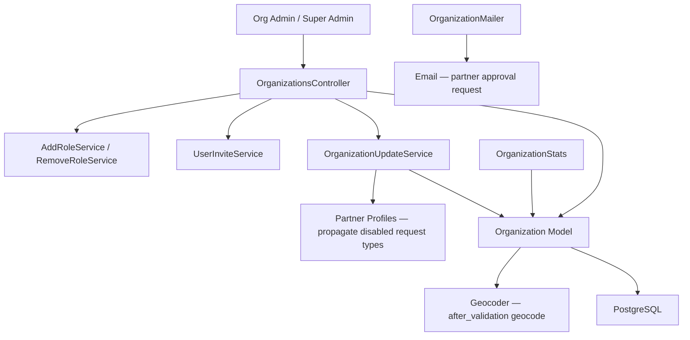
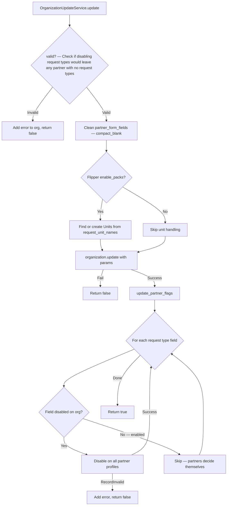

# Organizations

> **Status**: Active
> **Generated**: 2026-06-13T00:00:00Z
> **Last Updated**: 2026-06-13T00:00:00Z

---

## Overview

### What It Does
The Organizations feature manages the core organization (essentials bank) entity in Human Essentials. Each organization represents a diaper bank or essentials bank that coordinates donations, distributions, partners, and inventory. This feature provides the settings page where org admins configure their organization's profile, partner request types, email templates, printing preferences, export options, and user management (invite, promote, demote, remove).

### Why It Exists
Human Essentials is a multi-tenant application where each essentials bank operates independently. The organization record is the central tenant entity that scopes nearly every other resource in the system. Org admins need a self-service settings page to configure how their bank operates, what partner request types are available, how reminder/distribution emails are composed, and who has access.

### Key Capabilities
- View and edit organization profile (name, address, email, URL, logo, NDBN membership)
- Configure default storage locations (intake and general)
- Control partner approval workflow (one-step invite, partner form sections, invitation text)
- Enable/disable partner request types (child-based, individual, quantity-based)
- Configure custom request units (behind `enable_packs` feature flag)
- Set reminder schedules and deadline days for partner reminders
- Customize distribution email content and reminder email text (rich text via Action Text)
- Toggle printing options (YTD on printout, signature lines, value/package column visibility)
- Toggle export options (in-kind values, packages in distribution export)
- Manage organization users: invite, resend invitation, promote to org admin, demote to user, remove

---

## Architecture

### High-Level Design



### Components

#### Backend Components

| Component | File Path | Purpose |
|-----------|-----------|---------|
| OrganizationsController | `app/controllers/organizations_controller.rb` | Show/edit org settings, user management actions |
| Organization | `app/models/organization.rb` | Core tenant model with validations, associations, scopes |
| OrganizationStats | `app/models/organization_stats.rb` | Dashboard stat macros (partner count, storage locations, donation sites) |
| OrganizationUpdateService | `app/services/organization_update_service.rb` | Handles org update with partner flag propagation and validation |
| OrganizationHelper | `app/helpers/organization_helper.rb` | Logo display and partner field label lookup |
| OrganizationMailer | `app/mailers/organization_mailer.rb` | Sends partner approval request email to org |
| Geocodable (concern) | `app/models/concerns/geocodable.rb` | Geocodes address after validation |

#### Frontend Components

| Component | File Path | Purpose |
|-----------|-----------|---------|
| Show view | `app/views/organizations/show.html.erb` | Displays org settings with details partial and users table |
| Edit view | `app/views/organizations/edit.html.erb` | Form for editing all org settings (simple_form) |
| Details partial | `app/views/organizations/_details.html.erb` | Read-only display of all org configuration sections |
| Header partial | `app/views/organizations/_header.html.erb` | Page header with breadcrumbs |
| Approval email (HTML) | `app/views/organization_mailer/partner_approval_request.html.erb` | HTML email for partner approval |
| Approval email (text) | `app/views/organization_mailer/partner_approval_request.text.erb` | Plain text email for partner approval |

### Technology Stack
- **Backend**: Ruby on Rails, Devise (authentication), Rolify (roles), PaperTrail (audit trail), Geocoder, Flipper (feature flags)
- **Frontend**: ERB templates, simple_form, Trix rich text editor (Action Text), Select2 (partner form fields, request units)
- **Database**: PostgreSQL
- **External Services**: Geocoding provider (via Geocoder gem, skipped in development)

---

## Model Details

### Organization

#### Associations

```ruby
# Source: app/models/organization.rb

belongs_to :account_request, optional: true
belongs_to :ndbn_member, class_name: 'NDBNMember', optional: true

# All of the following have dependent: :destroy
has_many :adjustments
has_many :annual_reports
has_many :audits
has_many :product_drive_participants
has_many :product_drives
has_many :donation_sites
has_many :donations
has_many :items
has_many :item_categories
has_many :manufacturers
has_many :partners
has_many :partner_groups
has_many :purchases
has_many :requests
has_many :storage_locations
has_many :tags
has_many :product_drive_tags, -> { by_type("ProductDrive") },
  class_name: "Tag", inverse_of: false
has_many :inventory_items, through: :storage_locations
has_many :kits
has_many :transfers
has_many :users, -> { distinct }, through: :roles
has_many :vendors
has_many :request_units, class_name: 'Unit'

# Custom block associations (also dependent: :destroy)
has_many :barcode_items, dependent: :destroy do
  def all
    unscope(where: :organization_id).where("barcode_items.organization_id = ? OR barcode_items.barcodeable_type = ?", proxy_association.owner.id, "BaseItem")
  end
end
has_many :distributions, dependent: :destroy do
  def upcoming
    this_week.scheduled.where(issued_at: Time.zone.today..)
  end
end

has_rich_text :default_email_text
has_rich_text :reminder_email_text
has_one_attached :logo

accepts_nested_attributes_for :users, :account_request, :request_units
```

#### Concerns

| Concern | Purpose |
|---------|---------|
| `Geocodable` | Adds `geocoded_by :address` and `after_validation :geocode` (skipped in development) |
| `has_paper_trail` | Adds PaperTrail version tracking for audit history |
| `resourcify` | Rolify concern — makes Organization a role resource (users have roles scoped to orgs) |
| `filterrific` | Adds filterable search with `search_name` filter |

#### Callbacks

| Callback | Method | Purpose |
|----------|--------|---------|
| `before_save` | `:save_reminder_schedule_definition` | Serializes `ReminderScheduleService` to iCal string in `reminder_schedule_definition` |
| `after_create` | (inline block) | Updates associated `account_request` status to `"admin_approved"` |
| `after_validation` | `:geocode` (from Geocodable) | Geocodes address when address fields change (non-development only) |

#### Validations

| Validation | Field(s) | Rule |
|------------|----------|------|
| `presence` | `name` | Name is required |
| `format` | `url` | Must match `URI::DEFAULT_PARSER.make_regexp`; allows blank |
| `format` | `email` | Must match `URI::MailTo::EMAIL_REGEXP`; allows blank |
| `numericality` | `deadline_day` | Integer, 1..28, allows nil |
| custom | `logo` | Must be JPEG or PNG MIME type (`correct_logo_mime_type`) |
| custom | `logo` | Must be under 1 MB (`logo_size_check`, only if attached) |
| custom | request types | At least one of `enable_child_based_requests`, `enable_individual_requests`, `enable_quantity_based_requests` must be true (`some_request_type_enabled`) |
| custom | reminder schedule | If filled out, must be valid and reminder day must differ from deadline day (`reminder_schedule_is_empty_or_valid?`) |

#### Scopes

| Scope | Purpose |
|-------|---------|
| `alphabetized` | `order(:name)` |
| `search_name(query)` | Case-insensitive ILIKE on `name` |
| `is_active` | Organizations with at least one user who signed in within the last 4 months |

#### Key Methods

| Method | Returns | Purpose | Notes |
|--------|---------|---------|-------|
| `address` | `String` | Composes full address from `street`, `city`, `state`, `zipcode` | |
| `address_changed?` | `Boolean` | True if any address component changed | |
| `partials_to_show` | `Array` | Returns `partner_form_fields` or all partials if blank | |
| `valid_items` | `Array<Hash>` | Active, visible items as `{id:, partner_key:, name:}` | |
| `item_id_to_display_string_map` | `Hash` | Maps item ID to item name | |
| `from_email` | `String` | Org email, or a random org admin's email if blank | Falls back to `get_admin_email` |
| `earliest_reporting_year` | `Integer` | Earliest year from org creation or first donation/purchase/distribution | |
| `display_last_distribution_date` | `String` | Formatted date or `"No distributions"` | |
| `reminder_schedule` | `ReminderScheduleService` | Lazily builds from iCal definition or defaults to today | Memoized via `@reminder_schedule_service` |
| `seed_items(item_collection)` | `Organization` | Creates items from collection, handles duplicates | Used in seeding |
| `flipper_id` | `String` | Returns `"Org:#{id}"` for Flipper feature flag targeting | |
| `assign_attributes_from_account_request(account_request)` | `Organization` | Populates name, url, email from an AccountRequest | Returns self |

#### Constants

```ruby
# Source: app/models/organization.rb:46
DIAPER_APP_LOGO = Rails.public_path.join("img", "humanessentials_logo.png")

# Source: app/models/organization.rb:116-127
ALL_PARTIALS = [
  ['Media Information', 'media_information'],
  ['Agency Stability', 'agency_stability'],
  ['Organizational Capacity', 'organizational_capacity'],
  ['Sources of Funding', 'sources_of_funding'],
  ['Area Served', 'area_served'],
  ['Population Served', 'population_served'],
  ['Contacts', 'contacts'],
  ['Pickup Person', 'pick_up_person'],
  ['Agency Distribution Information', 'agency_distribution_information'],
  ['Attached Documents', 'attached_documents']
].freeze
```

### OrganizationStats

A plain Ruby class (not an ActiveRecord model) that provides dashboard statistics.

```ruby
# Source: app/models/organization_stats.rb
class OrganizationStats
  delegate :partners,
           :storage_locations,
           :donation_sites,
           to: :current_organization, allow_nil: true

  def initialize(organization, inventory)
    @current_organization = organization
    @inventory = inventory
  end

  def partners_added
    partners&.length || 0
  end

  def storage_locations_added
    storage_locations&.length || 0
  end

  def donation_sites_added
    donation_sites&.length || 0
  end

  def num_locations_with_inventory
    return 0 unless storage_locations
    storage_locations.count { |loc| inventory.quantity_for(storage_location: loc.id).positive? }
  end
end
```

---

## Database Schema

### organizations

| Column | Type | Default | Notes |
|--------|------|---------|-------|
| `id` | `serial` (integer) | auto-increment | Primary key |
| `name` | `string` | | Organization name |
| `email` | `string` | | Contact email |
| `url` | `string` | | Website URL |
| `created_at` | `datetime` | | Not null |
| `updated_at` | `datetime` | | Not null |
| `intake_location` | `integer` | | FK to storage_locations (integer, not formal FK) |
| `street` | `string` | | Address street |
| `city` | `string` | | Address city |
| `state` | `string` | | Address state |
| `zipcode` | `string` | | Address zip code |
| `latitude` | `float` | | Geocoded latitude |
| `longitude` | `float` | | Geocoded longitude |
| `reminder_day` | `integer` | | Legacy reminder day (replaced by reminder_schedule_definition) |
| `deadline_day` | `integer` | | Day of month for partner request deadline |
| `invitation_text` | `text` | | Custom partner invitation message |
| `default_storage_location` | `integer` | | FK to storage_locations (integer, not formal FK) |
| `partner_form_fields` | `text[]` | `[]` | Array of partner profile section keys |
| `account_request_id` | `integer` | | FK to account_requests |
| `repackage_essentials` | `boolean` | `false` | Not null. Annual survey: does bank repackage? |
| `distribute_monthly` | `boolean` | `false` | Not null. Annual survey: does bank distribute monthly? |
| `ndbn_member_id` | `bigint` | | FK to ndbn_members |
| `enable_child_based_requests` | `boolean` | `true` | Not null. Allow child-based partner requests |
| `enable_individual_requests` | `boolean` | `true` | Not null. Allow individual-based partner requests |
| `enable_quantity_based_requests` | `boolean` | `true` | Not null. Allow quantity-based partner requests |
| `ytd_on_distribution_printout` | `boolean` | `true` | Not null. Show YTD on distribution PDF |
| `one_step_partner_invite` | `boolean` | `false` | Not null. Skip separate approval after partner invite |
| `hide_value_columns_on_receipt` | `boolean` | `false` | Hide value columns on distribution/donation printout |
| `hide_package_column_on_receipt` | `boolean` | `false` | Hide package column on distribution printout |
| `signature_for_distribution_pdf` | `boolean` | `false` | Include signature lines on distribution PDF |
| `receive_email_on_requests` | `boolean` | `false` | Not null. Email org when partner makes request |
| `include_in_kind_values_in_exported_files` | `boolean` | `false` | Not null. Include in-kind values in CSV exports |
| `reminder_schedule_definition` | `string` | | iCal RRULE string for reminder schedule |
| `include_packages_in_distribution_export` | `boolean` | `false` | Not null. Include packages in distribution CSV |
| `bank_is_set_up` | `boolean` | `false` | Not null. Indicates org setup is complete |

**Indexes:**
- `index_organizations_on_latitude_and_longitude` on `(latitude, longitude)`

**Ignored columns (pending migration):**
- `short_name` — marked in `self.ignored_columns` with TODO to remove after migration `20250504183911` runs in production

### Relationships

```mermaid
erDiagram
    organizations ||--o| account_requests : "belongs_to (optional)"
    organizations ||--o| ndbn_members : "belongs_to (optional)"
    organizations ||--o{ adjustments : "has_many (dependent: destroy)"
    organizations ||--o{ annual_reports : "has_many (dependent: destroy)"
    organizations ||--o{ audits : "has_many (dependent: destroy)"
    organizations ||--o{ barcode_items : "has_many (dependent: destroy)"
    organizations ||--o{ distributions : "has_many (dependent: destroy)"
    organizations ||--o{ donations : "has_many (dependent: destroy)"
    organizations ||--o{ donation_sites : "has_many (dependent: destroy)"
    organizations ||--o{ items : "has_many (dependent: destroy)"
    organizations ||--o{ item_categories : "has_many (dependent: destroy)"
    organizations ||--o{ kits : "has_many (dependent: destroy)"
    organizations ||--o{ manufacturers : "has_many (dependent: destroy)"
    organizations ||--o{ partners : "has_many (dependent: destroy)"
    organizations ||--o{ partner_groups : "has_many (dependent: destroy)"
    organizations ||--o{ product_drives : "has_many (dependent: destroy)"
    organizations ||--o{ product_drive_participants : "has_many (dependent: destroy)"
    organizations ||--o{ purchases : "has_many (dependent: destroy)"
    organizations ||--o{ requests : "has_many (dependent: destroy)"
    organizations ||--o{ storage_locations : "has_many (dependent: destroy)"
    organizations ||--o{ tags : "has_many (dependent: destroy)"
    organizations ||--o{ transfers : "has_many (dependent: destroy)"
    organizations ||--o{ vendors : "has_many (dependent: destroy)"
    organizations ||--o{ units : "has_many (dependent: destroy) as request_units"
    organizations }o--o{ users : "has_many through: roles (distinct)"
```



---

## API Endpoints

> Routes are defined as a singular `resource :organization` (member-only, no index/create/destroy).

| Method | Path | Action | Description | Notes |
|--------|------|--------|-------------|-------|
| `GET` | `/organization` | `show` | Display org settings and users list | Any org user or super admin |
| `GET` | `/manage/edit` | `edit` | Edit org settings form | Org admin only |
| `PATCH/PUT` | `/manage` | `update` | Update org settings | Org admin only |
| `POST` | `/manage/invite_user` | `invite_user` | Invite a new user to the org | Org admin only |
| `POST` | `/manage/remove_user` | `remove_user` | Remove a user from the org | Org admin only |
| `POST` | `/manage/resend_user_invitation` | `resend_user_invitation` | Resend invitation email to a user | Org admin only |
| `POST` | `/manage/promote_to_org_admin` | `promote_to_org_admin` | Promote user to org admin role | Org admin only |
| `POST` | `/manage/demote_to_user` | `demote_to_user` | Demote org admin to regular user | Org admin only |

---

## Authorization

This feature does NOT use Pundit policies. Authorization is handled via `before_action` callbacks in the controller:

| Callback | Actions | Logic |
|----------|---------|-------|
| `authorize_admin` | All except `show` | Defined in `ApplicationController`; requires org admin or super admin role |
| `authorize_user` | `show` only | Checks `current_user.has_cached_role?(Role::SUPER_ADMIN)` OR `current_user.has_cached_role?(Role::ORG_USER, current_organization)` |

Additional authorization within actions:

| Action | Guard | Effect |
|--------|-------|--------|
| `promote_to_org_admin` | `user.has_role?(Role::ORG_USER, current_organization)` | Raises `ActiveRecord::RecordNotFound` if user is not an org user |
| `demote_to_user` | `user.has_role?(Role::ORG_ADMIN, current_organization)` | Raises `ActiveRecord::RecordNotFound` if user is not an org admin |
| `remove_user` | `user.has_role?(Role::ORG_USER, current_organization)` | Raises `ActiveRecord::RecordNotFound` if user is not an org user |

---

## Service Layer

### OrganizationUpdateService

Handles the update flow with partner flag propagation logic.



Key behavior: When an org **disables** a request type, it is propagated to all partner profiles. When an org **enables** a request type, it is NOT automatically enabled on partners -- partners must opt in themselves (per issue #3264).

---

## Configuration

### Feature Flags (Flipper)

| Flag | Effect |
|------|--------|
| `enable_packs` | When enabled, shows custom request units UI on org edit form and processes `request_unit_names` on update |

### Organization Settings (self-configured)

The organization edit form exposes the following configuration sections:

1. **Basic information** — name, NDBN member, URL, email, address, logo
2. **Storage** — default intake location, default storage location
3. **Partner approval process** — one-step invite, custom invitation text, partner profile sections
4. **Request types** — child-based, individual, quantity-based requests; custom request units
5. **Other emails** — reminder schedule, deadline day, reminder email text, distribution email text, receive email on requests
6. **Printing** — YTD on printout, signature lines, hide value columns, hide package column
7. **Exports** — in-kind values in exports, packages in distribution export
8. **Annual Survey** — repackage essentials, distribute monthly

---

## Usage Examples

### Organization Update Flow (Controller)

```ruby
# Source: app/controllers/organizations_controller.rb:18-27
def update
  @organization = current_organization
  @organization.reminder_schedule.assign_attributes(reminder_schedule_params)
  if OrganizationUpdateService.update(@organization, organization_params)
    redirect_to organization_path, notice: "Updated your organization!"
  else
    flash.now[:error] = @organization.errors.full_messages.join("\n")
    render :edit
  end
end
```

### Inviting a User

```ruby
# Source: app/controllers/organizations_controller.rb:29-37
def invite_user
  UserInviteService.invite(email: params[:email],
    name: params[:name],
    roles: [Role::ORG_USER],
    resource: Organization.find(params[:org]))
  redirect_to organization_path, notice: "User invited to organization!"
rescue => e
  redirect_to organization_path, alert: e.message
end
```

### Request Type Formatter (private helper)

```ruby
# Source: app/controllers/organizations_controller.rb:117-131
def request_type_formatter(params)
  if params[:organization][:enable_individual_requests] == "false"
    params[:organization][:enable_child_based_requests] = false
  end

  if params[:organization][:enable_child_based_requests] == "false"
    params[:organization][:enable_individual_requests] = false
  end

  if params[:organization][:enable_quantity_based_requests] == "false"
    params[:organization][:enable_quantity_based_requests] = false
  end

  params
end
```

### OrganizationMailer — Partner Approval Request

```ruby
# Source: app/mailers/organization_mailer.rb
class OrganizationMailer < ApplicationMailer
  default from: "Please do not reply to this email as this mail box is not monitored — Human Essentials <no-reply@humanessentials.app>"

  def partner_approval_request(organization:, partner:)
    @partner = partner
    @organization = organization

    mail to: @organization.email, subject: "[Action Required] Approval requested for #{@partner.name}"
  end
end
```

---

## Testing

### Test Files

| File | Type | Purpose |
|------|------|---------|
| `spec/models/organization_spec.rb` | Unit | Organization model validations, associations, methods |
| `spec/models/organization_stats_spec.rb` | Unit | OrganizationStats dashboard stat methods |
| `spec/services/organization_update_service_spec.rb` | Unit | Update service with partner flag propagation |
| `spec/requests/organization_requests_spec.rb` | Request | Controller actions (show, edit, update, user management) |
| `spec/mailers/organization_mailer_spec.rb` | Unit | Mailer delivery and content |
| `spec/system/organization_system_spec.rb` | System | End-to-end browser tests for org settings |
| `spec/factories/organizations.rb` | Factory | FactoryBot factory for Organization |
| `spec/support/pages/organization_page.rb` | Support | Page object for system tests |

---

## Known Issues & Caveats

| Issue | Location | Description |
|-------|----------|-------------|
| Ignored column pending removal | `app/models/organization.rb:49` | `short_name` column is in `ignored_columns` with a TODO to remove after migration `20250504183911` runs in production |
| `from_email` random admin fallback | `app/models/organization.rb:225-229` | If org email is blank, `get_admin_email` picks a random org admin via `.sample` — non-deterministic |
| `intake_location` / `default_storage_location` are plain integers | `db/schema.rb:496,506` | These columns store `storage_location_id` values as plain integers, not formal foreign keys — no referential integrity at DB level |
| `reminder_day` column unused | `db/schema.rb:503` | The `reminder_day` column exists in the schema but is not referenced in the model code; replaced by `reminder_schedule_definition` |
| Request type formatter coupling | `app/controllers/organizations_controller.rb:117-131` | Disabling `enable_individual_requests` force-disables `enable_child_based_requests` and vice versa; the third condition (`enable_quantity_based_requests == "false"`) just re-assigns to `false` which is a no-op cast |
| OrganizationStats in models directory | `app/models/organization_stats.rb:1` | Has a TODO comment: "Move this out of models" — it's a service-like object placed in the models directory |
| Broad rescue in invite_user | `app/controllers/organizations_controller.rb:36` | `rescue => e` catches all StandardError subclasses, not just expected invite failures |

---

## Performance

### Database Optimization

**Indexes on `organizations` table:**
- `index_organizations_on_latitude_and_longitude` — composite index for geocoding queries

**Notable N+1 considerations:**
- `OrganizationUpdateService.update_partner_flags` iterates all partners and updates each profile individually — could be slow for orgs with many partners
- `OrganizationStats` methods use `.length` (not `.count`) which loads all records into memory
- `show` action eager-loads users with `.includes(:roles, :organization)`

---

## Troubleshooting

### Common Issues

#### Issue: "You must allow at least one request type" error on update
**Symptoms:**
- Saving org settings fails with validation error on all three request type fields

**Cause:**
All three request types (`enable_child_based_requests`, `enable_individual_requests`, `enable_quantity_based_requests`) were set to false. The `some_request_type_enabled` validation requires at least one to be true.

**Solution:**
Ensure at least one request type remains enabled.

#### Issue: "The following partners would be unable to make requests with this update"
**Symptoms:**
- Org update fails with an error listing partner names

**Cause:**
`OrganizationUpdateService.valid?` detected that disabling the selected request types would leave one or more partners with no enabled request types at all.

**Solution:**
Either keep at least one request type enabled that those partners currently use, or have the partners enable a different request type first.

#### Issue: Logo upload rejected
**Symptoms:**
- "Must be a JPG or a PNG file" or "File size is greater than 1 MB"

**Cause:**
Logo must be JPEG or PNG and under 1 MB. Accepted MIME types: `image/jpeg`, `image/jpg`, `image/pjpeg`, `image/png`, `image/x-png`.

**Solution:**
Resize/convert the image before uploading.

---

## Related Features

- **[Partners](./partners.md)** — Partner organizations belong to an organization; request type flags propagate from org to partner profiles
- **[Users & Authentication](./users-authentication.md)** — User invite/promote/demote/remove actions delegate to UserInviteService, AddRoleService, RemoveRoleService
- **[Admin Panel](./admin-panel.md)** — Super admins manage organizations via `Admin::OrganizationsController`
- **[Account Requests](./account-requests.md)** — New org creation originates from account requests; org `after_create` updates request status
- **[Dashboard](./dashboard.md)** — OrganizationStats is consumed by the dashboard for summary statistics
- **[Distributions](./distributions.md)** — Distribution email text, printing options, and export toggles are configured here
- **[Partner Portal](./partner-portal.md)** — Partner profile form sections and request type availability are controlled by org settings

---

**Generated:** 2026-06-13T00:00:00Z
**Last Updated:** 2026-06-13T00:00:00Z
**Status:** Active
