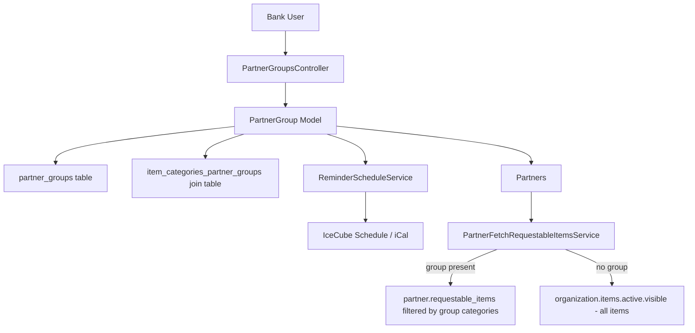
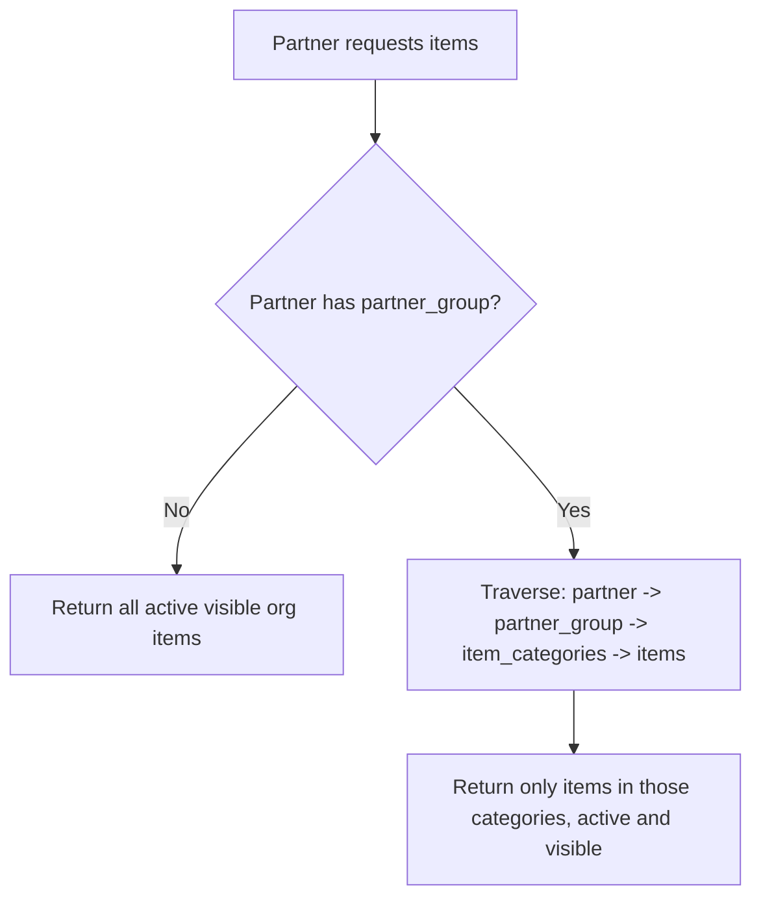
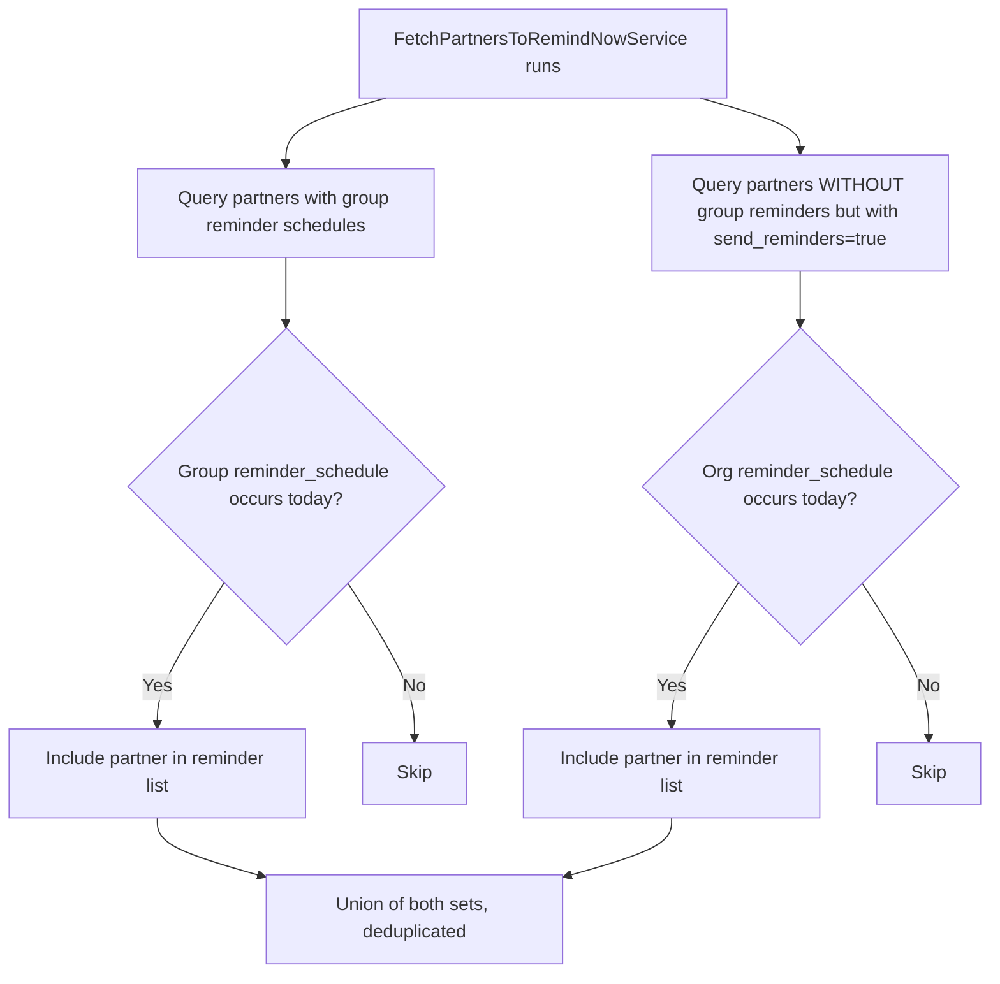
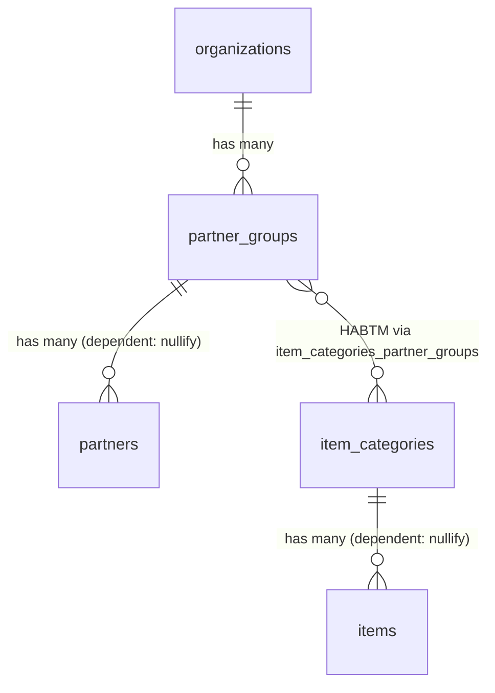

# Partner Groups

> **Status**: Active
> **Generated**: 2026-06-13T00:00:00Z
> **Last Updated**: 2026-06-13T00:00:00Z

---

## Overview

### What It Does
Partner Groups allow an essentials bank organization to group partner organizations together and configure two key behaviors per group: (1) which item categories the group members can request, and (2) a custom reminder/deadline schedule for submission reminders. When a partner belongs to a group, the group's item category restrictions filter which items appear in the partner's request form. When reminders are enabled on a group, they override the organization-level reminder schedule for all partners in that group.

### Why It Exists
Essentials banks work with many partner agencies that have different needs. Some partners should only be able to request certain categories of items (e.g., diapers only, not period supplies). Additionally, different groups of partners may operate on different submission schedules. Partner Groups provide a single configuration point to manage both item visibility and reminder scheduling for a cohort of partners, rather than configuring each partner individually.

### Key Capabilities
- Create named groups scoped to an organization with unique names
- Assign item categories to a group, restricting which items group members can request
- Enable per-group deadline reminders with configurable schedules (day-of-month or day-of-week recurrence via iCal/IceCube)
- Prevent deletion of groups that still have partners assigned
- Version tracking via PaperTrail for audit history

---

## Architecture

### High-Level Design


### How Item Filtering Works


### How Reminder Scheduling Works


### Components

#### Backend Components
| Component | File Path | Purpose |
|-----------|-----------|---------|
| PartnerGroupsController | `app/controllers/partner_groups_controller.rb` | CRUD actions (new, create, edit, update, destroy) |
| PartnerGroup | `app/models/partner_group.rb` | Model with associations, validations, reminder schedule logic |
| ItemCategory | `app/models/item_category.rb` | HABTM association back to partner_groups; prevents deletion if groups exist |
| ReminderScheduleService | `app/services/reminder_schedule_service.rb` | Builds/parses IceCube schedules from iCal strings for reminder recurrence |
| PartnerFetchRequestableItemsService | `app/services/partner_fetch_requestable_items_service.rb` | Determines which items a partner can request based on group membership |
| FetchPartnersToRemindNowService | `app/services/partners/fetch_partners_to_remind_now_service.rb` | Finds partners due for reminders today; group schedule overrides org schedule |

#### Frontend Components
| Component | File Path | Purpose |
|-----------|-----------|---------|
| checkbox-with-nested-element controller | `app/javascript/controllers/checkbox_with_nested_element_controller.js` | Stimulus controller toggling reminder fields visibility based on send_reminders checkbox |
| deadline-day controller | `app/javascript/controllers/deadline_day_controller.js` | Stimulus controller managing day-of-month vs day-of-week radio toggle and preview text |

#### Views
| View | File Path | Purpose |
|------|-----------|---------|
| New | `app/views/partner_groups/new.html.erb` | New partner group form page |
| Edit | `app/views/partner_groups/edit.html.erb` | Edit partner group form page |
| Form partial | `app/views/partner_groups/_form.html.erb` | Shared form: name, item categories checkboxes, reminder toggle + schedule fields |
| Deadline fields partial | `app/views/shared/_deadline_day_fields.html.erb` | Shared partial for reminder schedule configuration (day-of-month or day-of-week radio, fields, deadline day) |

### Technology Stack
- **Backend**: Ruby on Rails, ActiveRecord, IceCube gem (iCal recurrence), PaperTrail (versioning)
- **Frontend**: ERB templates, Stimulus.js controllers, SimpleForm, AdminLTE/Bootstrap CSS
- **Database**: PostgreSQL

---

## Model Details

### PartnerGroup

#### Associations
```ruby
# Source: app/models/partner_group.rb
belongs_to :organization
has_many :partners, dependent: :nullify
has_and_belongs_to_many :item_categories
```

**Note on `dependent: :nullify`**: When a PartnerGroup is destroyed, associated partners have their `partner_group_id` set to `NULL` rather than being deleted. However, the controller's `destroy` action prevents deletion when partners are present.

#### Concerns
| Concern | Purpose |
|---------|---------|
| `has_paper_trail` | Version tracking for audit history on all attribute changes |

#### Validations
| Validation | Field | Rule |
|------------|-------|------|
| `validates :name` | `name` | `presence: true, uniqueness: { scope: :organization }` |
| `validates :deadline_day` | `deadline_day` | `presence: true, if: :send_reminders?` |
| `validates :deadline_day` | `deadline_day` | `numericality: { only_integer: true, less_than_or_equal_to: 28, greater_than_or_equal_to: 1, allow_nil: true }` |
| `validate :reminder_schedule_is_empty_or_valid?` | reminder schedule | Validates schedule fields if user filled them out; ensures reminder day != deadline day |
| `validate :reminder_schedule_present?` | reminder schedule | Required when `send_reminders` is true; ensures valid schedule and reminder != deadline |

#### Callbacks
| Callback | Method | Purpose |
|----------|--------|---------|
| `before_save` | `:save_reminder_schedule_definition` | Serializes the ReminderScheduleService object to an iCal string and stores it in `reminder_schedule_definition`; resets the memoized service instance |

#### Key Methods
| Method | Returns | Purpose | Notes |
|--------|---------|---------|-------|
| `reminder_schedule` | `ReminderScheduleService` | Lazy-loads/memoizes the reminder schedule service, either by parsing the stored iCal definition or creating a new default instance | Returns default with `start_date: Time.zone.today` if no definition stored |
| `save_reminder_schedule_definition` | `nil` | Converts schedule to iCal string and stores it; clears `@reminder_schedule_service` cache | Called as `before_save` callback |
| `reminder_schedule_is_empty_or_valid?` | N/A | Validation: only validates if user filled out schedule fields AND `by_month_or_week` is present; merges schedule errors and checks deadline != reminder day | Skips validation if form was not touched |
| `reminder_schedule_present?` | N/A | Validation: requires valid schedule when `send_reminders` is true; ensures deadline != reminder day | Adds errors on both `:send_reminders` and `:day_of_month` |
| `deadline_on_reminder_date?` | `Boolean` | Returns true if schedule is day-of-month AND the reminder day equals the deadline day | Used by both validators to prevent same-day reminders |

### ItemCategory (related)

```ruby
# Source: app/models/item_category.rb
has_and_belongs_to_many :partner_groups, dependent: :nullify
before_destroy :ensure_no_associated_partner_groups
```

The `ensure_no_associated_partner_groups` callback prevents destroying an ItemCategory if any partner groups reference it.

### Partner (related)

```ruby
# Source: app/models/partner.rb (relevant lines)
belongs_to :partner_group, optional: true
has_many :item_categories, through: :partner_group
has_many :requestable_items, through: :item_categories, source: :items
```

The `optional: true` means a partner does not need to belong to a group. The `requestable_items` chain traverses `partner -> partner_group -> item_categories -> items`.

---

## Database Schema

### partner_groups

| Column | Type | Default | Notes |
|--------|------|---------|-------|
| `id` | `bigint` | auto-increment | Primary key |
| `organization_id` | `bigint` | — | FK to organizations |
| `name` | `string` | — | Group name |
| `send_reminders` | `boolean` | `false` | NOT NULL; whether to send deadline reminders |
| `reminder_day` | `integer` | — | Legacy column (see Known Issues) |
| `deadline_day` | `integer` | — | Day of month for submission deadline (1-28) |
| `reminder_schedule_definition` | `string` | — | iCal RRULE string for reminder recurrence |
| `created_at` | `datetime` | — | NOT NULL |
| `updated_at` | `datetime` | — | NOT NULL |

**Indexes:**
| Index Name | Columns | Unique |
|------------|---------|--------|
| `index_partner_groups_on_name_and_organization_id` | `[name, organization_id]` | Yes |
| `index_partner_groups_on_organization_id` | `[organization_id]` | No |

**Check Constraints:**
| Constraint Name | Expression |
|-----------------|------------|
| `deadline_day_of_month_check` | `deadline_day <= 28` |
| `reminder_day_of_month_check` | `reminder_day <= 28` |

**Foreign Keys:**
- `partner_groups.organization_id` references `organizations.id`

### item_categories_partner_groups (join table)

| Column | Type | Default | Notes |
|--------|------|---------|-------|
| `partner_group_id` | `bigint` | — | NOT NULL; FK to partner_groups |
| `item_category_id` | `bigint` | — | NOT NULL; FK to item_categories |
| `created_at` | `datetime` | — | NOT NULL |
| `updated_at` | `datetime` | — | NOT NULL |

**Indexes:**
| Index Name | Columns |
|------------|---------|
| `index_item_categories_partner_groups_on_item_category_id` | `[item_category_id]` |
| `index_item_categories_partner_groups_on_partner_group_id` | `[partner_group_id]` |

**Foreign Keys:**
- `item_categories_partner_groups.item_category_id` references `item_categories.id`
- `item_categories_partner_groups.partner_group_id` references `partner_groups.id`

### Relationships


---

## API Endpoints

> All routes are scoped under the organization context (via `ApplicationController` and `current_organization`).

| Method | Path | Action | Description | Notes |
|--------|------|--------|-------------|-------|
| `GET` | `/partner_groups/new` | `new` | Render new partner group form | Sets `@item_categories` for checkboxes |
| `POST` | `/partner_groups` | `create` | Create a partner group | Redirects to `partners_path#nav-partner-groups` |
| `GET` | `/partner_groups/:id/edit` | `edit` | Render edit form for existing group | |
| `PATCH/PUT` | `/partner_groups/:id` | `update` | Update an existing group | Redirects to `partners_path#nav-partner-groups` |
| `DELETE` | `/partner_groups/:id` | `destroy` | Delete a group (only if no partners assigned) | Blocked with alert if partners exist |

**Route definition** (from `config/routes.rb:231`):
```ruby
resources :partner_groups, only: %i(new create edit update destroy)
```

**Note:** There is no `index` or `show` action. Partner groups are listed within the Partners index page under the `#nav-partner-groups` tab.

---

## Authorization

The controller inherits from `ApplicationController`. There is no dedicated `PartnerGroupPolicy`. All actions require an authenticated user belonging to the current organization (enforced by `current_organization` scoping on all queries). No Pundit policy file was found for this resource.

---

## Configuration

### Environment Variables
No feature-specific environment variables.

### Dependencies
- **IceCube gem**: Used by `ReminderScheduleService` to parse and generate iCal recurrence rules
- **PaperTrail gem**: Provides `has_paper_trail` version tracking on the model

---

## Usage Examples

### Creating a Partner Group with Reminder Schedule
```ruby
# Source: app/controllers/partner_groups_controller.rb:10-20
def create
  @partner_group = current_organization.partner_groups.new(partner_group_params)
  @partner_group.reminder_schedule.assign_attributes(reminder_schedule_params)
  if @partner_group.save
    # Redirect to groups tab in Partner page.
    redirect_to partners_path + "#nav-partner-groups", notice: "Partner group added!"
  else
    flash.now[:error] = "Something didn't work quite right -- try again?"
    set_items_categories
    render action: :new
  end
end
```

### How Requestable Items Are Filtered by Group
```ruby
# Source: app/services/partner_fetch_requestable_items_service.rb:6-13
def call
  requestable_items = if partner.partner_group.blank?
    organization.items.active.visible
  else
    partner.requestable_items.active.visible
  end

  requestable_items.map { |item| [item.name, item.id] }.sort
end
```

### Reminder Schedule Cascade (Group Overrides Org)
```ruby
# Source: app/services/partners/fetch_partners_to_remind_now_service.rb:3-27
def fetch
  current_day = Time.current
  deactivated_status = ::Partner.statuses[:deactivated]

  partners_with_group_reminders = ::Partner.left_joins(:partner_group)
    .where.not(partner_groups: {reminder_schedule_definition: nil})
    .where.not(partner_groups: {deadline_day: nil})
    .where.not(status: deactivated_status)

  # where partner groups have reminder schedule match
  filtered_partner_groups = partners_with_group_reminders.select do |partner|
    partner.partner_group.reminder_schedule.occurs_on?(current_day)
  end

  partners_with_only_organization_reminders = ::Partner.left_joins(:partner_group, :organization)
    .where(partner_groups: {reminder_schedule_definition: nil})
    .where(send_reminders: true)
    .where.not(organizations: {deadline_day: nil})
    .where.not(organizations: {reminder_schedule_definition: nil})
    .where.not(status: deactivated_status)

  filtered_organizations = partners_with_only_organization_reminders.select do |partner|
    partner.organization.reminder_schedule.occurs_on?(current_day)
  end
  (filtered_partner_groups + filtered_organizations).flatten.uniq
end
```

---

## Testing

### Test Files
- `spec/models/partner_group_spec.rb` -- Model validations, associations, DB constraints, versioning
- `spec/requests/partner_groups_requests_spec.rb` -- Controller request specs for new, create, edit, update
- `spec/requests/partner_group_spec.rb` -- Delete action specs (with and without associated partners)
- `spec/factories/partner_groups.rb` -- Factory definition

### Key Test Cases

**Model specs (`spec/models/partner_group_spec.rb`):**
- Association tests: `belongs_to :organization`, `has_many :partners`, `has_and_belongs_to_many :item_categories`
- DB constraint: `send_reminders` cannot be NULL (raises `ActiveRecord::StatementInvalid`)
- DB constraint: `deadline_day > 28` raises error
- Validation: name must be present and unique within organization
- Validation: name uniqueness is NOT enforced across organizations
- Validation: `send_reminders: true` requires both `deadline_day` and valid `reminder_schedule_definition`
- Validation: deadline day and reminder day cannot be the same for day-of-month schedules
- Validation: deadline day and reminder day CAN be same for day-of-week schedules
- PaperTrail versioning is enabled

**Request specs (`spec/requests/partner_groups_requests_spec.rb`):**
- GET new: renders template, assigns new PartnerGroup, assigns item categories
- POST create (valid): creates record, redirects to partners#nav-partner-groups
- POST create (invalid/duplicate name): does not create, re-renders new with error
- GET edit: renders template, assigns existing group, assigns item categories
- PATCH update (valid): updates name, redirects
- PATCH update (invalid/nil name): does not update, re-renders edit with error

**Delete specs (`spec/requests/partner_group_spec.rb`):**
- DELETE with no partners: destroys group, flash notice, redirects
- DELETE with partners: does NOT destroy, flash alert "Partner Group cannot be deleted", redirects

---

## Known Issues & Caveats

| Issue | Location | Description |
|-------|----------|-------------|
| Legacy `reminder_day` column | `db/schema.rb:541` | The `reminder_day` integer column exists in the schema with a check constraint (`<= 28`), but is never referenced in the model code. The reminder schedule was refactored to use `reminder_schedule_definition` (iCal string) instead. This column appears to be dead/legacy. |
| No index action | `config/routes.rb:231` | Partner groups have no dedicated index or show pages. They are displayed inline within the Partners index page under the `#nav-partner-groups` tab. |
| No Pundit policy | — | Unlike many other resources in the app, there is no dedicated policy file for PartnerGroup. Authorization relies solely on `current_organization` scoping. |
| N+1 query risk in reminder service | `app/services/partners/fetch_partners_to_remind_now_service.rb:13-14` | The `filtered_partner_groups` selection loads all matching partners into memory and calls `partner.partner_group.reminder_schedule.occurs_on?` in a Ruby `select` block rather than a SQL query, which could be slow with many partners. |
| Duplicate `set_items_categories` call in new/edit | `app/controllers/partner_groups_controller.rb:6-7,25-26` | Both `new` and `edit` call `set_items_categories` (which sets `@item_categories`) AND then immediately set `@item_categories` again on the next line. The second assignment is redundant. |
| `before_action` only covers edit and destroy | `app/controllers/partner_groups_controller.rb:2` | `set_partner_group` is declared for `only: %i[edit destroy]` but `edit` and `update` both manually call `find` again inside their action bodies, making the `before_action` redundant for `edit`. Meanwhile `update` is not in the `before_action` list but does its own `find`. |
| Typo in form | `app/views/partner_groups/_form.html.erb:19` | The label tag has a stray `l` attribute: `<label class='text-sm text-red-600' l>` |

---

## Performance

### Database Optimization
- **Unique index** on `[name, organization_id]` enforces name uniqueness at the DB level
- **Index** on `organization_id` for fast lookups by organization
- **Check constraints** on `deadline_day` and `reminder_day` enforce `<= 28` at the DB level
- **Indexes** on both columns of the join table `item_categories_partner_groups`

### Caching
No explicit caching. The `ReminderScheduleService` is memoized per model instance (`@reminder_schedule_service`).

---

## Troubleshooting

### Common Issues

#### Issue: "Partner Group cannot be deleted"
**Symptoms:**
- Clicking Delete redirects back with alert message

**Cause:**
The group still has partners assigned to it. The controller checks `@partner_group.partners.any?` before allowing deletion.

**Solution:**
Reassign or remove all partners from the group before deleting it. Partners must be moved to another group or have their `partner_group_id` set to nil.

#### Issue: "Something didn't work quite right -- try again?"
**Symptoms:**
- Form re-renders on create or update

**Cause:**
Validation failed. Common causes: duplicate name within the organization, `send_reminders` enabled without a valid deadline day and reminder schedule, or reminder day equals deadline day.

**Solution:**
Check the form for validation errors. Ensure the name is unique, and if reminders are enabled, both the deadline day (1-28) and a reminder schedule (day-of-month or day-of-week) are properly configured with different days.

#### Issue: Partner can request all items despite being in a group
**Symptoms:**
- Partner sees all organization items in their request form

**Cause:**
The partner group has no item categories assigned. `PartnerFetchRequestableItemsService` falls through to `partner.requestable_items` which, if the group has zero categories, returns no items -- but if the `partner_group` association is present but empty, behavior depends on the query chain.

**Solution:**
Ensure the partner group has at least one item category assigned via the checkboxes in the group form.

---

## Related Features

- **[Partners](./partners.md)** -- Partners belong to a partner group; the group controls their requestable items and reminder schedule
- **[Items](./items.md)** -- Items belong to item categories which are assigned to partner groups
- **[Partner Portal](./partner-portal.md)** -- The partner-facing request form uses `PartnerFetchRequestableItemsService` to filter items based on group membership

---

**Generated:** 2026-06-13T00:00:00Z
**Last Updated:** 2026-06-13T00:00:00Z
**Status:** Active
