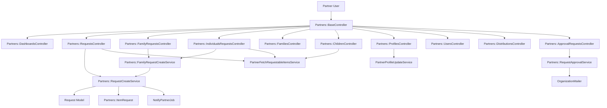
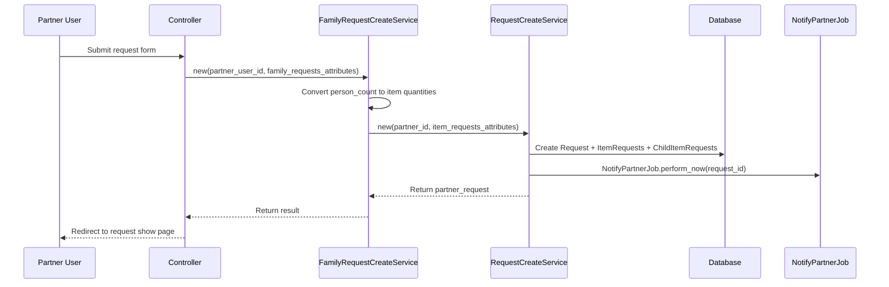
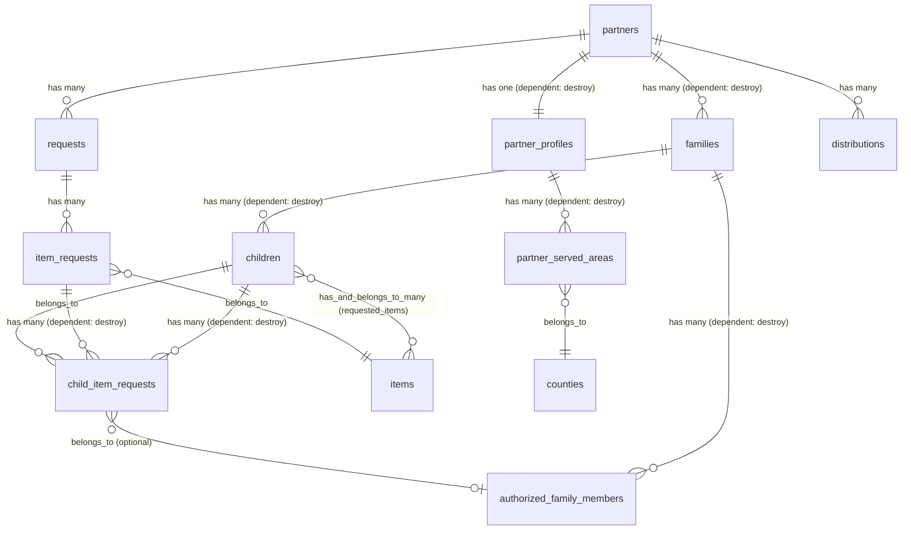

# Partner Portal

> **Status**: Active
> **Generated**: 2026-06-13T00:00:00Z
> **Last Updated**: 2026-06-13T00:00:00Z

---

## Overview

### What It Does
The Partner Portal is a self-service interface for partner organizations (nonprofits, shelters, food banks, etc.) to interact with an essentials bank. Partners can submit supply requests (quantity-based, individual-based, or child/family-based), manage their families and children records, view distribution history, maintain their organization profile, manage partner users, and submit for approval or recertification.

### Why It Exists
Essentials banks distribute supplies (diapers, period products, etc.) through partner organizations that serve families in need. The portal gives partners autonomy to submit requests, track distributions, and maintain demographic data -- reducing administrative overhead on the bank side and enabling partners to operate on their own schedule.

### Key Capabilities
- **Three request types**: Quantity-based requests, individual (person-count) requests, and child/family-based requests tied to specific children
- **Family & children management**: Full CRUD for families, children, and authorized family members with CSV export
- **Profile management**: Multi-section partner profile with agency info, demographics, contacts, served areas, and document uploads
- **Distribution viewing**: View upcoming and past distributions with PDF printing
- **Approval workflow**: Partners submit profiles for bank approval; banks can request recertification
- **User management**: Partners can invite and manage their own portal users
- **Quota enforcement**: Requests are validated against partner quotas before submission
- **Filterrific search**: Filterable lists for families, children, and family requests

---

## Architecture

### High-Level Design


### Request Creation Flow


### Components

#### Backend Components
| Component | File Path | Purpose |
|-----------|-----------|---------|
| BaseController | `app/controllers/partners/base_controller.rb` | Base controller with partner authentication, active/approved checks |
| DashboardsController | `app/controllers/partners/dashboards_controller.rb` | Partner dashboard with requests, distributions, families overview |
| RequestsController | `app/controllers/partners/requests_controller.rb` | Quantity-based supply requests (CRUD + validate) |
| IndividualsRequestsController | `app/controllers/partners/individuals_requests_controller.rb` | Person-count-based requests |
| FamilyRequestsController | `app/controllers/partners/family_requests_controller.rb` | Child/family-based requests tied to specific children |
| FamiliesController | `app/controllers/partners/families_controller.rb` | Family CRUD with CSV export and archiving |
| ChildrenController | `app/controllers/partners/children_controller.rb` | Children CRUD with CSV export and active toggle |
| AuthorizedFamilyMembersController | `app/controllers/partners/authorized_family_members_controller.rb` | Authorized pickup persons for families |
| ProfilesController | `app/controllers/partners/profiles_controller.rb` | Partner profile view/edit with step-form support |
| UsersController | `app/controllers/partners/users_controller.rb` | Partner user management (list, invite, edit) |
| HelpsController | `app/controllers/partners/helps_controller.rb` | Help page showing bank contact info |
| ApprovalRequestsController | `app/controllers/partners/approval_requests_controller.rb` | Submit profile for bank approval |
| RecertificationRequestsController | `app/controllers/partners/recertification_requests_controller.rb` | Bank-initiated recertification requests |
| DistributionsController | `app/controllers/partners/distributions_controller.rb` | View distributions list and print PDFs |
| Partners::Base | `app/models/partners/base.rb` | Abstract base model for partner-portal models |
| Partners::Family | `app/models/partners/family.rb` | Family records with guardian info, income, demographics |
| Partners::Child | `app/models/partners/child.rb` | Child records with requested items and demographics |
| Partners::AuthorizedFamilyMember | `app/models/partners/authorized_family_member.rb` | Authorized persons who can pick up supplies |
| Partners::Profile | `app/models/partners/profile.rb` | Partner organization profile (agency info, contacts, demographics) |
| Partners::FamilyRequest | `app/models/partners/family_request.rb` | Form object for family/individual request creation |
| Partners::ItemRequest | `app/models/partners/item_request.rb` | Individual line item within a request |
| Partners::ChildItemRequest | `app/models/partners/child_item_request.rb` | Join between item requests and children |
| Partners::ServedArea | `app/models/partners/served_area.rb` | Geographic areas served with client share percentages |
| RequestCreateService | `app/services/partners/request_create_service.rb` | Core request creation with item request population |
| FamilyRequestCreateService | `app/services/partners/family_request_create_service.rb` | Transforms family/individual requests into item requests |
| RequestApprovalService | `app/services/partners/request_approval_service.rb` | Submits partner for bank approval |
| FetchPartnersToRemindNowService | `app/services/partners/fetch_partners_to_remind_now_service.rb` | Finds partners due for request reminders |
| SectionErrorService | `app/services/partners/section_error_service.rb` | Maps validation errors to profile form sections |
| UpdateFamily | `app/services/partners/update_family.rb` | Archives family and all children |
| PartnerFetchRequestableItemsService | `app/services/partner_fetch_requestable_items_service.rb` | Fetches items available for partner to request |
| ProfileHelper | `app/helpers/partners/profile_helper.rb` | Helpers for document attachment display |
| SortableHelper | `app/helpers/partners/sortable_helper.rb` | Column sort links for tables |

#### View Directories
| Directory | Purpose |
|-----------|---------|
| `app/views/partners/dashboards/` | Dashboard show page |
| `app/views/partners/requests/` | Request list, show, new, validate |
| `app/views/partners/individuals_requests/` | Individual request form |
| `app/views/partners/family_requests/` | Family/child request form |
| `app/views/partners/families/` | Family CRUD views |
| `app/views/partners/children/` | Children CRUD views |
| `app/views/partners/authorized_family_members/` | Authorized member CRUD views |
| `app/views/partners/profiles/` | Profile show/edit (including step form variant) |
| `app/views/partners/users/` | User list and invite views |
| `app/views/partners/helps/` | Help page |
| `app/views/partners/distributions/` | Distribution list and print |
| `app/views/served_areas/` | Served area partials for profile |

### Technology Stack
- **Backend**: Ruby on Rails (namespaced under `Partners::` module)
- **Frontend**: ERB templates with AdminLTE layout (`partners/application`), Stimulus controllers, Filterrific for filtering
- **Database**: PostgreSQL (JSONB columns for arrays, paper_trail for auditing)
- **Feature Flags**: Flipper (`enable_packs` for request units, `partner_step_form` for step-wise profile editing)
- **File Uploads**: ActiveStorage (profile documents, proof of status, proof of form 990)

---

## Model Details

### Partners::Family

#### Associations
```ruby
# Source: app/models/partners/family.rb
belongs_to :partner, class_name: '::Partner'
has_many :children, dependent: :destroy
has_many :authorized_family_members, dependent: :destroy
```

#### Concerns
| Concern | Purpose |
|---------|---------|
| `Filterable` | Adds filterrific scope support |
| `Exportable` | Adds CSV generation via `generate_csv` |
| `has_paper_trail` | Version tracking for audit history |

#### Callbacks
| Callback | Method | Purpose |
|----------|--------|---------|
| `after_create` | `:create_authorized` | Auto-creates an AuthorizedFamilyMember from guardian name |

#### Constants
| Constant | Value |
|----------|-------|
| `INCOME_TYPES` | `['SSI', 'SNAP/FOOD Stamps', 'TANF', 'WIC', 'Housing/subsidized', 'Housing/unsubsidized', 'N/A']` |
| `INSURANCE_TYPES` | `['Private insurance', 'Medicaid', 'Uninsured']` |
| `EMPLOYMENT_TYPES` | `%w[Full-time Part-time N/A]` |

#### Filterrific Scopes
| Scope | Purpose |
|-------|---------|
| `search_guardian_names` | ILIKE search on `guardian_first_name` or `guardian_last_name` |
| `search_agency_guardians` | ILIKE search on `case_manager` |
| `include_archived` | Filter archived families (default: exclude archived) |

#### Key Methods
| Method | Returns | Purpose |
|--------|---------|---------|
| `guardian_display_name` | `String` | Concatenates guardian first + last name |
| `total_children_count` | `Integer` | Sum of `home_child_count` + `home_young_child_count` |
| `csv_export_attributes` | `Array` | Row data for CSV export |

---

### Partners::Child

#### Associations
```ruby
# Source: app/models/partners/child.rb
belongs_to :family
has_many :child_item_requests, dependent: :destroy
has_and_belongs_to_many :requested_items, class_name: 'Item'
```

#### Concerns
| Concern | Purpose |
|---------|---------|
| `Filterable` | Adds filterrific scope support |
| `Exportable` | Adds CSV generation via `generate_csv` |
| `has_paper_trail` | Version tracking for audit history |

#### Filterrific Scopes
| Scope | Purpose |
|-------|---------|
| `search_names` | ILIKE search on `first_name` or `last_name` |
| `search_active` | Filter to active children only |
| `search_families` | ILIKE search on guardian names via families join |

#### Constants
| Constant | Purpose |
|----------|---------|
| `CAN_LIVE_WITH` | `['Mother', 'Father', 'Grandparent', 'Foster Parent', 'Other Parent/Relative']` |
| `RACES` | `['African American', 'Caucasian', 'Hispanic', 'Asian', 'American Indian', 'Pacific Islander', 'Multi-racial', 'Other']` |
| `CHILD_ITEMS` | 27-item array of diaper/supply types children can need |

---

### Partners::AuthorizedFamilyMember

#### Associations
```ruby
# Source: app/models/partners/authorized_family_member.rb
belongs_to :family
has_many :child_item_requests, dependent: :nullify
```

#### Concerns
| Concern | Purpose |
|---------|---------|
| `has_paper_trail` | Version tracking for audit history |

---

### Partners::Profile

#### Associations
```ruby
# Source: app/models/partners/profile.rb
belongs_to :partner
has_one :organization, through: :partner, class_name: "::Organization"
has_one_attached :proof_of_partner_status
has_one_attached :proof_of_form_990
has_many :served_areas, foreign_key: "partner_profile_id", class_name: "Partners::ServedArea", dependent: :destroy, inverse_of: :partner_profile
has_many :counties, through: :served_areas
has_many_attached :documents
```

#### Table Name Override
```ruby
self.table_name = "partner_profiles"
```

#### Enum
```ruby
# Source: app/models/partners/profile.rb:95-136
enum :agency_type,
  other: "OTHER", career: "CAREER", abuse: "ABUSE", bnb: "BNB",
  church: "CHURCH", college: "COLLEGE", cdc: "CDC", health: "HEALTH",
  outreach: "OUTREACH", legal: "LEGAL", crisis: "CRISIS", disab: "DISAB",
  district: "DISTRICT", domv: "DOMV", ece: "ECE", child: "CHILD",
  edu: "EDU", family: "FAMILY", food: "FOOD", foster: "FOSTER",
  govt: "GOVT", headstart: "HEADSTART", homevisit: "HOMEVISIT",
  homeless: "HOMELESS", hosp: "HOSP", infpan: "INFPAN", lib: "LIB",
  mhealth: "MHEALTH", military: "MILITARY", police: "POLICE",
  preg: "PREG", presch: "PRESCH", ref: "REF", es: "ES", hs: "HS",
  ms: "MS", senior: "SENIOR", tribal: "TRIBAL", treat: "TREAT",
  twoycollege: "2YCOLLEGE", wic: "WIC"
```

#### Validations
| Validation | Context | Purpose |
|------------|---------|---------|
| `check_social_media` | `:edit` | Requires social media presence or explicit opt-out checkbox |
| `client_share_is_0_or_100` | all | Served area client shares must total exactly 0 or 100 |
| `has_at_least_one_request_setting` | all | At least one of child/individual/quantity requests must be enabled |
| `pick_up_email_addresses` | all | Max 3 emails, no duplicates, valid format |

#### Key Methods
| Method | Returns | Purpose |
|--------|---------|---------|
| `client_share_total` | `Integer` | Sum of all served area client shares |
| `split_pick_up_emails` | `Array<String>` or `nil` | Splits comma/whitespace-separated email string |
| `self.agency_types_for_selection` | `Array<Symbol>` | Alphabetized agency types for form dropdowns, with "other" last |

#### Profile Form Sections
The profile form is organized into these sections (documented in the model comments):
1. **agency_information** -- Agency type, mission, address, program address
2. **media_information** -- Website, social media, no-social-media checkbox
3. **agency_stability** -- Founded year, 990 form, program details, evidence-based
4. **organizational_capacity** -- Client capacity, storage space
5. **sources_of_funding** -- Funding and diaper sources, budget
6. **area_served** -- Served areas (counties with client share)
7. **population_served** -- Demographics, income levels, zip codes
8. **contacts** -- Executive director, primary contact
9. **pick_up_person** -- Pick-up person name, phone, email
10. **agency_distribution_information** -- Distribution times, client requirements
11. **attached_documents** -- Uploaded documents
12. **partner_settings** -- Request type toggles (quantity/child/individual)

---

### Partners::ItemRequest

#### Associations
```ruby
# Source: app/models/partners/item_request.rb
belongs_to :request, class_name: '::Request', foreign_key: :partner_request_id, inverse_of: :item_requests
belongs_to :item
has_many :child_item_requests, dependent: :destroy
has_many :children, through: :child_item_requests
```

#### Validations
```ruby
validates :quantity, presence: true
validates :quantity, numericality: { only_integer: true, greater_than_or_equal_to: 1 }
validates :name, presence: true
validate :request_unit_is_supported
```

#### Key Methods
| Method | Returns | Purpose |
|--------|---------|---------|
| `item_name` | `String` | Falls back to local `name` if `item` association is nil |
| `quantity_with_units` | `String` | Pluralized quantity with unit name (when `enable_packs` Flipper is on) |
| `name_with_unit` | `String` | Item name with unit suffix (when `enable_packs` Flipper is on) |

---

### Partners::ChildItemRequest

#### Associations
```ruby
# Source: app/models/partners/child_item_request.rb
belongs_to :item_request
belongs_to :child
belongs_to :authorized_family_member, optional: true
```

#### Key Methods
| Method | Returns | Purpose |
|--------|---------|---------|
| `quantity` | `Integer` | Divides item request quantity evenly among children |
| `ordered_item_diaperid` | `Integer` | Returns the item_id from the parent item_request |

---

### Partners::ServedArea

#### Associations
```ruby
# Source: app/models/partners/served_area.rb
belongs_to :partner_profile, class_name: "Partners::Profile"
belongs_to :county
```

#### Table Name Override
```ruby
self.table_name = "partner_served_areas"
```

#### Validations
```ruby
validates :client_share, numericality: {only_integer: true}
validates :client_share, inclusion: {in: 1..100, message: "Client share must be between 1 and 100 inclusive"}
```

---

### Partners::FamilyRequest (Form Object)

This is an `ActiveModel::Model` form object (not backed by a database table). It wraps the family/individual request form parameters.

```ruby
# Source: app/models/partners/family_request.rb
class FamilyRequest
  include ActiveModel::Model
  attr_accessor :comments, :partner
  attr_reader :items
end
```

Contains a nested `Item` class with `item_id`, `person_count`, and `children` attributes.

---

## Database Schema

### families
| Column | Type | Default | Notes |
|--------|------|---------|-------|
| `id` | `bigint` | auto | Primary key |
| `archived` | `boolean` | `FALSE` | Soft archive flag |
| `case_manager` | `string` | | Agency case manager name |
| `comments` | `text` | | Free-text notes |
| `guardian_county` | `string` | | Guardian's county |
| `guardian_employed` | `boolean` | | Employment flag |
| `guardian_employment_type` | `jsonb` | | Employment type array |
| `guardian_first_name` | `string` | | Required |
| `guardian_health_insurance` | `jsonb` | | Insurance type array |
| `guardian_last_name` | `string` | | Required |
| `guardian_monthly_pay` | `decimal` | | Monthly income |
| `guardian_phone` | `string` | | Phone number |
| `guardian_zip_code` | `string` | | Required |
| `home_adult_count` | `integer` | | Adults in household |
| `home_child_count` | `integer` | | Children in household |
| `home_young_child_count` | `integer` | | Young children in household |
| `military` | `boolean` | `FALSE` | Military family flag |
| `sources_of_income` | `jsonb` | | Serialized array of income types |
| `created_at` | `datetime` | | Not null |
| `updated_at` | `datetime` | | Not null |
| `old_partner_id` | `bigint` | | Legacy migration reference |
| `partner_id` | `bigint` | | FK to partners |

### children
| Column | Type | Default | Notes |
|--------|------|---------|-------|
| `id` | `bigint` | auto | Primary key |
| `active` | `boolean` | `TRUE` | Active/inactive toggle |
| `archived` | `boolean` | | Soft archive flag |
| `child_lives_with` | `jsonb` | | Serialized array from CAN_LIVE_WITH |
| `comments` | `text` | | Free-text notes |
| `date_of_birth` | `date` | | Child's DOB |
| `first_name` | `string` | | |
| `gender` | `string` | | |
| `health_insurance` | `jsonb` | | Insurance info |
| `item_needed_diaperid` | `integer` | | Legacy item reference |
| `last_name` | `string` | | |
| `race` | `jsonb` | | Race/ethnicity |
| `created_at` | `datetime` | | Not null |
| `updated_at` | `datetime` | | Not null |
| `agency_child_id` | `string` | | Agency's internal ID for child |
| `family_id` | `bigint` | | FK to families |

### authorized_family_members
| Column | Type | Default | Notes |
|--------|------|---------|-------|
| `id` | `bigint` | auto | Primary key |
| `comments` | `text` | | |
| `date_of_birth` | `date` | | |
| `first_name` | `string` | | |
| `gender` | `string` | | |
| `last_name` | `string` | | |
| `created_at` | `datetime` | | Not null |
| `updated_at` | `datetime` | | Not null |
| `family_id` | `bigint` | | FK to families |

### partner_profiles
| Column | Type | Default | Notes |
|--------|------|---------|-------|
| `id` | `bigint` | auto | Primary key |
| `above_1_2_times_fpl` | `integer` | | Population above 1.2x federal poverty level |
| `address1` | `string` | | Agency street address |
| `address2` | `string` | | Agency address line 2 |
| `agency_mission` | `text` | | Mission statement |
| `agency_type` | `string` | | Enum (see Profile model) |
| `at_fpl_or_below` | `integer` | | Population at or below FPL |
| `case_management` | `boolean` | | Has case management |
| `city` | `string` | | |
| `client_capacity` | `string` | | Number of clients served |
| `currently_provide_diapers` | `boolean` | | Currently distributing diapers |
| `describe_storage_space` | `text` | | Storage description |
| `distribution_times` | `string` | | When distributions happen |
| `enable_child_based_requests` | `boolean` | `TRUE` | Allow child-based requests |
| `enable_individual_requests` | `boolean` | `TRUE` | Allow individual requests |
| `enable_quantity_based_requests` | `boolean` | `TRUE` | Allow quantity requests |
| `essentials_budget` | `string` | | Budget for essentials |
| `essentials_funding_source` | `string` | | Funding source |
| `essentials_use` | `string` | | How essentials are used |
| `evidence_based` | `boolean` | | Evidence-based program |
| `executive_director_email` | `string` | | |
| `executive_director_name` | `string` | | |
| `executive_director_phone` | `string` | | |
| `facebook` | `string` | | Facebook URL |
| `form_990` | `boolean` | | Has IRS Form 990 |
| `founded` | `integer` | | Year founded |
| `greater_2_times_fpl` | `integer` | | Population above 2x FPL |
| `income_requirement_desc` | `boolean` | | Has income requirements |
| `income_verification` | `boolean` | | Verifies income |
| `instagram` | `string` | | Instagram URL |
| `more_docs_required` | `string` | | Additional documentation needs |
| `name` | `string` | | Profile display name |
| `new_client_times` | `string` | | When new clients accepted |
| `no_social_media_presence` | `boolean` | | Explicit opt-out of social media |
| `other_agency_type` | `string` | | Free text when agency_type is "other" |
| `pick_up_email` | `string` | | Comma-separated pickup emails (max 3) |
| `pick_up_name` | `string` | | Pickup person name |
| `pick_up_phone` | `string` | | Pickup person phone |
| `population_american_indian` | `integer` | | Demographic percentage |
| `population_asian` | `integer` | | Demographic percentage |
| `population_black` | `integer` | | Demographic percentage |
| `population_hispanic` | `integer` | | Demographic percentage |
| `population_island` | `integer` | | Demographic percentage |
| `population_multi_racial` | `integer` | | Demographic percentage |
| `population_other` | `integer` | | Demographic percentage |
| `population_white` | `integer` | | Demographic percentage |
| `poverty_unknown` | `integer` | | Poverty data unknown count |
| `primary_contact_email` | `string` | | |
| `primary_contact_mobile` | `string` | | |
| `primary_contact_name` | `string` | | |
| `primary_contact_phone` | `string` | | |
| `program_address1` | `string` | | Program delivery address |
| `program_address2` | `string` | | |
| `program_age` | `string` | | Age of program |
| `program_city` | `string` | | |
| `program_description` | `text` | | |
| `program_name` | `string` | | |
| `program_state` | `string` | | |
| `program_zip_code` | `integer` | | |
| `receives_essentials_from_other` | `string` | | Other essentials sources |
| `sources_of_diapers` | `string` | | Where diapers come from |
| `sources_of_funding` | `string` | | Funding sources |
| `state` | `string` | | |
| `status_in_diaper_base` | `string` | | Legacy status field |
| `storage_space` | `boolean` | | Has storage space |
| `twitter` | `string` | | Twitter URL |
| `website` | `string` | | Website URL |
| `zip_code` | `string` | | |
| `zips_served` | `string` | | Zip codes served |
| `created_at` | `datetime` | | Not null |
| `updated_at` | `datetime` | | Not null |
| `essentials_bank_id` | `bigint` | | FK to organizations |
| `partner_id` | `integer` | | FK to partners |

### item_requests
| Column | Type | Default | Notes |
|--------|------|---------|-------|
| `id` | `bigint` | auto | Primary key |
| `name` | `string` | | Item name (local copy) |
| `partner_key` | `string` | | Organization's partner key for item |
| `quantity` | `string` | | Quantity requested (stored as string) |
| `request_unit` | `string` | | Unit name (when packs feature enabled) |
| `created_at` | `datetime` | | Not null |
| `updated_at` | `datetime` | | Not null |
| `item_id` | `integer` | | FK to items |
| `old_partner_request_id` | `integer` | | Legacy migration reference |
| `partner_request_id` | `bigint` | | FK to requests |

### child_item_requests
| Column | Type | Default | Notes |
|--------|------|---------|-------|
| `id` | `bigint` | auto | Primary key |
| `picked_up` | `boolean` | `FALSE` | Whether item was picked up |
| `picked_up_item_diaperid` | `integer` | | Item ID of picked up item |
| `quantity_picked_up` | `integer` | | Actual quantity picked up |
| `created_at` | `datetime` | | Not null |
| `updated_at` | `datetime` | | Not null |
| `authorized_family_member_id` | `integer` | | FK to authorized_family_members (optional) |
| `child_id` | `bigint` | | FK to children |
| `item_request_id` | `bigint` | | FK to item_requests |

### partner_served_areas
| Column | Type | Default | Notes |
|--------|------|---------|-------|
| `id` | `bigint` | auto | Primary key |
| `client_share` | `integer` | | Percentage (1-100), total must be 0 or 100 |
| `created_at` | `datetime` | | Not null |
| `updated_at` | `datetime` | | Not null |
| `county_id` | `bigint` | | FK to counties, not null |
| `partner_profile_id` | `bigint` | | FK to partner_profiles, not null |

### Relationships


---

## API Endpoints

| Method | Path | Action | Description | Notes |
|--------|------|--------|-------------|-------|
| `GET` | `/partners/dashboard` | `dashboards#show` | Partner dashboard with overview | |
| `GET` | `/partners/help` | `helps#show` | Help page with bank contact info | |
| `GET` | `/partners/requests` | `requests#index` | List partner's requests | |
| `GET` | `/partners/requests/new` | `requests#new` | New quantity-based request form | |
| `GET` | `/partners/requests/:id` | `requests#show` | View a specific request | |
| `POST` | `/partners/requests` | `requests#create` | Submit quantity-based request | |
| `POST` | `/partners/requests/validate` | `requests#validate` | AJAX validation before submit | Returns JSON |
| `GET` | `/partners/individuals_requests/new` | `individuals_requests#new` | New individual (person-count) request | |
| `POST` | `/partners/individuals_requests` | `individuals_requests#create` | Submit individual request | |
| `POST` | `/partners/individuals_requests/validate` | `individuals_requests#validate` | AJAX validation before submit | Returns JSON |
| `GET` | `/partners/family_requests/new` | `family_requests#new` | New child/family request (select children) | |
| `POST` | `/partners/family_requests` | `family_requests#create` | Submit child/family request | |
| `POST` | `/partners/family_requests/validate` | `family_requests#validate` | AJAX validation before submit | Returns JSON |
| `GET` | `/partners/users` | `users#index` | List partner users | |
| `GET` | `/partners/users/new` | `users#new` | Invite new partner user form | |
| `POST` | `/partners/users` | `users#create` | Send user invitation | Uses `UserInviteService` |
| `GET` | `/partners/users/:id/edit` | `users#edit` | Edit current user info | |
| `PATCH` | `/partners/users/:id` | `users#update` | Update current user | |
| `GET` | `/partners/profile` | `profiles#show` | View partner profile | |
| `GET` | `/partners/profile/edit` | `profiles#edit` | Edit profile (standard or step form) | Flipper: `partner_step_form` |
| `PATCH` | `/partners/profile` | `profiles#update` | Save profile changes | |
| `POST` | `/partners/approval_request` | `approval_requests#create` | Submit profile for approval | |
| `GET` | `/partners/children` | `children#index` | List children with filters | CSV export via `.csv` format |
| `GET` | `/partners/children/new` | `children#new` | New child form (under family) | Requires `family_id` param |
| `GET` | `/partners/children/:id` | `children#show` | View child details | |
| `GET` | `/partners/children/:id/edit` | `children#edit` | Edit child form | |
| `POST` | `/partners/children` | `children#create` | Create child record | |
| `PATCH` | `/partners/children/:id` | `children#update` | Update child record | |
| `POST` | `/partners/children/:id/active` | `children#active` | Toggle child active status | |
| `GET` | `/partners/families` | `families#index` | List families with filters | CSV export via `.csv` format |
| `GET` | `/partners/families/new` | `families#new` | New family form | |
| `GET` | `/partners/families/:id` | `families#show` | View family details | |
| `GET` | `/partners/families/:id/edit` | `families#edit` | Edit family form | |
| `POST` | `/partners/families` | `families#create` | Create family record | |
| `PATCH` | `/partners/families/:id` | `families#update` | Update family record | |
| `DELETE` | `/partners/families/:id` | `families#destroy` | Delete family record | |
| `GET` | `/partners/authorized_family_members` | `authorized_family_members#index` | List authorized members | Route exists (full resources) |
| `GET` | `/partners/authorized_family_members/new` | `authorized_family_members#new` | New authorized member form | Requires `family_id` param |
| `GET` | `/partners/authorized_family_members/:id` | `authorized_family_members#show` | View authorized member | |
| `GET` | `/partners/authorized_family_members/:id/edit` | `authorized_family_members#edit` | Edit authorized member | |
| `POST` | `/partners/authorized_family_members` | `authorized_family_members#create` | Create authorized member | |
| `PATCH` | `/partners/authorized_family_members/:id` | `authorized_family_members#update` | Update authorized member | |
| `DELETE` | `/partners/authorized_family_members/:id` | `authorized_family_members#destroy` | Delete authorized member | |
| `GET` | `/partners/distributions` | `distributions#index` | List partner's distributions | |
| `GET` | `/partners/distributions/:id/print` | `distributions#print` | Download distribution PDF | |

---

## Authorization

The partner portal uses a custom authorization model rather than Pundit policies. Access control is handled through `before_action` filters in the base controller:

| Filter | Location | Purpose |
|--------|----------|---------|
| `require_partner` | `BaseController` | Ensures `current_partner` exists; redirects non-partners to dashboard |
| `verify_partner_is_active` | `BaseController` | Blocks deactivated partners; redirects with alert message |
| `authorize_verified_partners` | `BaseController` | Blocks unapproved partners from making requests; redirects with notice |
| `require_partner_or_org_admin` | `RequestsController` | Allows org admins to create requests on behalf of partners |

### Partner Status Enum
```ruby
# Source: app/models/partner.rb:32
enum :status, { uninvited: 0, invited: 1, awaiting_review: 2, approved: 3, recertification_required: 5, deactivated: 6 }
```

Access matrix by status:

| Status | Dashboard | View Requests | Create Requests | Manage Families | Edit Profile |
|--------|-----------|---------------|-----------------|-----------------|--------------|
| `uninvited` | Yes | Yes | No (redirected) | Yes | Yes |
| `invited` | Yes | Yes | No (redirected) | Yes | Yes |
| `awaiting_review` | Yes | Yes | No (redirected) | Yes | Yes |
| `approved` | Yes | Yes | Yes | Yes | Yes |
| `recertification_required` | Yes | Yes | No (redirected) | Yes | Yes |
| `deactivated` | Redirected | Redirected | Redirected | Redirected | Redirected |

---

## Configuration

### Feature Flags (Flipper)
| Flag | Purpose | Affects |
|------|---------|---------|
| `enable_packs` | Enables request unit selection (e.g., "packs" vs individual items) | `RequestsController#fetch_items`, `ItemRequest#quantity_with_units`, `ItemRequest#name_with_unit` |
| `partner_step_form` | Enables step-wise profile editing form instead of single-page form | `ProfilesController#edit`, `ProfilesController#update`, validation error mapping |

### Layout
All partner portal controllers use the `partners/application` layout, set in `BaseController`:
```ruby
# Source: app/controllers/partners/base_controller.rb:3
layout 'partners/application'
```

Exception: `RequestsController` dynamically switches layout -- uses `partners/application` for partner users, `application` for org admins creating requests on behalf of partners.

---

## Usage Examples

### Creating a Quantity-Based Request
```ruby
# Source: app/services/partners/request_create_service.rb:16-29
def call
  initialize_only
  return self if errors.present?

  Request.transaction do
    @partner_request.save!

    NotifyPartnerJob.perform_now(@partner_request.id)
  rescue StandardError => e
    errors.add(:base, e.message)
    raise ActiveRecord::Rollback
  end

  self
end
```

### Converting Family Request Person Counts to Item Quantities
```ruby
# Source: app/services/partners/family_request_create_service.rb:107-113
def convert_person_count_to_item_quantity(item_id:, person_count:)
  item = included_items_by_id[item_id.to_i]

  # Could not find matching item so return nil instead
  return nil if item.blank?

  person_count.to_i * item.default_quantity.abs
end
```

### Fetching Requestable Items (Respects Partner Group)
```ruby
# Source: app/services/partner_fetch_requestable_items_service.rb:6-13
def call
  requestable_items = if partner.partner_group.blank?
    organization.items.active.visible
  else
    partner.requestable_items.active.visible
  end

  requestable_items.map { |item| [item.name, item.id] }.sort
end
```

### Archiving a Family and Children
```ruby
# Source: app/services/partners/update_family.rb:8-18
def self.archive(family)
  if family.children.exists?
    ActiveRecord::Base.transaction do
      family.update(archived: true, updated_at: Time.zone.now)
      family.children.update_all(archived: true, updated_at: Time.zone.now)
    rescue => e
      errors.add(:base, e.message)
      raise ActiveRecord::Rollback
    end
  end
  self
end
```

---

## Testing

### Test Files (Expected Locations)
- `spec/controllers/partners/base_controller_spec.rb`
- `spec/controllers/partners/dashboards_controller_spec.rb`
- `spec/controllers/partners/requests_controller_spec.rb`
- `spec/controllers/partners/individuals_requests_controller_spec.rb`
- `spec/controllers/partners/family_requests_controller_spec.rb`
- `spec/controllers/partners/families_controller_spec.rb`
- `spec/controllers/partners/children_controller_spec.rb`
- `spec/controllers/partners/profiles_controller_spec.rb`
- `spec/controllers/partners/users_controller_spec.rb`
- `spec/controllers/partners/distributions_controller_spec.rb`
- `spec/models/partners/family_spec.rb`
- `spec/models/partners/child_spec.rb`
- `spec/models/partners/authorized_family_member_spec.rb`
- `spec/models/partners/profile_spec.rb`
- `spec/models/partners/item_request_spec.rb`
- `spec/models/partners/child_item_request_spec.rb`
- `spec/models/partners/served_area_spec.rb`
- `spec/services/partners/request_create_service_spec.rb`
- `spec/services/partners/family_request_create_service_spec.rb`
- `spec/services/partners/request_approval_service_spec.rb`
- `spec/services/partner_fetch_requestable_items_service_spec.rb`

> Note: Test file existence could not be verified due to filesystem indexing limitations. These are the expected conventional paths.

---

## Known Issues & Caveats

| Issue | Location | Description |
|-------|----------|-------------|
| Quantity stored as string | `item_requests.quantity` column | Quantity is a `string` column, not `integer`. All arithmetic must cast with `.to_i` |
| `skip_before_action :require_partner` on requests | `RequestsController:5` | `new`, `create`, and `validate` skip partner auth to allow org admins to create requests on behalf of partners |
| `RecertificationRequestsController` uses `current_organization` | `recertification_requests_controller.rb:4` | Uses `current_organization` (bank-side), not `current_partner`. This controller appears misplaced in the partners namespace -- it is a bank-side action |
| `UpdateFamily.archive` uses `update_all` | `update_family.rb:12` | Bypasses model validations and callbacks (`update_all`), explicitly marked with rubocop disable comment |
| `FamiliesController#archive_children` references undefined `service` | `families_controller.rb:110` | Error branch calls `service.errors` but `service` is not defined in scope -- should be `@family.errors` or similar |
| `item_needed_diaperid` column on children | `children.item_needed_diaperid` | Legacy column, not used in current code. Superseded by `requested_items` HABTM |
| `old_partner_id` / `old_partner_request_id` columns | Multiple tables | Legacy migration reference columns, no longer used |
| `status_in_diaper_base` column | `partner_profiles` | Legacy column documented as "currently does not appear in any partial" |
| `ChildItemRequest#quantity` divides evenly | `child_item_request.rb:22-24` | Quantity per child is integer division -- remainder is silently dropped |
| `FamilyRequestCreateService` Memflash truncation | `family_request_create_service.rb:97-99` | Error messages are truncated if they exceed `Memflash.threshold` to avoid cookie overflow |

---

## Performance

### Optimization Strategies
- **Eager loading**: Dashboard loads distributions with `includes(line_items: :item)` to avoid N+1 queries
- **Scoped queries**: All queries are scoped to `current_partner` to prevent cross-partner data access
- **Filterrific**: Server-side filtering for families and children lists

### Database Optimization
- Indexes expected on: `families.partner_id`, `children.family_id`, `item_requests.partner_request_id`, `child_item_requests.item_request_id`, `child_item_requests.child_id`, `partner_profiles.partner_id`, `partner_served_areas.partner_profile_id`, `partner_served_areas.county_id`

---

## Troubleshooting

### Common Issues

#### Issue: Partner cannot create requests
**Symptoms:**
- Partner is redirected to requests index with message about submitting for approval

**Cause:**
Partner status is not `approved`. Only approved partners can create requests. The `authorize_verified_partners` before_action in `IndividualsRequestsController` and `FamilyRequestsController` enforces this. `RequestsController` has a separate `require_partner_or_org_admin` check.

**Solution:**
Partner must complete their profile and submit for approval via the Approval Request button. Bank admin must then approve the partner.

#### Issue: Partner sees "Your account has been disabled" message
**Symptoms:**
- Redirected to requests path with alert about disabled account

**Cause:**
Partner status is `deactivated`. The `verify_partner_is_active` before_action blocks all request creation.

**Solution:**
Bank admin must reactivate the partner via the bank-side partner management interface.

#### Issue: Client share validation error on profile save
**Symptoms:**
- "Total client share must be 0 or 100" error when saving profile

**Cause:**
The served areas client_share percentages must sum to exactly 0 (none specified) or 100 (fully allocated). Partial allocations (e.g., 50%) are rejected.

**Solution:**
Adjust served area client shares to total exactly 100, or remove all served areas.

---

## Related Features

- **[Partners](partners.md)** -- Bank-side partner management (invite, approve, deactivate)
- **[Partner Groups](partner-groups.md)** -- Groups that control which items partners can request
- **[Requests](requests.md)** -- Bank-side view of partner requests
- **[Distributions](distributions.md)** -- Bank-side distribution management
- **[Users & Authentication](users-authentication.md)** -- User accounts, roles, and Devise authentication

---

**Generated:** 2026-06-13T00:00:00Z
**Last Updated:** 2026-06-13T00:00:00Z
**Status:** Active
