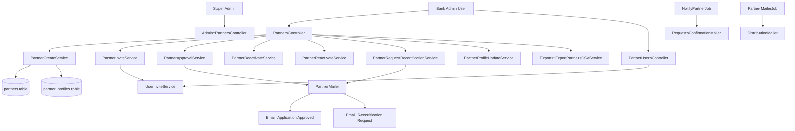
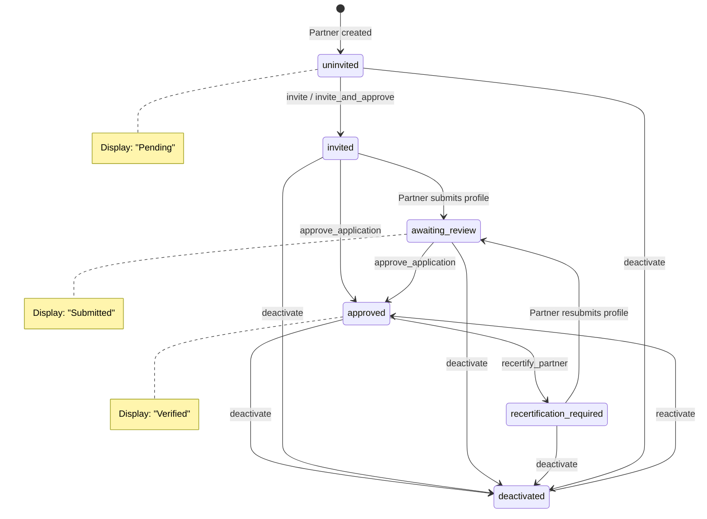
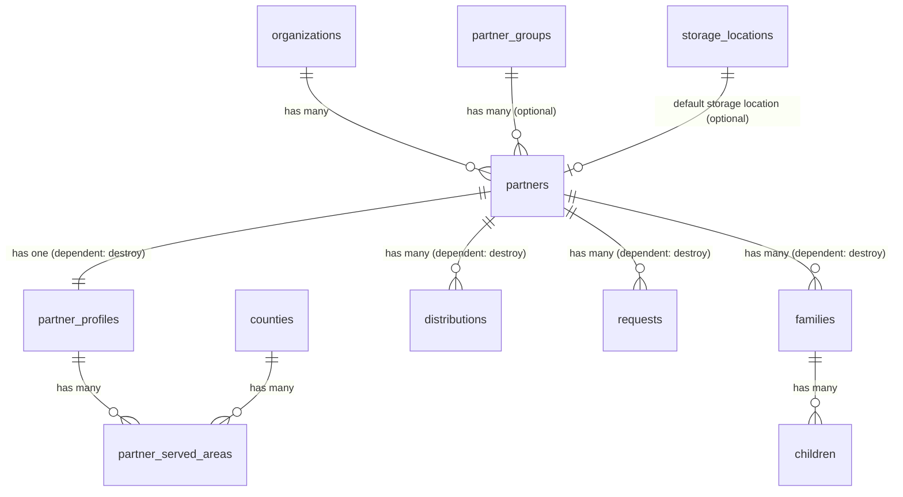

# Partners

> **Status**: Active
> **Generated**: 2026-06-13T00:00:00Z
> **Last Updated**: 2026-06-13T00:00:00Z

---

## Overview

### What It Does
The Partners feature manages partner organizations (agencies) from the essentials bank's administrative side. It provides a complete lifecycle for partner management: creating partner records, inviting them to the platform, reviewing and approving their applications, requesting recertification, deactivating/reactivating them, and managing partner users. It also supports CSV import/export, document attachments, quota tracking, and distribution history viewing.

### Why It Exists
Essentials banks (diaper banks, period supply banks, etc.) distribute supplies through a network of partner agencies. The bank needs to onboard, vet, and manage these partner organizations -- tracking their status, controlling their access to request supplies, and maintaining audit trails of all distributions made to each partner.

### Key Capabilities
- Create and edit partner organizations with name, email, group assignment, quota, and notes
- Invite partners to the platform via email (triggers user account creation via Devise)
- Approve partner applications (after partner submits their profile for review)
- Request recertification of partner information
- Deactivate and reactivate partners
- Combined invite-and-approve in a single action
- Manage partner users (invite, remove access, resend invitations, reset passwords)
- CSV import of partners in bulk and CSV export of partner data with profile fields
- Attach PDF/DOC documents to partner records
- View distribution history per partner
- Track impact metrics (families served, children served, zip codes)
- Filter partners by status; group partners via partner groups
- Super admin management of partners across all organizations

---

## Architecture

### High-Level Design



### Partner Status Lifecycle



### Components

#### Backend Components
| Component | File Path | Purpose |
|-----------|-----------|---------|
| PartnersController | `app/controllers/partners_controller.rb` | Full CRUD + invite, approve, deactivate, reactivate, recertify |
| PartnerUsersController | `app/controllers/partner_users_controller.rb` | Manage users belonging to a partner (invite, remove, resend, reset password) |
| Admin::PartnersController | `app/controllers/admin/partners_controller.rb` | Super admin index/show/edit/update of partners across all orgs |
| Partner | `app/models/partner.rb` | Core model with status enum, associations, validations, CSV import |
| PartnerCreateService | `app/services/partner_create_service.rb` | Creates partner + associated Partners::Profile in transaction |
| PartnerInviteService | `app/services/partner_invite_service.rb` | Sets status to invited, triggers UserInviteService |
| PartnerApprovalService | `app/services/partner_approval_service.rb` | Approves partner, sends approval email |
| PartnerDeactivateService | `app/services/partner_deactivate_service.rb` | Sets status to deactivated |
| PartnerReactivateService | `app/services/partner_reactivate_service.rb` | Sets status back to approved |
| PartnerProfileUpdateService | `app/services/partner_profile_update_service.rb` | Updates partner and profile in transaction, rebuilds served areas |
| PartnerRequestRecertificationService | `app/services/partner_request_recertification_service.rb` | Sets status to recertification_required, sends recertification email |
| ExportPartnersCSVService | `app/services/exports/export_partners_csv_service.rb` | Generates CSV export with profile fields based on org's enabled partials |
| PartnersHelper | `app/helpers/partners_helper.rb` | View helpers for status badges, boolean display, section errors |
| PartnerMailer | `app/mailers/partner_mailer.rb` | Sends approval and recertification emails |
| PartnerMailerJob | `app/jobs/partner_mailer_job.rb` | Background job to notify partner about pending distribution |
| NotifyPartnerJob | `app/jobs/notify_partner_job.rb` | Background job to send request confirmation email (skips deactivated partners) |

#### View Templates
| Template | Purpose |
|----------|---------|
| `app/views/partners/index.html.erb` | Partners list with tabs for partners and partner groups |
| `app/views/partners/show.html.erb` | Partner detail: status, contacts, profile, documents, distribution history |
| `app/views/partners/new.html.erb` | New partner form |
| `app/views/partners/edit.html.erb` | Edit partner form |
| `app/views/partners/_form.html.erb` | Shared form partial (name, email, storage location, group, reminders, quota, notes, info, documents) |
| `app/views/partner_users/` | Partner user management views |
| `app/views/partner_mailer/` | Email templates for approval and recertification |
| `app/views/admin/partners/` | Super admin partner views |

### Technology Stack
- **Backend**: Ruby on Rails, ActiveRecord, PaperTrail (audit trail), Rolify (resourcify)
- **Frontend**: ERB templates, AdminLTE, Stimulus.js (checkbox controller)
- **Database**: PostgreSQL
- **Background Jobs**: ActiveJob (Delayed Job adapter)
- **Email**: ActionMailer (PartnerMailer, DistributionMailer, RequestsConfirmationMailer)
- **File Uploads**: ActiveStorage (partner documents)

---

## Model Details

### Partner

#### Associations
```ruby
# Source: app/models/partner.rb
belongs_to :organization
belongs_to :partner_group, optional: true

has_many :item_categories, through: :partner_group
has_many :requestable_items, through: :item_categories, source: :items
has_one :profile, class_name: 'Partners::Profile', dependent: :destroy

has_many :distributions, dependent: :destroy
has_many :requests, dependent: :destroy, class_name: '::Request'
has_many :users, through: :roles, class_name: '::User', dependent: :destroy
has_many :families, dependent: :destroy, class_name: 'Partners::Family'
has_many :children, through: :families, class_name: 'Partners::Child'
has_many :authorized_family_members, through: :families, class_name: 'Partners::AuthorizedFamilyMember'
has_one :default_storage_location, class_name: 'StorageLocation', dependent: :nullify, foreign_key: 'id', primary_key: 'default_storage_location_id', inverse_of: false

has_many_attached :documents
```

#### Concerns
| Concern | Purpose |
|---------|---------|
| `Filterable` | Adds `class_filter` method for chaining scopes from filter params |
| `Exportable` | Adds export-related functionality |
| `has_paper_trail` | Version tracking / audit trail for all changes |
| `resourcify` | Rolify integration -- allows role-based access (users can have `Role::PARTNER` on a specific partner) |

#### Enum
```ruby
# Source: app/models/partner.rb:32
# Status `4` (error) was removed for being obsolete but is intentionally skipped to preserve existing enum values.
enum :status, { uninvited: 0, invited: 1, awaiting_review: 2, approved: 3, recertification_required: 5, deactivated: 6 }
```

#### Validations
```ruby
# Source: app/models/partner.rb:51-57
validates :name, presence: true, uniqueness: { scope: :organization }
validates :email, presence: true, uniqueness: { case_sensitive: false }, format: { with: URI::MailTo::EMAIL_REGEXP }
validates :quota, numericality: { greater_than_or_equal_to: 0 }, allow_blank: true
validate :correct_document_mime_type
```

#### Callbacks
| Callback | Method | Purpose |
|----------|--------|---------|
| `before_save` | `email&.downcase!` | Normalizes email to lowercase |
| `before_update` | `:invite_new_partner` | Re-invites partner if email changed while in active status and no existing user with that email has the partner role |

#### Scopes
```ruby
# Source: app/models/partner.rb:62-68
scope :alphabetized, -> { order(:name) }
scope :active, -> { where.not(status: :deactivated) }
scope :by_status, ->(status) { where(status: status.to_sym) }
```

#### Key Methods
| Method | Returns | Purpose | Notes |
|--------|---------|---------|-------|
| `display_status` | `String` | Human-readable status name | Maps `awaiting_review` to "Submitted", `uninvited` to "Pending", `approved` to "Verified" |
| `primary_user` | `User` | First user created for the partner | Ordered by `created_at ASC` |
| `deletable?` | `Boolean` | Whether partner can be destroyed | True only if `uninvited?` AND no distributions, requests, or users |
| `approvable?` | `Boolean` | Whether partner can be approved | True if `invited?` or `awaiting_review?` |
| `import_csv(csv, organization_id)` | `Array<String>` | Class method to bulk-import partners from CSV | Creates partners via PartnerCreateService, returns array of error strings |
| `partials_to_show` | `Array` | Delegates to organization's partials_to_show | Controls which profile sections are visible |
| `quantity_year_to_date` | `Integer` | Total items distributed to partner in current year | Sums line_item quantities from distributions |
| `impact_metrics` | `Hash` | Returns families_served, children_served, family_zipcodes, family_zipcodes_list | Used on show page for non-uninvited partners |
| `quota_exceeded?(total)` | `Boolean` | Whether total exceeds partner's quota | Returns false if quota is blank |

#### Constants
```ruby
# Source: app/models/partner.rb:25-29
ALLOWED_MIME_TYPES = [
  "application/pdf",
  "application/msword",
  "application/vnd.openxmlformats-officedocument.wordprocessingml.document"
].freeze
```

---

## Database Schema

### partners

| Column | Type | Default | Notes |
|--------|------|---------|-------|
| `id` | `serial` (integer) | auto-increment | Primary key |
| `name` | `string` | | Partner agency name |
| `email` | `string` | | Contact email (downcased on save) |
| `created_at` | `datetime` | | |
| `updated_at` | `datetime` | | |
| `organization_id` | `integer` | | FK to organizations |
| `status` | `integer` | `0` | Enum: 0=uninvited, 1=invited, 2=awaiting_review, 3=approved, 5=recertification_required, 6=deactivated |
| `send_reminders` | `boolean` | `false` | Whether to receive reminder emails |
| `notes` | `text` | | Internal notes from bank admin |
| `quota` | `integer` | | Maximum items per distribution (nullable) |
| `partner_group_id` | `bigint` | | FK to partner_groups (nullable) |
| `default_storage_location_id` | `bigint` | | FK to storage_locations (nullable) |
| `info_for_partner` | `text` | | Bank-to-partner notes visible to partner (max 500 chars in UI) |

#### Indexes
| Name | Columns |
|------|---------|
| `index_partners_on_default_storage_location_id` | `default_storage_location_id` |
| `index_partners_on_organization_id` | `organization_id` |
| `index_partners_on_partner_group_id` | `partner_group_id` |

### partner_profiles

| Column | Type | Default | Notes |
|--------|------|---------|-------|
| `id` | `bigint` | auto-increment | Primary key |
| `essentials_bank_id` | `bigint` | | FK to organizations |
| `partner_id` | `integer` | | FK to partners |
| `name` | `string` | | |
| `agency_type` | `string` | | |
| `agency_mission` | `text` | | |
| `address1` | `string` | | |
| `address2` | `string` | | |
| `city` | `string` | | |
| `state` | `string` | | |
| `zip_code` | `string` | | |
| `website` | `string` | | |
| `facebook` | `string` | | |
| `twitter` | `string` | | |
| `instagram` | `string` | | |
| `no_social_media_presence` | `boolean` | | |
| `founded` | `integer` | | Year founded |
| `form_990` | `boolean` | | |
| `program_name` | `string` | | |
| `program_description` | `text` | | |
| `program_age` | `string` | | |
| `case_management` | `boolean` | | |
| `evidence_based` | `boolean` | | |
| `essentials_use` | `string` | | |
| `receives_essentials_from_other` | `string` | | |
| `currently_provide_diapers` | `boolean` | | |
| `program_address1` | `string` | | |
| `program_address2` | `string` | | |
| `program_city` | `string` | | |
| `program_state` | `string` | | |
| `program_zip_code` | `integer` | | |
| `client_capacity` | `string` | | |
| `storage_space` | `boolean` | | |
| `describe_storage_space` | `text` | | |
| `income_requirement_desc` | `boolean` | | |
| `income_verification` | `boolean` | | |
| `population_black` | `integer` | | Percentage |
| `population_white` | `integer` | | Percentage |
| `population_hispanic` | `integer` | | Percentage |
| `population_asian` | `integer` | | Percentage |
| `population_american_indian` | `integer` | | Percentage |
| `population_island` | `integer` | | Percentage |
| `population_multi_racial` | `integer` | | Percentage |
| `population_other` | `integer` | | Percentage |
| `zips_served` | `string` | | |
| `at_fpl_or_below` | `integer` | | Percentage at or below federal poverty level |
| `above_1_2_times_fpl` | `integer` | | Percentage |
| `greater_2_times_fpl` | `integer` | | Percentage |
| `poverty_unknown` | `integer` | | Percentage |
| `executive_director_name` | `string` | | |
| `executive_director_phone` | `string` | | |
| `executive_director_email` | `string` | | |
| `primary_contact_name` | `string` | | |
| `primary_contact_phone` | `string` | | |
| `primary_contact_mobile` | `string` | | |
| `primary_contact_email` | `string` | | |
| `pick_up_name` | `string` | | |
| `pick_up_phone` | `string` | | |
| `pick_up_email` | `string` | | |
| `distribution_times` | `string` | | |
| `new_client_times` | `string` | | |
| `more_docs_required` | `string` | | |
| `sources_of_funding` | `string` | | |
| `sources_of_diapers` | `string` | | |
| `essentials_budget` | `string` | | |
| `essentials_funding_source` | `string` | | |
| `created_at` | `datetime` | | |
| `updated_at` | `datetime` | | |
| `other_agency_type` | `string` | | |
| `status_in_diaper_base` | `string` | | Legacy field |
| `enable_child_based_requests` | `boolean` | `true` | |
| `enable_individual_requests` | `boolean` | `true` | |
| `enable_quantity_based_requests` | `boolean` | `true` | Added later than other enable flags |

#### Indexes
| Name | Columns |
|------|---------|
| `index_partners_on_essentials_bank_id` | `essentials_bank_id` |

### partner_served_areas

| Column | Type | Default | Notes |
|--------|------|---------|-------|
| `id` | `bigint` | auto-increment | Primary key |
| `partner_profile_id` | `bigint` | not null | FK to partner_profiles |
| `county_id` | `bigint` | not null | FK to counties |
| `client_share` | `integer` | | Percentage of clients in this county |
| `created_at` | `datetime` | | |
| `updated_at` | `datetime` | | |

### Relationships


---

## API Endpoints

### PartnersController (bank-side)

| Method | Path | Action | Description | Notes |
|--------|------|--------|-------------|-------|
| `GET` | `/partners` | `index` | List all partners for current org | Supports CSV format; filters by status; defaults to active partners |
| `GET` | `/partners/new` | `new` | New partner form | |
| `POST` | `/partners` | `create` | Create a new partner | Uses PartnerCreateService |
| `GET` | `/partners/:id` | `show` | Show partner details, profile, distributions | Supports CSV export of partner distributions |
| `GET` | `/partners/:id/edit` | `edit` | Edit partner form | |
| `PATCH/PUT` | `/partners/:id` | `update` | Update partner attributes | |
| `DELETE` | `/partners/:id` | `destroy` | Delete partner | |
| `POST` | `/partners/import_csv` | `import_csv` | Bulk import partners from CSV | Via Importable concern |
| `GET` | `/partners/:id/profile` | `profile` | View partner profile | Member route |
| `PATCH` | `/partners/:id/profile` | `profile` | Update partner profile | Member route |
| `GET` | `/partners/:id/approve_application` | `approve_application` | Approve a partner application | Uses PartnerApprovalService |
| `POST` | `/partners/:id/invite` | `invite` | Send invitation to partner | Uses PartnerInviteService |
| `POST` | `/partners/:id/invite_and_approve` | `invite_and_approve` | Invite then approve in one step | Chains PartnerInviteService + PartnerApprovalService |
| `POST` | `/partners/:id/recertify_partner` | `recertify_partner` | Request partner recertification | Uses PartnerRequestRecertificationService |
| `PUT` | `/partners/:id/deactivate` | `deactivate` | Deactivate a partner | Uses PartnerDeactivateService |
| `PUT` | `/partners/:id/reactivate` | `reactivate` | Reactivate a deactivated partner | Uses PartnerReactivateService; validates partner is deactivated |

### PartnerUsersController (nested under partners)

| Method | Path | Action | Description | Notes |
|--------|------|--------|-------------|-------|
| `GET` | `/partners/:partner_id/users` | `index` | List users for a partner | Requires org admin role |
| `POST` | `/partners/:partner_id/users` | `create` | Invite a new user to partner | Uses UserInviteService with Role::PARTNER |
| `DELETE` | `/partners/:partner_id/users/:id` | `destroy` | Remove user's partner access | Removes Role::PARTNER from user |
| `POST` | `/partners/:partner_id/users/:id/resend_invitation` | `resend_invitation` | Resend invitation email | Only if user has not accepted yet |
| `POST` | `/partners/:partner_id/users/:id/reset_password` | `reset_password` | Send password reset email | Calls `send_reset_password_instructions` |

### Admin::PartnersController (super admin)

| Method | Path | Action | Description | Notes |
|--------|------|--------|-------------|-------|
| `GET` | `/admin/partners` | `index` | List all partners across all organizations | Ordered by name (case-insensitive) |
| `GET` | `/admin/partners/:id` | `show` | Show partner details | |
| `GET` | `/admin/partners/:id/edit` | `edit` | Edit partner form | |
| `PATCH/PUT` | `/admin/partners/:id` | `update` | Update partner name/email | Only permits name and email |

---

## Authorization

This feature does not use Pundit policies. Authorization is handled through:

| Mechanism | Location | Description |
|-----------|----------|-------------|
| `before_action :authorize_admin` | `PartnerUsersController` | Restricts partner user management to org admins |
| `before_action :validate_user_role` | `PartnersController#show` | Redirects partner-role users to partner portal |
| `skip_before_action :require_organization` | `PartnersController#show` | Allows show without org context |
| `AdminController` inheritance | `Admin::PartnersController` | Restricts to super admin role |
| `can_administrate?` helper | Show view | Controls visibility of approve button |
| `current_user.has_cached_role?(Role::ORG_ADMIN, ...)` | Show view | Controls visibility of "Manage Users" button |

---

## Configuration

### Organization-Level Settings
The following organization settings affect partner behavior:

| Setting | Column | Purpose |
|---------|--------|---------|
| `partner_form_fields` | `organizations.partner_form_fields` | Array of profile section names to show/collect |
| `enable_child_based_requests` | `organizations.enable_child_based_requests` | Copied to new partner profiles |
| `enable_individual_requests` | `organizations.enable_individual_requests` | Copied to new partner profiles |
| `enable_quantity_based_requests` | `organizations.enable_quantity_based_requests` | Copied to new partner profiles |
| `one_step_partner_invite` | `organizations.one_step_partner_invite` | Enables one-step invite+approve flow |

### CSV Import Template
Partners can be imported via CSV at `/partners_template.csv`. The CSV must include `name` and `email` columns.

---

## Usage Examples

### Creating a Partner (Service)
```ruby
# Source: app/services/partner_create_service.rb:11-36
def call
  @partner = organization.partners.build(partner_attrs)

  if @partner.valid?
    ActiveRecord::Base.transaction do
      @partner.save!

      Partners::Profile.create!({
                                  partner_id: @partner.id,
                                  name: @partner.name,
                                  enable_child_based_requests: organization.enable_child_based_requests,
                                  enable_individual_requests: organization.enable_individual_requests,
                                  enable_quantity_based_requests: organization.enable_quantity_based_requests
                                })
    rescue StandardError => e
      errors.add(:base, e.message)
      raise ActiveRecord::Rollback
    end
  else
    @partner.errors.each do |error|
      errors.add(error.attribute, error.message)
    end
  end

  self
end
```

### Inviting a Partner (Service)
```ruby
# Source: app/services/partner_invite_service.rb:9-17
def call
  partner.update!(status: 'invited')
  UserInviteService.invite(email: partner.email,
    name: partner.name,
    roles: [Role::PARTNER],
    resource: partner,
    force: @force)
rescue => e
  errors.add(:base, e.message)
end
```

### Auto Re-invite on Email Change
```ruby
# Source: app/models/partner.rb:169-186
def invite_new_partner
  UserInviteService.invite(email: email, roles: [Role::PARTNER], resource: self)
end

def should_invite_because_email_changed?
  email_changed? &&
    (
      invited? ||
      awaiting_review? ||
      recertification_required? ||
      approved?
    ) &&
    !partner_user_with_same_email_exist?
end

def partner_user_with_same_email_exist?
  User.exists?(email: email) && User.find_by(email: email).has_role?(Role::PARTNER, self)
end
```

---

## Testing

### Test Files
- `spec/models/partner_spec.rb` -- Model validations, associations, methods
- `spec/requests/partners_requests_spec.rb` -- Request specs for PartnersController
- `spec/services/partner_create_service_spec.rb` -- PartnerCreateService unit tests
- `spec/services/partner_invite_service_spec.rb` -- PartnerInviteService unit tests
- `spec/services/partner_approval_service_spec.rb` -- PartnerApprovalService unit tests
- `spec/services/partner_profile_update_service_spec.rb` -- PartnerProfileUpdateService unit tests
- `spec/services/partner_request_recertification_service_spec.rb` -- PartnerRequestRecertificationService unit tests

---

## Known Issues & Caveats

| Issue | Location | Description |
|-------|----------|-------------|
| Skipped enum value | `app/models/partner.rb:32` | Status enum skips value `4` (formerly "error"). Comment explains this is intentional to preserve existing values. |
| Deletable check is redundant | `app/controllers/partners_controller.rb:109` | `destroy` action checks `if partner` after `find` which would already raise `ActiveRecord::RecordNotFound` if not found. The `deletable?` guard is not called in the controller. |
| Email change triggers re-invite | `app/models/partner.rb:60` | `before_update :invite_new_partner` fires when email changes on an active partner. This is a model-level side effect that may surprise developers. |
| N+1 in CSV export | `app/services/exports/export_partners_csv_service.rb:171` | `build_row_data` calls `base_table.values` for each partner, which re-evaluates all lambdas. The `diaper_statuses` and `period_supplies_statuses` are memoized but `county_list_by_regions` queries are also memoized. |
| `default_storage_location` association hack | `app/models/partner.rb:47` | Uses `foreign_key: 'id', primary_key: 'default_storage_location_id'` which inverts the typical FK direction. This means `dependent: :nullify` would nullify the storage location's `id` field, which is incorrect -- but ActiveRecord won't actually do this for a `has_one` with a PK-based lookup. |
| PartnerMailerJob misleading name | `app/jobs/partner_mailer_job.rb` | Despite the name, this job sends emails via `DistributionMailer.partner_mailer`, not `PartnerMailer`. |

---

## Performance

### Database Optimization

#### Indexes on partners table
| Index | Columns |
|-------|---------|
| `index_partners_on_default_storage_location_id` | `default_storage_location_id` |
| `index_partners_on_organization_id` | `organization_id` |
| `index_partners_on_partner_group_id` | `partner_group_id` |

#### Eager Loading
- `PartnersController#index` uses `includes(:partner_group)` to avoid N+1 on partner group display
- `PartnersController#show` uses `includes(:partner, :storage_location, line_items: [:item])` on distributions
- `ExportPartnersCSVService` uses `includes(:profile)` on partners collection

### CSV Export Optimization
The CSV export service memoizes expensive queries:
- `diaper_statuses` -- single query for all partners with diaper distributions in last 12 months
- `period_supplies_statuses` -- single query for all partners with period supply distributions in last 12 months
- `county_list_by_regions` -- single query using `STRING_AGG` to aggregate county names per partner

---

## Troubleshooting

### Common Issues

#### Issue: Partner Cannot Be Approved
**Symptoms:**
- "Partner is not waiting for approval" error

**Cause:**
Partner must be in `invited` or `awaiting_review` status to be approved. The `approvable?` method checks this.

**Solution:**
Verify partner status. If uninvited, invite first. If deactivated, reactivate first (which sets to approved directly).

#### Issue: Partner Cannot Be Deleted
**Symptoms:**
- Partner delete succeeds at controller level but `deletable?` returns false

**Cause:**
The `deletable?` method requires `uninvited?` status AND no distributions, requests, or users. However, the controller's `destroy` action does not check `deletable?` -- it calls `partner.destroy` directly, which will fail if there are dependent records with restrict constraints.

#### Issue: Partner Email Change Triggers Unexpected Invite
**Symptoms:**
- Updating a partner's email sends an invitation email

**Cause:**
The `before_update :invite_new_partner` callback fires when `email_changed?` is true and the partner is in an active status (invited, awaiting_review, recertification_required, or approved).

---

## Related Features

- **[Partner Groups](./partner-groups.md)** -- Groups partners for item category restrictions and reminder configuration
- **[Partner Portal](./partner-portal.md)** -- Partner-facing portal where partners manage profiles, families, children, and submit requests
- **[Requests](./requests.md)** -- Bank-side view of requests submitted by partners
- **[Distributions](./distributions.md)** -- Distributions of supplies to partners
- **[Users & Authentication](./users-authentication.md)** -- User invite flow used when inviting partner users

---

**Generated:** 2026-06-13T00:00:00Z
**Last Updated:** 2026-06-13T00:00:00Z
**Status:** Active
