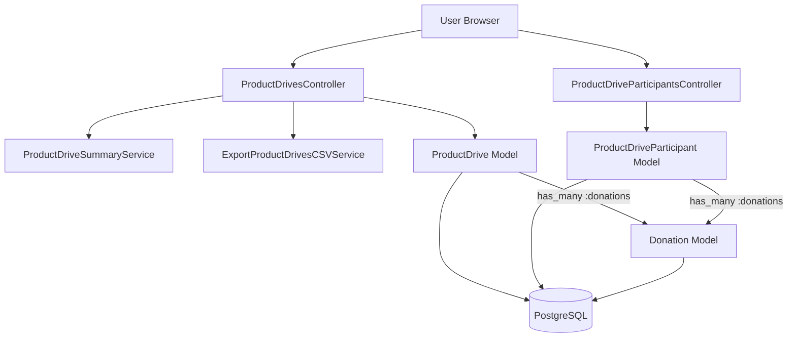
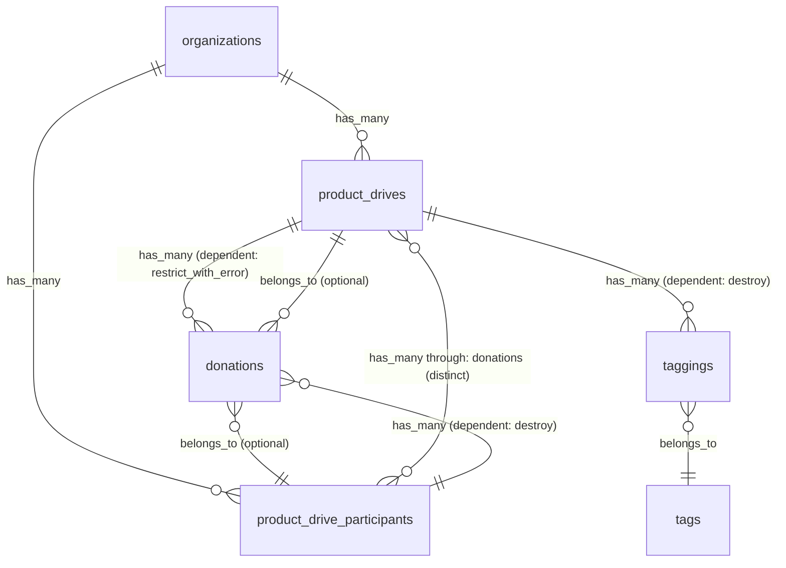
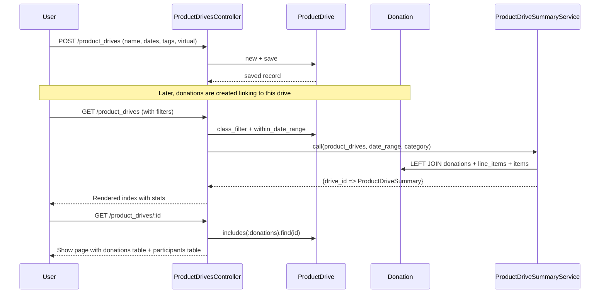

# Product Drives

> **Status**: Active
> **Generated**: 2026-06-13T00:00:00Z
> **Last Updated**: 2026-06-13T00:00:00Z

---

## Overview

### What It Does
Product Drives allow essentials bank organizations to organize, track, and report on community donation drives. Each drive has a name, date range, optional virtual flag, and tags. Donations received during a drive are linked to the drive record, and optionally to individual drive participants (businesses or contacts who collected items). The feature provides filtering, summary statistics (quantity, variety, in-kind value), CSV export, and per-drive detail views showing associated donations and participants.

### Why It Exists
Essentials banks run product drives as a primary mechanism for collecting donated goods from the community. Tracking drives separately from individual donations lets organizations measure the effectiveness of each drive campaign, recognize participant contributions, and generate reports for stakeholders and funders.

### Key Capabilities
- Create, edit, delete, and list product drives with date ranges, virtual flag, and tags
- Filter drives by name, item category, tags, and date range
- View per-drive summary statistics: total quantity, distinct item count, in-kind value
- View per-drive donations and participants on the show page
- Export filtered product drives to CSV with per-item quantity columns
- Manage product drive participants (businesses/contacts) with CSV import/export
- Track participant donation volumes across drives

---

## Architecture

### High-Level Design


### Components

#### Backend Components
| Component | File Path | Purpose |
|-----------|-----------|---------|
| ProductDrivesController | `app/controllers/product_drives_controller.rb` | Full CRUD for product drives; index with filters, CSV export |
| ProductDriveParticipantsController | `app/controllers/product_drive_participants_controller.rb` | CRUD (except destroy) for participants; CSV import/export |
| ProductDrive | `app/models/product_drive.rb` | Drive model with date validation, scopes, summary methods |
| ProductDriveParticipant | `app/models/product_drive_participant.rb` | Participant model with contact info, geocoding, volume calculation |
| ProductDriveSummaryService | `app/services/product_drive_summary_service.rb` | Calculates quantity, unique item count, value per drive |
| ExportProductDrivesCSVService | `app/services/exports/export_product_drives_csv_service.rb` | Generates CSV with drive stats and per-item quantity columns |
| ProductDriveHelper | `app/helpers/product_drive_helper.rb` | View helper for virtual flag display |
| Importable (concern) | `app/controllers/concerns/importable.rb` | Shared CSV import action (used by participants controller) |

#### Frontend Components
| Component | File Path | Purpose |
|-----------|-----------|---------|
| Product Drives Index | `app/views/product_drives/index.html.erb` | Lists drives with filters, summary stats, pagination, CSV export button |
| Product Drives Show | `app/views/product_drives/show.html.erb` | Drive detail with donations table and participants table |
| Product Drives Form | `app/views/product_drives/_form.html.erb` | Shared form partial (name, dates, tags via Select2, virtual checkbox) |
| Product Drives New Modal | `app/views/product_drives/_new_modal.html.erb` | Bootstrap modal wrapper for the form (used inline from donation form) |
| Product Drives New | `app/views/product_drives/new.html.erb` | Full-page new drive form |
| Product Drives Edit | `app/views/product_drives/edit.html.erb` | Full-page edit drive form |
| Create JS | `app/views/product_drives/create.js.erb` | JS response for AJAX create |
| New Modal JS | `app/views/product_drives/new_modal.js.erb` | JS response to render new modal |
| Participants Index | `app/views/product_drive_participants/index.html.erb` | Lists participants with volume, CSV import/export |
| Participants Show | `app/views/product_drive_participants/show.html.erb` | Participant detail |
| Participants Form | `app/views/product_drive_participants/_form.html.erb` | Participant form (business name, contact, phone, email, address, comment) |
| Participants Row | `app/views/product_drive_participants/_product_drive_participant_row.html.erb` | Table row partial for participants index |
| Participants New Modal | `app/views/product_drive_participants/_new_modal.html.erb` | Modal wrapper for participant form |
| Participants New | `app/views/product_drive_participants/new.html.erb` | Full-page new participant form |
| Participants Edit | `app/views/product_drive_participants/edit.html.erb` | Full-page edit participant form |
| Participants Create JS | `app/views/product_drive_participants/create.js.erb` | JS response for AJAX create |
| Participants New Modal JS | `app/views/product_drive_participants/new_modal.js.erb` | JS response to render new modal |

### Technology Stack
- **Backend**: Ruby on Rails (ApplicationController, SimpleForm, Kaminari pagination)
- **Frontend**: ERB templates, AdminLTE layout, Select2 (tags input), Bootstrap modals, JS/AJAX for modal forms
- **Database**: PostgreSQL
- **External Services**: Geocoder gem (for participant address geocoding, skipped in development)

---

## Model Details

### ProductDrive

#### Associations
```ruby
# Source: app/models/product_drive.rb
belongs_to :organization, optional: true
has_many :donations, dependent: :restrict_with_error
has_many :product_drive_participants, -> { distinct }, through: :donations
```

#### Concerns
| Concern | Purpose |
|---------|---------|
| `Filterable` | Adds `class_filter` class method that chains named scopes from a params hash |
| `Taggable` | Adds `has_many :taggings, as: :taggable, dependent: :destroy` and `has_many :tags, through: :taggings`; adds `by_tags` scope and `tags_for_display` method |
| `has_paper_trail` | PaperTrail version tracking for audit history |

#### Validations
```ruby
# Source: app/models/product_drive.rb:36-42
validates :name, presence:
  { message: "A name must be chosen." }
validates :start_date, presence:
  { message: "Please enter a start date." }
validate :end_date_is_bigger_of_end_date
```

#### Callbacks
| Callback | Method | Purpose |
|----------|--------|---------|
| (none defined directly) | — | No direct callbacks; `Taggable` adds `dependent: :destroy` on taggings |

#### Scopes
| Scope | Purpose |
|-------|---------|
| `by_name(name_filter)` | Filter by exact name match |
| `by_item_category_id(id)` | Filter by item category through donations -> line_items -> items |
| `within_date_range(search_range)` | Filter drives overlapping a date range string ("start - end") |
| `alphabetized` | Order by name ascending |

#### Key Methods
| Method | Returns | Purpose | Notes |
|--------|---------|---------|-------|
| `end_date_is_bigger_of_end_date` | `nil` | Custom validation: end_date must be after start_date | Skips if either date is nil |
| `donation_quantity` | `Integer` | Sum of all line_item quantities across all donations | |
| `distinct_items_count` | `Integer` | Count of distinct item_ids across all donations | |
| `in_kind_value` | `Integer` | Sum of `value_per_itemizable` across all donations | Value in cents |
| `donation_source_view` | `String` | Returns `"#{name} (product drive)"` | Used in donation source display |
| `self.search_date_range(dates)` | `Hash` | Parses `"start - end"` string into `{start_date:, end_date:}` | |
| `item_quantities_by_name_and_date(date_range)` | `Array<Integer>` | Per-item quantities filtered by date, sorted by item name | Used in CSV export |
| `donation_quantity_by_date(date_range, item_category_id)` | `Integer` | Donation quantity filtered by date range and optional category | |
| `distinct_items_count_by_date(date_range, item_category_id)` | `Integer` | Distinct item count filtered by date range and optional category | |

---

### ProductDriveParticipant

#### Associations
```ruby
# Source: app/models/product_drive_participant.rb
has_many :donations, inverse_of: :product_drive_participant, dependent: :destroy
```

#### Concerns
| Concern | Purpose |
|---------|---------|
| `Provideable` | Adds `belongs_to :organization`, `import_csv` class method, `csv_export_headers`/`csv_export_attributes` for CSV export. Includes `Exportable` which provides `generate_csv` class method |
| `Geocodable` | Adds `geocoded_by :address` and `after_validation :geocode` callback (skipped in development) |
| `has_paper_trail` | PaperTrail version tracking for audit history |

#### Validations
```ruby
# Source: app/models/product_drive_participant.rb:26-30
validates :phone, presence: { message: "Must provide a phone or an e-mail" }, if: proc { |pdp| pdp.email.blank? }
validates :email, presence: { message: "Must provide a phone or an e-mail" }, if: proc { |pdp| pdp.phone.blank? }
validates :contact_name, presence: { message: "Must provide a name or a business name" }, if: proc { |pdp| pdp.business_name.blank? }
validates :business_name, presence: { message: "Must provide a name or a business name" }, if: proc { |pdp| pdp.contact_name.blank? }
validates :comment, length: { maximum: 500 }
```

#### Callbacks
| Callback | Method | Purpose |
|----------|--------|---------|
| `after_validation` | `:geocode` | Geocodes the address field (from `Geocodable`; skipped in development) |

#### Scopes
| Scope | Purpose |
|-------|---------|
| `alphabetized` | Order by `contact_name` ascending |
| `with_volumes` | LEFT JOINs donations and line_items, selects SUM of quantities as `volume` |

#### Key Methods
| Method | Returns | Purpose | Notes |
|--------|---------|---------|-------|
| `volume` | `Integer` | Total line_item quantity across all donations | Computed in Ruby, not SQL |
| `volume_by_product_drive(product_drive_id)` | `Integer` | Volume filtered to a specific product drive | Uses `by_product_drive` scope on donations |
| `donation_source_view` | `String` or `nil` | Returns `"#{contact_name} (participant)"` | Returns nil if contact_name is blank |

---

## Database Schema

### product_drives

| Column | Type | Default | Notes |
|--------|------|---------|-------|
| `id` | `bigint` | auto-increment | Primary key |
| `name` | `string` | `NULL` | Drive name (validated present) |
| `start_date` | `date` | `NULL` | Drive start date (validated present) |
| `end_date` | `date` | `NULL` | Drive end date (optional) |
| `created_at` | `datetime` | `NULL` | Not null |
| `updated_at` | `datetime` | `NULL` | Not null |
| `organization_id` | `bigint` | `NULL` | FK to organizations |
| `virtual` | `boolean` | `false` | Not null; whether drive is virtual |

**Indexes:**
- `index_product_drives_on_organization_id` on (`organization_id`)

### product_drive_participants

| Column | Type | Default | Notes |
|--------|------|---------|-------|
| `id` | `integer` | auto-increment | Primary key |
| `contact_name` | `string` | `NULL` | Individual contact name |
| `email` | `string` | `NULL` | Contact email |
| `phone` | `string` | `NULL` | Contact phone |
| `comment` | `string` | `NULL` | Free-text comment (max 500 chars) |
| `organization_id` | `integer` | `NULL` | FK to organizations |
| `created_at` | `datetime` | `NULL` | Not null |
| `updated_at` | `datetime` | `NULL` | Not null |
| `address` | `string` | `NULL` | Physical address (geocoded) |
| `business_name` | `string` | `NULL` | Business/organization name |
| `latitude` | `float` | `NULL` | Geocoded latitude |
| `longitude` | `float` | `NULL` | Geocoded longitude |

**Indexes:**
- `index_product_drive_participants_on_latitude_and_longitude` on (`latitude`, `longitude`)

### Relationships


---

## API Endpoints

### Product Drives

| Method | Path | Action | Description | Notes |
|--------|------|--------|-------------|-------|
| `GET` | `/product_drives` | `index` | List product drives with filters and summary stats | Supports `.csv` format |
| `GET` | `/product_drives/new` | `new` | New product drive form | Supports XHR for modal |
| `POST` | `/product_drives` | `create` | Create a product drive | Supports JS response for modal |
| `GET` | `/product_drives/:id` | `show` | Show drive with donations and participants | |
| `GET` | `/product_drives/:id/edit` | `edit` | Edit product drive form | |
| `PATCH/PUT` | `/product_drives/:id` | `update` | Update a product drive | |
| `DELETE` | `/product_drives/:id` | `destroy` | Delete a product drive | Fails if donations exist (`restrict_with_error`) |

### Product Drive Participants

| Method | Path | Action | Description | Notes |
|--------|------|--------|-------------|-------|
| `GET` | `/product_drive_participants` | `index` | List participants with volumes | Supports `.csv` format |
| `GET` | `/product_drive_participants/new` | `new` | New participant form | Supports XHR for modal |
| `POST` | `/product_drive_participants` | `create` | Create a participant | Supports JS response for modal |
| `GET` | `/product_drive_participants/:id` | `show` | Show participant with donations | |
| `GET` | `/product_drive_participants/:id/edit` | `edit` | Edit participant form | |
| `PATCH/PUT` | `/product_drive_participants/:id` | `update` | Update a participant | |
| `POST` | `/product_drive_participants/import_csv` | `import_csv` | Bulk import participants from CSV | Via `Importable` concern |

### Related Report Endpoint

| Method | Path | Action | Description | Notes |
|--------|------|--------|-------------|-------|
| `GET` | `/reports/product_drives_summary` | `product_drives_summary` | Product drives summary report | Defined in ReportsController |

---

## Authorization

This application does not use Pundit policies for product drives. Authorization is handled via:

1. **Organization scoping**: All queries are scoped to `current_organization` in the controller, preventing cross-organization access.
2. **Role-based delete**: The show page only renders the delete button for users with the `Role::ORG_ADMIN` role:
```ruby
# Source: app/views/product_drives/show.html.erb:66
<%= delete_button_to product_drive_path(@product_drive), { confirm: "Are you sure you want to permanently remove this product drive?", size: "md" } if current_user.has_cached_role?(Role::ORG_ADMIN, current_organization) %>
```

Note: The `destroy` controller action itself does not check the role -- the authorization is only enforced at the view layer. Any authenticated user with a direct DELETE request could destroy a product drive.

---

## Configuration

No feature-specific environment variables or config files. The feature relies on:
- Standard Rails database configuration for PostgreSQL
- Geocoder gem configuration (for participant address geocoding, skipped in `development` environment)
- Kaminari for pagination (default page size)

---

## Usage Examples

### Creating a Product Drive (Controller)
```ruby
# Source: app/controllers/product_drives_controller.rb:44-58
def create
  @product_drive = current_organization.product_drives.new(product_drive_params)
  @product_drive.tags = tags_from_params
  respond_to do |format|
    if @product_drive.save
      format.html { redirect_to product_drives_path, notice: "New product drive added!" }
      format.js
    else
      set_tags
      flash.now[:error] = "Something didn't work quite right -- try again?"
      format.html { render action: :new }
      format.js { render template: "product_drives/new_modal" }
    end
  end
end
```

### Summary Calculation (Service)
```ruby
# Source: app/services/product_drive_summary_service.rb:16-18
def call(product_drives:, within_date_range:, item_category_id: nil)
  calculate_totals(product_drives, within_date_range, item_category_id)
end
```
Returns a hash of `{product_drive_id => ProductDriveSummary(quantity:, unique_item_count:, value:)}`. Drives with no matching donations default to zeroes via `NULL_PRODUCT_DRIVE_TOTALS`.

### CSV Export Row Generation
```ruby
# Source: app/services/exports/export_product_drives_csv_service.rb:28-39
def generate_row(drive)
  [
    drive.name.to_s,
    drive.start_date.strftime("%m-%d-%Y").to_s,
    drive.end_date&.strftime("%m-%d-%Y").to_s,
    (drive.virtual ? "Yes" : "No").to_s,
    drive.donation_quantity_by_date(date_range).to_s,
    drive.distinct_items_count_by_date(date_range).to_s,
    dollar_value(drive.in_kind_value).to_s,
    *drive.item_quantities_by_name_and_date(date_range)
  ]
end
```

### Participant Volume Calculation
```ruby
# Source: app/models/product_drive_participant.rb:39-45
def volume
  donations.map { |d| d.line_items.total }.reduce(:+)
end

def volume_by_product_drive(product_drive_id)
  donations.by_product_drive(product_drive_id).map { |d| d.line_items.total }.sum
end
```

---

## Data Flow: Product Drive Lifecycle



---

## Testing

### Test Files
- `spec/models/product_drive_spec.rb` -- Model specs for ProductDrive
- `spec/models/product_drive_participant_spec.rb` -- Model specs for ProductDriveParticipant
- `spec/requests/product_drives_requests_spec.rb` -- Request specs for ProductDrivesController
- `spec/requests/product_drive_participants_requests_spec.rb` -- Request specs for ProductDriveParticipantsController
- `spec/requests/reports/product_drives_summary_spec.rb` -- Request specs for the product drives summary report
- `spec/system/product_drive_system_spec.rb` -- System/integration specs for product drives
- `spec/system/product_drive_participant_system_spec.rb` -- System/integration specs for participants
- `spec/helpers/product_drive_helper_spec.rb` -- Helper specs for ProductDriveHelper
- `spec/factories/product_drives.rb` -- Factory definitions for product drives
- `spec/factories/product_drive_participants.rb` -- Factory definitions for participants
- `spec/fixtures/files/product_drive_participants.csv` -- CSV fixture for import testing
- `spec/support/pages/organization_reports_product_drives_summary_page.rb` -- Page object for report specs

---

## Known Issues & Caveats

| Issue | Location | Description |
|-------|----------|-------------|
| No destroy action for participants | `app/controllers/product_drive_participants_controller.rb:6` | TODO comment in controller: "Should there be a :destroy action for this?" Routes also exclude destroy (`except: [:destroy]`). Participants with donations cannot be orphaned since `dependent: :destroy` is set on the association -- deleting a participant would cascade-delete all its donations. |
| Delete authorization view-only | `app/views/product_drives/show.html.erb:66` | The delete button is only shown to `ORG_ADMIN` users, but the `destroy` controller action does not enforce this role check. Any authenticated org user could delete a drive via a direct DELETE request. |
| `set_product_drive` before_action unused | `app/controllers/product_drives_controller.rb:4,110-112` | `before_action :set_product_drive` sets `@product_drive_info` for `show`, `edit`, `update`, `destroy` -- but those actions each re-query with `current_organization.product_drives.find(params[:id])` into `@product_drive`, so `@product_drive_info` is never used in those actions. |
| `organization_id` optional on ProductDrive | `app/models/product_drive.rb:17` | `belongs_to :organization, optional: true` means a product drive could exist without an organization, though the controller always creates via `current_organization.product_drives`. |
| Volume computed in Ruby | `app/models/product_drive_participant.rb:39-40` | `volume` iterates donations in Ruby rather than using SQL aggregation. The `with_volumes` scope provides a SQL-based alternative used on the index page, but `volume` is used elsewhere (e.g., CSV export via Provideable). |
| Nested form in participants form | `app/views/product_drive_participants/_form.html.erb:1,12` | The form partial contains two nested `simple_form_for` calls for the same object, which is likely a bug -- the outer form tag wraps the inner one. |
| CSV in-kind value not date-filtered | `app/services/exports/export_product_drives_csv_service.rb:36` | `generate_row` calls `drive.in_kind_value` which sums ALL donations (not filtered by date range), while `donation_quantity_by_date` and `distinct_items_count_by_date` are date-filtered. This is inconsistent. |

---

## Performance

### Database Optimization
- **Index on `product_drives.organization_id`**: Supports org-scoped queries
- **Index on `product_drive_participants.(latitude, longitude)`**: Supports geographic queries
- **Summary service uses single SQL query**: `ProductDriveSummaryService` uses a single LEFT JOIN + GROUP BY + pluck query to compute stats for all drives at once, avoiding N+1

### Potential N+1 Concerns
- `ProductDrive#in_kind_value` calls `donations.sum(&:value_per_itemizable)` which loads all donations and calls a method on each
- `ProductDriveParticipant#volume` iterates donations in Ruby
- The index action mitigates this via `ProductDriveSummaryService` for display stats

---

## Troubleshooting

### Common Issues

#### Issue: Cannot delete a product drive
**Symptoms:**
- Error message on redirect: "Cannot delete record because dependent donations exist"

**Cause:**
The `has_many :donations, dependent: :restrict_with_error` association prevents deletion when donations reference this drive.

**Solution:**
Remove or reassign all donations linked to the product drive before deleting it. Edit each donation to change its source away from this product drive.

#### Issue: Product drive participants CSV import fails
**Symptoms:**
- Flash error "Check headers in file!"

**Cause:**
The CSV file has nil headers, possibly due to wrong encoding or extra columns without header names.

**Solution:**
Ensure the CSV has proper UTF-8 encoding (with or without BOM) and that all columns have header names matching: Business Name, Contact Name, Phone, Email.

---

## Related Features

- **[Donations](./donations.md)** -- Donations link to product drives via `product_drive_id` and to participants via `product_drive_participant_id`. The donation form includes a dropdown to select a product drive.
- **[Reports](./reports.md)** -- The product drives summary report (`/reports/product_drives_summary`) aggregates drive data for organizational reporting.
- **[Items](./items.md)** -- Item categories are used to filter product drive statistics by category.

---

**Generated:** 2026-06-13T00:00:00Z
**Last Updated:** 2026-06-13T00:00:00Z
**Status:** Active
