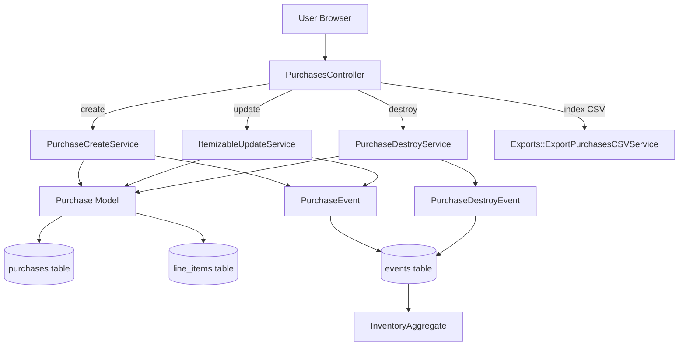
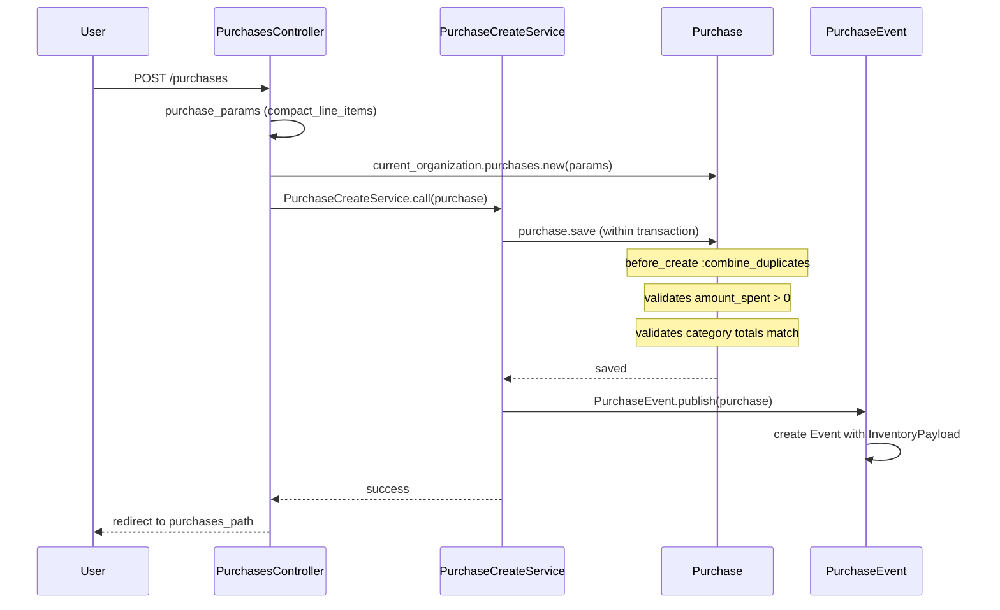
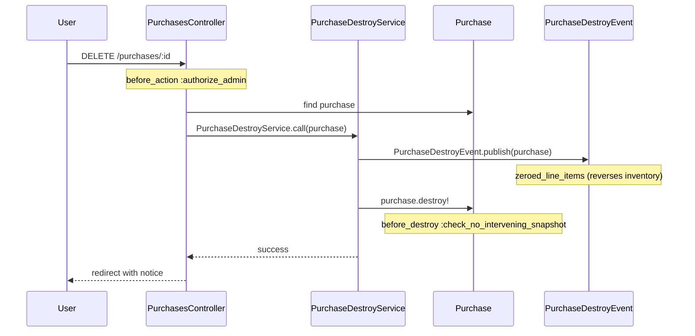
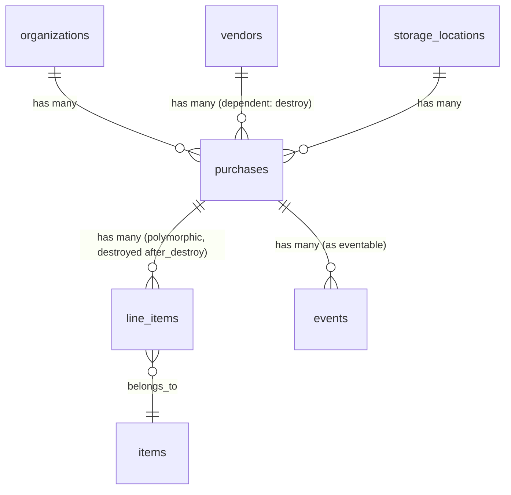

# Purchases

> **Status**: Active
> **Generated**: 2026-06-13T00:00:00Z
> **Last Updated**: 2026-06-13T00:00:00Z

---

## Overview

### What It Does
The Purchases feature allows diaper bank organizations to record and track inventory that they purchase from vendors. Each purchase records the vendor, storage location, monetary amount spent (broken down by product category), date, and the individual line items (items and quantities) that were acquired. Purchases increase inventory at the specified storage location via the event-sourcing system.

### Why It Exists
Diaper banks need to track purchased supplies separately from donated supplies for financial reporting, budgeting, and inventory management. This feature provides a complete audit trail of purchased goods including cost breakdowns by category (diapers, adult incontinence, period supplies, other), enabling organizations to generate summary reports and CSV exports.

### Key Capabilities
- Create, view, edit, and delete purchase records with line items
- Track monetary spend broken down by four product categories (diapers, adult incontinence, period supplies, other)
- Filter purchases by storage location, vendor, item category, and date range
- Export filtered purchases to CSV with per-item quantity columns
- Paginated index with running totals for quantity, dollar amount, and fair market value
- Event-sourced inventory updates via `PurchaseEvent` and `PurchaseDestroyEvent`
- Snapshot-aware guards that prevent editing/deleting purchases that precede an inventory snapshot

---

## Architecture

### High-Level Design


### Purchase Create Flow


### Purchase Destroy Flow


### Components

#### Backend Components
| Component | File Path | Purpose |
|-----------|-----------|---------|
| PurchasesController | `app/controllers/purchases_controller.rb` | Full CRUD for purchases with filtering, pagination, CSV export |
| Purchase | `app/models/purchase.rb` | Core model with monetary fields, validations, scopes |
| PurchaseCreateService | `app/services/purchase_create_service.rb` | Transactional create with event publishing |
| PurchaseDestroyService | `app/services/purchase_destroy_service.rb` | Transactional destroy with event publishing |
| ItemizableUpdateService | `app/services/itemizable_update_service.rb` | Shared update service handling line item diffs and events |
| ExportPurchasesCSVService | `app/services/exports/export_purchases_csv_service.rb` | Generates CSV with base columns + dynamic per-item columns |
| PurchaseEvent | `app/events/purchase_event.rb` | Publishes inventory-add event for event sourcing |
| PurchaseDestroyEvent | `app/events/purchase_destroy_event.rb` | Publishes inventory-zero event to reverse a purchase |
| PurchasesHelper | `app/helpers/purchases_helper.rb` | View helper for displaying `purchased_from` field |
| Vendor | `app/models/vendor.rb` | Vendor records; `has_many :purchases, dependent: :destroy` |

#### View Components
| Component | File Path | Purpose |
|-----------|-----------|---------|
| index | `app/views/purchases/index.html.erb` | Filterable, paginated list with totals footer |
| new | `app/views/purchases/new.html.erb` | New purchase form wrapper with barcode modal |
| edit | `app/views/purchases/edit.html.erb` | Edit form with audit/snapshot warnings |
| show | `app/views/purchases/show.html.erb` | Detail view with line items, edit/delete buttons |
| _purchase_form | `app/views/purchases/_purchase_form.html.erb` | Shared SimpleForm for vendor, storage, amounts, line items |
| _purchase_row | `app/views/purchases/_purchase_row.html.erb` | Table row partial for index listing |
| _purchase_item_row | `app/views/purchases/_purchase_item_row.html.erb` | Table row partial for show page line items |

### Technology Stack
- **Backend**: Ruby on Rails, SimpleForm, MoneyRails, PaperTrail, Kaminari (pagination)
- **Frontend**: ERB templates, AdminLTE (Bootstrap-based), Stimulus (`form-input` controller)
- **Database**: PostgreSQL
- **Event System**: Custom event sourcing via `Event` base class

---

## Model Details

### Purchase

#### Associations
```ruby
# Source: app/models/purchase.rb
belongs_to :organization
belongs_to :storage_location
belongs_to :vendor

# Via Itemizable concern:
has_many :line_items, as: :itemizable, inverse_of: :itemizable
has_many :items, through: :line_items
has_many :inactive_items, -> { inactive }, through: :line_items, source: :item
has_many :item_categories, through: :items
```

#### Concerns
| Concern | Purpose |
|---------|---------|
| `Itemizable` | Adds `has_many :line_items` (polymorphic), `accepts_nested_attributes_for :line_items`, `validates_associated :line_items`, methods: `value_per_itemizable`, `total_quantity`, `has_inactive_item?`, `inactive_items`, `line_item_values`; line_items collection methods: `combine!`, `total`, `sorted`, `quantities_by_category`, `quantities_by_name`, `total_value` |
| `Filterable` | Adds `class_filter(filtering_params)` class method that chains scopes from a params hash |
| `IssuedAt` | Adds `issued_at` presence validation, validates not before 2000 and not more than 1 year in the future, scopes: `by_issued_at`, `for_year` |
| `Exportable` | Adds `csv_export_headers`, `csv_export`, `generate_csv` class methods and `csv_export_attributes` instance method (both raise 'not implemented' by default) |
| `MoneyRails::ActionViewExtension` | Adds `humanized_money_with_symbol` and related money formatting helpers |

#### Monetized Fields
```ruby
# Source: app/models/purchase.rb:34-38
monetize :amount_spent_in_cents, as: :amount_spent
monetize :amount_spent_on_diapers_cents
monetize :amount_spent_on_adult_incontinence_cents
monetize :amount_spent_on_period_supplies_cents
monetize :amount_spent_on_other_cents
```

#### Callbacks
| Callback | Method | Purpose |
|----------|--------|---------|
| `before_save` | `:strip_symbols_from_money` | Strips `$` and `,` characters from money string fields |
| `before_create` | `:combine_duplicates` | Merges line items with the same `item_id` by summing quantities |
| `before_destroy` | `:check_no_intervening_snapshot` | Raises error if a `SnapshotEvent` exists after the purchase's `created_at` |
| `after_destroy` | (from Itemizable) | Destroys all associated `line_items` |

#### Validations
```ruby
# Source: app/models/purchase.rb:60-68
validates :amount_spent_in_cents, numericality: { greater_than: 0 }
validate :total_equal_to_all_categories
validate :line_items_quantity_is_positive
validates :amount_spent_on_diapers_cents, numericality: { greater_than_or_equal_to: 0 }
validates :amount_spent_on_adult_incontinence_cents, numericality: { greater_than_or_equal_to: 0 }
validates :amount_spent_on_period_supplies_cents, numericality: { greater_than_or_equal_to: 0 }
validates :amount_spent_on_other_cents, numericality: { greater_than_or_equal_to: 0 }

# Via IssuedAt concern:
validates :issued_at, presence: true
validate :issued_at_cannot_be_before_2000
validate :issued_at_cannot_be_further_than_1_year

# Via Itemizable concern:
validates_associated :line_items
```

The custom validation `total_equal_to_all_categories` checks that when category breakdowns are provided, they sum exactly to `amount_spent`. If all category fields are zero, the validation is skipped (allowing users to not break down their spending).

#### Scopes
```ruby
# Source: app/models/purchase.rb:42-56
scope :at_storage_location, ->(storage_location_id) {
  where(storage_location_id: storage_location_id)
}
scope :from_vendor, ->(vendor_id) {
  where(vendor_id: vendor_id)
}
scope :purchased_from, ->(purchased_from) { where(purchased_from: purchased_from) }
scope :during, ->(range) { where(purchases: { issued_at: range }) }
scope :recent, ->(count = 3) { order(issued_at: :desc).limit(count) }
scope :active, -> { joins(:line_items).joins(:items).where(items: { active: true }) }
scope :by_category, ->(item_category) {
  joins(line_items: {item: :item_category}).where("item_categories.name ILIKE ?", item_category)
}
```

#### Key Methods
| Method | Returns | Purpose | Notes |
|--------|---------|---------|-------|
| `storage_view` | `String` | Returns storage location name or "N/A" if nil | |
| `purchased_from_view` | `String` | Returns vendor business_name if vendor exists, otherwise raw `purchased_from` string | |
| `amount_spent_in_dollars` | `Float` | Returns amount_spent converted to dollars | |
| `self.organization_summary_by_dates(organization, date_range)` | `SummaryByDates` | Aggregates purchase data for reporting: total spent, recent purchases, per-category sums, total items | Returns a `Data.define` value object |
| `value_per_itemizable` | `Integer` | (from Itemizable) Sum of `value_per_line_item` across all line items | Fair market value |
| `total_quantity` | `Integer` | (from Itemizable) Sum of line item quantities | |

#### Data Object
```ruby
# Source: app/models/purchase.rb:70-78
SummaryByDates = Data.define(
  :amount_spent,
  :recent_purchases,
  :period_supplies,
  :diapers,
  :adult_incontinence,
  :other,
  :total_items
)
```

---

## Database Schema

### purchases

| Column | Type | Default | Notes |
|--------|------|---------|-------|
| `id` | `bigint` | auto | Primary key |
| `purchased_from` | `string` | | Legacy free-text vendor name (before vendor_id was added) |
| `comment` | `text` | | Optional comment |
| `organization_id` | `integer` | | FK to organizations |
| `storage_location_id` | `integer` | | FK to storage_locations |
| `amount_spent_in_cents` | `integer` | | Total purchase amount in cents |
| `issued_at` | `datetime` | | Date the purchase was made |
| `created_at` | `datetime` | | Not null |
| `updated_at` | `datetime` | | Not null |
| `vendor_id` | `integer` | | FK to vendors |
| `amount_spent_on_diapers_cents` | `integer` | `0` | Not null |
| `amount_spent_on_adult_incontinence_cents` | `integer` | `0` | Not null |
| `amount_spent_on_other_cents` | `integer` | `0` | Not null |
| `amount_spent_on_period_supplies_cents` | `integer` | `0` | Not null |

**Indexes:**
- `index_purchases_on_organization_id` on `(organization_id)`
- `index_purchases_on_storage_location_id` on `(storage_location_id)`

### line_items (polymorphic, shared)

| Column | Type | Default | Notes |
|--------|------|---------|-------|
| `id` | `serial` | auto | Primary key |
| `quantity` | `integer` | | Number of items |
| `item_id` | `integer` | | FK to items |
| `itemizable_id` | `integer` | | Polymorphic FK |
| `itemizable_type` | `string` | | Polymorphic type (e.g. "Purchase") |
| `created_at` | `datetime` | | Not null |
| `updated_at` | `datetime` | | Not null |

**Indexes:**
- `index_line_items_on_itemizable_id_and_itemizable_type` on `(itemizable_id, itemizable_type)`

### Relationships


---

## API Endpoints

| Method | Path | Action | Description | Notes |
|--------|------|--------|-------------|-------|
| `GET` | `/purchases` | `index` | List purchases with filters, pagination; responds to HTML and CSV | Filters: `at_storage_location`, `from_vendor`, `by_category`, date range |
| `GET` | `/purchases/new` | `new` | New purchase form | |
| `POST` | `/purchases` | `create` | Create a purchase with line items | Calls `PurchaseCreateService` |
| `GET` | `/purchases/:id` | `show` | Show purchase details with line items | |
| `GET` | `/purchases/:id/edit` | `edit` | Edit purchase form | Shows audit/snapshot warnings |
| `PATCH/PUT` | `/purchases/:id` | `update` | Update purchase and line items | Calls `ItemizableUpdateService` with `PurchaseEvent` |
| `DELETE` | `/purchases/:id` | `destroy` | Delete a purchase | Admin only; calls `PurchaseDestroyService` |

The route is defined as a standard `resources :purchases` with no additional member or collection routes.

---

## Authorization

This feature does not use Pundit policies. Authorization is handled via `before_action` callbacks in the controller and base `ApplicationController`:

| Check | Location | Conditions | Notes |
|-------|----------|------------|-------|
| `authenticate_user!` | `ApplicationController` (Devise) | All actions | Requires signed-in user |
| `authorize_user` | `ApplicationController` | All actions | Requires `SUPER_ADMIN`, `ORG_USER`, or `ORG_ADMIN` role on current organization |
| `authorize_admin` | `PurchasesController` | `destroy` only | Requires `SUPER_ADMIN` or `ORG_ADMIN` role |

The show page view template also checks `current_user.has_cached_role?(Role::ORG_ADMIN, current_organization)` before rendering the delete button.

---

## Configuration

No feature-specific environment variables or config files. The feature relies on:
- MoneyRails for currency handling (configured globally)
- PaperTrail for audit trail (configured globally)
- Kaminari for pagination (configured globally)

---

## Usage Examples

### Creating a Purchase (Service Layer)
```ruby
# Source: app/services/purchase_create_service.rb:3-9
def call(purchase)
  Purchase.transaction do
    unless purchase.save
      raise purchase.errors.full_messages.join("\n")
    end
    PurchaseEvent.publish(purchase)
  end
end
```

### Publishing a Purchase Event
```ruby
# Source: app/events/purchase_event.rb:3-13
def self.publish(purchase)
  create(
    eventable: purchase,
    group_id: "purchase-#{purchase.id}-#{SecureRandom.hex}",
    organization_id: purchase.organization_id,
    event_time: Time.zone.now,
    data: EventTypes::InventoryPayload.new(
      items: EventTypes::EventLineItem.from_line_items(purchase.line_items, to: purchase.storage_location_id)
    )
  )
end
```

### Destroying a Purchase (With Inventory Reversal)
```ruby
# Source: app/services/purchase_destroy_service.rb:3-8
def call(purchase)
  ActiveRecord::Base.transaction do
    PurchaseDestroyEvent.publish(purchase)
    purchase.destroy!
  end
end
```

The destroy event uses `zeroed_line_items` (instead of `from_line_items`) to reverse the inventory effect:
```ruby
# Source: app/events/purchase_destroy_event.rb:3-13
def self.publish(purchase)
  create(
    eventable: purchase,
    group_id: "purchase-destroy-#{purchase.id}-#{SecureRandom.hex}",
    organization_id: purchase.organization_id,
    event_time: Time.zone.now,
    data: EventTypes::InventoryPayload.new(
      items: EventTypes::EventLineItem.zeroed_line_items(purchase.line_items, to: purchase.storage_location_id)
    )
  )
end
```

### Category Total Validation
```ruby
# Source: app/models/purchase.rb:122-136
def total_equal_to_all_categories
  return unless amount_spent&.nonzero?
  return if !amount_spent_on_diapers&.nonzero? &&
    !amount_spent_on_adult_incontinence&.nonzero? &&
    !amount_spent_on_period_supplies&.nonzero? &&
    !amount_spent_on_other.nonzero?

  category_total = amount_spent_on_diapers + amount_spent_on_adult_incontinence + amount_spent_on_period_supplies + amount_spent_on_other
  if category_total != amount_spent
    cat_total = humanized_money_with_symbol(category_total)
    total = humanized_money_with_symbol(amount_spent)
    errors.add(:amount_spent,
      "does not equal all categories - categories add to #{cat_total} but given total is #{total}")
  end
end
```

### Organization Summary
```ruby
# Source: app/models/purchase.rb:93-105
def self.organization_summary_by_dates(organization, date_range)
  purchases = where(organization: organization).during(date_range)

  SummaryByDates.new(
    amount_spent: purchases.sum(:amount_spent_in_cents),
    recent_purchases: purchases.recent.includes(:vendor),
    period_supplies: purchases.sum(:amount_spent_on_period_supplies_cents),
    diapers: purchases.sum(:amount_spent_on_diapers_cents),
    adult_incontinence: purchases.sum(:amount_spent_on_adult_incontinence_cents),
    other: purchases.sum(:amount_spent_on_other_cents),
    total_items: purchases.joins(:line_items).sum(:quantity)
  )
end
```

---

## Testing

### Test Files
- `spec/models/purchase_spec.rb` -- Model validations, scopes, callbacks
- `spec/requests/purchases_requests_spec.rb` -- Controller request specs (CRUD, filters, CSV)
- `spec/system/purchase_system_spec.rb` -- End-to-end browser tests
- `spec/helpers/purchases_helper_spec.rb` -- Helper method specs
- `spec/services/exports/export_purchases_csv_service_spec.rb` -- CSV export service specs
- `spec/factories/purchases.rb` -- Factory definitions
- `spec/requests/reports/purchases_summary_requests_spec.rb` -- Purchases summary report specs
- `spec/support/pages/organization_purchases_summary_page.rb` -- Page object for system tests

---

## Known Issues & Caveats

| Issue | Location | Description |
|-------|----------|-------------|
| Legacy `purchased_from` field | `purchase.rb:13`, `purchases` table | The `purchased_from` string column is a legacy field from before `vendor_id` was added. The `purchased_from_view` method falls back to it when no vendor is set. The controller still permits it in params. |
| Commented-out CSV format | `purchases_controller.rb:35` | The original `Purchase.generate_csv` call is commented out, replaced by `ExportPurchasesCSVService` |
| No index on `vendor_id` | `db/schema.rb` | The `vendor_id` column on `purchases` has no database index, despite being used in `from_vendor` scope filtering |
| Potential N+1 in index totals | `purchases_controller.rb:18-25` | `@purchases.collect(&:total_quantity).sum` and similar calls load all purchases into memory and iterate; comment in code asks "Are these going to be inefficient with large datasets?" |
| Unused `total_value` private method | `purchases_controller.rb:141-147` | The `total_value` method is defined but never called in the controller |
| `strip_symbols_from_money` field mismatch | `purchase.rb:115` | Iterates over field names like `amount_spent` but accesses via `self[field]`, which would look up the attribute by that name. The actual column names end in `_cents` or `_in_cents`, and MoneyRails handles the virtual attribute. This works because MoneyRails intercepts the setter. |
| Snapshot guard blocks edits silently | `purchases_controller.rb:66` | The `@changes_disallowed` flag disables the "Add Another Item" button in the form but does not display an explicit message to the user about why changes are disallowed (the audit warning only shows for the separate audit case) |

---

## Performance

### Database Optimization
**Indexes on `purchases` table:**
- `index_purchases_on_organization_id` on `(organization_id)`
- `index_purchases_on_storage_location_id` on `(storage_location_id)`

**Missing indexes:**
- No index on `vendor_id` -- queries filtering by vendor scan the table
- No index on `issued_at` -- date range queries (`during` scope) may be slow on large datasets

### Eager Loading
The controller index action uses `includes(:storage_location, :vendor, line_items: [:item])` to avoid N+1 queries on the main listing. The CSV export service independently performs the same eager loading.

### Pagination
Uses Kaminari (`@purchases.page(params[:page])`) for the HTML view, but totals are computed over the full `@purchases` result set (not just the current page), which loads all matching records into memory.

---

## Troubleshooting

### Common Issues

#### Issue: "We can't delete purchases entered before [date]"
**Symptoms:**
- Attempting to delete a purchase raises an error with a date.

**Cause:**
An inventory `SnapshotEvent` was created after the purchase's `created_at` timestamp. The `before_destroy :check_no_intervening_snapshot` callback prevents deletion to maintain inventory consistency.

**Solution:**
The purchase predates a snapshot and cannot be deleted. Create an adjustment to correct inventory instead, or contact a super admin.

#### Issue: "Cannot update purchase because there has been an intervening snapshot"
**Symptoms:**
- Attempting to edit line items on a purchase fails with this message.

**Cause:**
`ItemizableUpdateService` detects that inventory has been snapshotted since the purchase was created and line items have changed.

**Solution:**
If only non-inventory fields need to change (comment, amount), those can still be updated. For line item changes, create an adjustment instead.

#### Issue: "Amount spent does not equal all categories"
**Symptoms:**
- Validation error when creating or updating a purchase.

**Cause:**
The sum of diapers + adult incontinence + period supplies + other does not equal the total `amount_spent`. This validation only fires when at least one category field is nonzero.

**Solution:**
Either make the category fields sum to the total, or set all category fields to zero (which bypasses the check).

---

## Related Features

- **[Vendors](vendors.md)** -- Vendor records that purchases reference; deleting a vendor cascades to destroy its purchases
- **[Storage Locations](storage-locations.md)** -- Where purchased items are stored; inventory is increased at the target storage location
- **[Items](items.md)** -- Item types referenced by purchase line items
- **[Inventory Events](inventory-events.md)** -- Event-sourcing infrastructure that `PurchaseEvent` and `PurchaseDestroyEvent` feed into
- **[Historical Trends](historical-trends.md)** -- Historical trend charts include a purchases trend view (`historical_trends/purchases`)
- **[Reports](reports.md)** -- Summary reports consume `Purchase.organization_summary_by_dates`
- **[Adjustments](adjustments.md)** -- Manual inventory corrections needed when purchases cannot be edited due to snapshots

---

**Generated:** 2026-06-13T00:00:00Z
**Last Updated:** 2026-06-13T00:00:00Z
**Status:** Active
