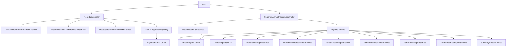
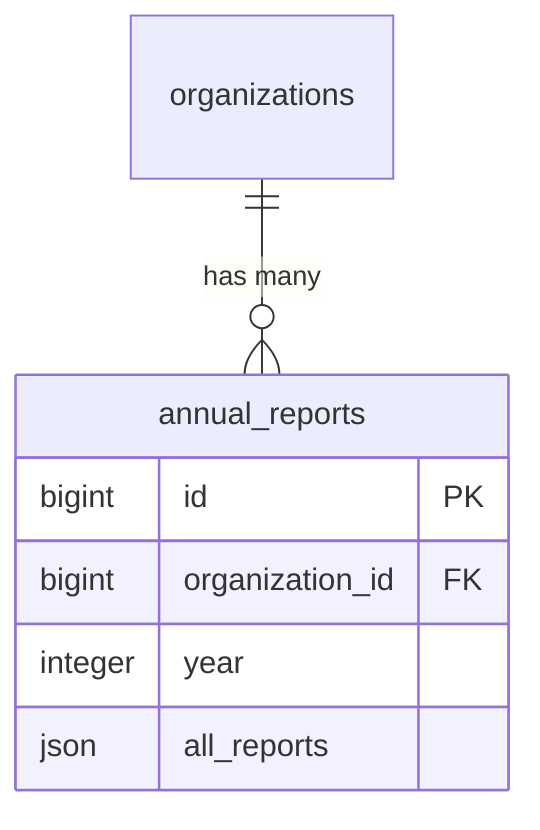
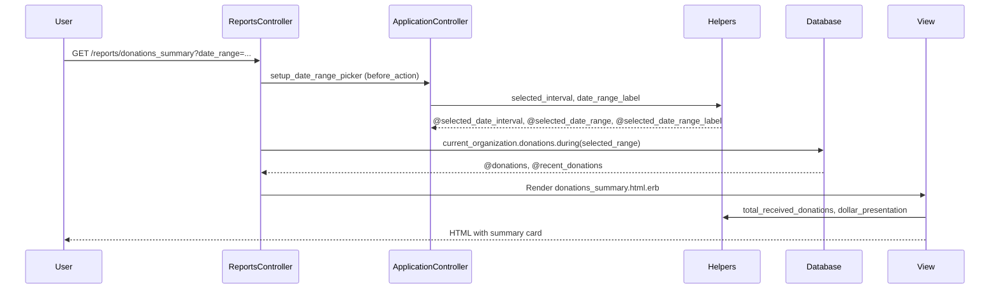
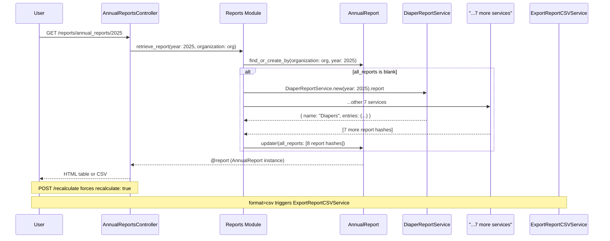

# Reports

> **Status**: Active
> **Generated**: 2026-06-13T00:00:00Z
> **Last Updated**: 2026-06-13T00:00:00Z

---

## Overview

### What It Does
The Reports feature provides two distinct reporting subsystems for essentials bank organizations: (1) **date-range summary reports** that show donations, distributions, purchases, product drives, manufacturer donations, and itemized breakdowns filtered by a selectable date range, and (2) **NDBN Annual Reports** that compute and persist yearly statistics across eight report categories (Diapers, Warehouse, Adult Incontinence, Period Supplies, Other Products, Partner Info, Children Served, and Year End Summary). Annual reports are cached in the database as JSON and can be recalculated on demand or exported to CSV.

### Why It Exists
Essentials banks need to track and report on their operations for internal management, board reporting, and compliance with the National Diaper Bank Network (NDBN) annual survey requirements. The date-range reports provide day-to-day operational visibility, while the annual reports automate the tedious process of compiling year-end statistics that would otherwise require manual data gathering across donations, distributions, purchases, and partner records.

### Key Capabilities
- Date-filtered summary reports for donations, distributions, purchases, product drives, and manufacturer donations
- Itemized breakdown reports for donations, distributions, and requests (item-level detail with on-hand quantities)
- Activity graph comparing received donations, purchases, and distributions in a bar chart (Highcharts)
- NDBN Annual Reports computed from 8 specialized service classes covering diapers, warehouse/storage, adult incontinence, period supplies, other products, partner agencies, children served, and year-end summary
- Annual report caching in the database with on-demand recalculation
- CSV export of annual reports

---

## Architecture

### High-Level Design



### Components

#### Backend Components

| Component | File Path | Purpose |
|-----------|-----------|---------|
| ReportsController | `app/controllers/reports_controller.rb` | Handles date-range summary reports (donations, distributions, purchases, product drives, manufacturer donations, itemized breakdowns, activity graph) |
| Reports::AnnualReportsController | `app/controllers/reports/annual_reports_controller.rb` | Lists available annual report years, shows/recalculates annual reports, CSV export |
| AnnualReport | `app/models/annual_report.rb` | Persists computed annual report data as JSON |
| Reports (module) | `app/services/reports.rb` | Orchestrates all 8 annual report services, handles find-or-create and caching |
| DiaperReportService | `app/services/reports/diaper_report_service.rb` | Computes diaper-specific annual metrics (disposable/cloth distributed, drives, purchased, donated) |
| WarehouseReportService | `app/services/reports/warehouse_report_service.rb` | Computes storage location counts, square footage, largest site type |
| AdultIncontinenceReportService | `app/services/reports/adult_incontinence_report_service.rb` | Computes adult incontinence supply distribution, donation/purchase percentages |
| PeriodSupplyReportService | `app/services/reports/period_supply_report_service.rb` | Computes period supply distribution, donation/purchase percentages |
| OtherProductsReportService | `app/services/reports/other_products_report_service.rb` | Computes other product distribution, donation/purchase percentages |
| PartnerInfoReportService | `app/services/reports/partner_info_report_service.rb` | Computes partner agency counts by type and zip codes served |
| ChildrenServedReportService | `app/services/reports/children_served_report_service.rb` | Computes total/average children served including kit-based calculations |
| SummaryReportService | `app/services/reports/summary_report_service.rb` | Computes year-over-year percent differences for donations, money, and diapers |
| ExportReportCSVService | `app/services/exports/export_report_csv_service.rb` | Exports annual report data to CSV format |

#### Frontend Components

| Component | File Path | Purpose |
|-----------|-----------|---------|
| Highcharts controller | `data-controller="highchart"` (Stimulus) | Renders bar chart for activity graph using Highcharts configuration passed via `data-highchart-config-value` |

### Technology Stack
- **Backend**: Ruby on Rails, ActiveRecord with raw SQL for kit-based calculations
- **Frontend**: ERB templates, Highcharts (bar charts via Stimulus controller), Bootstrap card layout
- **Database**: PostgreSQL (JSON column for annual report storage, `EXTRACT(year FROM ...)` for year filtering)
- **External Services**: None

---

## Model Details

### AnnualReport

#### Associations
```ruby
# Source: app/models/annual_report.rb
belongs_to :organization, inverse_of: :annual_reports
```

The `Organization` model declares the inverse:
```ruby
# Source: app/models/organization.rb:70
has_many :annual_reports
```

Note: No `dependent:` option is declared on the `has_many :annual_reports` association, so annual reports are NOT automatically destroyed when an organization is destroyed.

#### Concerns
| Concern | Purpose |
|---------|---------|
| `has_paper_trail` | Tracks version history of annual report changes via PaperTrail gem |

#### Callbacks
No custom callbacks are defined. PaperTrail adds its own `after_create`, `after_update`, and `after_destroy` callbacks for version tracking.

#### Validations
```ruby
# Source: app/models/annual_report.rb:15
validates :year, numericality: { greater_than: 1900, less_than: 10_000 }
```

#### Key Methods

| Method | Returns | Purpose | Notes |
|--------|---------|---------|-------|
| `each_report` | yields `[String, Array<Hash>]` | Iterates over all report sections in the `all_reports` JSON, yielding name and entries for each | Used by the show view to render report tables |

---

## Database Schema

### annual_reports

| Column | Type | Default | Notes |
|--------|------|---------|-------|
| `id` | `bigint` | auto-increment | Primary key |
| `organization_id` | `bigint` | `null` | Foreign key to organizations |
| `year` | `integer` | `null` | Report year (validated > 1900, < 10000) |
| `all_reports` | `json` | `null` | Stores all 8 computed report sections as JSON array of hashes |
| `created_at` | `datetime` | | Not null |
| `updated_at` | `datetime` | | Not null |

#### Indexes
| Name | Columns |
|------|---------|
| `index_annual_reports_on_organization_id` | `organization_id` |

### Relationships


---

## API Endpoints

### Date-Range Summary Reports (ReportsController)

All routes are nested under `namespace :reports` and use `GET`. The `before_action :setup_date_range_picker` runs on every action, populating `@selected_date_interval`, `@selected_date_range`, and `@selected_date_range_label`.

| Method | Path | Action | Description |
|--------|------|--------|-------------|
| `GET` | `/reports/donations_summary` | `donations_summary` | Donations from all sources with recent list |
| `GET` | `/reports/manufacturer_donations_summary` | `manufacturer_donations_summary` | Donations filtered to manufacturer source |
| `GET` | `/reports/product_drives_summary` | `product_drives_summary` | Product drive activity and recent drive donations |
| `GET` | `/reports/purchases_summary` | `purchases_summary` | Purchase totals by category (diapers, period, incontinence, other) |
| `GET` | `/reports/itemized_donations` | `itemized_donations` | Per-item donation totals and on-hand quantities |
| `GET` | `/reports/itemized_distributions` | `itemized_distributions` | Per-item distribution totals with on-hand and low-stock highlighting |
| `GET` | `/reports/distributions_summary` | `distributions_summary` | Distribution totals with recent list |
| `GET` | `/reports/activity_graph` | `activity_graph` | Bar chart comparing received, purchased, and distributed |
| `GET` | `/reports/itemized_requests` | `itemized_requests` | Per-item request totals with on-hand and low-stock highlighting |

### Annual Reports (Reports::AnnualReportsController)

| Method | Path | Action | Description |
|--------|------|--------|-------------|
| `GET` | `/reports/annual_reports` | `index` | List available report years from org's earliest reporting year to last year |
| `GET` | `/reports/annual_reports/:year` | `show` | Show computed annual report; supports `format: :csv` for CSV export |
| `POST` | `/reports/annual_reports/:year/recalculate` | `recalculate` | Force recalculation of cached annual report, redirects back to show |

---

## Authorization (Pundit)

No dedicated report policy file exists. The `ReportsController` and `Reports::AnnualReportsController` both inherit from `ApplicationController`, which enforces authentication via Devise (`before_action :authenticate_user!`). Access is implicitly scoped to `current_organization` -- all queries filter by the authenticated user's organization. There are no explicit Pundit `authorize` calls in either controller.

---

## Service Layer Details

### Reports Module (`app/services/reports.rb`)

The `Reports` module is the orchestrator for annual reports. It defines two class methods:

```ruby
# Source: app/services/reports.rb:6-16
def all_reports(year:, organization:)
  [
    Reports::DiaperReportService.new(year: year, organization: organization).report,
    Reports::WarehouseReportService.new(year: year, organization: organization).report,
    Reports::AdultIncontinenceReportService.new(year: year, organization: organization).report,
    Reports::PeriodSupplyReportService.new(year: year, organization: organization).report,
    Reports::OtherProductsReportService.new(year: year, organization: organization).report,
    Reports::PartnerInfoReportService.new(year: year, organization: organization).report,
    Reports::ChildrenServedReportService.new(year: year, organization: organization).report,
    Reports::SummaryReportService.new(year: year, organization: organization).report,
  ]
end
```

```ruby
# Source: app/services/reports.rb:23-31
def retrieve_report(year:, organization:, recalculate: false)
  report_attributes = { organization: organization, year: year }
  report = AnnualReport.find_or_create_by(report_attributes)
  if report.all_reports.blank? || recalculate
    calculated_reports = all_reports(**report_attributes)
    report.update!(all_reports: calculated_reports)
  end
  report
end
```

### Annual Report Services

All 8 services follow the same pattern: initialize with `year:` and `organization:`, expose a `#report` method returning `{ name: String, entries: Hash }`. Most include `ActionView::Helpers::NumberHelper` for formatting.

#### Report Output Structure

Each service produces a hash with this shape:
```ruby
{ name: "Report Name", entries: { "Metric Label" => value, ... } }
```

The `all_reports` JSON stored in `annual_reports.all_reports` is an array of these hashes.

#### Kit-Based Calculations

Several services (DiaperReportService, AdultIncontinenceReportService, PeriodSupplyReportService) use raw SQL to compute quantities from items distributed via kits. The pattern involves a multi-join through `distributions -> line_items -> items -> kit_line_items -> kit_items` to multiply kit quantities by item quantities within the kit, filtered by `reporting_category`:

```ruby
# Source: app/services/reports/diaper_report_service.rb:59-77
sql_query = <<-SQL
  SELECT SUM(line_items.quantity * kit_line_items.quantity)
  FROM distributions
  INNER JOIN line_items ON line_items.itemizable_type = 'Distribution' AND line_items.itemizable_id = distributions.id
  INNER JOIN items ON items.id = line_items.item_id
  INNER JOIN line_items AS kit_line_items ON items.id = kit_line_items.itemizable_id
  INNER JOIN items AS kit_items ON kit_items.id = kit_line_items.item_id
  WHERE distributions.organization_id = ?
    AND EXTRACT(year FROM issued_at) = ?
    AND items.kit_id IS NOT NULL
    AND kit_items.reporting_category = 'disposable_diapers'
    AND kit_line_items.itemizable_type = 'Item';
SQL
```

#### Children Served Calculation

The ChildrenServedReportService uses a distinctive approach to estimate children served by dividing distributed quantity by `items.distribution_quantity` (defaulting to 50 for loose items, 1 for kit items):

```ruby
# Source: app/services/reports/children_served_report_service.rb:37-45
def total_children_served_with_loose_disposables
  organization
  .distributions
  .for_year(year)
  .joins(line_items: :item)
  .merge(Item.loose.disposable_diapers)
  .pick(Arel.sql("CEILING(SUM(line_items.quantity::numeric / COALESCE(items.distribution_quantity, 50)))"))
  .to_i
end
```

### Report Category Summary

| Service | Report Name | Key Metrics |
|---------|-------------|-------------|
| DiaperReportService | "Diapers" | Disposable/cloth distributed, drives, virtual drives, % donated/purchased, money spent |
| WarehouseReportService | "Warehouse and Storage" | Total locations, square footage, largest site type |
| AdultIncontinenceReportService | "Adult Incontinence" | Supplies distributed, adults served/month, supply types, % donated/bought, money spent |
| PeriodSupplyReportService | "Period Supplies" | Supplies distributed, supply types, % donated/bought, money spent |
| OtherProductsReportService | "Other Items" | Products distributed, % donated/bought, money spent, product list |
| PartnerInfoReportService | "Partner Agencies and Service Area" | Agency count by type, zip codes served |
| ChildrenServedReportService | "Children Served" | Average monthly, total served, repackage/monthly distribution flags |
| SummaryReportService | "Year End Summary" | Year-over-year % change in donation count, money raised, and disposable diapers |

---

## Date-Range Report Flow



---

## Annual Report Flow



---

## CSV Export

The `ExportReportCSVService` flattens all 8 report sections into a single CSV with one header row and one data row:

```ruby
# Source: app/services/exports/export_report_csv_service.rb:18-32
def generate_csv_data
  headers = []
  data = []

  csv_data = []

  @reports.each do |report|
    headers.concat(report['entries'].keys)
    data.concat(report['entries'].values)
  end

  csv_data << headers
  csv_data << data

  csv_data
end
```

The CSV filename follows the pattern: `NdbnAnnuals-{year}-{today}.csv`

---

## Configuration

No environment variables or config files are specific to the reports feature. All configuration is derived from:
- Organization settings (`repackage_essentials?`, `distribute_monthly?`, `created_at`)
- Item `reporting_category` enum values used for filtering (e.g., `disposable_diapers`, `cloth_diapers`, `adult_incontinence`, `pads`, `tampons`, `period_liners`, `period_underwear`, `period_other`)
- Item `distribution_quantity` field used for children-served estimation

---

## Usage Examples

### Retrieving an Annual Report (with caching)
```ruby
# Source: app/services/reports.rb:23-31
report = Reports.retrieve_report(year: 2025, organization: current_organization)
# Returns AnnualReport with all_reports JSON populated
# Subsequent calls return cached version unless recalculate: true
```

### Iterating Over Report Sections in Views
```ruby
# Source: app/views/reports/annual_reports/show.html.erb:46-64
<% @report.each_report do |name, entries| %>
  <section class="content">
    <h1 class='text-3xl text-center'><%= name %></h1><br>
    <div class="card">
      <div class="card-body p-0">
        <table class="table">
          <tbody>
          <% entries.each do |name, value| %>
            <tr>
              <th><%= name %></th>
              <td><%= value %></td>
            </tr>
          <% end %>
          </tbody>
        </table>
      </div>
    </div>
  </section>
<% end %>
```

### Activity Graph Data Preparation
```ruby
# Source: app/controllers/reports_controller.rb:61-67
def received_distributed_data(range = selected_range)
  {
    "Received donations" => total_received_donations_unformatted(range),
    "Purchased" => total_purchased_unformatted(range),
    "Distributed" => total_distributed_unformatted(range)
  }
end
```

---

## Testing

### Test Files
- `spec/requests/reports/annual_reports_requests_spec.rb` -- Request specs for annual report index, show, recalculate, and CSV export
- `spec/system/annual_reports_system_spec.rb` -- System (browser) tests for annual reports
- `spec/services/reports/diaper_report_service_spec.rb`
- `spec/services/reports/warehouse_report_service_spec.rb`
- `spec/services/reports/adult_incontinence_report_service_spec.rb`
- `spec/services/reports/period_supply_report_service_spec.rb`
- `spec/services/reports/other_products_report_service_spec.rb`
- `spec/services/reports/partner_info_report_service_spec.rb`
- `spec/services/reports/children_served_report_service_spec.rb`
- `spec/services/reports/summary_report_service_spec.rb`
- `spec/services/exports/export_report_csv_service_spec.rb`
- `spec/support/pages/organization_reports_product_drives_summary_page.rb` -- Page object for product drives summary report system tests

### Coverage Notes
- All 8 annual report services have dedicated specs
- The CSV export service has a dedicated spec
- No request specs exist for the `ReportsController` (date-range summary reports) -- only the `AnnualReportsController` has request specs
- No model spec exists for `AnnualReport`

---

## Known Issues & Caveats

| Issue | Location | Description |
|-------|----------|-------------|
| No Pundit authorization | `reports_controller.rb`, `annual_reports_controller.rb` | Neither controller calls `authorize`. Access is only restricted by Devise authentication and `current_organization` scoping. Any authenticated user in an organization can access all reports. |
| Missing `dependent:` on association | `app/models/organization.rb:70` | `has_many :annual_reports` has no `dependent:` option. Deleting an organization leaves orphaned `annual_reports` rows. |
| Raw SQL for kit calculations | `diaper_report_service.rb:59-77`, `adult_incontinence_report_service.rb:101-113`, `period_supply_report_service.rb:112-128` | Complex multi-join raw SQL queries for kit-based item calculations. These bypass ActiveRecord and may break if schema changes. |
| N+1 in PartnerInfoReportService | `partner_info_report_service.rb:28` | `organization.partners.map(&:profile)` loads all partners then individually loads each profile. |
| N+1 in AdultIncontinenceReportService | `adult_incontinence_report_service.rb:146-161` | `total_distributed_kits_containing_adult_incontinence_items_per_month` iterates over kits and queries per kit. |
| Hardcoded default distribution_quantity | `children_served_report_service.rb:43` | Uses `COALESCE(items.distribution_quantity, 50)` -- assumes 50 diapers per child if `distribution_quantity` is null for loose items. |
| Money division inconsistency | `diaper_report_service.rb:117,127` | `money_from_drives` and `money_from_virtual_drives` divide by 100 (integer division) while other services use `/ 100.0` (float division). This could truncate cents for drive money calculations. |
| Private helper methods unused externally | `reports_controller.rb:49-67` | `total_purchased_unformatted`, `total_distributed_unformatted`, `total_received_donations_unformatted` are private methods duplicating logic that also exists in helpers. Only `received_distributed_data` uses them. |
| Year exclusion for current year | `annual_reports_controller.rb:11` | Uses `(foundation_year...@actual_year)` (exclusive range), so the current year is never available. Reports are only available for completed years. |

---

## Performance

### Optimization Strategies
- **Annual report caching**: Computed reports are persisted as JSON in the `annual_reports` table. Subsequent views load the cached JSON rather than recomputing. Only explicit "Recalculate" triggers recomputation.
- **Memoization**: All report service methods use `@report ||=` and instance variable memoization to avoid repeated computation within a single request.

### Database Optimization
- **Index**: `index_annual_reports_on_organization_id` on `annual_reports.organization_id`
- **Missing index**: No composite index on `(organization_id, year)`. The `find_or_create_by(organization:, year:)` call would benefit from one.
- **Year filtering**: Annual report services rely on `for_year(year)` scopes on donations/distributions/purchases, which use `EXTRACT(year FROM issued_at)`. These function-based filters cannot use standard B-tree indexes on `issued_at`.

---

## Troubleshooting

### Common Issues

#### Issue: Annual report shows stale data
**Symptoms:**
- Report values don't reflect recently entered donations, distributions, or purchases

**Cause:**
Annual reports are cached in the `annual_reports.all_reports` JSON column. New transaction data does not automatically trigger recalculation.

**Solution:**
Click the "Recalculate Report" button on the annual report show page, which triggers `POST /reports/annual_reports/:year/recalculate`.

#### Issue: Annual report page returns 404
**Symptoms:**
- Navigating to `/reports/annual_reports/0` or a non-numeric year returns 404

**Cause:**
The `validate_show_params` before_action calls `not_found!` unless `year_param.to_i.positive?`.

```ruby
# Source: app/controllers/reports/annual_reports_controller.rb:41-43
def validate_show_params
  not_found! unless year_param.to_i.positive?
end
```

#### Issue: Kit-based quantities showing as 0
**Symptoms:**
- Diapers/supplies distributed via kits not counted in annual reports

**Cause:**
The raw SQL joins require items to have `kit_id IS NOT NULL` and the kit's inner items to have the correct `reporting_category`. If items in kits lack proper `reporting_category` values, they will not be counted.

---

## Related Features

- **[Donations](./donations.md)** -- Donation data is the primary input for donation summary reports and annual diaper/supply calculations
- **[Distributions](./distributions.md)** -- Distribution data drives distribution summaries, itemized reports, and most annual report metrics
- **[Purchases](./purchases.md)** -- Purchase data feeds purchase summaries and annual report purchased/money-spent metrics
- **[Product Drives](./product-drives.md)** -- Product drive data is used in both the product drives summary report and annual diaper report
- **[Partners](./partners.md)** -- Partner profile data is used in the annual Partner Info report
- **[Storage Locations](./storage-locations.md)** -- Storage location data is used in the annual Warehouse report
- **[Items](./items.md)** -- Item `reporting_category` and `distribution_quantity` fields drive annual report filtering and children-served calculations
- **[Kits](./kits.md)** -- Kit composition is resolved via raw SQL in annual report services
- **[Historical Trends](./historical-trends.md)** -- Related but separate feature providing trend charts (not annual NDBN reports)
- **[Dashboard](./dashboard.md)** -- Dashboard uses similar helper methods for summary statistics

---

**Generated:** 2026-06-13T00:00:00Z
**Last Updated:** 2026-06-13T00:00:00Z
**Status:** Active
