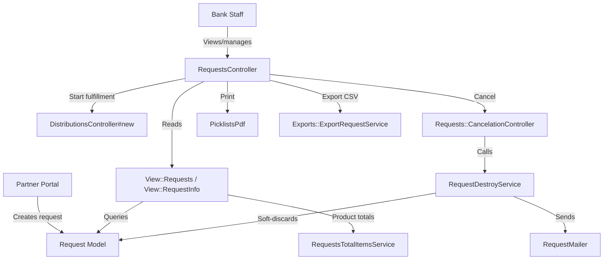
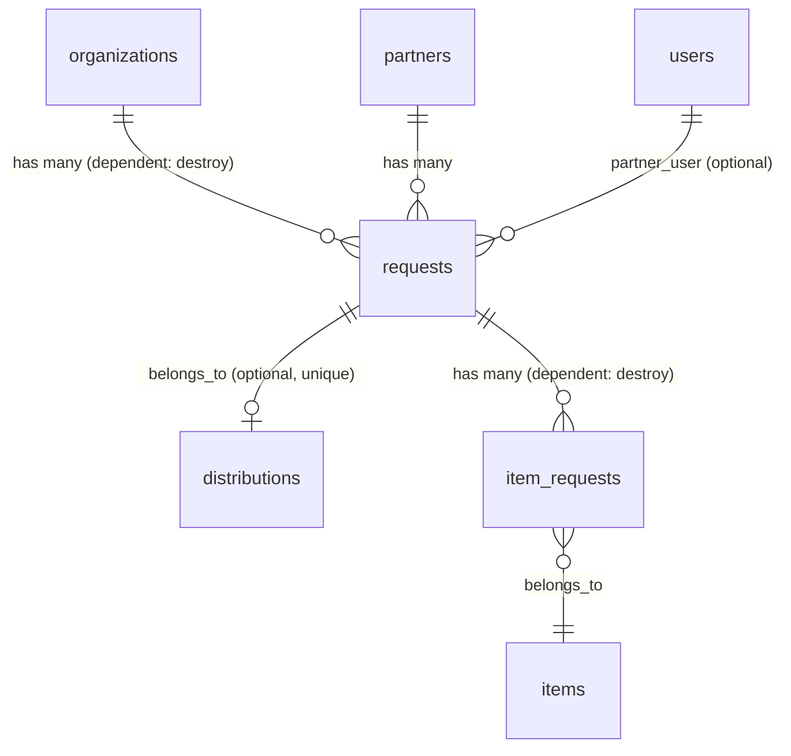
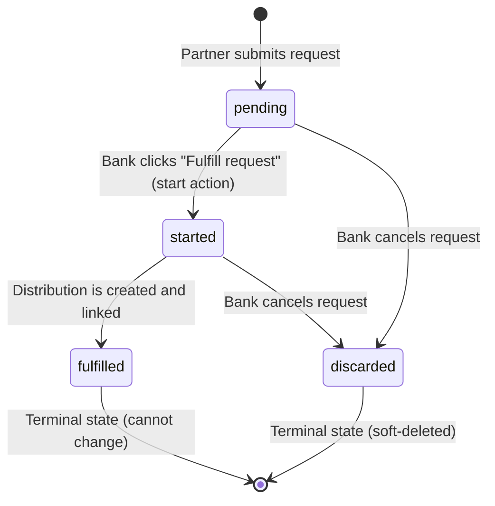

# Requests

> **Status**: Active
> **Generated**: 2026-06-13T00:00:00Z
> **Last Updated**: 2026-06-13T00:00:00Z

---

## Overview

### What It Does
The Requests feature manages supply requests submitted by partner organizations to essentials banks. Requests originate from the partner portal (or via the bank-side "New Quantity Request" modal) and appear on the bank-side Requests index, where bank staff can view, filter, start fulfillment, print picklists, export to CSV, or cancel requests. Starting a request transitions it to the "started" status and redirects the user to create a new Distribution pre-filled with the requested items.

### Why It Exists
Essentials banks need a structured workflow for receiving and tracking partner supply requests. Partners submit requests through the partner portal; bank administrators review, prioritize, and fulfill those requests by converting them into distributions. The request lifecycle (pending -> started -> fulfilled / discarded) provides visibility and accountability on both sides.

### Key Capabilities
- List, filter, and paginate requests by item, partner, status, request type, and date range
- View individual request details with inventory-on-hand context (total and per-storage-location)
- Start fulfillment of a request (transitions to "started" and redirects to new Distribution form)
- Cancel/discard a request with a reason, triggering an email notification to the partner
- Print picklist PDFs for individual requests or all unfulfilled requests
- Export filtered requests to CSV with per-item quantity columns
- Calculate aggregated product totals across filtered requests (modal)
- Confirmation email to partner and (optionally) the organization when a request is created
- Quota tracking and display per partner

---

## Architecture

### High-Level Design



### Components

#### Backend Components

| Component | File Path | Purpose |
|-----------|-----------|---------|
| RequestsController | `app/controllers/requests_controller.rb` | Index, show, start, print_picklist, print_unfulfilled actions |
| Requests::CancelationController | `app/controllers/requests/cancelation_controller.rb` | Cancel request with reason (new + create) |
| Request | `app/models/request.rb` | Core model with status enum, scopes, validations |
| RequestItem | `app/models/request_item.rb` | Plain Ruby object wrapping a JSON request item with inventory context |
| Partners::ItemRequest | `app/models/partners/item_request.rb` | ActiveRecord model for individual item line items within a request |
| View::Requests | `app/models/view/requests.rb` | View model for index page (filtering, pagination, totals) |
| View::RequestInfo | `app/models/view/request_info.rb` | View model for show page (item requests, inventory, custom units) |
| RequestDestroyService | `app/services/request_destroy_service.rb` | Soft-discards a request and notifies partner |
| RequestItemizedBreakdownService | `app/services/request_itemized_breakdown_service.rb` | Aggregates requested items with on-hand quantities |
| RequestsTotalItemsService | `app/services/requests_total_items_service.rb` | Calculates total quantities per item across requests |
| Exports::ExportRequestService | `app/services/exports/export_request_service.rb` | Generates CSV export with per-item columns |
| RequestsHelper | `app/helpers/requests_helper.rb` | Quota display and styling helpers |
| RequestMailer | `app/mailers/request_mailer.rb` | Sends cancellation notification to partner |
| RequestsConfirmationMailer | `app/mailers/requests_confirmation_mailer.rb` | Sends confirmation email when request is created |
| PicklistsPdf | `app/pdfs/picklists_pdf.rb` | Generates printable picklist PDFs using Prawn |

#### Frontend Components

| Component | File Path | Purpose |
|-----------|-----------|---------|
| Index view | `app/views/requests/index.html.erb` | Request listing with filters, action buttons, pagination |
| Show view | `app/views/requests/show.html.erb` | Single request detail with inventory context |
| Request row partial | `app/views/requests/_request_row.html.erb` | Table row for each request in index |
| Status partial | `app/views/requests/_status.html.erb` | Badge rendering for pending/started/fulfilled/errored |
| Product totals modal | `app/views/requests/_calculate_product_totals.html.erb` | Modal showing aggregated item totals |
| New request modal | `app/views/requests/_new.html.erb` | Modal to select partner for new quantity request |
| Cancelation form | `app/views/requests/cancelation/new.html.erb` | Cancelation confirmation with reason field |
| Cancel email | `app/views/request_mailer/request_cancel_partner_notification.html.erb` | HTML email for cancellation notification |
| Confirmation email | `app/views/requests_confirmation_mailer/confirmation_email.html.erb` | HTML email for request confirmation |

### Technology Stack
- **Backend**: Ruby on Rails, ActiveRecord, Prawn (PDF generation)
- **Frontend**: ERB templates, Bootstrap 4/5 (cards, badges, modals), Kaminari (pagination)
- **Database**: PostgreSQL (JSONB for `request_items`, integer enum for `status`)
- **Feature Flags**: Flipper (`:enable_packs` for custom unit support)
- **Soft Delete**: Discard gem (`discarded_at` / `discard_reason`)
- **Audit Trail**: PaperTrail (`has_paper_trail` on Request and Partners::ItemRequest)

---

## Model Details

### Request

**File**: `app/models/request.rb`

#### Associations

```ruby
belongs_to :partner
belongs_to :partner_user, class_name: "::User", optional: true
belongs_to :organization
belongs_to :distribution, optional: true

has_many :item_requests, class_name: "Partners::ItemRequest", foreign_key: :partner_request_id, dependent: :destroy, inverse_of: :request
accepts_nested_attributes_for :item_requests, allow_destroy: true, reject_if: proc { |attributes| attributes["quantity"].blank? }
has_many :child_item_requests, through: :item_requests
```

#### Concerns

| Concern | Purpose |
|---------|---------|
| `Discard::Model` | Soft-delete via `discarded_at` timestamp; provides `undiscarded` scope, `discard` method |
| `Exportable` | Adds CSV export interface (`csv_export_headers`, `csv_export_attributes`, `generate_csv`) |
| `Filterable` | Adds `class_filter` class method to chain named scopes from a params hash |
| `has_paper_trail` | Versioning/audit trail via PaperTrail gem |

#### Enums

```ruby
enum :status, { pending: 0, started: 1, fulfilled: 2, discarded: 3 }, prefix: true
enum :request_type, %w[quantity individual child].map { |v| [v, v] }.to_h
```

The `status` enum uses the `prefix: true` option, generating methods like `status_pending!`, `status_started!`, `status_fulfilled?`, etc.

#### Validations

| Validation | Target | Details |
|------------|--------|---------|
| `uniqueness` | `distribution_id` | Only one request per distribution (allows nil) |
| `item_requests_uniqueness_by_item_id` | custom | Ensures no duplicate `item_id` values across item_requests |
| `not_completely_empty` | custom | Requires either `comments` or `item_requests` to be present |
| `cannot_change_status_once_fulfilled` | custom (on: :update) | Prevents any status change after reaching "fulfilled" |

#### Callbacks

| Callback | Method | Purpose |
|----------|--------|---------|
| `after_validation` | `:sanitize_items_data` | Coerces `item_id` and `quantity` in the JSONB `request_items` column to integers |

#### Scopes

```ruby
scope :by_request_item_id, ->(item_id) { where("request_items @> :with_item_id ", with_item_id: [{ item_id: item_id.to_i }].to_json) }
scope :by_partner, ->(partner_id) { where(partner_id: partner_id) }
scope :by_status, ->(status) { where(status: status) }
scope :by_request_type, ->(request_type) { where(request_type: request_type) }
scope :during, ->(range) { where(created_at: range) }
```

Note: The `by_request_item_id` scope uses a PostgreSQL JSONB containment operator (`@>`).

#### Key Methods

| Method | Returns | Purpose | Notes |
|--------|---------|---------|-------|
| `total_items` | `Integer` | Sums `quantity` from all entries in the `request_items` JSONB column | |
| `requester` | `User` or `Partner` | Returns `partner_user` if `partner_user_id` is set, otherwise `partner` | Comment notes field can refer to org admin too |
| `request_type_label` | `String` or `nil` | Returns first character capitalized of `request_type` | e.g., "Q", "I", "C" |

---

### Partners::ItemRequest

**File**: `app/models/partners/item_request.rb`

#### Associations

```ruby
belongs_to :request, class_name: '::Request', foreign_key: :partner_request_id, inverse_of: :item_requests
belongs_to :item
has_many :child_item_requests, dependent: :destroy
has_many :children, through: :child_item_requests
```

#### Concerns

| Concern | Purpose |
|---------|---------|
| `has_paper_trail` | Versioning/audit trail |

#### Validations

| Validation | Target | Details |
|------------|--------|---------|
| `presence` | `quantity` | Must be present |
| `numericality` | `quantity` | Integer, >= 1 |
| `presence` | `name` | Must be present |
| `request_unit_is_supported` | custom | If `request_unit` is set, validates it exists in `item.request_units` |

#### Key Methods

| Method | Returns | Purpose | Notes |
|--------|---------|---------|-------|
| `item_name` | `String` | Returns `item.name` or falls back to local `name` column | Handles deleted items |
| `quantity_with_units` | `String` | Returns quantity with pluralized unit if `enable_packs` flag is on | |
| `name_with_unit(quantity_override)` | `String` | Returns item name with unit suffix if `enable_packs` flag is on | |

---

### RequestItem (Plain Ruby Object)

**File**: `app/models/request_item.rb`

A non-ActiveRecord value object used to wrap a JSON request item entry with inventory context. Includes the `ItemQuantity` concern (adds `value_per_line_item`, `has_packages`, `package_count`).

```ruby
attr_accessor :item, :quantity, :unit, :on_hand, :on_hand_for_location
```

The class method `RequestItem.from_json(json, request, inventory)` builds an instance by looking up the Item, determining the partner's default storage location, and fetching on-hand quantities from the inventory view.

---

## Database Schema

### requests

| Column | Type | Default | Notes |
|--------|------|---------|-------|
| `id` | `bigint` | auto | Primary key |
| `partner_id` | `bigint` | | FK to `partners` |
| `organization_id` | `bigint` | | FK to `organizations` |
| `request_items` | `jsonb` | `{}` | Array of `{item_id, quantity}` hashes |
| `comments` | `text` | | Free-text comments from partner |
| `created_at` | `datetime` | | |
| `updated_at` | `datetime` | | |
| `distribution_id` | `integer` | | FK to `distributions` (nullable, unique) |
| `status` | `integer` | `0` | Enum: 0=pending, 1=started, 2=fulfilled, 3=discarded |
| `discarded_at` | `datetime` | | Soft-delete timestamp (Discard gem) |
| `discard_reason` | `text` | | Reason provided on cancellation |
| `partner_user_id` | `integer` | | FK to `users` (the user who submitted the request) |
| `request_type` | `string` | | "quantity", "individual", or "child" |

**Indexes:**
- `index_requests_on_discarded_at` on `discarded_at`
- `index_requests_on_distribution_id` on `distribution_id` (unique)
- `index_requests_on_organization_id` on `organization_id`
- `index_requests_on_partner_id` on `partner_id`
- `index_requests_on_status` on `status`

### item_requests

| Column | Type | Default | Notes |
|--------|------|---------|-------|
| `id` | `bigint` | auto | Primary key |
| `name` | `string` | | Item name (local copy) |
| `quantity` | `string` | | Requested quantity (stored as string) |
| `partner_request_id` | `bigint` | | FK to `requests.id` |
| `created_at` | `datetime` | | |
| `updated_at` | `datetime` | | |
| `partner_key` | `string` | | Base item key |
| `item_id` | `integer` | | FK to `items` |
| `old_partner_request_id` | `integer` | | Legacy FK (migration artifact) |
| `request_unit` | `string` | | Custom unit name (e.g., "pack") |

**Indexes:**
- `index_item_requests_on_item_id` on `item_id`
- `index_item_requests_on_partner_request_id` on `partner_request_id`

### Relationships



---

## API Endpoints

> All routes verified against controller actions in `RequestsController` and `Requests::CancelationController`.

| Method | Path | Action | Description | Notes |
|--------|------|--------|-------------|-------|
| `GET` | `/requests` | `RequestsController#index` | List/filter requests with pagination | Also responds to `.csv` format |
| `GET` | `/requests/:id` | `RequestsController#show` | Show single request with inventory context | |
| `POST` | `/requests/:id/start` | `RequestsController#start` | Transition to "started", redirect to new distribution | |
| `GET` | `/requests/:id/print_picklist` | `RequestsController#print_picklist` | Generate PDF picklist for one request | |
| `GET` | `/requests/print_unfulfilled` | `RequestsController#print_unfulfilled` | Generate PDF picklist for all pending/started requests | |
| `GET` | `/requests/:request_id/cancelation/new` | `Requests::CancelationController#new` | Show cancelation confirmation form | |
| `POST` | `/requests/:request_id/cancelation` | `Requests::CancelationController#create` | Execute cancelation via RequestDestroyService | |

### Routes defined but NOT mapped to actions in RequestsController

The routes file also defines a second `resources :requests, except: %i(destroy)` block which generates standard RESTful routes (`new`, `create`, `edit`, `update`). The controller only implements `index`, `show`, `start`, `print_picklist`, and `print_unfulfilled`. The additional routes (`new`, `create`, `edit`, `update`, `print`, `partner_requests`) do not have corresponding controller actions -- they exist because of the broad `except: %i(destroy)` declaration but are effectively dead routes.

| Method | Path | Notes |
|--------|------|-------|
| `GET` | `/requests/new` | No `new` action in controller |
| `POST` | `/requests` | No `create` action in controller |
| `GET` | `/requests/:id/edit` | No `edit` action in controller |
| `PATCH/PUT` | `/requests/:id` | No `update` action in controller |
| `GET` | `/requests/:id/print` | No `print` action in controller |
| `GET` | `/requests/partner_requests` | No `partner_requests` action in controller |

---

## Request Lifecycle



**Key rules:**
- Once a request reaches `fulfilled`, its status cannot be changed (enforced by `cannot_change_status_once_fulfilled` validation).
- Cancellation (discarding) is handled by `RequestDestroyService`, which sets `discarded_at`, `discard_reason`, and `status = :discarded` in a single save.
- The `fulfilled` transition is not done directly by the Requests feature -- it happens when a Distribution is successfully created from the request (in `DistributionCreateService`).

---

## Services

### RequestDestroyService

**File**: `app/services/request_destroy_service.rb`

Soft-discards a request by setting `discarded_at`, `discard_reason`, and `status = :discarded`. If the partner is not deactivated, sends `RequestMailer.request_cancel_partner_notification` asynchronously via `deliver_later`.

```ruby
# Source: app/services/request_destroy_service.rb:9-20
def call
  return self unless valid?

  request.discarded_at = Time.current
  request.discard_reason = reason
  request.status = :discarded
  request.save!

  unless request.partner.deactivated?
    RequestMailer.request_cancel_partner_notification(request_id: request.id).deliver_later
  end

  self
end
```

Validation checks:
- Request must exist (by `request_id`)
- Request must not already be discarded

### RequestsTotalItemsService

**File**: `app/services/requests_total_items_service.rb`

Aggregates total quantities per item across a set of requests. Returns a `Hash` of `{ "Item Name" => total_quantity }`. Used by `View::Requests#calculate_product_totals` for the product totals modal.

### RequestItemizedBreakdownService

**File**: `app/services/request_itemized_breakdown_service.rb`

Class-method-based service that fetches all `Partners::ItemRequest` records for given request IDs, groups by `[item_id, request_unit]`, and enriches with on-hand quantities and minimum thresholds from `View::Inventory`. Supports both hash and CSV output formats.

### Exports::ExportRequestService

**File**: `app/services/exports/export_request_service.rb`

Generates CSV data with base columns (Date, Requestor, Type, Status) plus one column per item (and per item+unit combination when `enable_packs` is on). Handles deleted items with a `<DELETED_ITEMS>` column.

---

## Mailers

### RequestMailer

**File**: `app/mailers/request_mailer.rb`

| Method | Recipient | Subject | Trigger |
|--------|-----------|---------|---------|
| `request_cancel_partner_notification` | `partner.email` | "Your essentials request (#ID) has been canceled." | `RequestDestroyService#call` (only if partner is not deactivated) |

Formats `request_items` JSONB into `{name, quantity}` hashes by looking up Item records.

### RequestsConfirmationMailer

**File**: `app/mailers/requests_confirmation_mailer.rb`

| Method | Recipient | CC | Subject | Trigger |
|--------|-----------|-----|---------|---------|
| `confirmation_email` | `requester.email` | Partner email + organization email (if `receive_email_on_requests` is enabled) | "OrgName - Requests Confirmation" | Called when a partner submits a request (from partner portal services) |

---

## PDF Generation

### PicklistsPdf

**File**: `app/pdfs/picklists_pdf.rb`

Generates printable picklist documents using the Prawn PDF library. Each request gets its own page containing:
- Organization logo, name, address, email
- Partner name and primary contact details
- Pick-up person details (if configured)
- Request date
- Year-to-date items received (if `ytd_on_distribution_printout` is enabled)
- Partner quota (if set and > 0)
- Comments
- Line items table with columns: Items Requested, Quantity, [X] checkbox, Differences/Comments
- When `enable_packs` is active and custom units exist, an additional "Unit (if applicable)" column is shown

---

## View Models

### View::Requests

**File**: `app/models/view/requests.rb`

Encapsulates all data for the requests index page. Includes `DateRangeHelper`.

Key methods:
- `requests` -- Filtered, ordered, undiscarded requests for the organization
- `paginated_requests` -- Paginated version with partner eager-loaded
- `unfulfilled_requests_count` -- Count of pending + started requests matching current filters
- `calculate_product_totals` -- Delegates to `RequestsTotalItemsService`
- `items`, `partners`, `statuses`, `request_types` -- Filter option collections
- `partner_users` -- Users for the current page of requests (for "Request Sender" column)

### View::RequestInfo

**File**: `app/models/view/request_info.rb`

Encapsulates data for the request show page.

Key methods:
- `item_requests` -- Eager-loaded item requests with items
- `inventory` -- `View::Inventory` for the organization
- `default_storage_location` -- Partner's default or organization's default storage location
- `location` -- `StorageLocation` record for the default location
- `custom_units` -- Boolean; true if `enable_packs` flag is on and any item has a `request_unit`

**Bug**: Line 20 has a typo -- `@efault_storage_location` (missing `d`) -- but the method still works because of the `defined?(@default_storage_location)` guard on line 18 which uses the correct instance variable name. The memoization via `||=` assigns to the typo'd variable, but the `defined?` check on the correct name will always be false after the first call, causing re-computation on every subsequent call.

---

## Helpers

### RequestsHelper

**File**: `app/helpers/requests_helper.rb`

```ruby
# Source: app/helpers/requests_helper.rb:1-13
module RequestsHelper
  def quota_display(partner)
    return "" if partner.quota.blank?

    "(#{partner.quota})"
  end

  def quota_column_class(total, partner)
    return "" if partner.quota.blank? || total.to_i < partner.quota

    "font-italic font-weight-bold"
  end
end
```

- `quota_display(partner)` -- Returns the partner's quota in parentheses, or empty string if no quota
- `quota_column_class(total, partner)` -- Returns bold/italic CSS classes when total items meet or exceed the partner's quota

---

## Configuration

### Organization Settings

The following `Organization` model fields affect request behavior:

| Field | Type | Default | Purpose |
|-------|------|---------|---------|
| `enable_quantity_based_requests` | `boolean` | `true` | Enables quantity-type requests in partner portal |
| `enable_individual_requests` | `boolean` | `true` | Enables individual-type requests in partner portal |
| `enable_child_based_requests` | `boolean` | `true` | Enables child-type requests in partner portal |
| `receive_email_on_requests` | `boolean` | `false` | CCs the organization on request confirmation emails |
| `default_storage_location` | `integer` | | Default storage location for inventory context |
| `ytd_on_distribution_printout` | `boolean` | `true` | Shows YTD items received on picklist PDFs |

### Feature Flags (Flipper)

| Flag | Effect |
|------|--------|
| `:enable_packs` | Enables custom unit support (packs, boxes, etc.) throughout requests, exports, and picklists |

---

## Testing

### Test Files

- `spec/models/request_spec.rb` -- Model specs for Request (enums, scopes, validations, status transitions)

---

## Known Issues & Caveats

| Issue | Location | Description |
|-------|----------|-------------|
| Typo in instance variable | `app/models/view/request_info.rb:20` | `@efault_storage_location` should be `@default_storage_location`. The memoization is broken -- the `defined?` guard on line 18 checks `@default_storage_location` but `||=` assigns to `@efault_storage_location`, so the value is recomputed on every call. |
| Dead routes | `config/routes.rb:250-256` | The second `resources :requests, except: %i(destroy)` block generates `new`, `create`, `edit`, `update`, `print`, and `partner_requests` routes that have no corresponding controller actions. |
| JSONB and ActiveRecord duplication | `app/models/request.rb` | Request items are stored in both the `request_items` JSONB column on `requests` AND as separate `item_requests` (Partners::ItemRequest) ActiveRecord rows. The JSONB column appears to be a legacy/denormalized copy. The `total_items` method reads from JSONB while most other features use the `item_requests` association. |
| Quantity stored as string | `item_requests` table | The `quantity` column in `item_requests` is a `string` type, requiring `.to_i` conversions throughout the codebase. |
| Status badge mismatch | `app/views/requests/_status.html.erb` | The "discarded" status renders as "Errored" with a danger badge, which could confuse users since the request was intentionally cancelled, not errored. |
| No authorization/policy | N/A | No Pundit policy file was found for requests. The "New Quantity Request" button is gated by `current_user.has_role?(Role::ORG_ADMIN, current_organization)` directly in the view, but other actions (show, start, cancel) have no visible authorization checks beyond organization scoping. |

---

## Performance

### Database Optimization

**Indexes on `requests`:**
- `index_requests_on_discarded_at` -- Supports `undiscarded` scope (Discard gem)
- `index_requests_on_distribution_id` (unique) -- Enforces one-to-one with distribution
- `index_requests_on_organization_id` -- Organization-scoped queries
- `index_requests_on_partner_id` -- Partner filtering
- `index_requests_on_status` -- Status filtering

**Indexes on `item_requests`:**
- `index_item_requests_on_item_id` -- Item lookups
- `index_item_requests_on_partner_request_id` -- Joining to parent request

### Eager Loading
- `View::Requests` eager-loads `:partner` on paginated requests
- `RequestsController#print_picklist` eager-loads `:item_requests, partner: [:profile]`
- `Exports::ExportRequestService` eager-loads `:partner, {item_requests: :item}`

---

## Troubleshooting

### Common Issues

#### Issue: Request cannot be started
**Symptoms:**
- Flash alert with validation errors when clicking "Fulfill request"

**Cause:**
The `status_started!` call triggers validations. If the request has been fulfilled previously, the `cannot_change_status_once_fulfilled` validation prevents the transition.

**Solution:**
Check the request's current status. Only `pending` requests can be started.

#### Issue: Cancellation email not sent
**Symptoms:**
- Partner does not receive cancellation email after request is discarded

**Cause:**
`RequestDestroyService` skips the email if `request.partner.deactivated?` returns true.

**Solution:**
Verify the partner is not in a deactivated state.

#### Issue: "N/A" shown for storage location inventory
**Symptoms:**
- Default storage location inventory column shows "N/A" on the request show page

**Cause:**
The partner has no `default_storage_location_id` set, the organization has no `default_storage_location`, or the storage location has zero or negative inventory for that item.

**Solution:**
Configure a default storage location on the partner or organization.

---

## Related Features

- **[Distributions](./distributions.md)** -- Requests are fulfilled by creating distributions; the `start` action redirects to `new_distribution_path(request_id: request.id)`
- **[Partner Portal](./partner-portal.md)** -- Partners create requests through the partner portal controllers (`Partners::RequestsController`, `Partners::IndividualsRequestsController`, `Partners::FamilyRequestsController`)
- **[Partners](./partners.md)** -- Each request belongs to a partner; partner quota affects display
- **[Items](./items.md)** -- Requested items reference the items catalog; custom units via `ItemUnit`
- **[Storage Locations](./storage-locations.md)** -- Inventory context shown on request detail page

---

**Generated**: 2026-06-13T00:00:00Z
**Last Updated**: 2026-06-13T00:00:00Z
**Status**: Active
