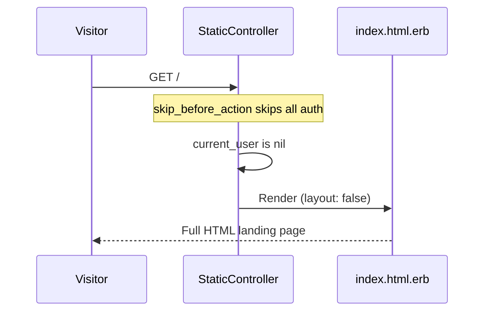
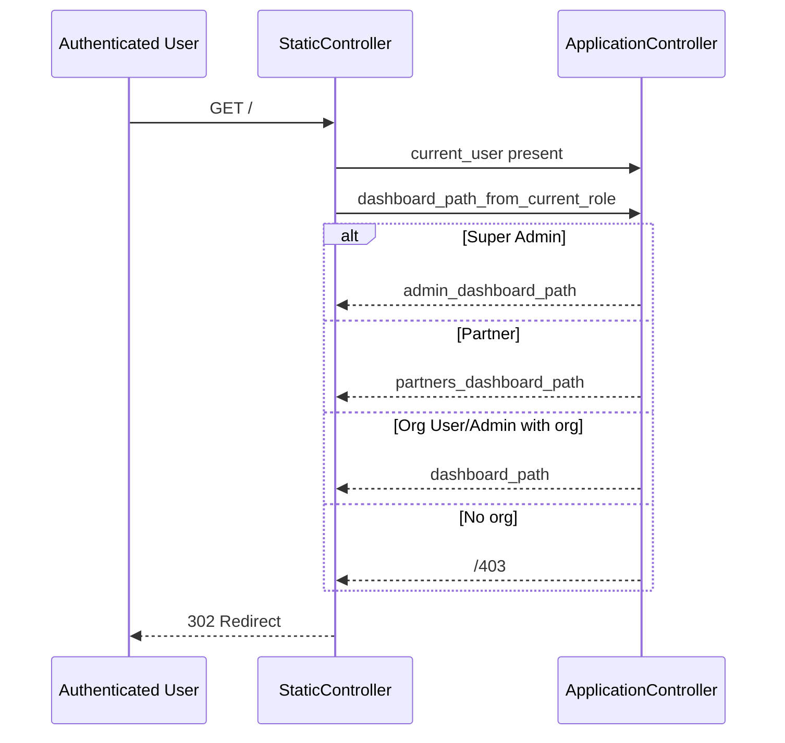
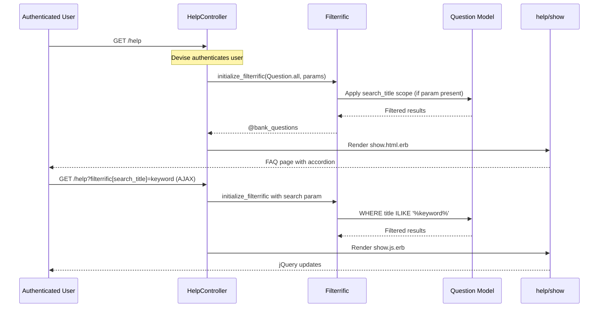

# Static Pages

> **Status**: Active
> **Generated**: 2026-06-13T00:00:00Z
> **Last Updated**: 2026-06-13T00:00:00Z

---

## Overview

### What It Does
The static-pages feature serves the public-facing marketing landing page, the privacy policy page, a generic static page renderer, and an authenticated FAQ/help page. It provides the entry point for unauthenticated visitors and redirects authenticated users to their role-appropriate dashboard.

### Why It Exists
Human Essentials needs a public website presence to attract new organizations (essentials banks), communicate what the platform offers, and provide legal compliance through a privacy policy. The help page gives authenticated users a searchable FAQ interface managed by super admins through the admin panel.

### Key Capabilities
- Public landing page with marketing content, feature highlights, testimonials, and registration CTA
- Privacy policy page accessible without authentication
- Generic static page renderer that maps URL slugs to ERB templates (`/pages/:name`)
- Authenticated FAQ help page with Filterrific search over admin-managed Question records
- Role-based redirect for authenticated users hitting the root URL (org users to dashboard, partners to partner dashboard, super admins to admin dashboard)

---

## Architecture

### High-Level Design

```mermaid
graph TD
    A[Visitor / User] -->|GET /| B[StaticController#index]
    A -->|GET /privacypolicy| C[StaticController#privacypolicy]
    A -->|GET /pages/:name| D[StaticController#page]
    A -->|GET /help| E[HelpController#show]

    B -->|unauthenticated| F[Render index.html.erb]
    B -->|authenticated| G[Redirect to role dashboard]

    C --> H[Render privacypolicy.html.erb]
    D --> I[Render static/:name.html.erb]

    E -->|requires auth| J[Question.all via Filterrific]
    J --> K[Render help/show.html.erb]
    K --> L[_bank_questions.html.erb partial]

    G -->|super_admin| M[admin_dashboard_path]
    G -->|partner| N[partners_dashboard_path]
    G -->|org_user / org_admin| O[dashboard_path]
    G -->|no org| P[/403]
```

### Components

#### Backend Components

| Component | File Path | Purpose |
|-----------|-----------|---------|
| StaticController | `app/controllers/static_controller.rb` | Serves public landing page, privacy policy, and generic static pages |
| HelpController | `app/controllers/help_controller.rb` | Serves authenticated FAQ page with Filterrific search |
| Question (model) | `app/models/question.rb` | Stores FAQ questions with rich text answers; used by HelpController |
| ApplicationHelper | `app/helpers/application_helper.rb` | Provides `support_ticket_form_url` helper used in help view |
| ApplicationController | `app/controllers/application_controller.rb` | Provides `dashboard_path_from_current_role` used by StaticController#index |

#### Frontend Components (Views)

| Component | File Path | Purpose |
|-----------|-----------|---------|
| Landing page | `app/views/static/index.html.erb` | Full standalone HTML page with marketing content, no layout |
| Privacy policy | `app/views/static/privacypolicy.html.erb` | Full standalone HTML page for privacy policy, no layout |
| Help page | `app/views/help/show.html.erb` | FAQ listing with Filterrific search form, uses application layout |
| FAQ partial | `app/views/help/_bank_questions.html.erb` | Renders accordion of Question records |
| JS response | `app/views/help/show.js.erb` | Updates FAQ list via AJAX when Filterrific filter changes |

### Technology Stack
- **Backend**: Ruby on Rails, Devise (authentication bypass on static pages)
- **Frontend**: Standalone HTML/CSS/JS (landing + privacy), AdminLTE/Bootstrap (help page)
- **Search/Filter**: Filterrific gem for FAQ search
- **Rich Text**: ActionText (`has_rich_text :answer` on Question model)
- **Audit Trail**: PaperTrail (`has_paper_trail` on Question model)

---

## Model Details

### Question

> Note: The Question model is owned by the admin-panel feature (CRUD via `Admin::QuestionsController`), but it is consumed here by `HelpController#show`.

#### Associations
```ruby
# Source: app/models/question.rb
has_rich_text :answer
```

ActionText's `has_rich_text` creates a polymorphic `has_one` association to `ActionText::RichText`.

#### Concerns
| Concern | Purpose |
|---------|---------|
| `has_paper_trail` | Tracks all changes to Question records for audit history |

#### Callbacks
No explicit callbacks defined.

#### Validations
```ruby
# Source: app/models/question.rb:13-14
validates :answer, presence: true
validates :title, presence: true
```

#### Scopes
```ruby
# Source: app/models/question.rb:15
scope :search_title, ->(query) { where("title ilike ?", "%#{query}%").includes([:rich_text_answer]) }
```

#### Filterrific Configuration
```ruby
# Source: app/models/question.rb:17-21
filterrific(
  available_filters: [
    :search_title
  ]
)
```

---

## Database Schema

### questions

| Column | Type | Default | Notes |
|--------|------|---------|-------|
| `id` | `bigint` | auto-increment | Primary key |
| `title` | `string` | — | NOT NULL, the FAQ question text |
| `created_at` | `datetime` | — | NOT NULL |
| `updated_at` | `datetime` | — | NOT NULL |

Rich text answers are stored in the `action_text_rich_texts` table (polymorphic association via `record_type: "Question"`).

---

## API Endpoints

> Routes verified against `config/routes.rb` (lines 267-269, 281) and controller action methods.

| Method | Path | Action | Controller | Description | Auth Required | Notes |
|--------|------|--------|------------|-------------|---------------|-------|
| `GET` | `/` | `index` | `StaticController` | Landing page or redirect | No | Redirects authenticated users to role-based dashboard |
| `GET` | `/privacypolicy` | `privacypolicy` | `StaticController` | Privacy policy page | No | No explicit action method in controller; rendered implicitly by Rails |
| `GET` | `/pages/:name` | `page` | `StaticController` | Generic static page renderer | No | Renders `app/views/static/:name.html.erb` |
| `GET` | `/help` | `show` | `HelpController` | FAQ help page | Yes | Requires Devise authentication (standard `before_action :authenticate_user!`) |

### Route Details

#### StaticController (routes.rb:268-269, 281)
```ruby
# Source: config/routes.rb:268-269, 281
get "pages/:name", to: "static#page"
get "/privacypolicy", to: "static#privacypolicy"
root "static#index"
```

#### HelpController (routes.rb:267)
```ruby
# Source: config/routes.rb:267
get "help", to: "help#show"
```

---

## Controller Details

### StaticController

```ruby
# Source: app/controllers/static_controller.rb (complete file)
class StaticController < ApplicationController
  skip_before_action :authorize_user
  skip_before_action :authenticate_user!
  skip_before_action :require_organization
  skip_before_action :log_active_user

  layout false

  def index
    redirect_to dashboard_path_from_current_role if current_user
  end

  def register; end

  def page
    # This allows for a flexible addition of static content
    # Anything under the url /pages/:name will render the file /app/views/static/[name].html.erb
    # Example: /pages/contact renders /app/views/static/contact.html.erb
    # Example2: /pages/index renders /app/views/static/index.html.erb, even when logged in
    render template: "static/#{params[:name]}"
  end
end
```

Key behaviors:
- **All four `before_action` filters are skipped**: `authorize_user`, `authenticate_user!`, `require_organization`, `log_active_user`. This makes all actions fully public.
- **`layout false`**: Views are standalone HTML documents; they do not use the application layout.
- **`index`**: If `current_user` is present (e.g., session cookie), redirects to `dashboard_path_from_current_role`. Otherwise renders `index.html.erb`.
- **`page`**: Dynamically renders any template under `app/views/static/` based on the `:name` URL parameter.
- **`privacypolicy`**: No explicit action method exists. Rails implicitly renders `app/views/static/privacypolicy.html.erb`.
- **`register`**: Empty action, renders `register.html.erb`. Note: this action has no corresponding route in `config/routes.rb`.

### HelpController

```ruby
# Source: app/controllers/help_controller.rb (complete file)
class HelpController < ApplicationController
  def show
    @filterrific = initialize_filterrific(
      Question.all,
      params[:filterrific]
    ) || return

    @bank_questions = @filterrific.find

    respond_to do |format|
      format.html
      format.js
    end
  end
end
```

Key behaviors:
- **No `before_action` skips**: Inherits all filters from `ApplicationController`, so authentication, authorization, organization requirement, and activity logging all apply.
- **Filterrific integration**: Initializes a Filterrific object over `Question.all`, applying any search parameters from `params[:filterrific]`.
- **Dual format response**: Responds to both HTML (full page) and JS (AJAX partial update via `show.js.erb`).

### dashboard_path_from_current_role (ApplicationController)

```ruby
# Source: app/controllers/application_controller.rb:59-72
def dashboard_path_from_current_role
  return root_path if current_role.blank?

  if current_role.name == Role::SUPER_ADMIN.to_s
    admin_dashboard_path
  elsif current_role.name == Role::PARTNER.to_s
    partners_dashboard_path
  elsif current_user.organization
    dashboard_path
  else
    "/403"
  end
end
```

---

## Authorization

### StaticController
All authorization is **bypassed** via `skip_before_action` directives. No Pundit policy is used. All static pages are fully public.

### HelpController
Standard `ApplicationController` authorization applies:

| Check | Source | Behavior |
|-------|--------|----------|
| `authenticate_user!` | Devise | Redirects to login if not authenticated |
| `authorize_user` | `ApplicationController#authorize_user` | Verifies user has a valid role (super_admin, org_user, org_admin, or partner) |
| `require_organization` | `ApplicationController#require_organization` | Redirects if user has no associated organization |

No Pundit policy file exists for HelpController or StaticController.

---

## Configuration

### Environment Variables

| Variable | Used In | Purpose |
|----------|---------|---------|
| `SUPPORT_TICKET_FORM_URL` | `app/helpers/application_helper.rb:70` | URL for the external support ticket form linked from the help page |

```ruby
# Source: app/helpers/application_helper.rb:69-71
def support_ticket_form_url
  ENV["SUPPORT_TICKET_FORM_URL"]
end
```

---

## View Details

### Landing Page (`app/views/static/index.html.erb`)
A self-contained HTML document (669 lines) with inline CSS and JavaScript. Does not use the Rails application layout (`layout false`). Sections include:
- **Header**: Fixed navigation bar with logo, anchor links (About, Features, Testimonials, Contact), and login button linking to `new_user_session_path`
- **Hero**: Gradient banner with headline, description, register CTA linking to `new_account_request_path`, and animated floating cards
- **Features Grid**: Six feature cards (Partner Management, Forecasting, Report Generation, Barcode Scanning, Inventory Management, Dashboard Visualization)
- **Testimonials**: Two testimonial cards from real users (Megan from Sweet Cheeks Diaper Bank, Rachel Alston from PDX Diaper Bank)
- **CTA Section**: "Request An Account" button linking to `new_account_request_path`, email contact link
- **Footer**: Three-column footer with branding, contact info (with privacy policy link to `privacypolicy_path`), and about text

JavaScript features:
- Smooth scrolling for anchor links
- Scroll-based header background/shadow changes
- IntersectionObserver-based fade-in animation on feature cards

### Privacy Policy (`app/views/static/privacypolicy.html.erb`)
A self-contained HTML document (483 lines) with inline CSS and JavaScript. Sections: Information Collection, Log Data, Communications, Cookies, Security, Changes to Policy. Last updated date is hardcoded as "March 7th, 2022". Contact email: `info@humanessentials.app`.

### Help Page (`app/views/help/show.html.erb`)
Uses the application layout (AdminLTE). Contains:
- Filterrific search form for searching questions by title
- `#filterrific_results` div rendered by `_bank_questions.html.erb` partial
- Support links to Human Essentials Slack channel and external support ticket form

### FAQ Partial (`app/views/help/_bank_questions.html.erb`)
```erb
<%# Source: app/views/help/_bank_questions.html.erb (complete file) %>
<% @bank_questions.each do |bank_question| %>
  <div class="card">
    <a class="d-block w-100" data-bs-toggle="collapse" href="#question<%= bank_question.id %>">
      <div class="card-header">
        <h4 class="card-title w-100">
          <%= bank_question.title %>
        </h4>
      </div>
    </a>
    <div id="question<%= bank_question.id %>" class="collapse" data-parent="#accordion">
      <div class="card-body">
        <%= bank_question.answer %>
      </div>
    </div>
  </div>
<% end %>
```

### JS Response (`app/views/help/show.js.erb`)
```erb
<%# Source: app/views/help/show.js.erb (complete file) %>
<% js = escape_javascript(
  render(partial: 'bank_questions', locals: { bank_questions: @bank_questions })
) %>
$("#filterrific_results").html("<%= js %>")
```

---

## Request Flow

### Unauthenticated Visitor Hits Root URL



### Authenticated User Hits Root URL



### Help Page with Filterrific Search



---

## Testing

### Test Files

| Test File | Type | Description |
|-----------|------|-------------|
| `spec/requests/static_requests_spec.rb` | Request | Tests root path rendering, authentication redirects, role-based redirects |
| `spec/controllers/help_controller_spec.rb` | Controller | Tests help page access for authenticated and unauthenticated users |
| `spec/system/static_error_pages_system_spec.rb` | System | Tests static error pages (403, 404, 422, 500) render correct headlines |

### Key Test Cases

**Static requests** (`spec/requests/static_requests_spec.rb`):
- Unauthenticated GET `/` returns 200 and renders `:index`
- Unauthenticated GET `/privacypolicy` renders `:privacypolicy`
- Authenticated org user GET `/` redirects to `dashboard_url`
- User without organization GET `/` redirects to `/403`
- Super admin without organization GET `/` redirects to `admin_dashboard_url`

**Help controller** (`spec/controllers/help_controller_spec.rb`):
- Signed-in user GET `/help` returns HTTP success
- Signed-out user GET `/help` does not return success (Devise redirect)

---

## Known Issues & Caveats

| Issue | Location | Description |
|-------|----------|-------------|
| Path traversal risk | `static_controller.rb:21` | `render template: "static/#{params[:name]}"` directly interpolates user input into a template path. Rails does restrict template resolution to the view path, but this pattern is generally discouraged. |
| Missing controller action | `static_controller.rb` | The `privacypolicy` route (`GET /privacypolicy`) maps to `static#privacypolicy`, but no `privacypolicy` method exists in `StaticController`. Rails renders the view implicitly, but this is undocumented/fragile. |
| Dead action | `static_controller.rb:14` | `register` action is defined but has no corresponding route in `config/routes.rb`. It is unreachable via normal routing. |
| Hardcoded date | `privacypolicy.html.erb:368` | Privacy policy "Last updated" date is hardcoded as "March 7th, 2022" in the HTML rather than being dynamic. |
| jQuery dependency | `help/show.js.erb:4` | Uses `$("#filterrific_results").html(...)` which depends on jQuery being available globally. |
| Inline styles | `static/index.html.erb`, `static/privacypolicy.html.erb` | Both landing page and privacy policy contain all CSS inline (460+ lines each) rather than using the asset pipeline, making maintenance harder. |
| No layout | `static_controller.rb:8` | `layout false` means static pages do not inherit any shared layout, headers, or asset includes from the Rails app. They are completely standalone HTML documents. |
| SUPPORT_TICKET_FORM_URL | `help/show.html.erb:68` | The help page links to `support_ticket_form_url` which reads from `ENV["SUPPORT_TICKET_FORM_URL"]`. If this env var is not set, the link href will be empty/nil. |

---

## Performance

### Optimization Strategies
- Static pages skip all `before_action` filters (authentication, authorization, organization loading, activity logging), minimizing database queries for public pages.
- `layout false` on `StaticController` avoids rendering the full application layout and its associated partials/queries.

### Database Optimization
- The `search_title` scope on Question uses `ILIKE` for case-insensitive search and eagerly loads `rich_text_answer` via `.includes([:rich_text_answer])` to avoid N+1 queries when rendering FAQ answers.
- No database indexes exist on `questions.title` for the `ILIKE` search. For large numbers of questions, this could be slow (though the FAQ dataset is expected to be small).

---

## Troubleshooting

### Common Issues

#### Issue: Root URL shows landing page instead of dashboard
**Symptoms:**
- Authenticated user sees the marketing landing page instead of being redirected.

**Cause:**
Session may have expired or `current_user` returns nil despite the user believing they are logged in.

**Solution:**
Clear browser cookies/session and log in again. Check that Devise session configuration is correct.

#### Issue: Help page returns 302 redirect to login
**Symptoms:**
- Clicking "Help" redirects to the login page.

**Cause:**
`HelpController` requires authentication (inherits `authenticate_user!` from `ApplicationController`). The user's session has expired.

**Solution:**
Log in again. Unlike static pages, the help page requires an active session.

#### Issue: Support ticket link is broken on help page
**Symptoms:**
- "Submit a support ticket here" link goes nowhere or shows an error.

**Cause:**
The `SUPPORT_TICKET_FORM_URL` environment variable is not set.

**Solution:**
Set the environment variable to a valid URL:
```bash
SUPPORT_TICKET_FORM_URL=https://your-support-form-url.com
```

---

## Related Features

- **[admin-panel](./admin-panel.md)** -- Super admins manage Question records (CRUD) that appear on the help page via `Admin::QuestionsController`
- **[account-requests](./account-requests.md)** -- The landing page CTA links to `new_account_request_path` for new organization registration
- **[users-authentication](./users-authentication.md)** -- The landing page login button links to `new_user_session_path`; help page requires Devise authentication
- **[dashboard](./dashboard.md)** -- Authenticated org users are redirected from root to the organization dashboard

---

**Generated:** 2026-06-13T00:00:00Z
**Last Updated:** 2026-06-13T00:00:00Z
**Status:** Active
