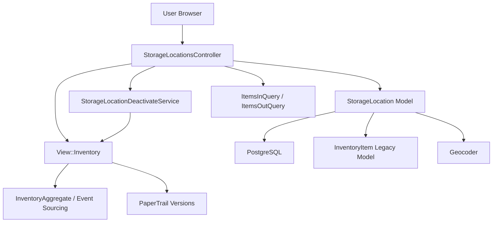
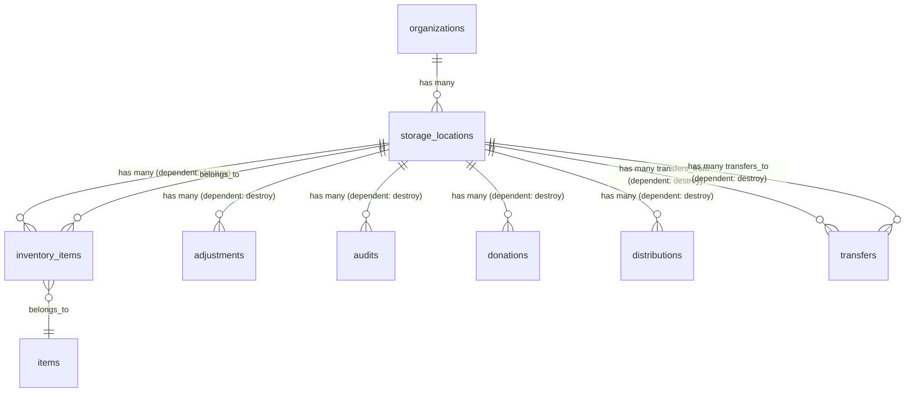
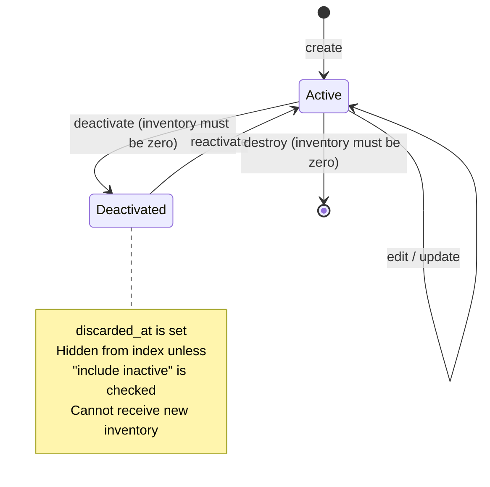
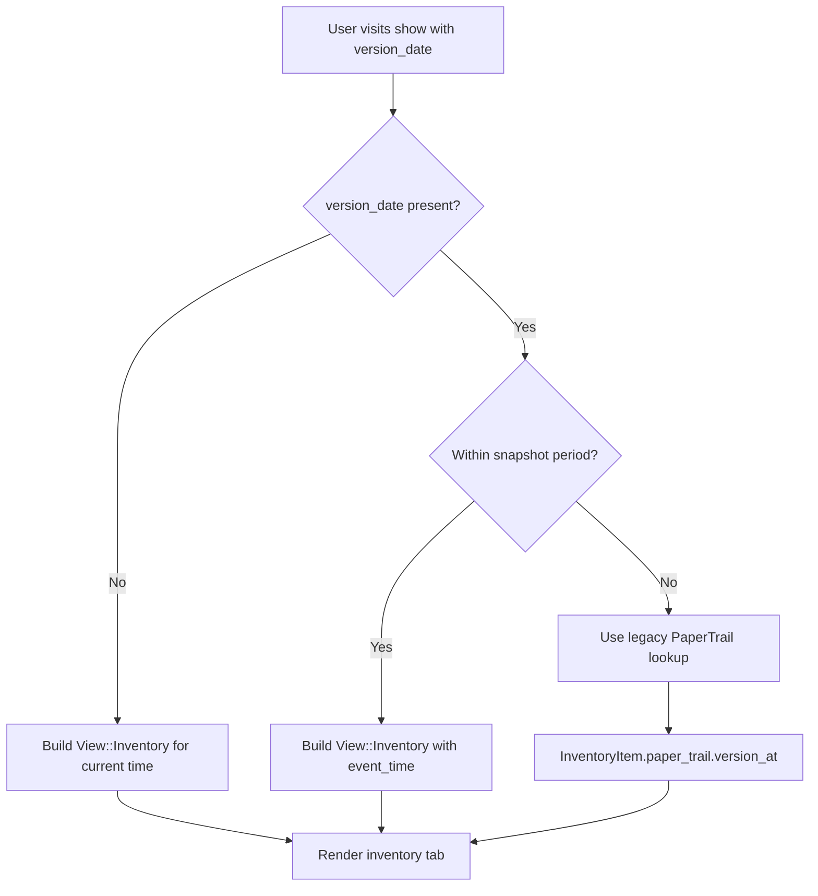
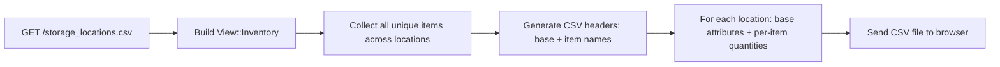

# Storage Locations

> **Status**: Active
> **Generated**: 2026-06-13T00:00:00Z
> **Last Updated**: 2026-06-13T00:00:00Z

---

## Overview

### What It Does
Storage Locations represent physical warehouses, closets, or other spaces where a diaper bank (or essentials bank) holds inventory. Each organization can have multiple storage locations, and every inventory transaction (donation, distribution, purchase, transfer, adjustment, audit) is tied to a specific storage location. The feature provides full CRUD operations, CSV import/export, inventory viewing (current and historical), activation/deactivation lifecycle, geocoding, and filtering by item.

### Why It Exists
Essentials banks typically store donated goods across multiple physical sites -- volunteer homes, church basements, commercial warehouses. Tracking which items are at which location is critical for fulfilling partner requests, planning distributions, conducting audits, and managing transfers between locations.

### Key Capabilities
- Create, edit, view, and delete storage locations with address, square footage, and warehouse type metadata
- View current inventory per location with fair market value calculations
- View historical inventory at any past date (via PaperTrail versioning and event sourcing)
- Filter locations by which item they contain
- Import storage locations from CSV; import baseline inventory from CSV
- Export storage locations (with per-item quantities) to CSV
- Deactivate locations (soft-delete via Discard) when inventory is zero; reactivate them later
- Geocode addresses for latitude/longitude coordinates
- JSON API endpoint for fetching a location's inventory (used by other features' forms)

---

## Architecture

### High-Level Design



### Components

#### Backend Components

| Component | File Path | Purpose |
|-----------|-----------|---------|
| StorageLocationsController | `app/controllers/storage_locations_controller.rb` | Full CRUD, inventory import/export, deactivate/reactivate, JSON inventory endpoint |
| StorageLocation | `app/models/storage_location.rb` | Core model -- associations, validations, CSV generation, inventory import |
| InventoryItem | `app/models/inventory_item.rb` | Legacy join model linking items to storage locations with quantity (used by PaperTrail for historical lookups) |
| View::Inventory | `app/models/view/inventory.rb` | Event-sourced inventory view wrapper -- computes quantities, values, item lists from InventoryAggregate |
| StorageLocationDeactivateService | `app/services/storage_location_deactivate_service.rb` | Validates inventory is zero, then soft-deletes via Discard |
| InventoryCheckService | `app/services/inventory_check_service.rb` | Post-distribution check for items below minimum/recommended quantity thresholds |
| ItemsByStorageCollectionAndQuantityQuery | `app/queries/items_by_storage_collection_and_quantity_query.rb` | Query object: items grouped by storage location with quantities (used by items index) |
| LowInventoryQuery | `app/queries/low_inventory_query.rb` | Query object: finds items below minimum or recommended on-hand quantities |
| Importable (concern) | `app/controllers/concerns/importable.rb` | Shared CSV import action for bulk-creating storage locations from CSV |

#### Frontend Components (Views)

| Component | File Path | Purpose |
|-----------|-----------|---------|
| index.html.erb | `app/views/storage_locations/index.html.erb` | List all storage locations with filter, totals, CSV export/import |
| show.html.erb | `app/views/storage_locations/show.html.erb` | Detail view with 3 tabs: Inventory, Inventory In, Inventory Out; historical date picker |
| new.html.erb | `app/views/storage_locations/new.html.erb` | New storage location form wrapper |
| edit.html.erb | `app/views/storage_locations/edit.html.erb` | Edit storage location form wrapper |
| _form.html.erb | `app/views/storage_locations/_form.html.erb` | Shared form partial (name, address, square footage, warehouse type, time zone) |
| _storage_location_row.html.erb | `app/views/storage_locations/_storage_location_row.html.erb` | Table row partial for index listing (includes deactivate/reactivate buttons) |
| _line_item_row.html.erb | `app/views/storage_locations/_line_item_row.html.erb` | Table row for items-in / items-out tabs |
| _source.html.erb | `app/views/storage_locations/_source.html.erb` | Dropdown partial used by other features (distributions, transfers) to select a source storage location |
| event_inventory.json.jbuilder | `app/views/storage_locations/event_inventory.json.jbuilder` | JSON endpoint rendering item_id, item_name, quantity for a location |

### Technology Stack
- **Backend**: Ruby on Rails, PaperTrail (versioning), Discard (soft-delete), Geocoder (address geocoding), Dry::Types (View::Inventory)
- **Frontend**: ERB templates, AdminLTE/Bootstrap, simple_form
- **Database**: PostgreSQL
- **Event Sourcing**: InventoryAggregate for current inventory; PaperTrail for historical pre-snapshot inventory

---

## Model Details

### StorageLocation

#### Associations
```ruby
# Source: app/models/storage_location.rb
belongs_to :organization
has_many :adjustments, dependent: :destroy
has_many :audits, dependent: :destroy
has_many :inventory_items, -> { includes(:item).order("items.name") },
         inverse_of: :storage_location,
         dependent: :destroy
has_many :donations, dependent: :destroy
has_many :distributions, dependent: :destroy
has_many :transfers_from, class_name: "Transfer",
                          inverse_of: :from,
                          foreign_key: :from_id,
                          dependent: :destroy
has_many :transfers_to, class_name: "Transfer",
                        inverse_of: :to,
                        foreign_key: :to_id,
                        dependent: :destroy
```

#### Concerns

| Concern | Purpose |
|---------|---------|
| `Discard::Model` | Soft-delete via `discarded_at` column; provides `discard!`, `undiscard!`, `kept` scope, `discarded?` |
| `Geocodable` | Geocodes address to lat/lng via `geocoded_by :address`; runs `after_validation :geocode` when address changes (skipped in development) |
| `Filterable` | Provides `class_filter(params)` for chaining named scopes from filter parameters |
| `Exportable` | Provides CSV export infrastructure (`csv_export_headers`, `generate_csv`, `normalize_csv_attribute`) |

#### Additional Module
```ruby
has_paper_trail
```
Enables PaperTrail versioning for full audit trail of changes.

#### Validations
```ruby
# Source: app/models/storage_location.rb
validates :name, :address, presence: true
validates :name, uniqueness: { scope: :organization_id, case_sensitive: false }
validates :warehouse_type, inclusion: { in: WAREHOUSE_TYPES }, allow_blank: true
validates :square_footage, numericality: { greater_than_or_equal_to: 0 }, allow_nil: true
```

#### Constants
```ruby
# Source: app/models/storage_location.rb
WAREHOUSE_TYPES = [
  'Residential space used',
  'Consumer, self-storage or container space',
  'Commercial/office/business space that includes storage space',
  'Warehouse with loading bay'
].freeze
```

#### Callbacks

| Callback | Method | Purpose |
|----------|--------|---------|
| `before_destroy` | `:validate_empty_inventory` | Prevents deletion if inventory has non-zero quantities; calls `throw(:abort)` to halt |
| `after_validation` | `:geocode` (from Geocodable) | Geocodes address to lat/lng when address changes (non-development only) |

#### Scopes
```ruby
# Source: app/models/storage_location.rb
scope :alphabetized, -> { order(:name) }
scope :active, -> { where(discarded_at: nil) }
scope :with_adjustments_for, ->(organization) {
  joins(:adjustments).where(organization_id: organization.id).distinct.active.alphabetized
}
scope :with_audits_for, ->(organization) {
  joins(:audits).where(organization_id: organization.id).distinct.alphabetized
}
scope :with_transfers_to, ->(organization) {
  joins(:transfers_to).where(organization_id: organization.id).distinct.order(:name)
}
scope :with_transfers_from, ->(organization) {
  joins(:transfers_from).where(organization_id: organization.id).distinct.order(:name)
}
```

#### Key Methods

| Method | Returns | Purpose | Notes |
|--------|---------|---------|-------|
| `items` | `Array<Item>` | Returns active items at this location via event-sourced inventory | Delegates to `View::Inventory.items_for_location` |
| `size` | `Integer` | Total quantity of all items at this location | Sums from event-sourced inventory |
| `item_total(item_id)` | `Integer` | Quantity of a specific item at this location | Via `View::Inventory` |
| `inventory_total_value_in_dollars(inventory)` | `Integer` | Fair market value in dollars for all items at this location | Accepts optional pre-built inventory |
| `to_csv` | `String` | Generates a CSV template with item names and empty quantity column | Used for baseline inventory import |
| `empty_inventory?` | `Boolean` | Whether total quantity at this location is zero | Used by deactivation and destroy guards |
| `validate_empty_inventory` | `void` | `before_destroy` callback; adds error and aborts if not empty | |
| `self.import_csv(csv, organization)` | `Array` | Bulk-creates storage locations from CSV rows | |
| `self.import_inventory(filename, org, loc)` | `void` | Imports baseline inventory via an Adjustment; raises if location already has items | |
| `self.items_inventoried(organization, inventory)` | `Array<Option>` | Unique items with inventory across all locations (for filter dropdown) | |
| `self.generate_csv_from_inventory(storage_locations, inventory)` | `String` | Full CSV export with per-item columns per location | |
| `self.csv_export_headers` | `Array<String>` | `["Name", "Address", "Square Footage", "Warehouse Type", "Total Inventory", "Fair Market Value"]` | |

### InventoryItem (Legacy)

#### Associations
```ruby
# Source: app/models/inventory_item.rb
belongs_to :storage_location
belongs_to :item
```

#### Additional Module
```ruby
has_paper_trail
```

#### Constants
```ruby
MAX_INT = 2**31
EARLIEST_VERSION = "2021-08-02"
```

#### Validations
```ruby
validates :quantity, presence: true
```

#### Scopes
```ruby
scope :by_partner_key, ->(partner_key) { joins(:item).merge(Item.by_partner_key(partner_key)) }
scope :active, -> { joins(:item).where(items: { active: true }) }
scope :inactive, -> { joins(:item).where(items: { active: false }) }
```

#### Key Methods

| Method | Returns | Purpose | Notes |
|--------|---------|---------|-------|
| `item_name` | `String` | Delegated to `item.name` | Via `delegate :name, to: :item, prefix: true` |
| `to_h` | `Hash` | Returns `{ item_id:, quantity:, item_name: }` | Stringified keys |

---

## Database Schema

### storage_locations

| Column | Type | Default | Notes |
|--------|------|---------|-------|
| `id` | `serial` | auto-increment | Primary key |
| `name` | `string` | — | Required; unique per organization (case-insensitive) |
| `address` | `string` | — | Required; geocoded to lat/lng |
| `created_at` | `datetime` | — | Not null |
| `updated_at` | `datetime` | — | Not null |
| `organization_id` | `integer` | — | Foreign key to organizations |
| `latitude` | `float` | — | Set by Geocoder |
| `longitude` | `float` | — | Set by Geocoder |
| `square_footage` | `integer` | — | Optional; must be >= 0 |
| `warehouse_type` | `string` | — | Optional; must be one of WAREHOUSE_TYPES if present |
| `time_zone` | `string` | `"America/Los_Angeles"` | Not null |
| `discarded_at` | `datetime` | — | Soft-delete timestamp (Discard gem) |

**Indexes:**
- `index_storage_locations_on_discarded_at` on (`discarded_at`)
- `index_storage_locations_on_latitude_and_longitude` on (`latitude`, `longitude`)
- `index_storage_locations_on_organization_id` on (`organization_id`)

### inventory_items

| Column | Type | Default | Notes |
|--------|------|---------|-------|
| `id` | `serial` | auto-increment | Primary key |
| `storage_location_id` | `integer` | — | Foreign key to storage_locations |
| `item_id` | `integer` | — | Foreign key to items |
| `quantity` | `integer` | `0` | Current quantity (legacy; event-sourced inventory is primary) |
| `created_at` | `datetime` | — | Not null |
| `updated_at` | `datetime` | — | Not null |

**Indexes:** None defined in schema.

### Relationships



---

## API Endpoints

| Method | Path | Action | Description | Notes |
|--------|------|--------|-------------|-------|
| `GET` | `/storage_locations` | `index` | List all storage locations with filters; supports `.csv` format | Filters: `containing` (item), `include_inactive_storage_locations` |
| `GET` | `/storage_locations/new` | `new` | New storage location form | |
| `POST` | `/storage_locations` | `create` | Create a new storage location | Params: name, address, square_footage, warehouse_type, time_zone |
| `GET` | `/storage_locations/:id` | `show` | Show location details with inventory tabs; supports `.csv` and `.xls` | Accepts `version_date` param for historical view |
| `GET` | `/storage_locations/:id/edit` | `edit` | Edit storage location form | |
| `PATCH/PUT` | `/storage_locations/:id` | `update` | Update storage location attributes | |
| `DELETE` | `/storage_locations/:id` | `destroy` | Delete storage location | Blocked if inventory is non-zero |
| `PUT` | `/storage_locations/:id/deactivate` | `deactivate` | Soft-delete (discard) a location | Only if inventory quantity is zero |
| `PUT` | `/storage_locations/:id/reactivate` | `reactivate` | Restore a soft-deleted location | Calls `undiscard!` |
| `POST` | `/storage_locations/import_csv` | `import_csv` | Bulk-import storage locations from CSV | From Importable concern |
| `POST` | `/storage_locations/import_inventory` | `import_inventory` | Import baseline inventory for a specific location | Raises `Errors::InventoryAlreadyHasItems` if location has items |
| `GET` | `/storage_locations/:id/inventory` | `inventory` | JSON endpoint returning items at a location | Used by distribution/transfer forms via `_source.html.erb` partial |

---

## Authorization

This application does not use Pundit policies for storage locations. Authorization is handled at the controller level through `current_organization` scoping -- all queries are scoped to `current_organization.storage_locations`, ensuring users can only access their own organization's storage locations. Authentication is handled by Devise via `ApplicationController`.

---

## Configuration

### Environment Variables
No feature-specific environment variables. Geocoding configuration is handled by the Geocoder gem's initializer.

### Constants
- `StorageLocation::WAREHOUSE_TYPES` -- allowed warehouse type values
- `InventoryItem::EARLIEST_VERSION` -- `"2021-08-02"` -- earliest date for PaperTrail historical lookups
- `InventoryItem::MAX_INT` -- `2**31` -- maximum integer for quantity validation

---

## Usage Examples

### Inventory Import Flow

```ruby
# Source: app/models/storage_location.rb:138-152
def self.import_inventory(filename, org, loc)
  storage_location = StorageLocation.find(loc.to_i)
  raise Errors::InventoryAlreadyHasItems unless storage_location.empty_inventory?

  current_org = Organization.find(org)
  adjustment = current_org.adjustments.new(storage_location_id: loc.to_i,
                                           user_id: User.with_role(Role::ORG_ADMIN, current_org).first&.id,
                                           comment: "Starting Inventory")
  # NOTE: this was originally headers: false; it may create buggy behavior
  CSV.parse(filename, headers: true) do |row|
    adjustment.line_items
              .build(quantity: row[0].to_i, item_id: current_org.items.find_by(name: row[1]))
  end
  AdjustmentCreateService.new(adjustment).call
end
```

### Deactivation Service

```ruby
# Source: app/services/storage_location_deactivate_service.rb:1-22
class StorageLocationDeactivateService
  include ServiceObjectErrorsMixin

  def initialize(storage_location:)
    @storage_location = storage_location
  end

  def call
    return false unless valid?

    @storage_location.discard!

    self
  end

  private

  def valid?
    inventory = View::Inventory.new(@storage_location.organization_id)
    inventory.quantity_for(storage_location: @storage_location.id) <= 0
  end
end
```

### Storage Location Source Partial (used by Distributions/Transfers)

The `_source.html.erb` partial is used across multiple features to render a storage location dropdown that triggers a JSON inventory fetch when selected:

```erb
<%# Source: app/views/storage_locations/_source.html.erb %>
<%= source.association association_field,
  collection: storage_locations,
  label: label,
  error: error,
  selected: storage_location_for_source(source.object),
  include_blank: true,
  input_html: {
    data: {
      storage_location_inventory_path: inventory_storage_location_path(
        include_omitted_items: include_omitted_items,
        id: ":id",
        format: :json
      )
    },
    class: "storage-location-source",
    "data-controller": "trigger-change-event"
  } %>
```

---

## Key Flows

### Deactivation / Reactivation Lifecycle



### Historical Inventory View



### CSV Export Flow



---

## Testing

### Test Files

Based on standard Rails conventions, expected test file locations:

- `spec/models/storage_location_spec.rb`
- `spec/models/inventory_item_spec.rb`
- `spec/requests/storage_locations_requests_spec.rb` or `spec/controllers/storage_locations_controller_spec.rb`
- `spec/services/storage_location_deactivate_service_spec.rb`
- `spec/services/inventory_check_service_spec.rb`
- `spec/queries/items_by_storage_collection_and_quantity_query_spec.rb`
- `spec/queries/low_inventory_query_spec.rb`
- `spec/system/storage_location_system_spec.rb`

> Note: Test file verification was not possible due to repository indexing constraints. Verify actual existence with `find spec/ -name '*storage_location*'`.

---

## Known Issues & Caveats

| Issue | Location | Description |
|-------|----------|-------------|
| Dual inventory systems | `app/models/view/inventory.rb`, `app/models/inventory_item.rb` | The codebase maintains BOTH event-sourced inventory (`View::Inventory` / `InventoryAggregate`) AND legacy `inventory_items` table. Historical views before the snapshot cutoff fall back to PaperTrail on the legacy table. This creates complexity and potential inconsistencies. |
| TODO: Move queries to Query Objects | `app/controllers/storage_locations_controller.rb:57` | Controller `show` action has a TODO comment acknowledging that `ItemsOutQuery`, `ItemsOutTotalQuery`, `ItemsInQuery`, `ItemsInTotalQuery` are "manually updated because they're not in-sync with the Model." |
| Import CSV note about headers | `app/models/storage_location.rb:146` | Comment: "NOTE: this was originally headers: false; it may create buggy behavior" -- the CSV parse for `import_inventory` was changed from `headers: false` to `headers: true`, which may affect backward compatibility with older CSV templates. |
| import_inventory user lookup | `app/models/storage_location.rb:144` | Uses `User.with_role(Role::ORG_ADMIN, current_org).first&.id` -- the `&.id` means if no ORG_ADMIN exists, user_id will be nil, which may cause a validation failure on the adjustment. |
| Nested simple_form_for | `app/views/storage_locations/_form.html.erb:1,12` | The form partial has two nested `simple_form_for` calls for the same object -- the outer one at line 1 and inner at line 12. This generates duplicate `<form>` tags in the HTML, which is invalid and may cause unexpected behavior. |
| No `destroy` protection beyond inventory check | `app/controllers/storage_locations_controller.rb:127` | The `destroy` action hard-deletes the record. Unlike `deactivate`, there is no service layer -- it relies solely on the `before_destroy :validate_empty_inventory` callback. Associated adjustments, audits, donations, distributions, and transfers are cascadingly destroyed. |
| OmittedInventoryItem struct | `app/controllers/storage_locations_controller.rb:5-9` | `Struct.new('OmittedInventoryItem', :item)` is defined in the controller but the `include_omitted_items` helper method using it (line 152) does not appear to be called from any controller action. The JSON inventory endpoint uses `View::Inventory.items_for_location` instead. Potentially dead code. |
| No indexes on inventory_items | `db/schema.rb:370-376` | The `inventory_items` table has no indexes on `storage_location_id` or `item_id`, which could cause slow lookups on large datasets. |

---

## Performance

### Database Optimization
- **Indexes on storage_locations:**
  - `index_storage_locations_on_discarded_at` -- for Discard `kept` scope filtering
  - `index_storage_locations_on_latitude_and_longitude` -- for geospatial queries
  - `index_storage_locations_on_organization_id` -- for organization scoping
- **Missing indexes on inventory_items:** No indexes on `storage_location_id` or `item_id` (see Known Issues)

### Caching
- `View::Inventory` rebuilds from `InventoryAggregate` on every request (no caching layer observed in this feature's code)
- The `InventoryAggregate` itself may have caching via snapshot events (`SnapshotEvent`)

---

## Troubleshooting

### Common Issues

#### Issue: Cannot delete a storage location
**Symptoms:**
- Error message: "Cannot delete storage location containing inventory items with non-zero quantities"

**Cause:**
The `before_destroy :validate_empty_inventory` callback checks whether the event-sourced inventory quantity is zero. If any items remain, deletion is blocked.

**Solution:**
Transfer or adjust all inventory out of the location first, or use deactivate (soft-delete) instead of destroy.

#### Issue: Cannot deactivate a storage location
**Symptoms:**
- Error message: "Cannot deactivate storage location containing inventory items with non-zero quantities"

**Cause:**
`StorageLocationDeactivateService` checks `View::Inventory` quantity and returns `false` if any items remain.

**Solution:**
Create transfers or adjustments to zero out inventory before deactivating.

#### Issue: Inventory import fails with "Could not complete action: inventory already has items stored"
**Symptoms:**
- Redirect with error when importing baseline inventory CSV

**Cause:**
`StorageLocation.import_inventory` raises `Errors::InventoryAlreadyHasItems` if the location already has non-zero inventory. Baseline import is only allowed for empty locations.

**Solution:**
Only use baseline inventory import on newly created locations with no existing inventory.

---

## Related Features

- **[Donations](./donations.md)** -- Donations are received into a storage location
- **[Distributions](./distributions.md)** -- Distributions are sent out from a storage location
- **[Transfers](./transfers.md)** -- Transfers move inventory between two storage locations
- **[Adjustments](./adjustments.md)** -- Manual inventory corrections at a storage location
- **[Audits](./audits.md)** -- Physical inventory verification at a storage location
- **[Items](./items.md)** -- Item types tracked within storage locations
- **[Inventory Events](./inventory-events.md)** -- Event-sourcing infrastructure that powers the current inventory view
- **[Dashboard](./dashboard.md)** -- Dashboard uses LowInventoryQuery for low-stock alerts

---

**Generated:** 2026-06-13T00:00:00Z
**Last Updated:** 2026-06-13T00:00:00Z
**Status:** Active
