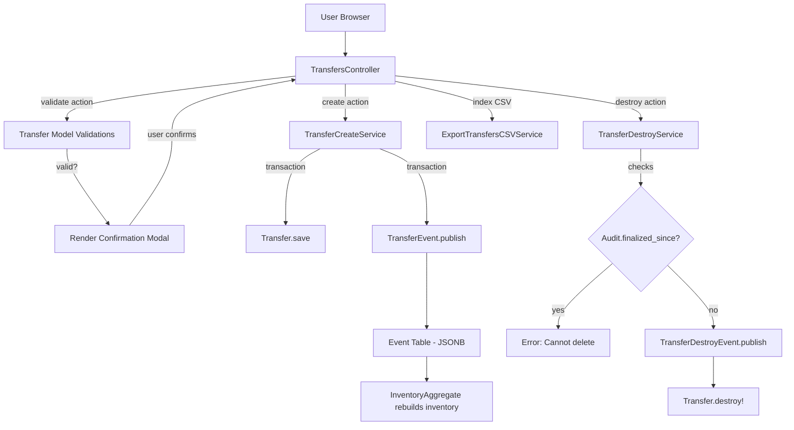
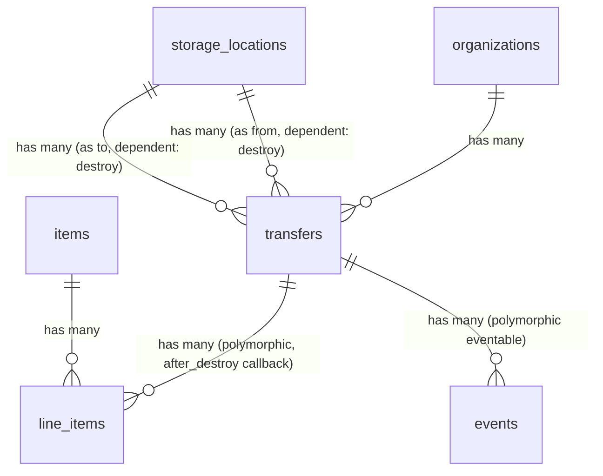
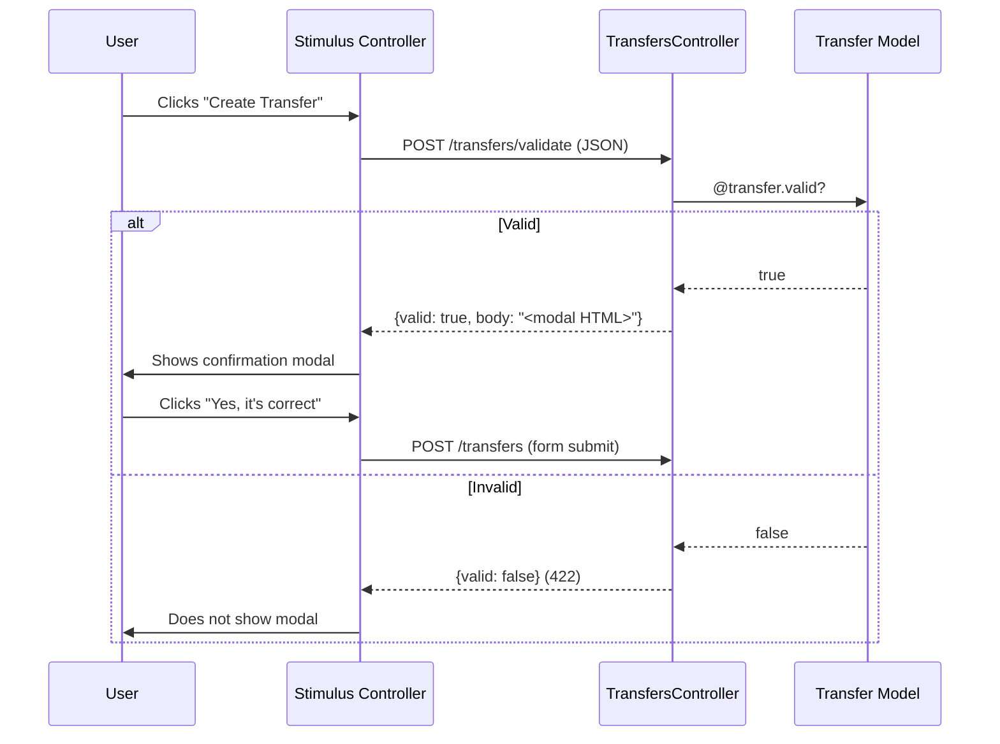

# Transfers

> **Status**: Active
> **Generated**: 2026-06-13T00:00:00Z
> **Last Updated**: 2026-06-13T00:00:00Z

---

## Overview

### What It Does
Transfers move inventory items between storage locations within a single organization. A user selects a source ("from") and destination ("to") storage location, adds one or more line items with quantities, and confirms the transfer. The system validates that sufficient inventory exists at the source, records the transfer, publishes an event-sourced inventory event to update both locations, and provides CSV export and filtering capabilities on the index page.

### Why It Exists
Diaper banks and essentials banks operate multiple storage locations (warehouses, residential spaces, offices). Supplies frequently need to be redistributed between these locations to meet partner demand. Transfers provide an auditable record of every inter-location movement, feeding into inventory tracking and reporting.

### Key Capabilities
- Create a transfer moving items from one storage location to another with quantity validation
- Pre-submit confirmation modal that validates the transfer server-side before final submission
- Filter transfers by source location, destination location, and date range
- Export filtered transfer data to CSV with per-item quantity columns
- Delete a transfer (with rollback via event sourcing), blocked if items have been audited since
- Full audit trail via PaperTrail versioning on both Transfer and LineItem records

---

## Architecture

### High-Level Design


### Components

#### Backend Components
| Component | File Path | Purpose |
|-----------|-----------|---------|
| TransfersController | `app/controllers/transfers_controller.rb` | CRUD actions (index, new, create, show, destroy) plus `validate` for modal confirmation |
| Transfer | `app/models/transfer.rb` | Core model with validations for location ownership, distinctness, and inventory sufficiency |
| TransferCreateService | `app/services/transfer_create_service.rb` | Wraps save + event publish in a transaction |
| TransferDestroyService | `app/services/transfer_destroy_service.rb` | Checks audit constraints, publishes destroy event, deletes record |
| ExportTransfersCSVService | `app/services/exports/export_transfers_csv_service.rb` | Generates CSV with base columns + one column per item type |
| TransferEvent | `app/events/transfer_event.rb` | Publishes inventory movement event (from -> to) |
| TransferDestroyEvent | `app/events/transfer_destroy_event.rb` | Publishes zeroed-out reversal event on destroy |
| Itemizable (concern) | `app/models/concerns/itemizable.rb` | Provides `has_many :line_items` with combine!, total, sorted, and nested attributes |
| Filterable (concern) | `app/models/concerns/filterable.rb` | Provides `class_filter` for scope-based filtering from controller params |
| LineItem | `app/models/line_item.rb` | Polymorphic line item belonging to any Itemizable |
| Result | `app/models/result.rb` | Immutable result object used by TransferDestroyService |

#### View Components
| Component | File Path | Purpose |
|-----------|-----------|---------|
| Index | `app/views/transfers/index.html.erb` | Lists transfers with filter form, CSV export button, and table |
| New | `app/views/transfers/new.html.erb` | Form to create a transfer with storage location selects and line item fields |
| Show | `app/views/transfers/show.html.erb` | Detail view of a single transfer with item table and total |
| Transfer Row partial | `app/views/transfers/_transfer_row.html.erb` | Table row partial rendered in collection on the index page |
| Validate Modal partial | `app/views/transfers/_validate_modal.html.erb` | Confirmation modal rendered server-side via the `validate` action |

### Technology Stack
- **Backend**: Ruby on Rails (ApplicationController, ActiveRecord, SimpleForm)
- **Frontend**: ERB templates, AdminLTE layout, Stimulus.js (`confirmation` controller for modal flow, `form-input` controller)
- **Database**: PostgreSQL
- **Audit Trail**: PaperTrail gem (`has_paper_trail` on Transfer and LineItem)
- **Event Sourcing**: Custom `Event` STI hierarchy with JSONB `data` column

---

## Model Details

### Transfer

#### Associations
```ruby
# Source: app/models/transfer.rb
belongs_to :organization, inverse_of: :transfers
belongs_to :from, class_name: "StorageLocation", inverse_of: :transfers_from
belongs_to :to, class_name: "StorageLocation", inverse_of: :transfers_to

# Alias of :from -- to satisfy Itemizable's expectation of a :storage_location association
belongs_to :storage_location, class_name: "StorageLocation", inverse_of: :transfers_from, foreign_key: :from_id

# Via Itemizable concern:
has_many :line_items, as: :itemizable, inverse_of: :itemizable  # after_destroy callback destroys them
has_many :items, through: :line_items
has_many :inactive_items, -> { inactive }, through: :line_items, source: :item
has_many :item_categories, through: :items
```

Note: There is no explicit `dependent:` option on the `line_items` association. Instead, the `Itemizable` concern uses an `after_destroy` callback that iterates and destroys each line item individually. This was intentional to allow other cleanup to happen before line items are deleted.

#### Concerns
| Concern | Purpose |
|---------|---------|
| `Itemizable` | Adds `has_many :line_items` (polymorphic), `combine!`, `total`, `sorted`, `quantities_by_category`, `quantities_by_name`, `total_quantity`, `value_per_itemizable`, nested attributes, and `validates_associated :line_items` |
| `Filterable` | Adds `class_filter(filtering_params)` class method that chains named scopes from a params hash |

#### Callbacks
| Callback | Method | Purpose |
|----------|--------|---------|
| `after_destroy` | (inline block from Itemizable) | Iterates `line_items.each(&:destroy)` to clean up line items after the transfer is destroyed |

#### Scopes
```ruby
# Source: app/models/transfer.rb
scope :from_location, ->(location_id) { where(from_id: location_id) }
scope :to_location, ->(location_id) { where(to_id: location_id) }
scope :during, ->(range) { where(created_at: range) }
```

#### Validations
| Validation | Method | Purpose |
|------------|--------|---------|
| Custom | `storage_locations_belong_to_organization` | Ensures both `from` and `to` locations belong to the transfer's organization |
| Custom | `storage_locations_must_be_different` | Ensures `from_id != to_id` |
| Custom | `from_storage_quantities` | Checks `View::Inventory` to ensure the source location has enough of each item |
| Custom | `line_items_quantity_is_positive` | Delegates to `Itemizable#line_items_quantity_is_at_least(1)` -- every line item quantity must be >= 1 |
| `validates_associated` | `:line_items` (from Itemizable) | Ensures all line items are individually valid |

#### Key Methods
| Method | Returns | Purpose | Notes |
|--------|---------|---------|-------|
| `insufficient_items` (private) | `Array<LineItem>` | Returns line items whose quantity exceeds available inventory at the `from` location | Uses `View::Inventory` for real-time inventory check |
| `line_items_quantity_is_positive` (private) | `nil` | Calls `line_items_quantity_is_at_least(1)` from Itemizable | Ensures no zero or negative quantities |

### LineItem (polymorphic, shared)

#### Associations
```ruby
# Source: app/models/line_item.rb
belongs_to :itemizable, polymorphic: true, inverse_of: :line_items, optional: false
belongs_to :item
```

#### Concerns
| Concern | Purpose |
|---------|---------|
| `ItemQuantity` | Shared quantity-related logic |

---

## Database Schema

### transfers

| Column | Type | Default | Notes |
|--------|------|---------|-------|
| `id` | `serial` (integer) | auto-increment | Primary key |
| `from_id` | `integer` | `NULL` | FK to `storage_locations.id` (source) |
| `to_id` | `integer` | `NULL` | FK to `storage_locations.id` (destination) |
| `comment` | `string` | `NULL` | Optional user comment |
| `created_at` | `datetime` | not null | Timestamp (also used as the transfer date) |
| `updated_at` | `datetime` | not null | Timestamp |
| `organization_id` | `integer` | `NULL` | FK to `organizations.id` |

**Indexes:**
| Name | Columns |
|------|---------|
| `index_transfers_on_organization_id` | `organization_id` |

Note: There are no indexes on `from_id` or `to_id`, which could affect filter query performance on large datasets.

### line_items (polymorphic, shared with other Itemizable models)

| Column | Type | Default | Notes |
|--------|------|---------|-------|
| `id` | `serial` (integer) | auto-increment | Primary key |
| `quantity` | `integer` | `NULL` | Number of items |
| `item_id` | `integer` | `NULL` | FK to `items.id` |
| `itemizable_id` | `integer` | `NULL` | FK to the owning record (transfers.id when itemizable_type = "Transfer") |
| `itemizable_type` | `string` | `NULL` | Polymorphic type discriminator ("Transfer", "Donation", etc.) |
| `created_at` | `datetime` | not null | Timestamp |
| `updated_at` | `datetime` | not null | Timestamp |

**Indexes:**
| Name | Columns |
|------|---------|
| `index_line_items_on_itemizable_id_and_itemizable_type` | `(itemizable_id, itemizable_type)` |

### Relationships


---

## API Endpoints

| Method | Path | Action | Description | Notes |
|--------|------|--------|-------------|-------|
| `GET` | `/transfers` | `index` | List transfers with filters; responds to HTML and CSV | Supports `filters[from_location]`, `filters[to_location]`, date range |
| `GET` | `/transfers/new` | `new` | Render the new transfer form | |
| `POST` | `/transfers` | `create` | Create a transfer and publish inventory event | Redirects to index on success, re-renders `new` on failure |
| `GET` | `/transfers/:id` | `show` | Display a single transfer with line items | |
| `DELETE` | `/transfers/:id` | `destroy` | Delete a transfer if not blocked by audits | Redirects to index with flash |
| `POST` | `/transfers/validate` | `validate` | Server-side validation returning JSON with modal HTML | Returns `{valid: true, body: "<html>"}` or `{valid: false}` with 422 |

Routes definition (from `config/routes.rb` line 124):
```ruby
resources :transfers, only: %i(index create new show destroy) do
  post :validate, on: :collection
end
```

Note: There is no `edit` or `update` action. Transfers are immutable once created -- they can only be viewed or destroyed.

---

## Authorization

This application does not use Pundit policies for transfers. There is no `app/policies/transfer_policy.rb` file. Authorization is handled at the controller level via `current_organization` scoping -- all queries are scoped to `current_organization.transfers`, ensuring users can only access their own organization's transfers.

---

## Configuration

No feature-specific environment variables or configuration files. Transfers rely on the standard application database configuration and the organization/storage location setup.

---

## Usage Examples

### Creating a Transfer (Service Layer)
```ruby
# Source: app/services/transfer_create_service.rb:3-12
class TransferCreateService
  class << self
    def call(transfer)
      if transfer.valid?
        ActiveRecord::Base.transaction do
          transfer.save
          TransferEvent.publish(transfer)
        end
      else
        raise StandardError.new(transfer.errors.full_messages.join(", "))
      end
    end
  end
end
```

### Destroying a Transfer (with Audit Guard)
```ruby
# Source: app/services/transfer_destroy_service.rb:6-18
def call
  if Audit.finalized_since?(transfer, transfer.to_id, transfer.from_id)
    raise "We can't delete this transfer because its items were audited since you made the transfer."
  end

  transfer.transaction do
    TransferDestroyEvent.publish(transfer)
    transfer.destroy!
  end

  Result.new
rescue StandardError => e
  Result.new(error: e)
end
```

### Publishing a Transfer Event
```ruby
# Source: app/events/transfer_event.rb:3-15
def self.publish(transfer)
  create(
    eventable: transfer,
    group_id: "transfer-#{transfer.id}-#{SecureRandom.hex}",
    organization_id: transfer.organization_id,
    event_time: Time.zone.now,
    data: EventTypes::InventoryPayload.new(
      items: EventTypes::EventLineItem.from_line_items(transfer.line_items,
        from: transfer.from.id,
        to: transfer.to.id)
    )
  )
end
```

### Combining Duplicate Line Items Before Save
```ruby
# Source: app/controllers/transfers_controller.rb:23-24
@transfer = current_organization.transfers.new(transfer_params)
@transfer.line_items.combine!
```
The `combine!` method (from Itemizable) merges line items with the same `item_id` by summing their quantities, preventing duplicate rows.

### Validation Flow (Pre-Submit Confirmation)


---

## Testing

### Test Files
- `spec/models/transfer_spec.rb` -- Model validations and associations
- `spec/requests/transfers_requests_spec.rb` -- Request/integration specs for all controller actions
- `spec/system/transfer_system_spec.rb` -- System/browser tests for the transfer UI
- `spec/controllers/transfers_controller_spec.rb` -- Controller unit specs
- `spec/services/transfer_destroy_service_spec.rb` -- Destroy service specs including audit guard
- `spec/services/exports/export_transfers_csv_service_spec.rb` -- CSV export specs
- `spec/factories/transfers.rb` -- Factory definitions

---

## Known Issues & Caveats

| Issue | Location | Description |
|-------|----------|-------------|
| No indexes on FK columns | `db/schema.rb:783-791` | `from_id` and `to_id` columns have no database indexes, which may slow filter queries on organizations with many transfers |
| No edit/update action | `config/routes.rb:124` | Transfers are immutable -- there is no way to edit a transfer after creation. The only recourse is to delete and recreate. |
| Duplicate `belongs_to` for `storage_location` | `app/models/transfer.rb:24` | `belongs_to :storage_location` is an alias of `belongs_to :from` (same `foreign_key: :from_id`) added solely to satisfy the `Itemizable` concern's expectation. This could confuse developers unfamiliar with the pattern. |
| `from_storage_quantities` uses `View::Inventory` not `StorageLocation` | `app/models/transfer.rb:56-64` | Inventory sufficiency is checked via the event-sourced `View::Inventory` aggregate, not the legacy `InventoryItem` table. If event replay is broken, validation may give incorrect results. |
| `combine!` clears and rebuilds line items | `app/models/concerns/itemizable.rb:36-57` | `combine!` calls `clear` (which is aliased to `delete_all`) then `build` -- this means any unsaved line item state is lost. Duplicate items submitted from the form are merged, but zero-quantity items are silently dropped. |
| Audit guard only checks `finalized` status | `app/services/transfer_destroy_service.rb:7` | `Audit.finalized_since?` only blocks deletion if there is a `finalized` audit. Audits that are `in_progress` or `confirmed` will not prevent transfer deletion. |

---

## Performance

### Database Optimization
- **Index on `organization_id`**: `index_transfers_on_organization_id` supports the org-scoped queries in the controller.
- **Missing indexes**: `from_id` and `to_id` are not indexed. The `from_location` and `to_location` scopes perform `WHERE from_id = ?` / `WHERE to_id = ?` without index support.
- **Eager loading**: Controller index action uses `.includes(:line_items, :from, :to)` to avoid N+1 queries. The show action additionally includes `:items`.
- **CSV export**: The CSV export further includes `line_items: :item` to avoid N+1 during row generation.

---

## Troubleshooting

### Common Issues

#### Issue: "location has insufficient inventory for ..."
**Symptoms:**
- Transfer creation fails with a flash error listing item names.

**Cause:**
The source storage location does not have enough of the requested items according to the event-sourced inventory (`View::Inventory`).

**Solution:**
Verify inventory levels at the source location. If the event-sourced inventory appears incorrect, an admin may need to create a new inventory snapshot via the events system.

#### Issue: "We can't delete this transfer because its items were audited since you made the transfer."
**Symptoms:**
- Transfer deletion fails with a flash error.

**Cause:**
A finalized audit exists at the `from` or `to` storage location that was updated after the transfer was created and involves the same item IDs.

**Solution:**
The transfer cannot be deleted. This is by design to maintain audit integrity.

#### Issue: "location must be different than from location"
**Symptoms:**
- Transfer creation fails validation.

**Cause:**
The user selected the same storage location for both "From" and "To".

**Solution:**
Select different storage locations.

---

## Related Features

- **[Storage Locations](./storage-locations.md)** -- Transfers move inventory between storage locations; `StorageLocation` has `has_many :transfers_from` and `has_many :transfers_to` (both `dependent: :destroy`)
- **[Inventory Events](./inventory-events.md)** -- `TransferEvent` and `TransferDestroyEvent` feed the event-sourced inventory system
- **[Audits](./audits.md)** -- Finalized audits block transfer deletion via `Audit.finalized_since?`
- **[Items](./items.md)** -- Line items reference items; the CSV export generates one column per item type
- **[Adjustments](./adjustments.md)** -- Similar Itemizable pattern for manual inventory changes

---

**Generated:** 2026-06-13T00:00:00Z
**Last Updated:** 2026-06-13T00:00:00Z
**Status:** Active
