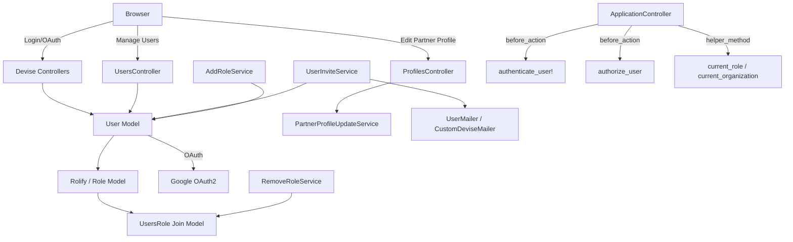
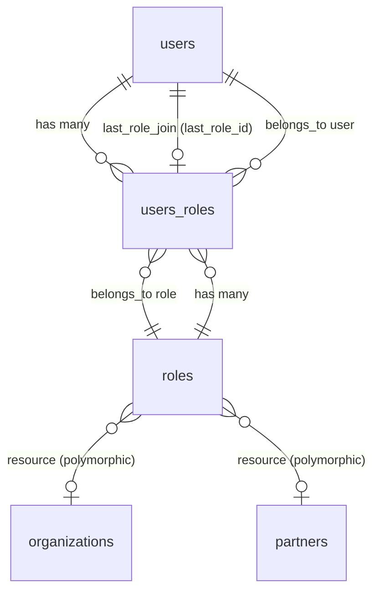
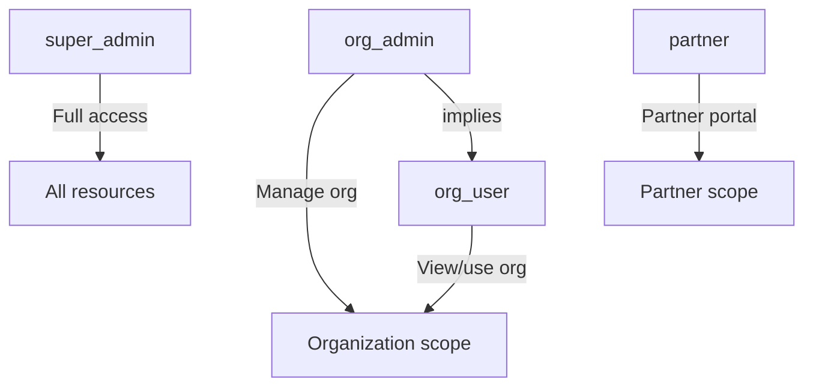
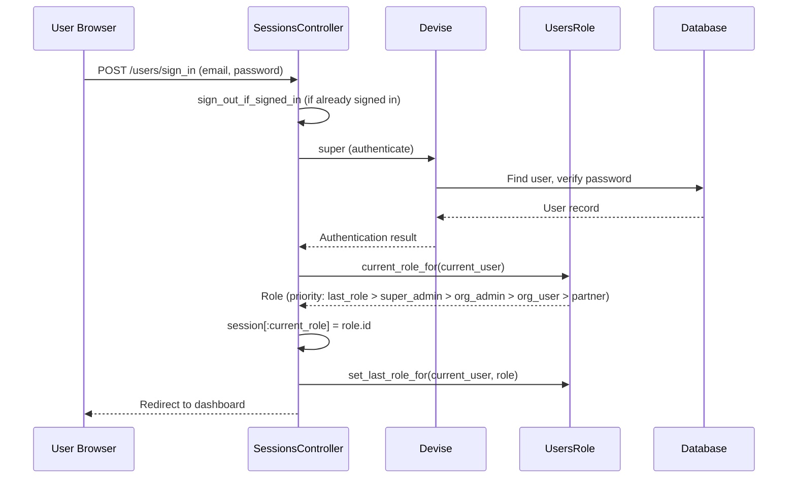
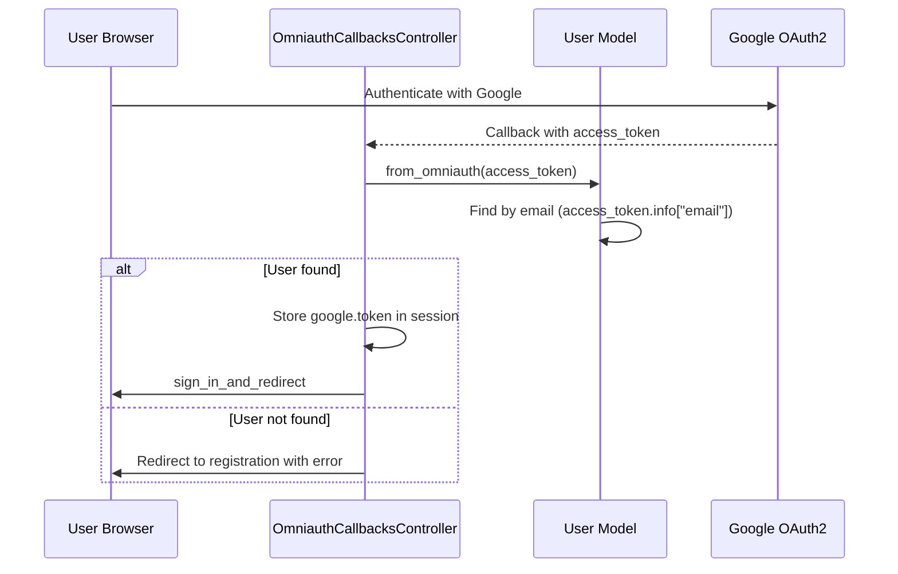

# Users & Authentication

> **Status**: Active
> **Generated**: 2026-06-13T00:00:00Z
> **Last Updated**: 2026-06-13T00:00:00Z

---

## Overview

### What It Does
Manages user accounts, authentication, authorization, role-based access control, and invitations across the Human Essentials application. Users authenticate via email/password (Devise) or Google OAuth2, and are assigned roles (super_admin, org_admin, org_user, partner) scoped to specific resources (organizations or partners). The system supports invitation-based onboarding, password recovery, session management with timeout, role switching for multi-org users, and soft-deletion (discard).

### Why It Exists
Human Essentials serves multiple user types -- essentials bank staff, partner organization users, and super admins. Each needs different access levels to different resources. The authentication system ensures secure access while the role system enforces authorization boundaries across organizations and partner agencies.

### Key Capabilities
- Email/password authentication with Devise (database_authenticatable, registerable, recoverable, rememberable, trackable, validatable, timeoutable)
- Google OAuth2 sign-in for existing users
- Invitation-based user onboarding via devise_invitable
- Four-tier role system: super_admin, org_admin, org_user, partner
- Role switching for users with multiple roles across organizations
- Password complexity enforcement (requires special character)
- Session timeout after 7 days of inactivity
- Invitation token expiry after 2 weeks
- Soft-delete (discard) support for user deactivation
- Gravatar integration for user avatars
- Activity tracking via last_request_at (throttled to 10-minute intervals)
- Audit trail via PaperTrail on User, Role, and UsersRole

---

## Architecture

### High-Level Design



### Components

#### Backend Components

| Component | File Path | Purpose |
|-----------|-----------|---------|
| UsersController | `app/controllers/users_controller.rb` | List org users, role switching, partner password reset |
| Sessions | `app/controllers/users/sessions_controller.rb` | Devise session override -- sign-out before sign-in, role tracking |
| Registrations | `app/controllers/users/registrations_controller.rb` | Devise registration override (edit only) |
| Passwords | `app/controllers/users/passwords_controller.rb` | Devise password recovery override |
| Confirmations | `app/controllers/users/confirmations_controller.rb` | Devise email confirmation override |
| Invitations | `app/controllers/users/invitations_controller.rb` | Devise invitation override (empty, inherits SessionsController) |
| OmniAuth Callbacks | `app/controllers/users/omniauth_callbacks_controller.rb` | Google OAuth2 callback handler |
| Unlocks | `app/controllers/users/unlocks_controller.rb` | Devise account unlock override |
| ProfilesController | `app/controllers/profiles_controller.rb` | Bank-side partner profile editing |
| User Model | `app/models/user.rb` | Core user model with Devise, Rolify, Discard |
| Role Model | `app/models/role.rb` | Role definitions (org_user, org_admin, super_admin, partner) |
| UsersRole Model | `app/models/users_role.rb` | Join table with role resolution logic |
| UserInviteService | `app/services/user_invite_service.rb` | Invite new or existing users with roles |
| AddRoleService | `app/services/add_role_service.rb` | Add roles to existing users |
| RemoveRoleService | `app/services/remove_role_service.rb` | Remove roles, cascading admin removal |
| CustomDeviseMailer | `app/mailers/custom_devise_mailer.rb` | Custom invitation email subjects for partner users |
| UserMailer | `app/mailers/user_mailer.rb` | Notification when roles are added to existing users |
| UsersHelper | `app/helpers/users_helper.rb` | Gravatar URLs and re-invite button helper |

#### Frontend Components

| Component | File Path | Purpose |
|-----------|-----------|---------|
| Users index | `app/views/users/index.html.erb` | List organization users with invite modal |
| User form | `app/views/users/new.html.erb` | New user form (name, email, password) |
| Add user modal | `app/views/users/_add_user_modal.erb` | Modal for inviting users to organization |
| Org user partial | `app/views/users/_organization_user.html.erb` | Single user row partial |
| Org users table | `app/views/users/_organization_users_table.html.erb` | Users table partial |
| Role added email | `app/views/user_mailer/role_added.html.erb` | Email template for role-added notification |
| Devise views | `app/views/users/sessions/`, `passwords/`, `registrations/`, etc. | Scoped Devise view overrides |
| Profile views | `app/views/profiles/` | Bank-side partner profile edit views |

### Technology Stack
- **Backend**: Ruby on Rails, Devise (authentication), Rolify (roles), Discard (soft-delete), PaperTrail (audit), devise_invitable (invitations)
- **Frontend**: ERB templates, AdminLTE layout, SimpleForm
- **Database**: PostgreSQL
- **External Services**: Google OAuth2 (via omniauth-google-oauth2)

---

## Model Details

### User

#### Associations
```ruby
# Source: app/models/user.rb
has_one :organization_role_join, class_name: "UsersRole", dependent: :destroy
has_one :organization_role, through: :organization_role_join, class_name: "Role", source: :role

belongs_to :last_role_join, class_name: "UsersRole", optional: true, inverse_of: :user, foreign_key: :last_role_id
has_one :last_role, through: :last_role_join, class_name: "Role", source: :role

has_one :organization, through: :organization_role, source: :resource, source_type: "Organization"
has_many :organizations, through: :roles, source: :resource, source_type: "Organization"

has_one :partner_role_join, class_name: "UsersRole", dependent: :destroy
has_one :partner_role, through: :partner_role_join, class_name: "Role", source: :role
has_one :partner, through: :partner_role, source: :resource, source_type: "Partner"
has_many :partners, through: :roles, source: :resource, source_type: "Partner"

has_many :requests, class_name: "::Request", foreign_key: :partner_id, dependent: :destroy, inverse_of: :partner_user
has_many :submitted_requests, class_name: "Request", foreign_key: :partner_user_id, dependent: :destroy, inverse_of: :partner_user
```

#### Concerns / Modules
| Concern | Purpose |
|---------|---------|
| `Discard::Model` | Soft-delete via `discarded_at` column; `default_scope -> { kept }` |
| `has_paper_trail` | Audit trail for all changes to user records |
| `rolify` | Adds role management methods (`add_role`, `has_role?`, `has_cached_role?`, `with_role`) |
| Devise modules | `:invitable, :database_authenticatable, :registerable, :recoverable, :rememberable, :trackable, :validatable, :timeoutable, :omniauthable` |

#### Callbacks
| Callback | Method | Purpose |
|----------|--------|---------|
| `before_validation` | `:normalize_blank_name_to_nil` | Converts blank name strings to nil |

#### Validations
```ruby
# Source: app/models/user.rb:68-71
validates :email, presence: true, uniqueness: {case_sensitive: false},
  format: {with: URI::MailTo::EMAIL_REGEXP, on: :create}

validate :password_complexity
```

Password complexity requires at least 1 special character matching: `#?!@$%^&*-;,.()=+|:`

#### Scopes
```ruby
# Source: app/models/user.rb:73-78
default_scope -> { kept }
scope :alphabetized, -> { order(discarded_at: :desc, name: :asc) }
scope :partner_users, -> { with_role(Role::PARTNER, :any) }
scope :org_users, -> { with_role(Role::ORG_USER, :any) }
scope :search_name, ->(query) { where("name ilike ?", "%#{query}%") }
scope :search_email, ->(query) { where("email LIKE ?", "%#{query}%") }
```

#### Key Methods
| Method | Returns | Purpose | Notes |
|--------|---------|---------|-------|
| `display_name` | `String` | Returns name or "Name Not Provided" | |
| `preferred_name` | `String` | Returns name or email | |
| `formatted_email` | `String` | Returns "Name <email>" format | |
| `password_complexity` | validation | Ensures at least 1 special character | |
| `invitation_status` | `String` | Returns "joined", "accepted", or "invited" | |
| `org_role` | `String` | Returns "admin", "normal", or "not a member" | |
| `is_admin?(org)` | `Boolean` | Checks org_admin or super_admin role | |
| `switchable_roles` | `Array<Role>` | Deduplicates roles (admin subsumes user for same resource) | |
| `flipper_id` | `String` | Returns "User:{id}" for Flipper feature flags | |
| `reinvitable?` | `Boolean` | True if invited status and invitation sent > 7 days ago | |
| `self.from_omniauth(access_token)` | `User/nil` | Finds existing user by OAuth email | Does NOT create new users |

### Role

#### Associations
```ruby
# Source: app/models/role.rb
has_and_belongs_to_many :users, join_table: :users_roles
belongs_to :resource, polymorphic: true, optional: true
```

#### Concerns
| Concern | Purpose |
|---------|---------|
| `has_paper_trail` | Audit trail |
| `scopify` | Rolify scope methods |

#### Constants
```ruby
# Source: app/models/role.rb:29-48
ORG_USER = :org_user
ORG_ADMIN = :org_admin
SUPER_ADMIN = :super_admin
PARTNER = :partner

TITLES = {
  org_user: "Organization",
  org_admin: "Organization Admin",
  partner: "Partner",
  super_admin: "Super admin"
}.freeze

TITLE_TO_RESOURCE = {
  org_user: ::Organization,
  org_admin: ::Organization,
  partner: ::Partner
}.freeze

ROLES_WITHOUT_RESOURCE = [SUPER_ADMIN].freeze
```

### UsersRole

#### Associations
```ruby
# Source: app/models/users_role.rb
belongs_to :user
belongs_to :role
has_one :last_user, class_name: "User", foreign_key: :last_role_id, inverse_of: :last_role, dependent: :nullify
```

#### Concerns
| Concern | Purpose |
|---------|---------|
| `has_paper_trail` | Audit trail |

#### Key Methods
| Method | Returns | Purpose | Notes |
|--------|---------|---------|-------|
| `self.current_role_for(user)` | `Role/nil` | Resolves current role: last_role > priority order (super_admin > org_admin > org_user > partner) | |
| `self.set_last_role_for(user, role)` | `void` | Persists user's last selected role via `last_role_id` | |

---

## Database Schema

### users

| Column | Type | Default | Notes |
|--------|------|---------|-------|
| `id` | `serial` | auto | Primary key |
| `email` | `string` | `""` | NOT NULL, unique index |
| `encrypted_password` | `string` | `""` | NOT NULL |
| `reset_password_token` | `string` | | Unique index |
| `reset_password_sent_at` | `datetime` | | |
| `remember_created_at` | `datetime` | | |
| `sign_in_count` | `integer` | `0` | NOT NULL |
| `current_sign_in_at` | `datetime` | | |
| `last_sign_in_at` | `datetime` | | |
| `current_sign_in_ip` | `inet` | | |
| `last_sign_in_ip` | `inet` | | |
| `created_at` | `datetime` | | NOT NULL |
| `updated_at` | `datetime` | | NOT NULL |
| `organization_id` | `integer` | | Legacy column |
| `invitation_token` | `string` | | Unique index |
| `invitation_created_at` | `datetime` | | |
| `invitation_sent_at` | `datetime` | | |
| `invitation_accepted_at` | `datetime` | | |
| `invitation_limit` | `integer` | | |
| `invited_by_type` | `string` | | Polymorphic |
| `invited_by_id` | `integer` | | Polymorphic |
| `invitations_count` | `integer` | `0` | |
| `organization_admin` | `boolean` | | Legacy column |
| `name` | `string` | | |
| `super_admin` | `boolean` | `false` | Legacy column |
| `last_request_at` | `datetime` | | Activity tracking |
| `discarded_at` | `datetime` | | Soft-delete, indexed |
| `provider` | `string` | | OAuth provider |
| `uid` | `string` | | OAuth UID |
| `partner_id` | `bigint` | | Legacy column, indexed |
| `last_role_id` | `bigint` | | FK to users_roles.id, indexed |

**Indexes**: `email` (unique), `invitation_token` (unique), `reset_password_token` (unique), `invitations_count`, `invited_by_id`, `invited_by_type + invited_by_id`, `last_role_id`, `partner_id`, `discarded_at`

### roles

| Column | Type | Default | Notes |
|--------|------|---------|-------|
| `id` | `bigint` | auto | Primary key |
| `name` | `string` | | Role name (org_user, org_admin, super_admin, partner) |
| `resource_type` | `string` | | Polymorphic type (Organization, Partner) |
| `resource_id` | `bigint` | | Polymorphic ID |
| `created_at` | `datetime` | | NOT NULL |
| `updated_at` | `datetime` | | NOT NULL |
| `old_resource_id` | `bigint` | | Migration artifact |

**Indexes**: `name + resource_type + resource_id` (composite), `resource_type + resource_id` (composite)

### users_roles

| Column | Type | Default | Notes |
|--------|------|---------|-------|
| `id` | `bigint` | auto | Primary key |
| `user_id` | `bigint` | | |
| `role_id` | `bigint` | | |

**Indexes**: `role_id`, `user_id + role_id` (composite)

### Relationships



---

## API Endpoints

### Devise Routes (users scope)

| Method | Path | Action | Description | Notes |
|--------|------|--------|-------------|-------|
| `GET` | `/users/sign_in` | `sessions#new` | Login page | Layout: devise |
| `POST` | `/users/sign_in` | `sessions#create` | Authenticate user | Sets session[:current_role] |
| `DELETE` | `/users/sign_out` | `sessions#destroy` | Logout | Inherited from Devise |
| `GET` | `/users/password/new` | `passwords#new` | Forgot password form | Layout: devise |
| `POST` | `/users/password` | `passwords#create` | Send reset email | |
| `GET` | `/users/password/edit` | `passwords#edit` | Reset password form | Inherited from Devise |
| `PUT` | `/users/password` | `passwords#update` | Update password | Inherited from Devise |
| `GET` | `/users/edit` | `registrations#edit` | Edit account | Layout: application |
| `PUT` | `/users` | `registrations#update` | Update account | Inherited from Devise |
| `GET` | `/users/auth/google_oauth2/callback` | `omniauth_callbacks#google_oauth2` | Google OAuth callback | |

### Users Routes

| Method | Path | Action | Description | Notes |
|--------|------|--------|-------------|-------|
| `GET` | `/users` | `users#index` | List organization users | |
| `GET` | `/users/new` | `users#new` | New user form | |
| `GET` | `/users/switch_to_role` | `users#switch_to_role` | Switch active role | `params[:role_id]` |
| `POST` | `/users/partner_user_reset_password` | `users#partner_user_reset_password` | Reset partner user password | `params[:partner_id, :email]` |

### Profile Routes

| Method | Path | Action | Description | Notes |
|--------|------|--------|-------------|-------|
| `GET` | `/profiles/:id/edit` | `profiles#edit` | Edit partner profile (bank-side) | Flipper: partner_step_form |
| `PATCH/PUT` | `/profiles/:id` | `profiles#update` | Update partner profile | Uses PartnerProfileUpdateService |

### Organization User Management Routes

| Method | Path | Action | Description | Notes |
|--------|------|--------|-------------|-------|
| `POST` | `/manage/invite_user` | `organizations#invite_user` | Invite user to org | Uses UserInviteService |
| `POST` | `/manage/remove_user` | `organizations#remove_user` | Remove user from org | |
| `POST` | `/manage/resend_user_invitation` | `organizations#resend_user_invitation` | Resend invitation email | |
| `POST` | `/manage/promote_to_org_admin` | `organizations#promote_to_org_admin` | Promote user to admin | |
| `POST` | `/manage/demote_to_user` | `organizations#demote_to_user` | Demote admin to user | |

### Admin User Routes

| Method | Path | Action | Description | Notes |
|--------|------|--------|-------------|-------|
| `GET` | `/admin/users` | `admin/users#index` | List all users | Super admin only |
| `GET` | `/admin/users/new` | `admin/users#new` | New user form | |
| `POST` | `/admin/users` | `admin/users#create` | Create user | |
| `GET` | `/admin/users/:id` | `admin/users#show` | View user | |
| `GET` | `/admin/users/:id/edit` | `admin/users#edit` | Edit user | |
| `PATCH/PUT` | `/admin/users/:id` | `admin/users#update` | Update user | |
| `DELETE` | `/admin/users/:id` | `admin/users#destroy` | Delete user | |
| `DELETE` | `/admin/users/:id/remove_role` | `admin/users#remove_role` | Remove role | Uses RemoveRoleService |
| `POST` | `/admin/users/:id/add_role` | `admin/users#add_role` | Add role | Uses AddRoleService |
| `POST` | `/admin/users/:id/resend_invitation` | `admin/users#resend_invitation` | Resend invite | |
| `GET` | `/admin/users/resource_ids` | `admin/users#resource_ids` | Get resource IDs | Collection route |

---

## Authorization

### Role-Based Access (ApplicationController)

Authorization is enforced via `before_action :authorize_user` in ApplicationController, not via Pundit policies. The `authorize_user` method checks:

```ruby
# Source: app/controllers/application_controller.rb:74-81
def authorize_user
  return unless params[:controller]
  verboten! unless params[:controller].include?("devise") ||
    current_user.has_cached_role?(Role::SUPER_ADMIN) ||
    current_user.has_cached_role?(Role::ORG_USER, current_organization) ||
    current_user.has_cached_role?(Role::ORG_ADMIN, current_organization) ||
    current_user.has_cached_role?(Role::PARTNER, current_partner)
end
```

### Role Hierarchy



| Role | Scope | Can Do |
|------|-------|--------|
| `super_admin` | Global | Manage all orgs, users, base items; access admin panel and DelayedJob web |
| `org_admin` | Organization | Invite/remove users, promote/demote, manage org settings; always also has org_user |
| `org_user` | Organization | Access org features (donations, distributions, etc.) |
| `partner` | Partner | Access partner portal only |

### Role Switching
Users with multiple roles can switch between them via `GET /users/switch_to_role?role_id=X`. The controller verifies the role belongs to the user before switching. The selected role is stored in both `session[:current_role]` and persisted to `users.last_role_id` via UsersRole.

---

## Configuration

### Environment Variables
```bash
GOOGLE_OAUTH_CLIENT_ID=           # Google OAuth2 client ID
GOOGLE_OAUTH_CLIENT_SECRET=       # Google OAuth2 client secret
FLIPPER_USERNAME=                  # Flipper UI basic auth username
FLIPPER_PASSWORD=                  # Flipper UI basic auth password
```

### Devise Configuration (config/initializers/devise.rb)
| Setting | Value | Purpose |
|---------|-------|---------|
| `mailer_sender` | `"[DO NOT REPLY] Human Essentials" <accounts@humanessentials.app>` | From address for auth emails |
| `mailer` | `CustomDeviseMailer` | Custom mailer class |
| `case_insensitive_keys` | `[:email]` | Case-insensitive email lookup |
| `strip_whitespace_keys` | `[:email]` | Strip whitespace from email |
| `stretches` | `1` (test) / `11` (other) | bcrypt cost factor |
| `invite_for` | `2.weeks` | Invitation token validity period |
| `reconfirmable` | `true` | Email changes require re-confirmation |
| `expire_all_remember_me_on_sign_out` | `true` | Invalidate remember-me on sign-out |
| `password_length` | `8..128` | Password length range |
| `timeout_in` | `7.days` | Session timeout without activity |
| `reset_password_within` | `6.hours` | Reset password token validity |
| `sign_out_via` | `:delete` | HTTP method for sign-out |
| `scoped_views` | `true` | Use users/ scoped view directory |
| `omniauth :google_oauth2` | configured | Google OAuth2 provider |

### Feature Flags
| Flag | Purpose |
|------|---------|
| `partner_step_form` | When enabled, renders step-based partner profile edit form instead of single-page form |

---

## Usage Examples

### Inviting a User to an Organization
```ruby
# Source: app/services/user_invite_service.rb:8-46
def self.invite(email:, resource:, name: nil, roles: [], force: false)
  raise "Resource not found!" if resource.nil? && roles.any? { |role| !Role::ROLES_WITHOUT_RESOURCE.include?(role) }

  if roles.include?(Role::ORG_ADMIN)
    roles.append(Role::ORG_USER)
  end

  user = User.find_by(email: email)

  if !force && user && roles.all? { |role| user.has_role?(role, resource) }
    raise "User already has the requested role!"
  end

  if user
    add_roles(user, resource: resource, roles: roles)
    if force
      user.invite!
    else
      UserMailer.role_added(user, resource, roles).deliver_later
    end
    return user
  end

  User.invite!(email: email) do |user1|
    name = nil if name.blank?
    user1.name = name.presence || nil
    add_roles(user1, resource: resource, roles: roles)
    user1.skip_invitation = user1.errors[:email].any?
  end
end
```

### Role Resolution at Login
```ruby
# Source: app/models/users_role.rb:21-32
def self.current_role_for(user)
  return nil if user.nil?
  return user.last_role if user.last_role

  role_order = [Role::SUPER_ADMIN, Role::ORG_ADMIN, Role::ORG_USER, Role::PARTNER]
  role_order.each do |role|
    found_role = user&.roles&.find { |r| r.name.to_sym == role }
    return found_role if found_role
  end

  nil
end
```

### Google OAuth2 Authentication
```ruby
# Source: app/controllers/users/omniauth_callbacks_controller.rb:5-16
def google_oauth2
  user = User.from_omniauth(request.env["omniauth.auth"])

  session["google.token"] = request.env.dig("omniauth.auth", "credentials", "token")
  session["google.refresh_token"] = request.env.dig("omniauth.auth", "credentials", "refresh_token")
  if user
    flash[:notice] = I18n.t "devise.omniauth_callbacks.success", kind: "Google"
    sign_in_and_redirect user, event: :authentication
  else
    redirect_to new_user_registration_url, alert: "Authentication failed: User not found!"
  end
end
```

### Session Sign-In with Role Tracking
```ruby
# Source: app/controllers/users/sessions_controller.rb:18-21
def create
  super
  session[:current_role] ||= UsersRole.current_role_for(current_user)&.id
  UsersRole.set_last_role_for(current_user, @role)
end
```

### Removing a Role (with cascading admin removal)
```ruby
# Source: app/services/remove_role_service.rb:6-28
def self.call(user_id:, role_id: nil, resource_type: nil, resource_id: nil)
  if role_id.nil? && resource_id.nil?
    raise "Must provide either a role ID or resource ID!"
  end
  if role_id.nil?
    role_id = Role.find_by(name: resource_type, resource_id: resource_id).id
  end
  user_role = UsersRole.find_by(user_id: user_id, role_id: role_id)
  unless user_role
    user = User.find(user_id)
    role = Role.find(role_id)
    raise "User #{user.display_name} does not have role for #{role.resource.name}!"
  end

  user_role.destroy

  if user_role.role.name.to_sym == Role::ORG_USER
    admin_role = Role.find_by(resource_id: user_role.role.resource_id, name: Role::ORG_ADMIN)
    if admin_role
      UsersRole.find_by(user_id: user_id, role_id: admin_role.id)&.destroy
    end
  end
end
```

---

## Authentication Flow





---

## Testing

### Test Files
- `spec/models/user_spec.rb` -- User model validations, methods, scopes
- `spec/models/role_spec.rb` -- Role model
- `spec/models/users_role_spec.rb` -- UsersRole join model, current_role_for, set_last_role_for
- `spec/requests/users_requests_spec.rb` -- UsersController request specs
- `spec/requests/sessions_requests_spec.rb` -- Sessions controller
- `spec/requests/users/omniauth_callbacks_requests_spec.rb` -- OAuth callback specs
- `spec/requests/profiles_requests_spec.rb` -- ProfilesController
- `spec/requests/user_dropdown_requests_spec.rb` -- User role dropdown
- `spec/services/user_invite_service_spec.rb` -- UserInviteService
- `spec/services/add_role_service_spec.rb` -- AddRoleService
- `spec/services/remove_role_service_spec.rb` -- RemoveRoleService
- `spec/mailers/user_mailer_spec.rb` -- UserMailer
- `spec/requests/admin/users_requests_spec.rb` -- Admin users management
- `spec/system/admin/users_system_spec.rb` -- Admin users system tests

---

## Known Issues & Caveats

| Issue | Location | Description |
|-------|----------|-------------|
| Legacy columns | `db/schema.rb` (users table) | `organization_id`, `organization_admin`, `super_admin`, and `partner_id` columns exist on the users table but are legacy -- roles are now managed via the `roles`/`users_roles` tables with Rolify |
| Legacy column on roles | `db/schema.rb` (roles table) | `old_resource_id` column exists as a migration artifact |
| OAuth does not create users | `app/models/user.rb:149-152` | `User.from_omniauth` only finds existing users by email; it does NOT create new accounts. New users must be pre-created or invited before they can use Google OAuth |
| Invitations controller inherits wrong parent | `app/controllers/users/invitations_controller.rb` | Inherits from `Devise::SessionsController` instead of `Devise::InvitationsController` -- the class is empty so it relies entirely on inherited session behavior |
| Sign-out before sign-in | `app/controllers/users/sessions_controller.rb:38-39` | `sign_out_if_signed_in` forces sign-out of current user before every login attempt, which means signing in as a different user from another browser tab will sign out the first session |
| Duplicate role joins possible | `app/models/user.rb:44,54` | Both `organization_role_join` and `partner_role_join` are declared as `has_one` with `dependent: :destroy`, but the User can have multiple UsersRole records; these associations may return unpredictable results for multi-role users |
| `search_email` is case-sensitive | `app/models/user.rb:78` | `search_email` uses `LIKE` (case-sensitive) while `search_name` uses `ilike` (case-insensitive) -- inconsistent behavior |
| No `create` action in UsersController | `app/controllers/users_controller.rb` | The `new` action exists but there is no `create` action -- the form in `new.html.erb` submits to a route that would 404 unless handled by Devise registration |
| `@role` undefined in sessions#create | `app/controllers/users/sessions_controller.rb:21` | `set_last_role_for(current_user, @role)` references `@role` which is not set in the create action -- it would be nil |
| Reinvitable 7-day window | `app/models/user.rb:143-147` | `reinvitable?` returns true only if invitation was sent >= 7 days ago, meaning there is no way to re-invite during the first 7 days after initial invitation |

---

## Performance

### Optimization Strategies
- Activity tracking (`last_request_at`) is throttled to 10-minute intervals using `update_columns` (skips validations and callbacks)
- Role lookups use `has_cached_role?` for in-memory caching of role checks
- Filterrific scopes (`search_name`, `search_email`) enable server-side user search

### Database Optimization
- **Unique indexes**: `email`, `invitation_token`, `reset_password_token` on users
- **Composite indexes**: `name + resource_type + resource_id` on roles; `user_id + role_id` on users_roles
- **Soft-delete index**: `discarded_at` on users for default scope performance

---

## Troubleshooting

### Common Issues

#### Issue: User cannot sign in after Google OAuth
**Symptoms:**
- User clicks "Sign in with Google" and gets redirected to registration with "Authentication failed: User not found!"

**Cause:**
`User.from_omniauth` only looks up existing users by email. If the user has not been created/invited first, OAuth will fail.

**Solution:**
The user must first be invited via `UserInviteService.invite` or created by an admin before they can use Google OAuth.

#### Issue: User stuck on wrong organization after login
**Symptoms:**
- User sees data from wrong organization or gets "Access Denied"

**Cause:**
`session[:current_role]` may reference a stale role ID.

**Solution:**
Use the role switcher at `GET /users/switch_to_role?role_id=X` to switch to the correct role. The role switcher is available in the UI navigation for users with multiple roles.

#### Issue: Invitation email not received
**Symptoms:**
- New user never gets invitation email

**Cause:**
If the email validation fails during `User.invite!`, the `skip_invitation` flag is set to true (see `user_invite_service.rb:44`).

**Solution:**
Check that the email address is valid. Re-invitation is available after 7 days via the `reinvitable?` check and the re-invite UI button.

---

## Related Features

- **[Organizations](./organizations.md)** -- Organization settings, invite_user/remove_user/promote/demote actions live on OrganizationsController
- **[Admin Panel](./admin-panel.md)** -- Super admin user management (CRUD, role add/remove)
- **[Partners](./partners.md)** -- Partner invitation and user management
- **[Partner Portal](./partner-portal.md)** -- Partner-scoped user experience after authentication

---

**Generated:** 2026-06-13T00:00:00Z
**Last Updated:** 2026-06-13T00:00:00Z
**Status:** Active
